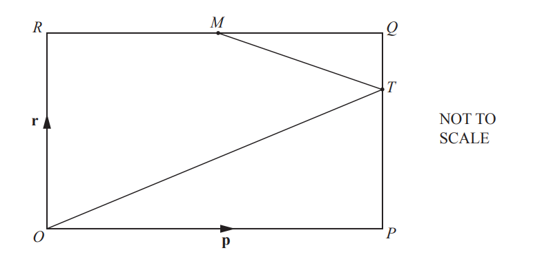
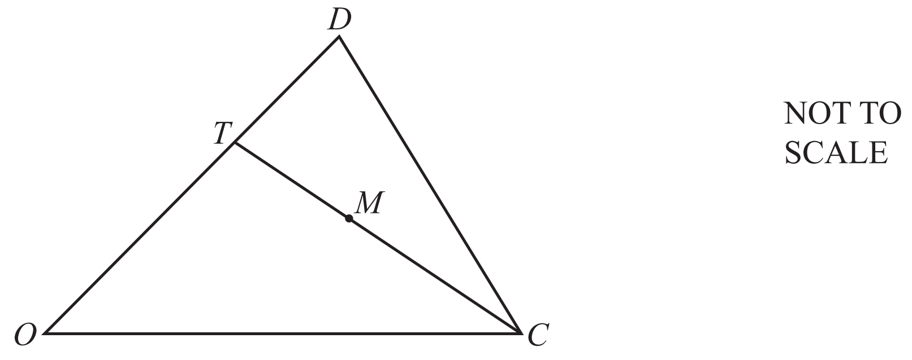
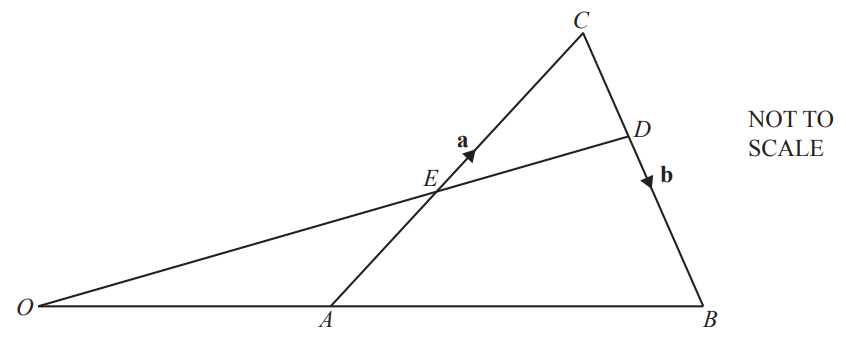
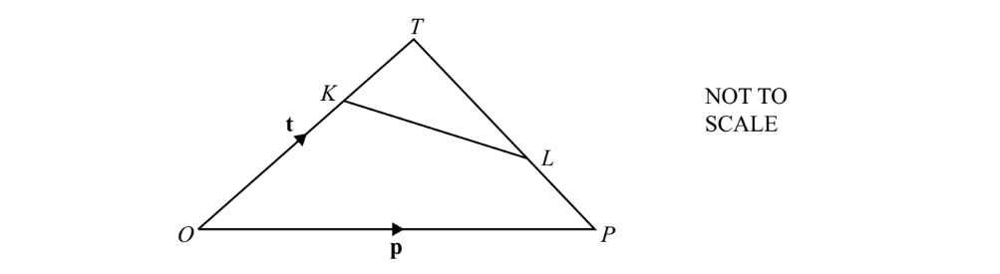
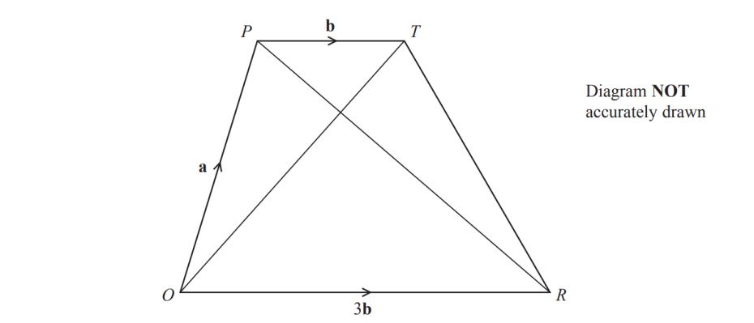
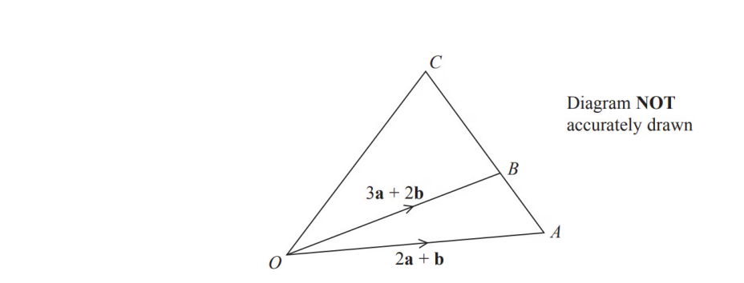
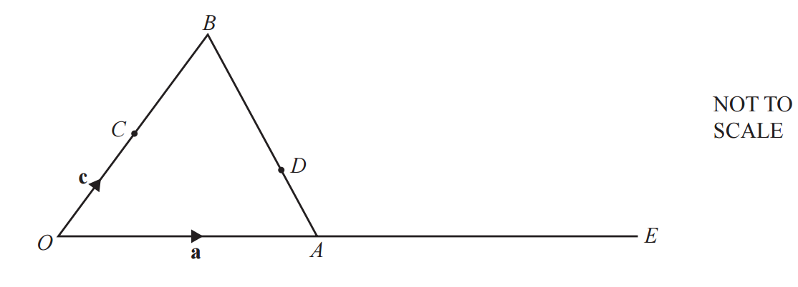

# Exam Questions — Vectors
**Vectors & Transformations** · Cambridge (CIE) IGCSE maths (0580 & 0980)
> Source: [https://www.savemyexams.com/igcse/maths/cie/25/extended/topic-questions/](https://www.savemyexams.com/igcse/maths/cie/25/extended/topic-questions/) · 17 questions across 1 sets

## Calculator Questions (17 questions)

### Q1 — very_hard — 6 marks

**Q1** [4 marks]

The diagram shows triangle $OAB$.

In the diagram $\overset{\rightarrow}{OA}=a$ and $\overset{\rightarrow}{OB}=b$.
$OM:MA=3:1$, and $N$ is the midpoint of $AB$.

Find, in terms of $a$ and $b$, in its simplest form

(i) $\overset{\rightarrow}{NB}$

[2]

(ii) $\overset{\rightarrow}{MN}$

[2]

**Q1** [2 marks]

**Extract:**

The diagram shows triangle \[O A B\].

In the diagram \[\overset{\rightarrow}{O A} = \mathbf{a}\] and \[\overset{\rightarrow}{O B} = \mathbf{b}\].

\[O M : M A = 3 : 1\], and \[N\] is the midpoint of \[A B\].

$MN$ is extended to the point $P$.
$\overset{\rightarrow}{MP}=-\frac{3}{4}a+\frac{3}{2}b$.

Show that $P$ lies on $OB$ extended.

### Q2 — medium — 2 marks

**Q2** [2 marks]

Find the magnitude of the vector $( \begin{gathered} - 1 \\ 7 \end{gathered} )$.

*Source: 2018	Feb/Mar 0580/42 Q9A*

### Q3 — medium — 2 marks

**Q3** [2 marks]

$\vec{VW} = ( \begin{gathered} 10 \\ - 24 \end{gathered} )$ 
Find  $\left| \vec{VW} \right| .$

*Source: 2020	May/June 0580/21 Q17A*

### Q4 — very_hard — 5 marks

**Q4** [3 marks]

$OPQR$ is a rectangle and $O$ is the origin. 
$M$ is the midpoint of $RQ$ and $PT:TQ=2:1$. 
$\overset{\rightarrow}{OP}=p$ and  $\overset{\rightarrow}{OR}=r$.

Find, in terms of $p$ and/or $r$, in its simplest form

i) $\overset{\rightarrow}{MQ}$,

$\overset{\rightarrow}{MQ}=$ ..............................................  [1]

ii) $\overset{\rightarrow}{MT}$,

$\overset{\rightarrow}{MT}=$ .............................................. [1]

iii) $\overset{\rightarrow}{OT}$,

$\overset{\rightarrow}{OT}=$ .............................................. [1]

*Source: 2020 Specimen 0580/04 Q6A*

**Q4** [2 marks]

**Extract:**

[O P Q R] is a rectangle and [O] is the origin. 

[M] is the midpoint of [R Q] and [P T : T Q = 2 : 1]. 

[O P = bold p] and  [O R = bold r].

Find, in terms of [bold p] and/or [bold r], in its simplest form

i) [M Q =] ..............................................  [1]

ii) [M T =] .............................................. [1]

iii) [O T =] .............................................. [1]

$R Q$ and $O T$ are extended and meet at $U$.

Find the position vector of $U$ in terms of $p$ and $r$. 
Give your answer in its simplest form.

*Source: 2020 Specimen 0580/04 Q6B*

### Q5 — medium — 4 marks

**Q5** [4 marks]

$p = ( \begin{gathered} 4 \\ 5 \end{gathered} )$       $q = ( \begin{gathered} - 2 \\ 7 \end{gathered} )$

i) Find $2p+q.$

$( \begin{gathered} \\ \end{gathered} )$ [2]

ii) Find $\left| p \right|$.

[2]

*Source: 2020 May/June 0580/42 Q2A*

### Q6 — hard — 3 marks

**Q6** [3 marks]

In the diagram, $O$ is the origin, $OT=2TD$ and $M$ is the midpoint of $TC$. 
$\overset{\rightarrow}{OC}=c$ and $\overset{\rightarrow}{OD}=d$.

Find the position vector of $M$. 
Give your answer in terms of $c$ and $d$ in its simplest form.

*Source: 2020 May/June 0580/42 Q2D*

### Q7 — hard — 4 marks

**Q7** [4 marks]

*P* is the point (16, 9) and *Q* is the point (22, 24).

*N* is the point on *PQ* such that *PN* = 2*NQ*. 
Find the co-ordinates of *N*.

(.................... , ....................)

*Source: 2018	May/June 0580/22 Q25B*

### Q8 — very_hard — 6 marks

**Q8** [6 marks]

In the diagram, $OAB$ and $OED$ are straight lines. 
$O$ is the origin, $A$ is the midpoint of $OB$ and $E$ is the midpoint of $AC$. $\overset{\rightarrow}{AC}=a$and $\overset{\rightarrow}{CB}=b$.   
Find, in terms of $a$ and $b$, in its simplest form

i) $\overset{\rightarrow}{AB}$,

$\overset{\rightarrow}{AB}=$................................................ [1]

ii) $\overset{\rightarrow}{OE}$,

$\overset{\rightarrow}{OE}=$................................................ [2]

iii) the position vector of $D$.

[3]

*Source: 2020 Oct/Nov 0580/43 Q8B*

### Q9 — hard — 6 marks

**Q9** [4 marks]

The diagram shows triangle $OPT$.

In the diagram $\overset{\rightarrow}{OT}=t$ and $\overset{\rightarrow}{OP}=p$. $OK:KT=2:1$ and $TL:LP=2:1$.

Find, in terms of **t** and **p**, in its simplest form

i)   $\overset{\rightarrow}{PL}$

[2]

ii)  $\overset{\rightarrow}{KL}$

[2]

*Source: Specimen 2025 0580/04 Q22A(I,II)*

**Q9** [2 marks]

**Extract:**

The diagram shows triangle ![O P T].

In the diagram ![stack O T with rightwards arrow on top space equals space bold t] and ![stack O P with rightwards arrow on top space equals space bold p]. ![O K space colon space K T space equals space 2 space colon 1] and ![T L space colon space L P space equals space 2 space colon 1].

$KL$ is extended to the point $M$.

$\overset{\rightarrow}{KM}=-\frac{2}{3}t+\frac{4}{3}p.$

Show that $M$ lies on $OP$ extended.

*Source: Specimen 2025 0580/04 Q22B*

### Q10 — hard — 6 marks

**Q10** [2 marks]

$OPTR$is a trapezium.

$\overset{\rightarrow}{OP}=a\,\overset{\rightarrow}{PT}=b\,\overset{\rightarrow}{OR}=3b$

i) Find $\overset{\rightarrow}{OT}$ in terms of $a$ and$b$

[1]

ii) Find $\overset{\rightarrow}{PR}$ in terms of $a$ and $b$ Give your answer in its simplest form.

[1]

*Source: June 2016 1MA0/1H Q23A*

**Q10** [2 marks]

**Extract:**

OPTR is a trapezium.

\( \vec{OP} = \mathbf{a} \)
\( \vec{PT} = \mathbf{b} \)
\( \vec{OR} = 3\mathbf{b} \)

ii) Find \( \vec{PR} \) in terms of \( \mathbf{a} \) and \( \mathbf{b} \). Give your answer in its simplest form.

$S$ is the point on $PR$ such that $PS:SR$ = 1 : 3

Find $\overset{\rightarrow}{OS}$ in terms of $a$ and $b$. 
Give your answer in its simplest form.

*Source: June 2016 1MA0/1H Q23B*

**Q10** [2 marks]

**Extract:**

![S] is the point on ![P R] such that ![P S space colon space S R] = 1 : 3

Find ![stack O S with rightwards arrow on top] in terms of ![bold a] and ![bold b]. 

Give your answer in its simplest form.

What does your answer to part (b) tell you about the position of point $S$?

*Source: June 2016 1MA0/1H Q23C*

### Q11 — medium — 4 marks

**Q11** [4 marks]

$a = ( \begin{gathered} - 3 \\ 2 \end{gathered} ) b = ( \begin{gathered} 5 \\ 4 \end{gathered} ) c = ( \begin{gathered} 14 \\ 9 \end{gathered} )$

i) Find  $3a-2b$ .

$( \begin{gathered} \\ \end{gathered} )$ [2]

ii) Find  $\vert a \vert$.

[2]

*Source: 2018	Oct/Nov 0580/42 Q11A*

### Q12 — very_hard — 4 marks

**Q12** [4 marks]

$ABC$is a straight line.

$AB:BC=2:5$

$\overset{\rightarrow}{OA}=2a+b\,\overset{\rightarrow}{OB}=3a+2b$

Express $\overset{\rightarrow}{OC}$ in terms of $a$and $b$. 
Give your answer in its simplest form.

*Source: June 2015 1MA0/2H Q27*

### Q13 — medium — 3 marks

**Q13** [3 marks]

i) Find the column vector $\overset{\rightarrow}{AB}$.

$\vec{AB} = ( \begin{gathered} \\ \end{gathered} )$ [1]

ii) Find  $\vert \vec{AB} \vert$.

$\vert \vec{AB} \vert =$................................................. [2]

*Source: 2018	Oct/Nov 0580/43 Q1B*

### Q14 — hard — 5 marks

**Q14** [5 marks]

$a = ( \begin{gathered} - 3 \\ 2 \end{gathered} ) b = ( \begin{gathered} 5 \\ 4 \end{gathered} ) c = ( \begin{gathered} 14 \\ 9 \end{gathered} )$

$ma+nb=\text{c}$

Write down two simultaneous equations and solve them to find the value of $m$ and the value of $n$. Show all your working.

$m$ = ................................................     
 $n$ = ................................................

*Source: 2018	Oct/Nov 0580/42 Q11A*

### Q15 — medium — 5 marks

**Q15** [5 marks]

$\vec{OA} = ( \begin{gathered} 4 \\ 3 \end{gathered} )$      $\vec{AB} = ( \begin{gathered} 8 \\ - 7 \end{gathered} )$      $\vec{AC} = ( \begin{gathered} - 3 \\ 6 \end{gathered} )$

Find

i) $\left| \vec{OB} \right|$,

$\left| \vec{OB} \right| =$............................................... [3]

ii) $\overset{\rightarrow}{BC}$.

$\overset{\rightarrow}{BC}=$$( \begin{gathered} \\ \end{gathered} )$ [2]

*Source: 2018	May/June 0580/41 Q11A*

### Q16 — medium — 6 marks

**Q16** [6 marks]

$\vec{AB} = ( 6
- 1 )$               $\vec{BC} = ( - 2
5 )$                $\vec{DC} = ( 2
- 3 )$

Find

i) $\overset{\rightarrow}{AC}$,

$\vec{AC} = (
 
 )$  [2]

ii) $\overset{\rightarrow}{BD}$,

$\vec{BD} = (
 
 )$  [2]

iii) $\left| \vec{BC} \right|$.

[2]

*Source: 2020 Oct/Nov 0580/43 Q8A*

### Q17 — very_hard — 6 marks

**Q17** [5 marks]

$OAB$ is a triangle and $C$ is the mid-point of $OB$. 
$D$ is on $AB$ such that $AD$ : $DB$ = 3 : 5. 
$OAE$ is a straight line such that $OA:AE$ = 2 : 3.
 $\overset{\rightarrow}{OA}=a$ and $\overset{\rightarrow}{OC}=c$.

Find the following vectors, in terms of $a$ and $c$, in their simplest form

i) $\overset{\rightarrow}{AB}$,

$\overset{\rightarrow}{AB}=$................................................ [1]

ii) $\overset{\rightarrow}{AD}$,

$\overset{\rightarrow}{AD}=$................................................ [1]

iii) $\overset{\rightarrow}{CE}$,

$\overset{\rightarrow}{CE}=$................................................ [1]

iv) $\overset{\rightarrow}{CD}$.

$\overset{\rightarrow}{CD}=$................................................ [2]

*Source: 2018	Oct/Nov 0580/42 Q11B*

**Q17** [1 mark]

**Extract:**

Find the following vectors, in terms of bold a and bold c, in their simplest form

i) stack A B with rightwards arrow on top,

stack A B with rightwards arrow on top equals................................................ [1]

ii) stack A D with rightwards arrow on top,

stack A D with rightwards arrow on top equals................................................ [1]

iii) stack C E with rightwards arrow on top,

stack C E with rightwards arrow on top equals................................................ [1]

iv) stack C D with rightwards arrow on top.

stack C D with rightwards arrow on top equals................................................ [2]

$\overset{\rightarrow}{CE}=k\overset{\rightarrow}{CD}$

Find the value of $k$.

$k$ = ................................................

*Source: 2018	Oct/Nov 0580/42 Q11B*

