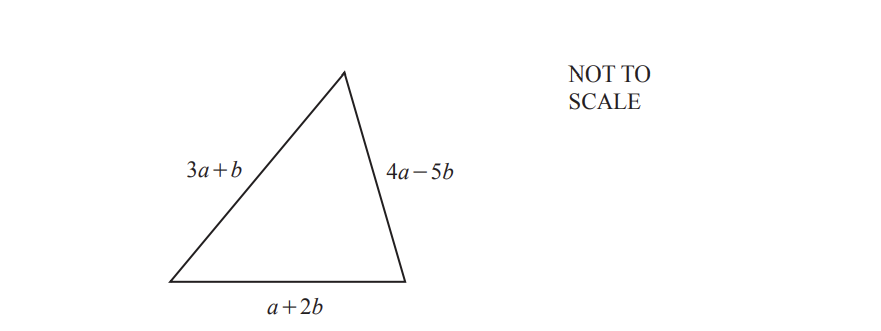

# Exam Questions — Introduction to Algebra
**Algebra & Sequences** · Cambridge (CIE) IGCSE maths (0607)
> Source: [https://www.savemyexams.com/igcse/maths/cie/international-maths/23/core/topic-questions/](https://www.savemyexams.com/igcse/maths/cie/international-maths/23/core/topic-questions/) · 19 questions across 1 sets

## Exam Questions (19 questions)

### Q1 — medium — 2 marks

**Q1** [2 marks]

The cost to manufacture a product is given by the formula:

$C = \frac{3m^{2}t}{4} + 2 m t - 5$

where $C$ is the cost in pounds, $m$ is the material cost in pounds per unit, and $t$ is the time in hours.

Calculate the cost to manufacture the product when the material cost is £8.40 per unit and the time is 3 hours.

### Q2 — hard — 3 marks

**Q2** [3 marks]

Find an expression for the perimeter of this triangle. 
Give your answer in its simplest form.

*Source: June 2020 0580/32 Q5C*

### Q3 — hard — 4 marks

**Q3** [4 marks]

$c=5a-2b$

i) Find the value of $c$ when $a$ = 8 and $b$ = −3.

[2]

ii) Make $a$ the subject of the formula $c=5a-2b$.

$a$ = ................................................... [2]

*Source: Nov 2019 0580/32 Q9A*

### Q4 — hard — 5 marks

**Q4** [2 marks]

Simplify.

$9x-2y-5x-y$

*Source: Nov 2019 0580/33 Q5A*

**Q4** [3 marks]

$P=4ab+3b^{2}$

Work out the value of a when $P$ = 35 and $b$ = 5.

$a$ = ...................................................

*Source: Nov 2019 0580/33 Q5B*

### Q5 — hard — 3 marks

**Q5** [3 marks]

$A = \frac{( a + b ) h}{2}$

Work out the value of $h$ when $A$ = 38.64, $a$ = 5.5 and $b$ = 3.7

$h$= .................................................

*Source: June 2020 0580/31 Q8D*

### Q6 — hard — 2 marks

**Q6** [2 marks]

A pen costs 60 cents and a ruler costs 29 cents. 
Write down an expression for the total cost, in cents, of $x$ pens and $y$rulers.

........................................ cents

*Source: Nov 2020 0580/32 Q9B*

### Q7 — medium — 2 marks

**Q7** [2 marks]

$T=3a^{2}b$

Find the value of $T$ when a = 4 and b = 5.

$T$=.....................................

*Source: June 2020 0580/32 Q5A*

### Q8 — medium — 1 marks

**Q8** [1 mark]

Kyra has a faulty thermometer. 
It always shows the temperature as 2°C higher than the actual temperature. 
The temperature on the thermometer is $T$°C.

Write an expression, in terms of $T$, for the actual temperature.

............................................ °C

*Source: MArch 2020 0580/12 Q3B*

### Q9 — medium — 2 marks

**Q9** [2 marks]

Simplify.

$4x-12y+10x+25y$

*Source: May/June 2019 0580/13 Q9*

### Q10 — medium — 2 marks

**Q10** [2 marks]

Calculate the value of $4x^{2}+xy$ when $x=3$ and $y=-2$.

*Source: June 2019 0580/31 Q9B*

### Q11 — medium — 2 marks

**Q11** [2 marks]

$A=\frac{1}{4}bc^{2}$

Calculate the value of$A$when $b$= 3 and c = 6.

*Source: Nov 2020 0580/12 Q9*

### Q12 — easy — 2 marks

**Q12** [2 marks]

Simplify.

$4x+3y+2x-8y$

*Source: Nov 2020 0580/32 Q9A*

### Q13 — easy — 2 marks

**Q13** [2 marks]

Simplify $5c-d-3d-2c$.

*Source: June 2019 0580/11 Q12*

### Q14 — easy — 2 marks

**Q14** [2 marks]

Simplify  $3c-5d-c+2d$

*Source: June 2020 0580/31 Q8A*

### Q15 — easy — 2 marks

**Q15** [2 marks]

$W=3a+5c$

Find the value of $W$ when $a$ = 6 and $c$ = 2.

$W$ = .................................................

*Source: Nov 2020 0580/33 Q7A*

### Q16 — easy — 2 marks

**Q16** [2 marks]

Simplify.

6a-3b+2a-4b

*Source: Nov 2020 0580/31 Q4A*

### Q17 — easy — 2 marks

**Q17** [2 marks]

Simplify.

$5w+3h-7w+8h$

*Source: June 2020 0580/13 Q6*

### Q18 — easy — 1 marks

**Q18** [1 mark]

Simplify  5*t*+4*t*-2*t*

*Source: Nov 2019 0580/12 Q1*

### Q19 — easy — 2 marks

**Q19** [2 marks]

Simplify $8a+3b-2a+b$

*Source: June 2019 0580/31 Q9A*

