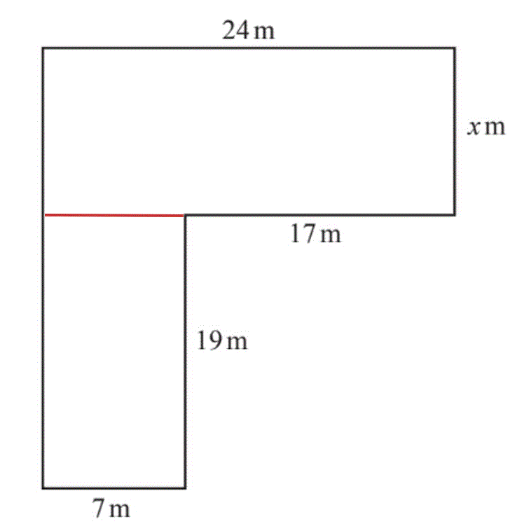

# Mark Schemes — Linear Equations
**Algebra & Sequences** · Cambridge (CIE) IGCSE maths (0607)

## Exam Questions (23 questions)

### Q1
> *Angles in a triangle sum to 180°*

F*ind the sum of the angles and set equal to 180°*

$2x+x+23+2x-13=180$

**[M1]**

> *Simplify*

$\begin{gathered} 5 x + 10 & = 180 \end{gathered}$

> *Solve for *$x$

$\begin{gathered} 5 x & = 170 \\ x = \frac{170}{5} \\ x = 34 \end{gathered}$

**[M1 A1]**

> *Substitute *$x=34$* into each of the expressions for the angles in the triangle*

$\begin{gathered} 2 x & = 2 ( 34 ) = 68 \\ x + 23 & = 34 + 23 = 57 \\ 2 x - 13 & = 2 ( 34 ) - 13 = 55 \end{gathered}$

**[M1]**

**Final answer:** **The smallest angle is 55°**

**[A1]**

> **[mark-scheme]**
> **M1**: Forming an equation using the sum of the angles being equal to 180.
> 
> **M1**: Method to solve the equation.
> 
> **A1**: Finding $x=34$.
> 
> **M1**: Method to substitute in the found value of $x$ into at least 1 expression.
> 
> **A1**: Correct final answer of 55.

### Q2
> *Multiply every term by 4*

$3x+28=48$

**[M1]**

> *Subtract 28 from both sides*

$3x=20$

> *Divide both sides by 3*

$x=\frac{20}{3}$

**[A1]**

> **[mark-scheme]**
> **M1**: At least one correct step carried out accurately.
> 
> **A1**: Correct final answer found. Must be $\frac{20}{3}$ or $6\frac{2}{3}$ as question asks for exact and simplified.

### Q3
> *Multiply both sides by 2*

$3-x=-4$

**[M1]**

> *Subtract 3 from both sides*

$-x=-7$

> *Multiply both sides by -1*

$x=7$

**[A1]**

> **[mark-scheme]**
> **M1**: Evidence of at least 1 correct step.
> 
> **A1**: Correct final answer.

### Q4
> *Write the number of goals for each team using algebra.*

* **Rovers = *$x$

*United = *$x+8$

*City = *$2x-3$

* ***[1]**

> *Add the expressions and equate to 117 (the three teams scored a total of 117 goals). *

$x+x+8+2x-3=117$

**[1]**

> *Combine like terms.*

> * *$4x+5=117$

**[1]**

> *Subtract 5 from both sides.*

> * *$4x=117-5\,\,4x=112$

> *Divide both sides by 4.*

> * *$x=112\div4$

$x=28$* ***[1]**

**working must be shown, answer alone only gains one mark**

### Q5
> *Subtract the hire cost for the machine from the total cost to determine the cost for the hours of work for the other day*

$88-25=63$

**[1]**

> *Divide this value by the rate of pay to determine the number of days beyond the first day of hire*

$63\div9=7$

**[1]**

> *Add the first day of hire*

$7+1$

**8**** [1]**

### Q6
> *First find an expression for how many pencils each person has.*

*Cara = ***n**

*Alice = 2***n**

*Leon = 2***n*** + 3*

**2n or 2n + 3 ****[1]**

> *Form an equation, given that the total is 58*

$n+2n+2n+3=58$

**[1]**

> *Simplify by collecting like terms*

$5n+3=58$

> *Solve for **n** by subtracting 3 from both sides*

$5n=55$

**[1]**

> *Divide both sides by 5*

$n=11$

**n ****= 11**** ****[1]**

### Q7
(i) *Add all the angles together and put equal to 180 (angles in a triangle add up to *$180^{\circ}$*).*

> * *$2x+x+23+2x-13=180$

* *$2x+x+23+2x-13=180$* ***[1]**

(ii) *Rearrange the terms to get the *$x$* terms together, then combine like terms.*

> * *$\begin{gathered} 2 x + x + 2 x + 23 - 13 & = 180 \\ \\ 5 x + 10 & = 180 \end{gathered}$

*   ***[1] **

> *Subtract 10 from both sides.*

$5x=180-10\,\,5x=170$

> * Divide both sides by 5.*

> * *$x=170\div5$

**[1]   **

$x=34^{\circ}$* ***[1]**

(iii) *Substitute *$x=34$* into each of the expressions for the angles in the triangle. *

$\begin{gathered} 2 \times 34 & = 68 \\ \\ 34 + 23 & = 57 \\ \\ 2 \times 34 - 13 & = 55 \end{gathered}$

* ***[1]**

> *The smallest one is 55.*

* *$55^{\circ}$* ***[1]**

### Q8
> *Work out the perimeter of the kite by adding all the sides.*

> * *$( 3 x - 1 ) + ( 3 x - 1 ) + ( 2 x + 5 ) + ( 2 x + 5 )$

* ***[1]**

> *Rearrange to write all the *$x$* terms together and combine like terms. *

$3x+3x+2x+2x-1-1+5+5=10x+8$

> *Set equal to 33.*

$10x+8=33$

> * [1]*

> *Subtract 8 from both sides.*

> * *$10x=33-8\,\,10x=25$

* ***[1]**

> *Divide both sides by 10 to solve for *$x$*.*

> * *$x=25\div10\,\,x=2.5$

**[1]**

> *Substitute *$x=2.5$* into *$3x-1$* (the length of the shorter side).*

> * *$( 3 \times 2.5 ) - 1 = 6.5$

> * *

**6.5 cm** **[1]**

### Q9
> *Split the shape into two rectangles.*

> *Find the area of each rectangle by multiplying its length by its width. *

$19\times7=133\,\,24\timesx=24x$

**[1]**

> *Add together the areas of the two rectangles and put it equal to 517. *

$24x+133=517$

> *  Subtract 133 from both sides.*

$24x=517-133\,\,24x=384$

**[1]**

> *Divide both sides by 24 to solve for *$x$*.*

$x=384\div24\,\,x=16$

**[1]**

> * *

$x=16$* ***[1]**

**any correct separation and calculation of appropriate areas to achieve correct final result i***s acceptable*

### Q10
i) *Using the same linear format as given for Speedy Coaches and as the rate is *`$ 19`* per member, the cost for *$x$* members is multiplied by *$19$

$19x+f$

**[1]**

> *where *$f$* is the fixed price*

> *As the fixed price *`f equals $ 117`*, the expression for the total cost for Sporty Coaches is*

$19x+117$ **[1]**

** **

ii) *As the total cost is the same, form an equation where the expression for Speedy Coaches is equal to the expression for Sporty Coaches*

$15x+625=19x+117$

**[1]**

> *Solve this equation for *$x$

$\begin{gathered} 15 x + 625 - 117 & = 19 x \\ 15 x + 508 & = 19 x \end{gathered}$

**[1]**

$\begin{gathered} 508 = 19 x - 15 x \\ 508 = 4 x \\ x = 508 \div 4 \end{gathered}$

$x=127$ **[1]**

### Q11
i) *Convert all masses to kilograms*

* **5 g = 0.005 kg*

*10 g = 0.01 kg*

*20 g, 0.02 kg*

**[1]**

> *Form an equation from the balanced scales*

$\begin{gathered} 0.005 + 0.01 + 0.02 + w & = 2 \end{gathered}$

**[1]**

$\begin{gathered} 0.035 + w & = 2 \end{gathered}$

> *Solve the equation for *$w$

> * *$w=2-0.035$

**1.965 kg*** ***[1]**

** **

ii) *Convert the mass of the parcel into grams by multiplying by *$1000$

* **12.4 kg = 12400 g*

> *The error interval has a range of *$100g$*, halve this*

$100\div2=50$

> *In two separate calculations, add and subtract *$50g$* to determine the limits of the error interval*

*Lower limit: *$12400-50=12350$

*Upper limit: *$12400+50=12450$

> *Convert values back to kilograms by dividing by 1000 and place into the error interval *

*12350 g = 12.35 kg*

*12450 g = 12.45 kg*

** ****12.35**$\leqp<$**12.45** **[2]**

**1 mark for each correct value in kg**

### Q12
> *One magazine costs \$2.45. Find the cost of 8 magazines.*

$8 \times \$ 2.45 = \$ 19.60$

> *Esme spent \$60.55 in total so subtract the cost of the magazines to find out how much she spent on cards.*

$\$ 60.55 - \$ 19.60 = \$ 40.95$

**[1]**

> *To work out how many cards she bought, divide the total cost of the cards by the cost of one card.*

$\$ 40.95 \div \$ 3.15 = 13$

**13**** ****[1]**

### Q13
i) *Divide both sides by 10.*

$x=0.5$ **[1]**

ii) *Subtract 2**x** from both sides*

$5x-3=11$

**[1]**

> *Add 3 to both sides*

$5x=14$

> *Divide both sides by 5*

$x=2.8$

$x=2.8$ **[1]**

iii) *Expand the bracket*

$6x-3=27$

**[1]**

> *Add 3 to both sides*

$6x=30$

**[1]**

> *Divide both sides by 6*

$x=5$

$x=5$* ***[1]**

### Q14
(i) *Divide both sides of the equation by 5.*

> * *$x=-30\div5$

* *$x=-6$* ***[1]**

(ii) *Add 2 to both sides of the equation.*

> * *$4x=28+2\,\,4x=30$

* ***[1]**

> *Divide both sides by 4.*

> * *$x=30\div4$

* *$x=7.5$* ***[1]**

(iii) *Expand the brackets by multiplying everything inside the bracket by 3.*

> * *$6x+21=12$

* ***[1]**

> *Subtract 21 from both sides.*

> * *$6x=12-21\,\,6x=-9$

* ***[1]**

> *Divide both sides by 6.*

> * *$x=-9\div6$

$x=-1.5$* ***[1]**

### Q15
> *Expand the bracket by multiplying everything inside the bracket by 5. *

$5 ( 2 x + 4 ) = 10 x + 20$

> *Set equal to 85.*

> * *$10x+20=85$

* ***[1]**

> *Subtract 20 from both sides.*

> * *$10x=85-20\,\,10x=65$

> *Divide both sides by 10 to solve for *$x$*.*

> * *$x=65\div10$

$x=6.5$* ***[1]**

### Q16
i) *Multiply both sides of the equation by *$4$

$x=20\times4=80$

$x=80$** [1]**

ii) *Solve the equation for *$x$*, start by adding 5 to both sides*

$3x=16+5$

**[1]**

$3x=21$

$x=21\div3=7$

$x=7$** [1]**

iii) *Expand the bracket first*

$10x+5=27$

**[1]**

> *Solve for *$x$

$10x=27-5$

$10x=22$

**[1]**

$x=22\div10=2.2$

$x=2.2$** [1]**

### Q17
(i) *Multiply both sides of the equation by 3.*

> * *$x=18\times3$

$x=54$* ***[1]**

(ii) *Subtract 18 from both sides of the equation.*

$5x=8-18$

**[1]**

> * *$5x=-10$

> * Divide both sides by 5.*

> * *$x=-10\div5$

$x=-2$* ***[1]**

(iii) *Subtract *$4x$* from both sides of the equation.*

> * *$\begin{gathered} 12 x - 4 x - 3 & = 21 \\ \\ 8 x - 3 & = 21 \end{gathered}$

> * Add 3 to both sides.*

> * *$8x=21+3\,\,8x=24$

**[1]**

> * Divide both sides by 8.*

> * *$x=24\div8$

* *$x=3$* ***[1]**

### Q18
> *Add *$2x$* to both sides of the equation.*

> * *$6=3x+2x$

**[1]**

$6=5x$

> *Divide both sides by 5.*

> * *$\begin{gathered} 6 \div 5 & = x \\ \\ 1.2 & = x \end{gathered}$

$x=1.2$* ***[1]**

### Q19
> *Add 7 to both sides of the equation.  *

$12x=23+7\,\,12x=30$

* ***[1]**

> *Divide both sides by 12. *

$x=30\div12$

$x=2.5$* ***[1]**

### Q20
i) *Subtract *$7$* from both sides of the equation*

$x=15-7$

$x=8$ **[1]**

ii) *Expand the bracket *$5 ( 3 x + 8 )$

$5 ( 3 x + 8 ) = 15 x + 40$

**[1]**

> *Solve for *$x$

$\begin{gathered} 15 x + 40 & = 10 \\ 15 x & = 10 - 40 \end{gathered}$

**[1]**

$\begin{gathered} 15 x & = - 30 \\ x = - 30 \div 15 \end{gathered}$

$x=-2$ **[1]**

### Q21
> *Add *$5$* to both sides of the equation*

$7x=16+5$

**[1]**

$7x=21$

> *Divide both sides of the equation by *$7$

$x=21\div7=3$

$x=3$** [1]**

### Q22
> *Expand the brackets*

$8x+88=120$

**[1]**

> *Subtract 88 from both sides.*

$8x=32$

> *Divide both sides by 8*

$x=4$

**4**** ****[1]**
> *Multiply both sides of the equation by 3.*

$x-2=9$

**[1]**

> *Add 2 to both sides*

$x=11$

**11** **[1]**

### Q23
> *Start with the statement *$10w=70$

> *Divide both sides by 10 to find *$w$

$\begin{gathered} 10 w & = 70 \\ w = 7 \end{gathered}$

> *So when *$w=7$*, *$10w$* will be equal to 70*

$w=7$ **[1]**
*Find the value of *$x$* using the statement *$5x=15$

> *Divide both sides by 5*

$\begin{gathered} 5 x & = 15 \\ x = 3 \end{gathered}$

> *Find the value of *$12x$

$12x=12\times3=36$

$12x=36$ **[1]**
