# Mark Schemes — Sequences
**Algebra & Sequences** · Cambridge (CIE) IGCSE maths (0607)

## Exam Questions (25 questions)

### Q1
> *The difference between each term is -3, so the *$n$*th** term contains *$-3n$

> *Write down the sequence *$-3n$

$-3,-6,-9,-12$

> *To get from this sequence to *$1,-2,-5,-8$* each term needs 4 added to it*

$-3n+4$

**[B1 B1]**

> **[mark-scheme]**
> **B1**: $-3n$ shown.
> 
> **B1**: Fully correct final answer. May also be written as $4-3n$.
> *Equate the *$n$*th** term to -302, but use *$p$* in place of *$n$

$\begin{gathered} - 3 n + 4 & = - 302 \\ - 3 p + 4 & = - 302 \end{gathered}$

**[M1]**

> *Solve the equation to find *$p$

$\begin{gathered} - 3 p & = - 306 \\ 3 p & = 306 \\ p = \frac{306}{3} \end{gathered}$

$p=102$

**[A1]**

> **[mark-scheme]**
> **M1**: Setting up equation with either $n$ or $p$.
> 
> **A1**: Correct final answer.

### Q2
> *Find the difference between the terms*

$5,8,13,20,29\,3579$

> *Find the differences between the differences (second differences)*

$5,8,13,20,29\,3579\,222$

> *The second difference is always 2, so this is a quadratic sequence, involving *$n^{2}$

> *The first 5 terms of the sequence *$n^{2}$* are*

$1,4,9,16,25$

> *To get from *$1,4,9,16,25$* to *$5,8,13,20,29$* you have to add 4 to each term*

$n^{2} + 4$

**[M1 A1]**

> **[mark-scheme]**
> **M1**: Answer includes an  $n^{2}$ term.
> 
> **A1**: Correct final answer.

### Q3
> *Increase the number of shaded grey squares by 3, and the number of chairs (**X**) by 2*

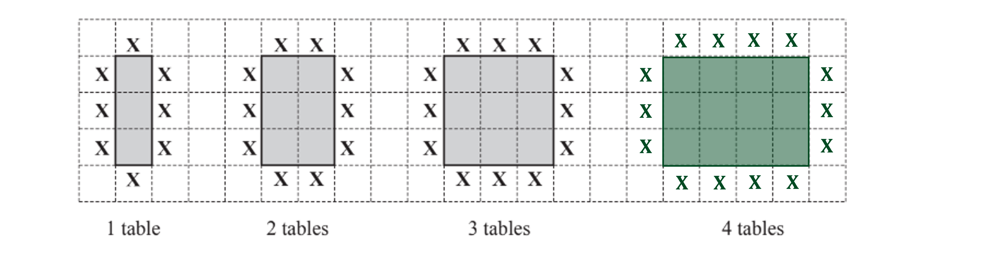

**[1]**
> *The number if chairs in the next pattern is 2 more than the number of chairs in the previous pattern*

$14,16,18$ **[2]**
**1 mark for adding 2 for term 5 and 6 but with an incorrect value for the 4th term**
> *The term to term rule is *

*Add 2*

> *The n**th** term of the sequence has the format*

$2n+c$

**[1]**

> *where *$c$* is the shift to be found.*

> *The first 5 terms of the sequence *$2n$* are*

$2,4,6,8,10$

> *To get to the required sequence, add *$6$* to each term*

$8,10,12,14,16$

> *This sequence has the n**th** term *

$2n+6$

> *Rewrite in terms of *$c$* and *$t$

$c=2t+6$ **[1]**
> *Substitute *$t=18$* into the formula for the sequence, *$c=2t+6$

$2\times18+6=36+6=42$

**Correct substitution ****[1]**

**42**** ****[1]**
> *Use the formula for the sequence, *$c=2t+6$* and substitute in *$c=80$*, then solve for *$t$

$2t+6=80$

**[1]**

$2t=80-6$

$2t=74$

$t=74\div2=37$

**37**** ****[1]**

### Q4
i) *The difference between two rows is*

* **3002 - 3001 = 1*

> $A$* is one row above 3042 so add 1 to this value*

* **3042 + 1 = 3043 *

> *The difference between two columns is*

* **3021 - 3001 = 20 *

> *  *$B$* is one column to the right of 3041 so add 20 to this value*

* **3041 + 20 = 3061*

* *

** **$A$**= 3043*** ***[1]**

$B$** = 3061** **[1]**

** **

ii) *Every column moved to the right increases the number by 20*

> *Every row upwards increases the number by 1*

> *Start at Row 1, Column 1*

> *Row 1 ends with 1, so add 14 rows to end up in a row that ends in ...15 *

*3001 + 14 = 3015*

* *

> *Subtract 3015 from 3135 to find the difference between the candidate positions *

*3135 - 3015 = 120*

* *

> *Divide 120 by 20 to determine how many Columns need to be moved *

$120\div20=6$

> *Write down the Row and Column that Candidate 3135 sits in*

**  Column 7**** ****[1]**

**Row 15** **[1]**

** **

iii) *Find the n**th** term of the linear sequence for row 1: *$3001,3021,3041,...$

> *The term to term rule is  *

*add *$20$

> *The n**th** term of a sequence that increases by *$20$* each term is  *

> * *$20n$

**[1]**

> *The first 3 terms in the sequence *$20n$* are:*

> * *$20,40,60$

> *Subtract the first term from the first term in the desired sequence to calculate the shift*

> * *$3001-20=2981$

> *The n**th** term of the linear sequence for row 1 is*

* *$20n+2981$ **[1]**

### Q5
> *The difference between the terms of the sequence increases in a pattern of odd numbers so the n**th** term must be of the format*

$n^{2}$

**[1]**

> *The first 5 terms of the sequence *$n^{2}$* are*

$1,4,9,16,25$

> *Add 2 to each term to get the desired sequence*

$3,6,11,18,27$

> *The n**th** term of this sequence is*

$n^{2}+2$ **[1]**

### Q6
(i) *Find the n**th** term for the sequence 1, 3, 5, 7, 9...*

> *n**th** term = *$dn+b$* *

> *The sequence is linear, with a common difference of 2. So *$d=2$*.*

> * *

**n***th** term *$=2n+b$

* *

> *The first term is 1. Substitute this and **n** = 1 into the formula, and solve for **b. *

$1=2\times1+b\,1=2+b\,b=-1$

> * **Substitute *$b=-1$* into the **n**th **term.*

$2n-1$* ***[2]**
**One mark for each term**

(ii) *Substitute 40 into the n**th** term.*

> * *$2\times40-1=79$

> * *

**79** **[1]**

(iii) *Put the n**th **term equal to 349 and solve to find n.*

> * *$2n-1=349$

* ***[1]**

> *Add 1 to both sides. *

$2n=349+1\,\,2n=350$

> * *

> *Divide both sides by 2. *

> $n=350\div2\,\,n=175$* *

**175** **[1]**
(i) *Find the n**th** term of the sequence 348, 346, 344, 342...*

> *n**th** term = *$dn+b$

> * *

> *The sequence is linear, with a common difference of -2. So *$d=-2$*.*

* ***n***th** term *$=-2n+b$

* **The first term is 348. Substitute this and **n** = 1 into the formula, and solve for **b.*

$348=-2\times1+b\,348=-2+b\,b=350$

> * **Substitute *$b=350$* into the **n**th **term.*

$-2n+350$* ***[2]**
**One mark for each term**

(ii) *The smallest house number on this side of the road is number 2. *

> *Put the n**th** term equal to 2 and solve to find n.*

> * *$-2n+350=2$

> * Subtract 350 from both sides.*

$-2n=2-350\,\,-2n=-348$

> * Divide both sides by -2.*

> * *$n = ( - 348 ) \div ( - 2 )

n = 174$

> * Any value of n bigger than 174 will give house numbers of 0 and negative numbers, which is not possible.*

> * *

**The largest value of **$n$** is ****174**** ****[1]**** **

**because ****any value of n greater than this will give house numbers that are zero/negative ****[1]**

### Q7
> *The black circles on the bottom and left increase by one each time. Draw 6 black circles along the bottom and 5 up the side.*

> *The white circles are arranged in squares where the length increases by one each time. Draw a square of white circles 4 by 4.*

> * *

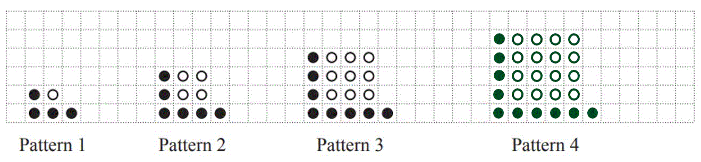

**[1]**
> *The number of black counters increases by 2 each time (one on the bottom row, one on the left hand side).*

> * *$\begin{gathered} 8 + 2 & = 10 \\ \\ 10 + 2 & = 12 \end{gathered}$

> * *

> *The number of white counters are square numbers. Write down the next two square numbers. *

$16,25$

> * *

> *Put the numbers into the correct places in the table.*

> * *

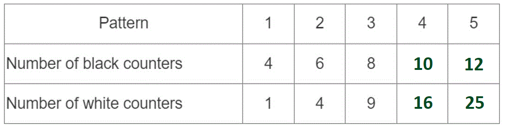

**[2]**

**one mark for 2 or 3 correct**
(i) *The number of black counters are:*

* **4, 6, 8, 10, 12...*

* *

> *This is a linear sequence with common difference 2.*

> * *

**n***th** term = *$2n+b$

* *

> *The first term is 4. Substitute this and **n** = 1 into the formula, and solve for **b.*

> * *$4 = ( 2 \times 1 ) + b

4 = 2 + b

b = 2$

> * *

> *Substitute *$b=2$* into the **n**th** term.*

* *$2n+2$* ***[2]**

**one mark for each part**

(ii) *The number of white counters are:*

> * *

*1, 4, 9, 16, 25*

* *

> *This sequence is the term number, **n**, squared.*

> * *

$n^{2}$* ***[1]**
> *Substitute *$n=12$* into the two **n**th **terms.*

> * *

$\begin{gathered} \text{Black} = ( 2 \times 12 ) + 2 \\ = 26 \end{gathered}$

* *

$\begin{gathered} \text{White} & = ( 12 )^{2} \\ = 144 \end{gathered}$

**12 substituted into either n****th**** term*** ***[1]**

> *Compare to the number of counters she has, 30 black and 140 white.*

> *Elena has enough black counters but not enough white counters.*

> * *

**No, she need would need 144 white counters and she only has 140** **[1]**

### Q8
i) *The number of squares in each row or column from the centre of the image increases by 1 square*

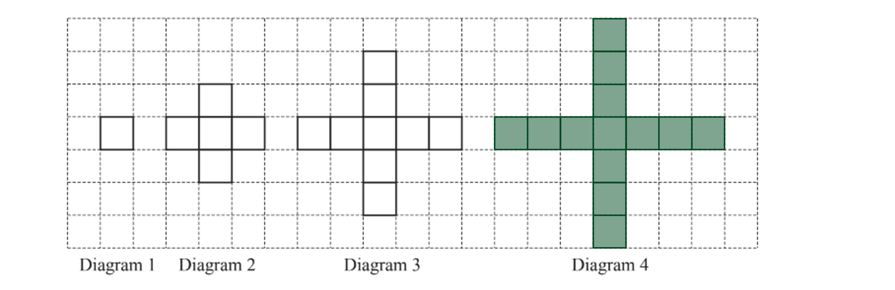

**[1]**

ii) *The term to term rule for the perimeter is *

*Add 8*

*20 + 8 = 28*

**28**** ****[1]**

iii) *As the sequence for the perimeter increases by *$8$*, the sequence follows the format of *

$8n+c$

> *where *$c$* is the shift for each term to be found.*

**[1]**

> *The first 5 terms in the sequence *$8n$* are*

$8,16,24,32,40$

> *To get the required sequence, subtract 4 from each term*

$8n-4$* ***[1]**

iv) *Form an equation with the nth term equal to the perimeter and solve*

$8n-4=300$

**[1]**

$8n=300+4$

$8n=304$

$n=304\div8$$=38$

**38**** ****[1]**

v) *The area of the base is a square of side length *$7cm$

$7\times7=49\mathrm{cm}^{2}$

> *The height of the net is two squares, which has a length of 14 cm. As the volume of any prism is the area of the cross section multiplied by the height*

$49\times7$

**[1]**

**686 cm****3**** [2]**
**1 mark for either 686 or the correct units**
i) *Diagram 3 is an equilateral triangle and retains its lines of symmetry with the shading within the shape*

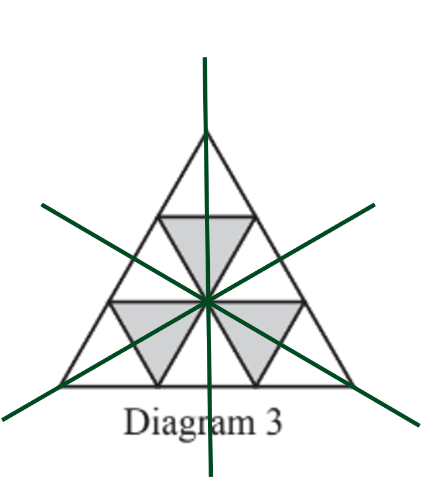

**3**** [1]**

ii) *Count the individual number of triangles within each pattern and complete the relevant box in the table*

**[2]**
**1 mark for at least 3 correct**

iii) *The number of small triangles is the sequence of square numbers*

$n^{2}$ **[1]**

iv) *Substitute *$n=3$* into the formula and evaluate for *$w$

$w = 1 \frac{1}{2} \times 3 \times ( 3 + 1 ) = 1 \frac{1}{2} \times 3 \times 4 = 1 \frac{1}{2} \times 12 = 6$

**6 ****[2] **
**1 mark for the correct substitution but an incorrect evaluation**

v) *Substitute *$n=15$* into the n**th** term for the number of white triangles and evaluate*

$w = 1 \frac{1}{2} \times 15 \times ( 15 + 1 ) = 1 \frac{1}{2} \times 15 \times 16 = 1 \frac{1}{2} \times 240 = 120$

$w=120$** [1]**

> *Substitute *$n=15$* into the nth term for the total number of small triangles found previously*

$t=15^{2}=225$

$t=225$** [1]**

> *Subtract the number of white triangles from the number of small triangles to determine the number of grey triangles*

$g=225-120=105$

$g=105$** [1]**

### Q9
> *The width and height increase by 1 square in each diagram*

> *The grey areas remain 1 square wide but overall increases by 2 squares*

> *The white squares make a square that has a height and width of 4 (increasing by 7 squares)*

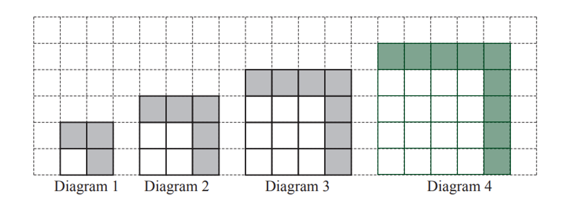

**[1]**
> *The number of grey squares increases by 2 in each diagram*

**Add 2*** ***[1]**
> *The number of white squares is the square of the term position.*

| Diagram Number | 1 | 2 | 3 | 4 |   | $n$ |
|---|---|---|---|---|---|---|
| Number of small white squares | 1 | 4 | 9 |   |   | $n^{2}$ |
| Number of small grey squares | 3 | 5 | 7 |   |   |   |
| Total number of small squares | 4 | 9 | 16 |   |   |   |

**[1]**

> *The next term in the sequence for white squares is *

$n^{2}=4^{2}=16$

| Diagram Number | 1 | 2 | 3 | 4 |   | $n$ |
|---|---|---|---|---|---|---|
| Number of small white squares | 1 | 4 | 9 | *16* |   | $n^{2}$ |
| Number of small grey squares | 3 | 5 | 7 |   |   |   |
| Total number of small squares | 4 | 9 | 16 |   |   |   |

> *  The number of grey squares is a linear sequence as the term to term difference is add 2*

> *This follows the structure of the sequence  *

$2n+c$

**[1]**

> *where *$n$* is the position of the term in the sequence, and *$c$* is the shift to be found*

> *As the sequence *$2n=2,4,6,8,10,...$*,   add *$1$* to each term to get the sequence *$3,5,7,9,11$

> *The n**th** term of this sequence is*

> * *

| Diagram Number | 1 | 2 | 3 | 4 |   | $n$ |
|---|---|---|---|---|---|---|
| Number of small white squares | 1 | 4 | 9 | *16* |   | $n^{2}$ |
| Number of small grey squares | 3 | 5 | 7 |   |   | $2n+1$ |
| Total number of small squares | 4 | 9 | 16 |   |   |   |

**    ****[1]  **

> *The 4**th** term in this sequence is *

$2\times4+1=9$

| Diagram Number | 1 | 2 | 3 | 4 |   | $n$ |
|---|---|---|---|---|---|---|
| Number of small white squares | 1 | 4 | 9 | *16* |   | $n^{2}$ |
| Number of small grey squares | 3 | 5 | 7 | *9* |   | $2n+1$ |
| Total number of small squares | 4 | 9 | 16 |   |   |   |

*The total number of small squares is the next square number*

> *This is calculated by adding *$1$* to *$n$* and then squaring this value   *

| Diagram Number | 1 | 2 | 3 | 4 |   | $n$ |
|---|---|---|---|---|---|---|
| Number of small white squares | 1 | 4 | 9 | *16* |   | $n^{2}$ |
| Number of small grey squares | 3 | 5 | 7 | *9* |   | $2n+1$ |
| Total number of small squares | 4 | 9 | 16 |   |   | $(n+1)^{2}$ |

** ** **[1]  **

> *The 4**th** term in this sequence is  *

$( 4 + 1 )^{2} = 5^{2} = 25$

| Diagram Number | 1 | 2 | 3 | 4 |   | $n$ |
|---|---|---|---|---|---|---|
| Number of small white squares | 1 | 4 | 9 | **16** |   | $n^{2}$ |
| Number of small grey squares | 3 | 5 | 7 | **9** |   | $2n+1$ |
| Total number of small squares | 4 | 9 | 16 | **25** |   | $(n+1)^{2}$ |

**16, 9 and 25 correct**** **** [2]**
*1 mark for any two of 16, 9 or 25*
> *Substitute *$18$* into the n**th** term rule for small white squares  *

$n^{2}=18^{2}$

**Final answer:** **  324**** [1]**
> *Form the equation of n**th** term = term value and solve  *

*(*$n+1$*)**2*$=900$

**[1]**

$n+1=\sqrt{900}$

$n+1=30$

$n=30-1$

**  ****29**** ****[1]**
> *Form the equation n**th** term = term value for small grey squares and solve for *$n$*   *

$2n+1=43$

**[1]**

$2n=42$

$n=21$

> *  Substitute this value for *$n$* into the n**th** term for small squares and evaluate  *

$( n + 1 )^{2} = ( 21 + 1 )^{2}$

**[1]**

**  484**** ****[1]**

### Q10
> *The number of seats can be written as a sequence that starts with 12 and has a common difference of 2.*

> * *

*12, 14, 16, 18, 20, 22, 24, 26, 28...*

* *

> *Add up the terms until the answer is 152.*

> * *

$12+14+16+18+20+22+24+26=152$

* ***[1]**

> *It takes adding the first 8 terms to get 152, so there are 8 rows of seats.*

* ***8 rows** **[1]**

### Q11
> *Continue the pattern*

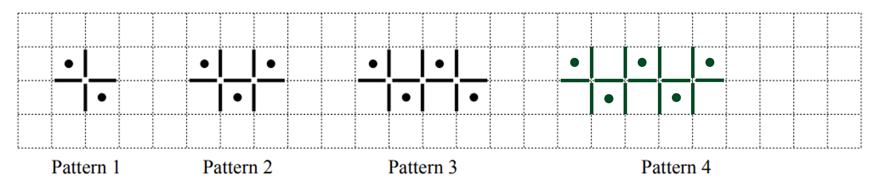

**[1]**
> *The common difference of the number of dots is*

*Add 1*

> *Continue adding 1 to the number of dots up to the 10th term  *

** 11**** ****[1]**

> *The common difference of the number of lines is*

*Add 3*

> *Continue adding 3 to the number of lines up to the 10th term*

> * *

**  **

**31**** [1] **
**Any two of 4, 5, 10 and 13**** [1] **
**All values in table correct**** [1]**
i) *The sequence is 1 greater than the term position.*

$n+1$ **[1]**

ii) *As the common difference is add 3, the sequence follows the structure of the sequence *

$3n$

**[1]**

> *The first 5 terms of the sequence *$3n$* are*

$3,6,9,12,15$

> *Each term in the desired sequence is 1 more than the term in the sequence *$3n$

$3n+1$ **[1]**
> *Form an equation where the nth term = the term value and solve for *$n$

$3n+1=76$

**[1]**

$3n=76-1$

$3n=75$

$n=75\div3$

$n=25$

> *Substitute this value for *$n$* into the nth term for the number of dots to determine how many dots feature in this pattern*

$25+1$

$26$** [1]**

### Q12
> *To find the first 3 terms of a sequence, substitute **n = **1, 2, and 3 into the **n**th term*

$1^{2 } + 2 ( 1 ) = 3
2^{2} + 2 ( 2 ) = 8
3^{2} + 2 ( 3 ) = 15$

**Final answer:** **3, 8, 15**

**two correct in correct positions ****[1] **
**all correct**** [1]**
> *i) To complete the table, count the lines in each pattern. There are 4 more lines in each pattern than the previous pattern.*

| Pattern | 1 | 2 | 3 | 4 | 5 |
|---|---|---|---|---|---|
| Number of lines | 6 | **10** | **14** | **18** | **22** |

**2 correct values ****[1]**

**3 correct values**** [1]**

> *ii) The sequence has a common difference of 4 so the sequence must be related to the 4 times table. Each term is 2 more than the 4 times table.*

**Final answer:** **4n + 2****  **

**4n correct**** [1]**

** ****+2 correct**** [1]**

*iii)* *Jake is incorrect as there are no odd numbers in the sequence.*

**All patterns have an even number of lines** **[1]**

### Q13
*i)* *Substitute n = 1, 2, and 3 into the nth term *$n^{2}+5$

$1^{2}+5=1+5=6$

$2^{2}+5=4+5=9$

$3^{2}+5=9+5=14$

** ****1 correct term in correct position ****[1]**
**6, 9, 14**** ****[1]**

> *ii) To find out if a term is in a sequence, form and solve an equation *

$n^{2}+5=261$

**[1]**

> *Solve by getting **n** on its own. Subtract 5 from both sides*

$n^{2}=256$

> *Square root both sides*

$n=16$* ***[1]**
> *The sequence is going up by 6 each time, so the common difference is 6. This means that the sequence is a shift of the 6 times table. Write out the 6 times table (6n) under the sequence *

$27333945\,6121824$

> *Each term in the sequence is 21 more than the term below it, so we have added 21 to the 6 times table.*

**Final answer:** **6n + 21 **

**6n correct ****[1]**
** ****+21 correct**** [1]**

### Q14
> *The largest number in the sequence is the first term (because the numbers in the sequence will go down by 8 each time).*

> *Substitute *$n=1$* into the *$n$*th term.*

> * *$60 - ( 8 \times 1 ) = 52$

> * *

**52**** ****[1]**
> *n**th** term = *$dn+b$

> *The terms go up by 7 each time, so the sequence is linear with a common difference of 7. That means *$d=7$*.*

* ***n***th** term *$=7n+b$*.*

> *The first term is 12. Substitute this and **n** = 1 into the formula, and solve for **b. *

$\begin{gathered} 12 = 7 \times 1 + b \\ 12 = 7 + b \\ b = 5 \end{gathered}$

> * *

> *Substitute *$b=5$* into the **n**th **term.*

$7n+5$* ***[2]**
**one mark for each part**

### Q15
(i) *Find the differences between the terms.*

> * *

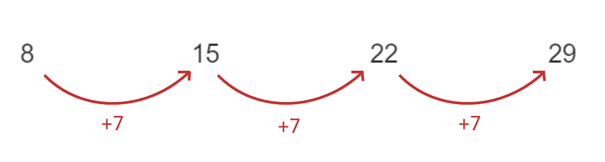

> * *

> *To get the next term, add 7 to 29.*

> * *$29+7=36$

** **$36$** [1]**

(ii) *To get from one term to the next, the difference is 7.*

> *The term to term rule for continuing the sequence is add 7.*

**Add 7** **[1]**

(iii) *n**th** term = *$dn+b$

> * **The sequence is linear, with a common difference of 7. So *$d=7$*.*

* ***n***th** term *$=7n+b$

* **The first term is 8. Substitute this and **n** = 1 into the formula, and solve for **b. *

$8=7\times1+b\,8=7+b\,b=1$

> * **Substitute *$b=1$* into the **n**th **term.*

$7n+1$* ***[2]**

**one mark for each part**
> *The first term in the sequence is when *$n=1$*.*

> *Substitute *$n=1$* into the **n**th **term.*

> * *

$( 1 )^{2} + ( 5 \times 1 ) = 6$

> * *

> *The second term is when *$n=2$*, so substitute *$n=2$* into the **n**th **term.*

> * *

$( 2 )^{2} + ( 5 \times 2 ) = 14$

> * *

> *The third term is when *$n=3$*, so substitute *$n=3$* into the **n**th **term.*

> * *

$( 3 )^{2} + ( 5 \times 3 ) = 24$

> * *

> *The first three terms are 6, 14, and 24.*

$6,14,24$* ***[2]**

**one mark for 2 terms in the correct place**

### Q16
i) *The sequence is going up by 6 each time*

**27 ****[1]**

ii) *The sequence is going up by 6 each time*

**Add 6 ****[1]**

iii) *The common difference is 6 so the **n**th term is in the form *

$6n+b$

**[1]**

> *Compare the sequence to the 6 times table. The sequence is 3 less than the 6 times table.*

$6n-3$** ****[1]**

### Q17
> *The term to term rule is*

*add 3*

> *Add 3 to 14 to determine the value of the next term in the sequence*

*14 + 3 = 17*

**17**** [1]**
> *The primary sequence that has a term to term rule of add 3 can be written as *

$3n$

**[1]**

> *The first 5 terms in this sequence are*

$3,6,9,12,15$

> *As the first 5 terms in the required sequence are *$5,8,11,14,17$*, add 2 to each term in the sequence *$3n$

$3n+2$ **[1]**

### Q18
> *Work out the difference between the terms of the sequence.*

> * *

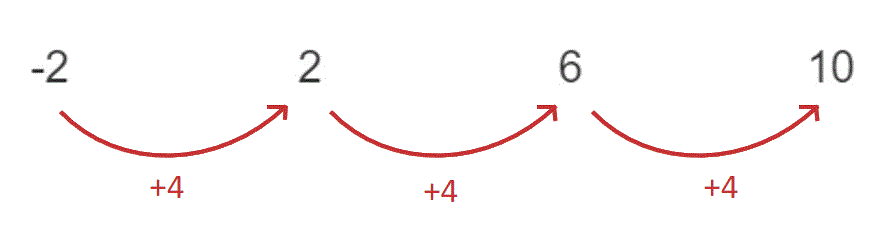

> * *

> *n**th** term = *$dn+b$

> * *

> *The sequence is linear, with a common difference of 4. So *$d=4$*.*

> * *

**n***th** term *$=4n+b$

* *

> *The first term is -2. Substitute this and **n** = 1 into the formula, and solve for **b.*

> * *

$\begin{gathered} - 2 & = 4 \times 1 + b \\ - 2 & = 4 + b \\ b = - 6 \end{gathered}$

> * *

> *Substitute *$b=-6$* into the **n**th **term.*

$4n-6$* ***[2]**
**one mark for each part**

### Q19
(i) *Work out the differences between the terms.*

> * *

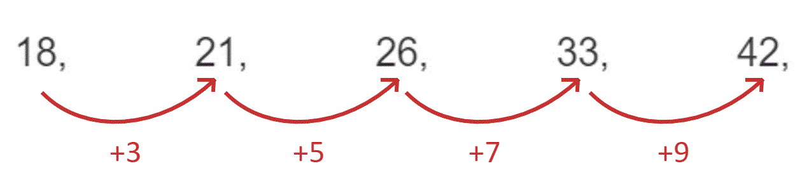

> * *

> *The differences are increasing by 2 every time, so the next difference will be 11.*

> *Add 11 onto 42. *

$42+11=53$

> * *

$53$* ***[1]**

(ii) *Work out the differences between the terms.*

> * *

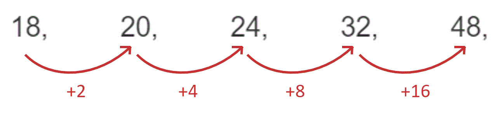

> * *

> *The differences are doubling every time, so the next difference will be 32.*

> *Add 32 onto 48.*

> *  *$48+32=80$

$80$* ***[1]**

### Q20
i) *The term to term rule is*

*Subtract *$5$

> *Subtract *$5$* to get the next term in the sequence*

$-8-5=-13$

**-13 ****[1]**

ii) *The term to term rule is*

*add double the difference between the previous two terms*

> *Double the difference between the previous two terms is*

$2 \times ( 49 - 25 ) = 48$

> *Add *$48$* to get the next term in the sequence*

$49+48=97$

**97**** ****[1]**

### Q21
(i) *Work out the differences between the terms.*

> * *

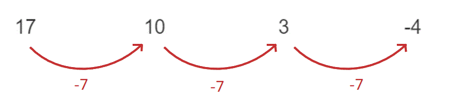

> * Subtract 7 from -4 to find the next term.*

> * *$-4-7=-11$

$-11$ **[1]**

(ii) *The differences between the all of terms is *$-7$*.*

> * To continue the sequence, we subtract 7 from the previous term.*

** ****Subtract 7** **[1]**

### Q22
> *i) The next term is 5 less than the previous term*

**12**** ****[1]**

> *ii) The next term is 5 less than the previous term*

**Subtract 5** **[1]**

### Q23
> *i) The sequence is increasing by 3 each time *

$38+3$

**41** **[1]**

*ii)* *The sequence is increasing by 3 each time*

**Add 3** **[1]**

### Q24
> *Substitute *$n=1$* into the n**th** term of the sequence to determine the value of the first term*

$1^{3}-5=1-5=-4$

> *Substitute *$n=2$* into the n**th** term of the sequence to determine the value of the second term*

$2^{3}-5=8-5=3$

> *Substitute *$n=3$* into the n**th** term of the sequence to determine the value of the third term*

$3^{3}-5=27-5=22$

**Final answer:** $-4,3,22$**  **

**Any two correct values**** [1]**
** ****Third value correct**** [1]**

### Q25
> *Substitute *$n=1,2,3$* into the n**th** term individually to determine the value of these terms*

$n=1:1^{2}+5=1+5=6$

$n=2:2^{2}+5=4+5=9$

$n=3:3^{2}+5=9+5=14$

**Any two of **$6,9,14$** [1]**

$6,9,14$** [1]**
