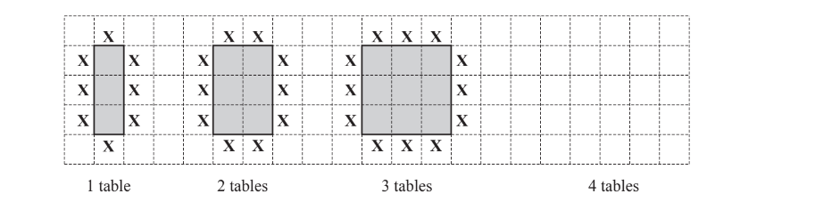
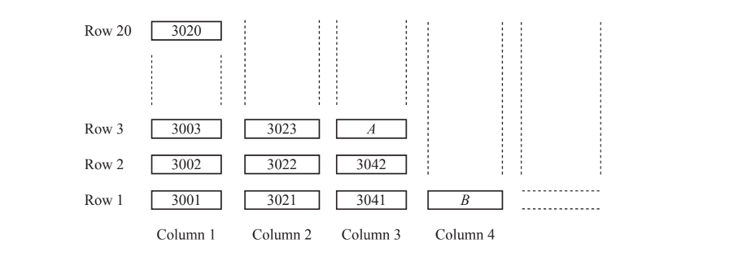
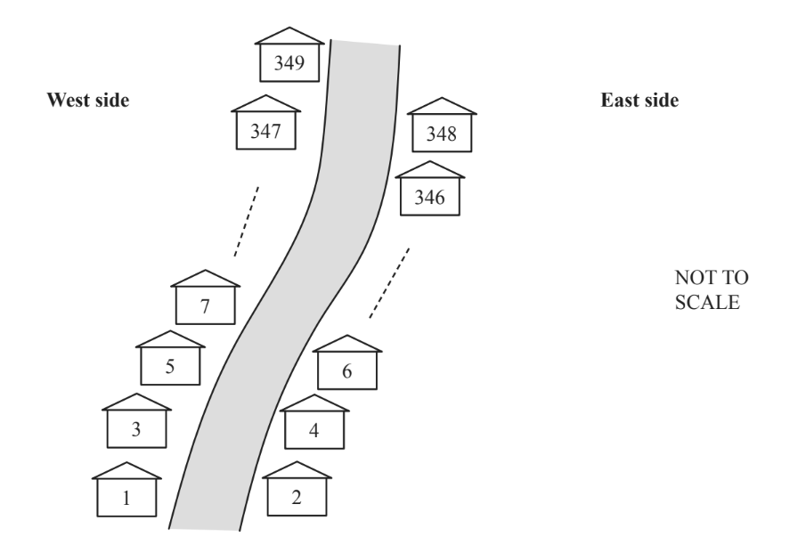
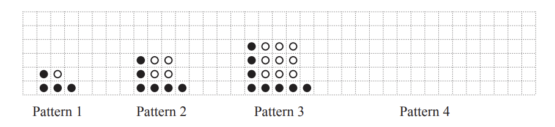
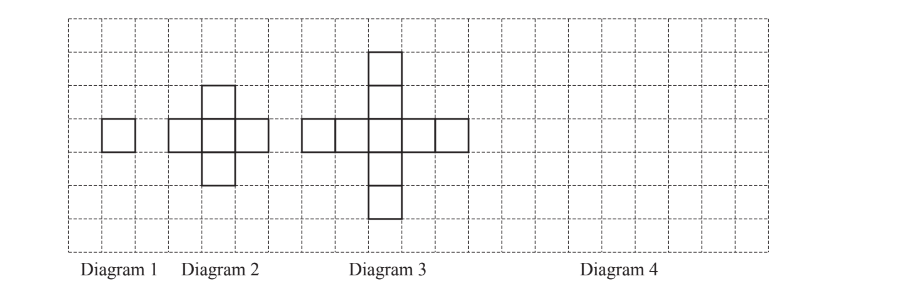
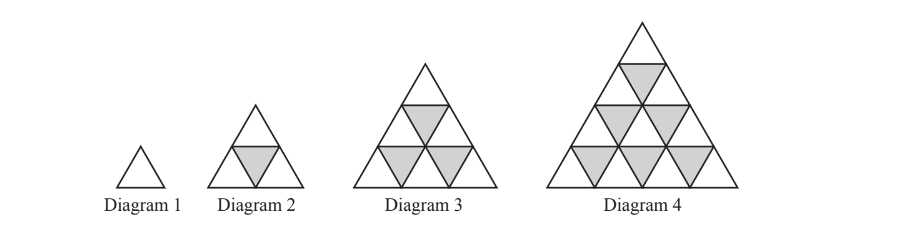
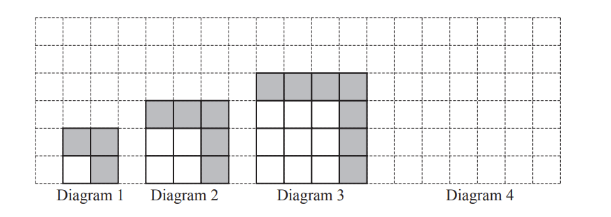
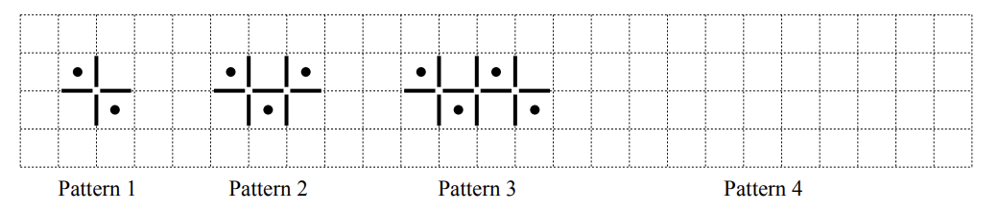

# Exam Questions — Sequences
**Algebra & Sequences** · Cambridge (CIE) IGCSE maths (0607)
> Source: [https://www.savemyexams.com/igcse/maths/cie/international-maths/23/core/topic-questions/](https://www.savemyexams.com/igcse/maths/cie/international-maths/23/core/topic-questions/) · 25 questions across 1 sets

## Exam Questions (25 questions)

### Q1 — medium — 4 marks

**Q1** [2 marks]

These are the first four terms of a sequence

$1,-2,-5,-8$

Find the $n$th term of the sequence.

**Q1** [2 marks]

The $p$th term in the same sequence is $-302$.

Find the value of $p$.

### Q2 — hard — 2 marks

**Q2** [2 marks]

Find an expression for the $n$th term of this sequence.

5,   8,   13,   20,   29,   ...

### Q3 — hard — 9 marks

**Q3** [1 mark]

Mrs Verma has a restaurant.
 In the restaurant each table has 8 chairs. 
Sometimes she puts tables together. 
The diagrams show how the tables are put together and the position of each chair **(X).**

The pattern of tables and chairs forms a sequence.

Draw the diagram for 4 tables.

*Source: March 2019 0580/32 Q5A*

**Q3** [2 marks]

**Extract:**

In the restaurant each table has 8 chairs. Sometimes she puts tables together. The diagrams show how the tables are put together and the position of each chair (X). The pattern of tables and chairs forms a sequence.

Complete the table.

| Number of tables (*t*) | 1 | 2 | 3 | 4 | 5 | 6 |
|---|---|---|---|---|---|---|
| Number of chairs (*c*) | 8 | 10 | 12 |   |   |   |

*Source: March 2019 0580/32 Q5B*

**Q3** [2 marks]

**Extract:**

| Number of tables (*t*) | 1 | 2 | 3 | 4 | 5 | 6 |
| Number of chairs (*c*) | 8 | 10 | 12 |   |   |   |

Find a formula for the number of chairs, *c*, in terms of the number of tables, *t*.

*c* = ...............................

*Source: March 2019 0580/32 Q5C*

**Q3** [2 marks]

**Extract:**

Find a formula for the number of chairs, *c*, in terms of the number of tables, *t*. *c* = ...............................

18 tables are put together in this way.

Work out the number of chairs needed.

*Source: March 2019 0580/32 Q5D*

**Q3** [2 marks]

**Extract:**

Find a formula for the number of chairs, c, in terms of the number of tables, t.
c = ...............................

Work out the number of tables, put together in this way, when 80 chairs are needed.

*Source: March 2019 0580/32 Q5E*

### Q4 — hard — 6 marks

**Q4** [6 marks]

Each of 196 candidates has a candidate number from 3001 to 3196.

The candidates sit in numerical order in columns and rows, as shown in the diagram.

There are 20 rows.

The diagram shows part of the plan for where the candidates sit.

i) The diagram shows where candidates $A$ and $B$ sit. Write down their numbers.

$A$ ..................................

$B$ ..................................  [2]

ii) Complete this statement.

Candidate 3135 sits in Column .......................... , Row ..........................

[2]

iii) Candidate *C* sits in Column $n$, Row 1.

Find an expression, in terms of $n$, for the number of candidate *C*.

[2]

*Source: March 2018 0580/32 Q2A*

### Q5 — hard — 2 marks

**Q5** [2 marks]

Here is a sequence of numbers.

3,   6,   11,   18,   27,   ...

Find an expression for the nth term of this sequence.

*Source: Specimen 2020 0580/01 Q27B*

### Q6 — hard — 9 marks

**Q6** [5 marks]

A road has 349 houses on it numbered from 1 to 349. The diagram shows some of these houses. The houses on the West side of the road have odd numbers. The houses on the East side have even numbers.

Tomaz delivers a leaflet to every house on the West side of the road. He starts at house number 1 and then delivers to each house in order.

i) Find an expression, in terms of $n$, for the house number of the $n$th house he delivers to.

[2]

ii) Work out the house number of the 40th house he delivers to.

[1]

iii) Work out how many houses are on the West side of the road.

[2]

*Source: June 2020 0580/33 Q4D*

**Q6** [4 marks]

**Extract:**

A road has 349 houses on it numbered from 1 to 349. The diagram shows some of these houses. The houses on the West side of the road have odd numbers. The houses on the East side have even numbers.

Alicia delivers a leaflet to every house on the East side of the road. She starts at house number 348 and then delivers to each house in order.

i) Find an expression, in terms of $n$, for the house number of the $n$th house she delivers to.

[2]

ii) What is the largest value of $n$ that can be used in your expression? Give a reason for your answer.

The largest value of $n$ is .....................because...............................

[2]

*Source: June 2020 0580/33 Q4E*

### Q7 — hard — 8 marks

**Q7** [1 mark]

A sequence of patterns is made using black counters and white counters.

Draw Pattern 4.

*Source: Nov 2020 0580/33 Q9A*

**Q7** [2 marks]

Complete the table.

| Pattern | 1 | 2 | 3 | 4 | 5 |
|---|---|---|---|---|---|
| Number of black counters | 4 | 6 | 8 |   |   |
| Number of white counters | 1 | 4 | 9 |   |   |

*Source: Nov 2020 0580/33 Q9B*

**Q7** [3 marks]

**Extract:**

| Pattern | 1 | 2 | 3 | 4 | 5 |
| Number of black counters | 4 | 6 | 8 |   |   |
| Number of white counters | 1 | 4 | 9 |   |   |

Write an expression, in terms of $n$, for

i) the number of black counters in Pattern $n$,

[2]

ii) the number of white counters in Pattern $n$.

[1]

*Source: Nov 2020 0580/33 Q9C*

**Q7** [2 marks]

**Extract:**

Write an expression, in terms of n, for
i) the number of black counters in Pattern n,
ii) the number of white counters in Pattern n.

Elena has 30 black counters and 140 white counters.

Can she make Pattern 12 using her counters? Explain your answer.

*Source: Nov 2020 0580/33 Q9D*

### Q8 — hard — 18 marks

**Q8** [9 marks]

The grid shows the first three diagrams in a sequence.

Each diagram is made using identical small squares.

Each square has sides that are 1 unit long.

i) On the grid, draw Diagram 4.

[1]

ii) Complete the table.

| Diagram number | 1 | 2 | 3 | 4 |
|---|---|---|---|---|
| Perimeter | 4 | 12 | 20 |   |

[1]

iii) Find an expression, in terms of $n$, for the perimeter of Diagram $n$.

[2]

iv) For one of the diagrams in the sequence the perimeter is 300 units.

Work out its Diagram number.

[2]

v) **Diagram 3** is drawn on a piece of card. 
The side of each small square is 7cm. 
The diagram is the net of an open box.

Calculate the volume of this box. 
Give the units of your answer.

[3]

*Source: June 2019 0580/32 Q6A*

**Q8** [9 marks]

These are the first four diagrams in a sequence.

Each diagram is made from small equilateral triangles.

i) Write down the number of lines of symmetry of Diagram 3.

[1]

ii) Complete the table.

| Diagram number ($n$) | 1 | 2 | 3 | 4 |
|---|---|---|---|---|
| Number of white triangles ($w$) | 1 | 3 | 6 |   |
| Number of grey triangles ($g$) | 0 |   | 3 |   |
| Total number of small triangles ($t$) | 1 | 4 |   |   |

[2]

iii)  Find a formula, in terms of  $n$, for the total number of small triangles, $t$, in Diagram $n$.

$t$ = ................................................... [1]

iv) The formula for the number of white triangles, $w$, in Diagram $n$ is $w = 1 \frac{1}{2} n ( n + 1 )$. 
Show that this formula gives the correct number of white triangles when $n$ = 3.

[2]

v) Complete this statement for Diagram 15.

When $n$ = 15, $w$ = ................. , $g$ = ................. and $t$ = ................. [3]

*Source: June 2019 0580/32 Q6B*

### Q9 — hard — 14 marks

**Q9** [1 mark]

The grid shows the first three diagrams in a sequence.

Each diagram is made using small squares that are white or grey.

On the grid, draw Diagram 4.

*Source: March 2020 0580/32 Q8A*

**Q9** [1 mark]

**Extract:**

The grid shows the first three diagrams in a sequence. Each diagram is made using small squares that are white or grey.

Write down the term to term rule for the number of grey squares.

*Source: March 2020 0580/32 Q8B*

**Q9** [6 marks]

| Diagram number | 1 | 2 | 3 | 4 |   | $n$ |
|---|---|---|---|---|---|---|
| Number of small white squares | 1 | 4 | 9 |   |   |   |
| Number of small grey squares | 3 | 5 | 7 |   |   |   |
| Total number of small squares | 4 | 9 | 16 |   |   |   |

Complete the table.

*Source: March 2020 0580/32 Q8C*

**Q9** [1 mark]

**Extract:**

| Diagram number | 1 | 2 | 3 | 4 |   | ![n] |
| Number of small white squares | 1 | 4 | 9 |   |   |   |
| Number of small grey squares | 3 | 5 | 7 |   |   |   |
| Total number of small squares | 4 | 9 | 16 |   |   |   |
 Complete the table.

Work out the number of small white squares in Diagram 18.

*Source: March 2020 0580/32 Q8D*

**Q9** [2 marks]

**Extract:**

| Diagram number | 1 | 2 | 3 | 4 |   | ![n] |
| Number of small white squares | 1 | 4 | 9 |   |   |   |
| Number of small grey squares | 3 | 5 | 7 |   |   |   |
| Total number of small squares | 4 | 9 | 16 |   |   |   |
 Complete the table.

One of the diagrams has a total of 900 small squares.

Work out its Diagram number.

Diagram .................................................

*Source: March 2020 0580/32 Q8E*

**Q9** [3 marks]

**Extract:**

| Diagram number | 1 | 2 | 3 | 4 |   | ![n] |
| Number of small white squares | 1 | 4 | 9 |   |   |   |
| Number of small grey squares | 3 | 5 | 7 |   |   |   |
| Total number of small squares | 4 | 9 | 16 |   |   |   |
 Complete the table.

Another diagram has 43 small grey squares.

Work out the total number of small squares in this diagram.

*Source: March 2020 0580/32 Q8F*

### Q10 — hard — 2 marks

**Q10** [2 marks]

Gabriela designs the seating layout for a new theatre. There are three sections of seats, A, B and C.

Section A has 152 seats.

In Section A:

- There are 12 seats in the front row.
- Each row has 2 more seats than the row in front of it.

Work out the number of rows for the 152 seats in Section A.

......................................... rows [2]

*Source: June 2020 0580/31 Q1C*

### Q11 — hard — 10 marks

**Q11** [1 mark]

A sequence of patterns is made using lines and dots. The first three patterns in the sequence are shown below.

Draw Pattern 4 on the grid.

*Source: Specimen 2020 0580/03 Q5A*

**Q11** [4 marks]

**Extract:**

A sequence of patterns is made using lines and dots. The first three patterns in the sequence are shown below.

Complete the table.

| Pattern | 1 | 2 | 3 | 4 |   | 10 |
|---|---|---|---|---|---|---|
| Number of dots | 2 | 3 |   |   |   |   |
| Number of lines | 4 | 7 |   |   |   |   |

*Source: Specimen 2020 0580/03 Q5B*

**Q11** [3 marks]

**Extract:**

| Pattern | 1 | 2 | 3 | 4 |   | 10 |
| Number of dots | 2 | 3 |   |   |   |   |
| Number of lines | 4 | 7 |   |   |   |   |

Find an expression, in terms of $n$, for

i) the number of dots in Pattern $n$,

[1]

ii) the number of lines in Pattern $n$.

[2]

*Source: Specimen 2020 0580/03 Q5C*

**Q11** [2 marks]

**Extract:**

Find an expression, in terms of n, for
i) the number of dots in Pattern n,
ii) the number of lines in Pattern n.

A pattern has 76 lines. Work out how many **dots **are in this pattern.

*Source: Specimen 2020 0580/03 Q5D*

### Q12 — medium — 7 marks

**Q12** [2 marks]

The $n$th term of a sequence is  $n^{2}+2n$

Find the first three terms of this sequence.

*Source: Nov 2019 0580/32 Q7B*

**Q12** [5 marks]

Here are the first three patterns in a sequence.

i) Complete the table.

| Pattern | 1 | 2 | 3 | 4 | 5 |
|---|---|---|---|---|---|
| Number of lines | 6 |   |   |   |   |

[2]

ii) Find an expression, in terms of $n$, for the number of lines in Pattern $n$.

[2]

iii) Jake says that he can make one of these patterns using exactly 105 lines.

Explain, without doing any working, why he is wrong.

[1]

*Source: Nov 2019 0580/32 Q7C*

### Q13 — medium — 6 marks

**Q13** [4 marks]

The $n$th term of a sequence is $n^{2}+5$.

i)  Find the first three terms.

[2]

ii) Show that 261 is a term in this sequence.

[2]

*Source: Nov 2019 0580/31 Q9B*

**Q13** [2 marks]

These are the first four terms of a sequence.

27      33      39      45

Find the nth term of this sequence.

*Source: Nov 2019 0580/31 Q9C*

### Q14 — medium — 3 marks

**Q14** [1 mark]

The $n$th term of a sequence is 60-8$n$.

Find the largest number in this sequence.

*Source: June 2020 0580/11 Q12A*

**Q14** [2 marks]

Here are the first five terms of a different sequence.

| 12 | 19 | 26 | 33 | 40 |
|---|---|---|---|---|

Find an expression for the $n$th term of this sequence.

*Source: June 2020 0580/11 Q12B*

### Q15 — medium — 6 marks

**Q15** [4 marks]

These are the first four terms of a sequence.

| 8 | 15 | 22 | 29 |
|---|---|---|---|

i) Write down the next term.

[1]

ii) Write down the term to term rule for continuing this sequence.

[1]

iii) Find an expression for the nth term.

[2]

*Source: Nov 2020 0580/31 Q10A*

**Q15** [2 marks]

Find the first three terms of the sequence with $n$th term $n^{2}+5n$.

*Source: Nov 2020 0580/31 Q10C*

### Q16 — medium — 4 marks

**Q16** [4 marks]

Here are the first four terms of a sequence.

3      9      15      21

i) Find the next term.

[1]

ii) Write down the rule for continuing this sequence.

[1]

iii) Find the $n$th term of this sequence.

[2]

*Source: Nov 2019 0580/33 Q8B*

### Q17 — medium — 3 marks

**Q17** [1 mark]

These are the first four terms of a sequence.

| 5 | 8 | 11 | 14 |
|---|---|---|---|

Write down the next term.

*Source: June 2019 0580/11 Q16A*

**Q17** [2 marks]

**Extract:**

These are the first four terms of a sequence.

| 5 | 8 | 11 | 14 |

Find an expression, in terms of $n$, for the $n$th term.

*Source: June 2019 0580/11 Q16B*

### Q18 — medium — 2 marks

**Q18** [2 marks]

These are the first four terms of a sequence.

| -2 | 2 | 6 | 10 |
|---|---|---|---|

Find an expression for the $n$th term.

*Source: Nov 2020 0580/12 Q14B*

### Q19 — easy — 2 marks

**Q19** [2 marks]

Find the next term in each of these sequences.

i)

| 18, | 21, | 26, | 33, | 42, | ....... |
|---|---|---|---|---|---|

[1]

ii)

| 18, | 20, | 24, | 32, | 48, | ....... |
|---|---|---|---|---|---|

[1]

*Source: Nov 2020 0580/31 Q10B*

### Q20 — easy — 2 marks

**Q20** [2 marks]

Write down the next term in each sequence.

i) $12,7,2,-3,-8,$ .....................

[1]

ii) $4,7,13,25,49,$.......................

[1]

*Source: May/June 2019 0580/13 Q21A*

### Q21 — easy — 1 marks

**Q21** [1 mark]

These are the first four terms of a sequence.

| 17 | 10 | 3 | -4 |
|---|---|---|---|

i) Find the next term.

[1]

ii) Write down the term to term rule for continuing this sequence.

[1]

*Source: Nov 2020 0580/12 Q14A*

### Q22 — easy — 2 marks

**Q22** [2 marks]

Here are the first four terms of a sequence.

32      27      22      17

i) Write down the next term.

[1]

ii) Write down the rule for continuing the sequence.

[1]

*Source: Nov 2019 0580/32 Q7A*

### Q23 — easy — 2 marks

**Q23** [2 marks]

These are the first four terms of a sequence.

| 29 | 32 | 35 | 38 |
|---|---|---|---|

i) Write down the next term.

[1]

ii) Write down the rule for continuing this sequence.

[1]

*Source: Nov 2019 0580/31 Q9A*

### Q24 — easy — 3 marks

**Q24** [3 marks]

The nth term of a sequence is $n^{3}-5$

Write down the first three terms of this sequence.

*Source: Specimen 2020 0580/01 Q27A*

### Q25 — easy — 2 marks

**Q25** [2 marks]

The $n$th term of a sequence is $n^{2}+5.$

Find the first three terms of this sequence.

*Source: June 2019 0580/31 Q5B*

