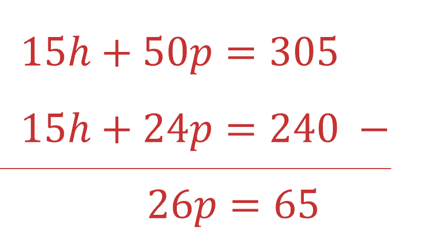

# Mark Schemes — Simultaneous Equations
**Algebra & Sequences** · Cambridge (CIE) IGCSE maths (0607)

## Exam Questions (15 questions)

### Q1
> *Let *$a$* be the cost of an adult ticket, and *$c$* be the cost of a child ticket.*

> *The Fraser family buy 6 adult tickets (*$6a$*) and 2 child tickets (*$2c$*) and their total cost is \$124. We can write this as:*

$6a+2c=124$

* ***[1]**

> *The Singh family buys 3 adult tickets (*$3a$*) and 5 child tickets (*$5c$*) and their total cost is \$100. We can write this as:*

$3a+5c=100$

**[1]**

> *Number the equations.*

$6a+2c=124$*  **(1)*

$3a+5c=100$*  (2)*

* *

> *Multiply all of the terms in equation (2) by 2 to make the coefficient of *$a$* the same in both equations.*

* *$6a+10c=200$*  **(3)*

* **Eliminate the *$a$* terms by subtracting equation 1 from equation 3.*

`equation`

**[1]**

> *Solve *$8c=76$* by dividing both sides of the equation by 8.*

$c=76\div8\,c=9.5$

> * Substitute *$c=9.5$* into one of the original equations.*

> * *`table row cell 6 a plus open parentheses 2 cross times 9.5 close parentheses end cell equals 124 row blank blank blank row cell 6 a plus 19 end cell equals 124 end table`

> * Solve this equation to find *$a$*. Subtract 19 from both sides.*

> * *$6a=124-19\,6a=105$

> *Divide both sides by 6.*

$a=105\div6\,a=17.5$

> * Write the answers to 2 decimal places, because the values are money.*

**adult ticket **`bold equals bold $ bold 17 bold. bold 50`* ***[1]**
**child ticket*** *`bold equals bold $ bold 9 bold. bold 50`* ***[1]**

### Q2
> *Form an equation for Ana in terms of *$p$* and *$b$*.*

* *$2p+4b=42$* **(equation 1)*

**[1]**

> *Form an equation for Paola.*

* *$7p+9b=107$* **(equation 2)*

* ***[1]**

> *Multiply all the terms in equation 1 by 7 and all the terms in equation 2 by 2 to equate the *$p$* coefficients.*

* *$14p+28b=294$* **(equation 3)*

* *$14p+18b=214$* **(equation 4)*

> * *

**equating coefficients of **$p$** or **$b$** ****[1]**

> *Subtract equation 4 from equation 3 to eliminate *$p$*.*

> * *`equation`

** eliminating one variable**** [1]**

> *Solve *$10b=80$* by dividing both sides by 10.*

> * *$b=80\div10\,\,b=8$

> * *

> *Substitute *$b=8$* into one of the equations.*

> * *`2 p plus open parentheses 4 cross times 8 close parentheses equals 42`

> * Work out *$4\times8$*, and subtract from both sides.*

> * *$2p=42-32\,\,2p=10$

> * *

> *Divide both sides by 2 to solve for *$p$*.*

> * *$p=10\div2\,\,p=5$

* *$p=5$* ***[1]**

$b=8$** [1]**

### Q3
(i) *Three times Alphonse’s age (*$3x$*) is **equal** to 5 times Beatrice’s age (*$5y$*). *

$3x=5y$** [1] **

> *Twice Beatrice’s age (*$2y$*) is 4 years more than Alphonse’s age (*$x+4$*).*

* *$2y=x+4$* ***[1]**

(ii) *Rearrange the equations so that *$x$* and *$y$* terms are on one side of the equals sign, and any constants are on the other.*

> *Label the equations. *

`table row cell 3 x minus 5 y end cell equals cell 0 space space open parentheses equation space 1 close parentheses end cell row blank blank blank row cell negative x plus 2 y end cell equals cell 4 space space open parentheses equation space 2 close parentheses end cell end table`

> * *

> *Multiply equation 2 by 3 to make the coefficients of *$x$* the same.*

> * *`negative 3 x plus 6 y equals 12 space space open parentheses equation space 3 close parentheses`

> * Add equation 1 and equation 3 to eliminate *$x$*.*

> * *`table row cell space 3 x minus 5 y plus open parentheses negative 3 x plus 6 y close parentheses end cell equals cell 0 plus 12 end cell row cell space 3 x minus 3 x minus 5 y plus 6 y end cell equals cell 0 plus 12 end cell row y equals 12 end table`

* ***eliminate one variable ****[1]**

** **

> *Substitute *$y=12$* into one of the equations.*

> * *`table row cell 3 x minus open parentheses 5 cross times 12 close parentheses end cell equals 0 row blank blank blank row cell 3 x minus 60 end cell equals 0 end table`

> * *

> *Add 60 to both sides.*

> * *$3x=0+60\,\,3x=60$

> * Divide both sides by 3.*

$x=60\div3\,\,x=20$

* *$x=20$* ***[1]**

$y=12$** [1]**

### Q4
i) *The cost is equal to the combination of hours and passengers stated*

**61** **[1]**

** **ii) *5 hours and 8 passengers can be represented as *

$5h+8p$

**[1]**

> *Use the same linear format for the equation as in part bi)*

**5****h**** + 8****p**** = 80**** ****[1]**

**  **

iii) *The two simultaneous equations to solve are*

$3h+10p=61$

$5h+8p=80$

> *Multiply the first equation by 5 to make the coefficients of *$h$* the same*

`open parentheses 5 cross times 3 h close parentheses plus open parentheses 5 cross times 10 p close parentheses equals open parentheses 5 cross times 61 close parentheses`

$15h+50p=305$

> *Multiply the second equation by 3 to make the coefficients of *$h$* the same*

*  *`open parentheses 3 cross times 5 h close parentheses plus open parentheses 3 cross times 8 p close parentheses equals open parentheses 3 cross times 80 close parentheses`

$15h+24p=240$

**Equating coefficients of **$h$** or **$p$** [1]**

*Eliminate the *$h$* term from each equation by subtracting one equation from the other*

**Correctly eliminating **$h$** or **$p$** [1]**

> *Solve the 1-step equation by dividing both sides by 26*

$p=65\div26=2.5$

**Correctly finding **$p=2.5$**or **$h=12$** [1]**

> *Substitute *$p=2.5$* into either of the two original equations and solve for *$h$

`table row cell 3 h plus open parentheses 10 cross times 2.5 close parentheses end cell equals 61 end table`

$3h+25=61$

$3h=61-25$

$3h=36$

$h=\frac{36}{3}$

$h=12$

* ***h**** = 12, ****p**** = 2.5 ****[1]**

### Q5
> *Let one number be *$x$* and the other be *$y$*.*

> *Write the sum of the numbers is -6 using *$x$* and *$y$*.*

> * *$x+y=-6$

**[1]**

> *Write the difference of the numbers is 62 using *$x$* and *$y$*.*

> * *$x-y=62$

**[1]**

> *Solve the two equations simultaneously by subtracting one from the other.*

> * *`table row cell open parentheses x plus y close parentheses minus open parentheses x minus y close parentheses end cell equals cell negative 6 minus 62 end cell row cell 2 y end cell equals cell negative 68 end cell end table`

> *Divide both sides of the equation by 2.*

> * *$y=-68\div2\,\,y=-34$

* ***[1]**

> *Substitute *$y=-34$* into one of the original equations.*

> * *`table row cell x plus open parentheses negative 34 close parentheses end cell equals cell negative 6 end cell row cell x minus 34 end cell equals cell negative 6 end cell end table`

> *Add 34 to both sides of the equation.*

> * *$x=-6+34\,\,x=28$

> * *

**28 and -34**** ****[1]**

### Q6
> *The cost is equal to the combination of pens and notebooks stated*

$5p+4n=450$ **[1]**
> *10 pens and 3 notebooks can be represented as *

> * *$10p+3n$

**[1]**

*Use the same linear format for the equation as in part a)*

$10p+3n=525$ **[1]**
> *The two simultaneous equations to solve are*

> * *$5p+4n=450$

$10p+3n=525$

> *Multiply the first equation by 2 to make coefficients of *$p$* the same*

> * *`open parentheses 2 cross times 5 p close parentheses plus open parentheses 2 cross times 4 n close parentheses equals open parentheses 2 cross times 450 close parentheses`

$10p+8n=900$

> *Eliminate the *$p$* term from each equation by subtracting one equation from the other*

$\frac{10p+8n=900\,10p+3n=525-}{5n=375}$

** [1]**

> *Solve the 1-step equation by dividing both sides by 5*

$n=75$

*Substitute *$n=75$* into either of the two original equations and solve for *$p$* *

`table row cell 10 p plus open parentheses 3 cross times 75 close parentheses end cell equals 525 row cell 10 p plus 225 end cell equals 525 row cell 10 p end cell equals cell 525 minus 225 end cell row cell 10 p end cell equals 300 row p equals cell 300 divided by 10 end cell row p equals 30 end table`

**Cost of a pen = 30 cents**** ****[1]**** **
**Cost of a notebook = 75 cents ****[1]**

### Q7
> *Label the equations.*

> * *`5 x minus 2 y equals 44 space space space open parentheses equation space 1 close parentheses

2 x plus 3 y equals 10 space space space open parentheses equation space 2 close parentheses`

> * *

> *Multiply every terms in equation 1 by 2, and every term in equation 2 by 5, to make the coefficients of *$x$* the same.*

> * *

`table row cell 10 x minus 4 y end cell equals cell 88 space space space open parentheses equation space 3 close parentheses end cell row blank blank blank row cell 10 x plus 15 y end cell equals cell 50 space space space open parentheses equation space 4 close parentheses end cell end table`

* ***[1]**

> *Subtract equation 4 from equation 3 to eliminate *$x$*.*

> * *`table row cell 10 x space minus 4 y minus open parentheses 10 x plus 15 y close parentheses end cell equals cell 88 minus 50 end cell row cell 10 x minus 10 x minus 4 y minus 15 y end cell equals cell 88 minus 50 end cell row cell negative 19 y end cell equals 38 end table`

* ***[1]**

> *Divide both sides of the equation by -19 to solve for *$y$*.*

> * *`y equals 38 divided by open parentheses negative 19 close parentheses`

$y=-2$* ***[1]**

> *Substitute *$y=-2$* into one of the original equations and solve to find *$x$*.*

> * *`table row cell 2 x plus open parentheses 3 cross times negative 2 close parentheses end cell equals 10 row blank blank blank row cell 2 x minus 6 end cell equals 10 end table`

> * *

> *Add 6 to both sides.*

> * *$2x=10+6\,\,2x=16$

> * *

> *Divide both sides by 2.*

> * *$x=16\div2$

$x=8$* ***[1]**

### Q8
> *To eliminate one of the variables, either the **x** or **y** variable needs to have the same coefficient in each equation. *

> *Number the equations*

`5 x space plus thin space 4 y space equals space 10 space space space space space space space circle enclose 1
7 x space minus space 6 y space equals space 43 space space space space space space space circle enclose 2`

> *Make the **y **coefficients the same. Find the lowest common multiple of 4 and 6 which is 12.*

> *Multiply everything in equation (1) by 3 and everything in equation (2) by 2.*

`15 x space plus thin space 12 y space equals space 30 space space space space space space space circle enclose 3
14 x space minus space 12 y space equals space 86 space space space space space space space circle enclose 4`

**[1]**

> *Add the equations together to eliminate the **y** variable.*

$29x=116$

**[1]**

> *Divide both sides by 29*

$x=4$* ***[1]**

> *To find the value of **y**, substitute the value of **x** into one of the other equations.*

$5\times4+4y=10$

$20+4y=10$

> *Subtract 20 from both sides*

$4y=-10$

> *Divide both sides by 4*

$y=-2.5$* ***[1]**

### Q9
(i) *3 apples *`open parentheses a close parentheses`* and 8 bananas *`open parentheses b close parentheses`* cost 93 cents*

$3a+8b=93$ **[2]** 
**1 mark for each side of equation**

(ii) *The two equations are*

`table row cell 7 a plus 4 b end cell equals 85 row cell 3 a plus 8 b end cell equals 93 end table`

> *Multiply the first equation by 2, so the coefficients of *$b$* match*

`table row cell 14 a plus 8 b end cell equals 170 row cell 3 a plus 8 b end cell equals 93 end table`

> *Subtract the second equation from the first equation to eliminate *$b$

$11a=77$

**Eliminating either variable**** [1]**

> *Divide both sides by 11 to find *$a$

$a=7$

**Either variable found ****[1]**

> *Substitute into the first equation, *$7a+4b=85$*, and solve to find *$b$

`table row cell 7 open parentheses 7 close parentheses plus 4 b end cell equals 85 row cell 49 plus 4 b end cell equals 85 row cell 4 b end cell equals 36 row b equals 9 end table`

$a=7$ 
$b=9$

**Both variables found ****[1]**

### Q10
> *As both equations are equivalent to *$y$*, they are equal to each other*

$3x+13=7x-3$

**[1]**

> *Solve this equation for *$x$

$13=7x-3-3x$

$13=4x-3$

$13+3=4x$

$16=4x$

$x=16\div4=4$

**[1]**

> *Substitute *$x=4$* into one of the two straight line equations and solve for *$y$

$y=3\times4+13$

$y=12+13=25$

**(4, 25)**** ****[1]**

### Q11
> *Label the equations.*

> * *`table row cell 3 x minus 8 y end cell equals cell 22 space space space open parentheses equation space 1 close parentheses end cell row cell x plus 4 y end cell equals cell 4 space space space space space space open parentheses equation space 2 close parentheses end cell end table`

> * Multiply all the terms in equation 2 by 3.*

> * *`3 x plus 12 y equals 12 space space space open parentheses equation space 3 close parentheses`

> *Subtract equation 3 from equation 1 to eliminate *$x$*.*

> * *`equation`

* ***[1]**

> *Solve *$-20y=10$* by dividing both sides by -20.*

> * *$y=\frac{10}{-20}=-0.5$

* *$y=-0.5$* ***[1]**

> *Substitute *$y=-0.5$* into one of the equations to find *$x$*.*

> * *`table row cell x plus open parentheses 4 cross times negative 0.5 close parentheses end cell equals 4 row blank blank blank row cell x minus 2 end cell equals 4 end table`

> *Add 2 to both sides.*

$x=4+2$

* *$x=6$* ***[1]**

### Q12
> *Equate coefficients of *$y$* by multiplying the first equation by *$3$

$5x\times3-2y\times3=26\times3$

$15x-6y=78$

> *As one coefficient of *$y$* is the negative of the other coefficient of *$y$*, add the two equations together to eliminate *$y$*and solve for *$x$

$15x-6y=78\,\frac{7x+6y=10+}{22x=88}$

**[1]**

$x=88\div22=4$

**[1]**

> *Substitute *$x=4$* into either equation and solve for *$y$

$7\times4+6y=10$

$28+6y=10$

$6y=10-28$

$6y=-18$

$y=-18\div6=-3$

$x=4,y=-3$** [1]**

### Q13
> *Multiply the first equation by 2 in order to eliminate the **y** variable*

$6x-2y=44\,x+2y=5$

**[1]**

> *Add the equations together*

$7x=49$

> *Divide by 7*

$x=7$

**x ****= 7**** ****[1]**

> *Substitute into one of the equations*

$7+2y=5$

> *Subtract 7 from both sides*

$2y=-2$

> *Divide both sides by 2*

$y=-1$

**y**** = -1**** ****[1]**

### Q14
> *Esme will have **x** lots of \$2.45 and **y** lots of \$3.15. Write these as a sum but do not add them together as they are not like terms.*

$2.45x+3.15y$ **[1]**
> *One magazine costs \$2.45. Find the cost of 8 magazines.*

`8 space cross times space $ 2.45 space equals space $ 19.60`

> *Esme spent \$60.55 in total so subtract the cost of the magazines to find out how much she spent on cards.*

`$ 60.55 space minus space $ 19.60 space equals space $ 40.95`

**[1]**

> *To work out how many cards she bought, divide the total cost of the cards by the cost of one card.*

`$ 40.95 space divided by space $ 3.15 space equals space 13`

**13 ****[1]**

### Q15
> *As one coefficient of *$y$* is the negative of the other coefficient of *$y$*, add the two equations to eliminate *$y$

$\frac{6x-3y=12\,2x+3y=16+}{8x=28}$

**[1]**

$x=28\div8=3.5$

> *Substitute *$x=3.5$* into either of the two equations and solve for *$y$

$2\times3.5+3y=16$

$7+3y=16$

$3y=16-7$

$3y=9$

$y=9\div3=3$

$x=3.5$** ****and **$y=3$** ****[1]**
