# Mark Schemes — Coordinates & Straight Line Graphs
**Coordinate Geometry & Graphs** · Cambridge (CIE) IGCSE maths (0607)

## Exam Questions (29 questions)

### Q1
> *Find the coordinates of the midpoint using the formula *$( \frac{x_{1} + x_{2} }{2} , \frac{y_{1} + y_{2} }{2} )$

$( \frac{2 + - 4}{2} , \frac{7 + 11}{2} )$

> *Simplify*

$( \frac{- 2}{2} , \frac{18}{2} )$

$( - 1 , 9 )$** [2]**
**1 mark for each**

### Q2
> *The **y-**intercept is 2 so the equation must look like*

$y=mx+2$

**[1]**

> *To work out the gradient, **m**, identify two points the line passes through and work out the rise and run.*

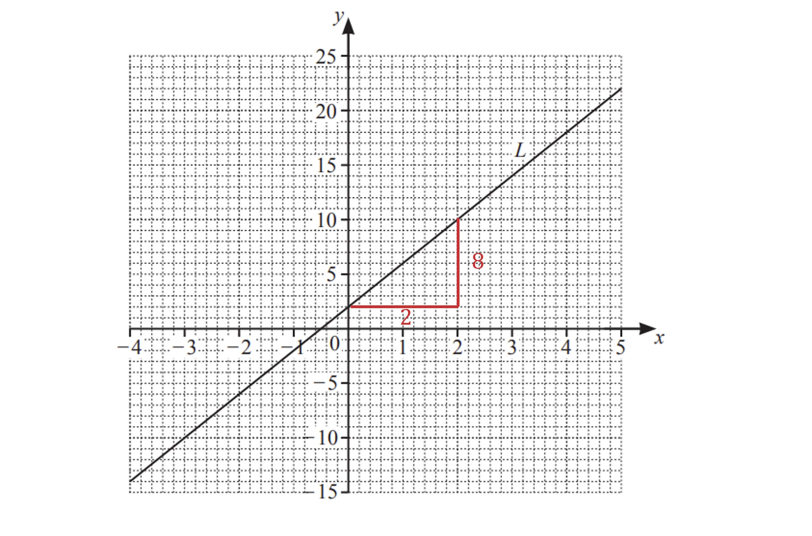

$m=\frac{\mathrm{rise}}{\mathrm{run}}=\frac{8}{2}=4$

**[1]**

> *The line is sloping uphill so the gradient is positive. *

> *The final equation of the line is given by*

$y=4x+2$* ***[1]**
i) *In the equation of a line in the form *$y=mx+c$*, **m** refers to the gradient  *

**3**** ****[1]**

ii) *In the equation of a line in the form *$y=mx+c$*, **c** refers to the **y-**intercept. In this case it is -4. Write this as a co-ordinate.  *

**(0, -4)**** ****[1]**
> *Use a table of values to work out the co-ordinates by substituting the values of **x** between -4 and 5 into the equation *$y=-2x+1$

$y = - 2 ( - 4 ) + 1 = 8 + 1 = 9 y = - 2 ( - 3 ) + 1 = 6 + 1 = 7 \text{etc}$

| *x* | *-4* | *-3* | *-2* | *-1* | *0* | *1* | *2* | *3* | *4* | *5* |
|---|---|---|---|---|---|---|---|---|---|---|
| *y* | *9* | *7* | *5* | *3* | *1* | *-1* | *-3* | *-5* | *-7* | *-9* |

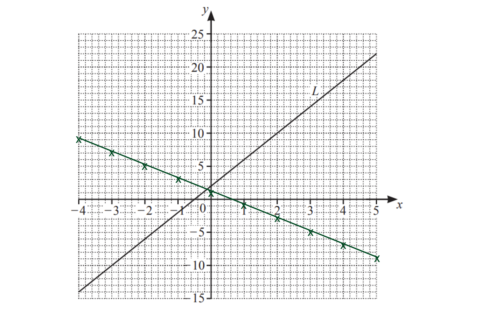

** ****1 correct point plotted or correct gradient**** ****[1] **
**2 correct points plotted**** [1] **
**Fully correct ruled line from -4 to**** ****5**** [1]**

### Q3
ia) *Substitute *$x=1$* into each equation.*

$A : y = - 3 \times ( 1 ) + 4 = - 3 + 4 = 1$

$B : y = 4 \times ( 1 ) - 3 = 4 - 3 = 1$

$C : y = 3 \times ( 1 ) - 4 = 3 - 4 = - 1$

$D : y = - 4 \times ( 1 ) - 3 = - 4 - 3 = - 7$

> *   The only equation to return a *$y-$*value of *$-1$* is *$C$*.*

$C$ **[1]**

** **

ib) *If the *$y-$*intercept is 4, then the graph passes through the coordinate *$( 0 , 4 )$*.* 
*Substitute *$x=0$* into each of the equations.*

$A : y = - 3 \times ( 0 ) + 4 = 0 + 4 = 4$

$B : y = 4 \times ( 0 ) - 3 = 0 - 3 = - 3$

$C : y = 3 \times ( 0 ) - 4 = 0 - 4 = - 4$

$D : y = - 4 \times ( 0 ) - 3 = 0 - 3 = - 3$

> * The only equation to return a *$y-$*value of *$4$* is *$A$*.*

$A$ **[1]**

** **

ic) *The gradient of a line is determined by the coefficient of *$x$* for a straight line of the form *$y=mx+c$*.*
*The only equation with a coefficient of *$x$* as *$-4$* is *$D$*.*

*  *$D$* ***[1]**

** **

ii) *Substitute *$y=-26$* and *$x=p$* into the equation and solve for *$p$*.*

$-26=-3p+4$

**[1]**

$\begin{gathered} - 26 - 4 & = - 3 p \\ - 30 & = - 3 p \\ 30 = 3 p \\ p = 30 \div 3 \end{gathered}$

$p=10$ **[1]**

### Q4
i) *The line crosses the *$y-$*axis when *$x=0$*.*

$y=0-3=-3$

$(0,-3)$ **[1]**

ii) *A line is parallel if the gradients are the same. *
*As the line passes through the origin, *$c=0$*.*

$y=6x$* ***[1]**
i) *Plot the coordinate *$( - 3 , - 2 )$* on the set of axes.*

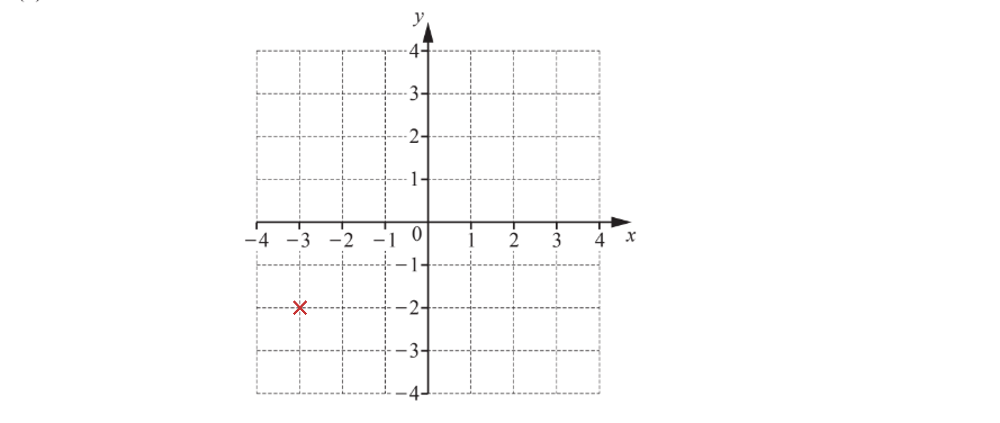

> *A line perpendicular to the *$y-$*axis is horizontal.*

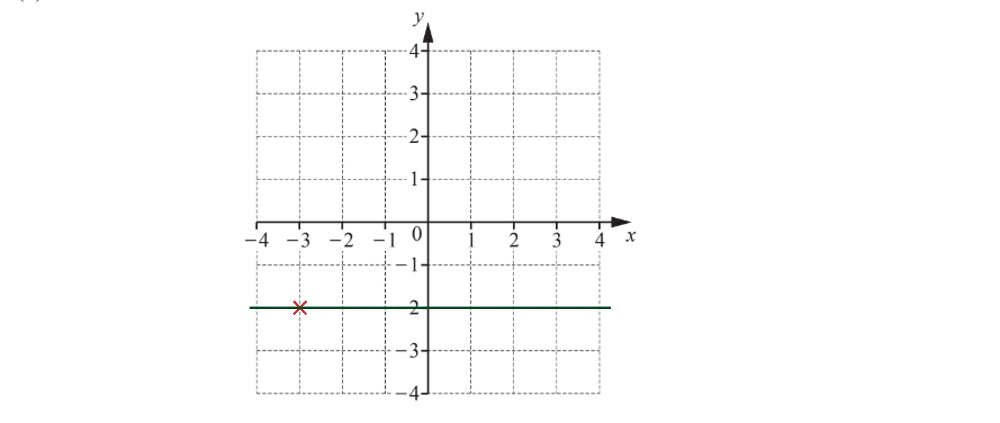

**[1]**

ii) *Determine a few coordinates for the line *$y=-2x$* by substituting some values of *$x$* into the equation of the line to determine the value of *$y$* at this point.*

$x=-2:y=-2\times-2=4$
$x=0:y=-2\times0=0$
$x=2:y=-2\times2=-4$

> *Plot these points onto the set of axes and connect using a straight, ruled line.*

$( - 2 , 4 ) , ( 0 , 0 ) , ( 2 , - 4 )$

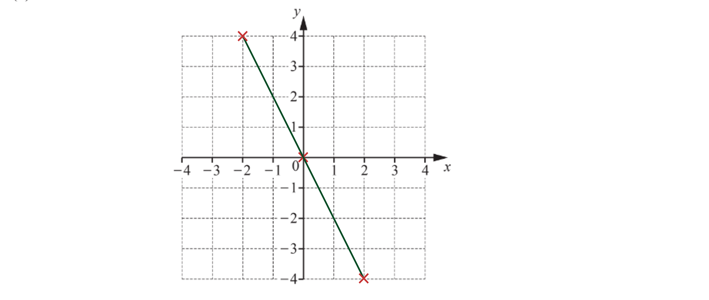

**[1]**

### Q5
> *The gradient of the line is calculated using *$m=$$\frac{\mathrm{rise}}{\mathrm{run}}$*.*

$m=\frac{0-3}{6-0}=-\frac{3}{6}=-\frac{1}{2}$

**[1]**

> *The *$y-$*intercept is the point where the straight line crosses the *$y-$*axis. *
*This is the point*

$( 0 , 3 )$

> *The *$y-$*intercept is therefore *

$c=3$

**[1]**

> *Write the equation of the straight line.*

$y=-\frac{1}{2}x+3$ **[1]**
i) *Substitute *$x=9,y=a$* into the equation of the straight line and solve for *$a$*.*

$a=\frac{2}{3}\times9-7=6-7=-1$

**Correct substitution**** [1]**
$a=-1$** [1]**

ii) *Substitute *$x=b,y=3$* into the equation of the straight line and solve for *$b$*.*

$3=\frac{2}{3}\timesb-7$

**[1]**

$\begin{gathered} 10 = \frac{2}{3} b \\ 30 = 2 b \\ \frac{30}{2} & = b \\ \end{gathered}$

$b=15$** [1]**

### Q6
> *Work out the gradient of the line, *$m$*, by identifying two points the line passes through and dividing the rise by the run.*

> * *

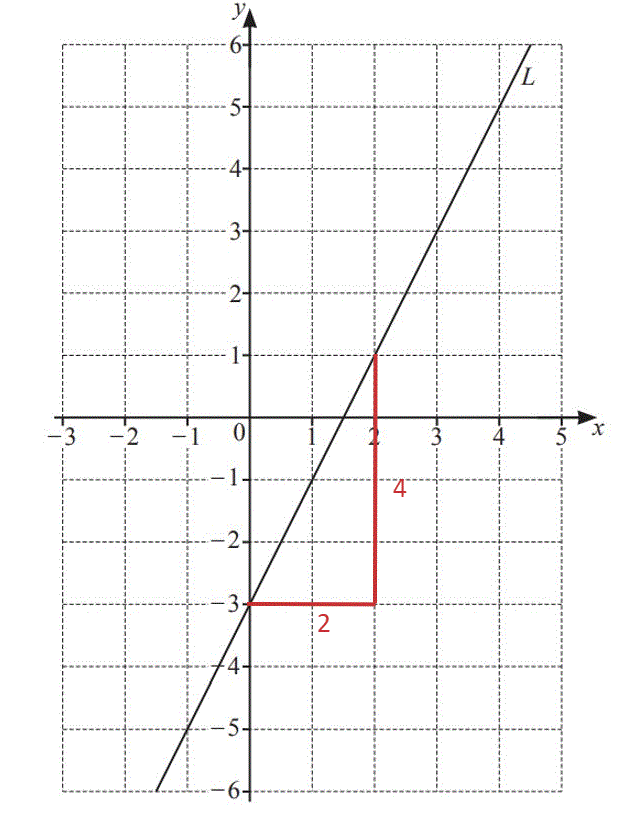

> * *

$\begin{gathered} \text{rise} & = 4 \\ \text{run} & = 2 \end{gathered}$

$\frac{\mathrm{rise}}{\mathrm{run}}=\frac{4}{2}=2$

** **

> *The gradient of the line is 2, so *$m=2$*. The line crosses the *$y$* axis at -3, so *$c=-3$*.*

> *Substitute these values into the equation of a line, *$y=mx+c$*.*

$y=2x-3$* ***[2] **

**1 mark for 2x, 1 mark for -3**
> *Use a ruler** to draw a line which is perpendicular (meets line **L** at *$90^{\circ}$*)*

> *Use your protractor to check that the lines meet at *$90^{\circ}$

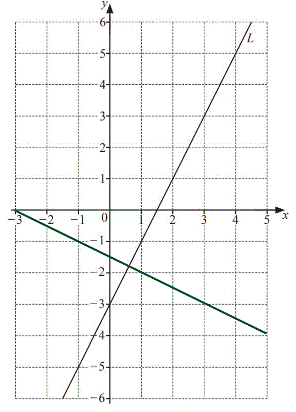

**Any perpendicular line**** [1]**

### Q7
> *The equation of the straight line is in the form *$y=mx+c$*, and in that form *$m$* is the **gradient.*

> *Look at the coefficient of *$x$* in the equation *$y=5x+12$*.*

> * *

**5**** ****[1]**
> *The line crosses the *$x$* axis when *$y=0$*.*

> *Substitute *$y=0$* into the equation of the line.*

> * *

$5x+12=0$

* ***[1]**

> *Subtract 12 from both sides.*

> * *

$5x=-12$

> * *

> *Divide both sides by 5.*

> * *

$x=-\frac{12}{5}$

> * *

> *Write the *$x$* and *$y$* values as a pair of coordinates.*

> * *

$(-\frac{12}{5},0)$* ***[1]**

### Q8
> *Parallel **lines have the same gradient, *$m$*.*

> *The line *$y=5x+6$* has a gradient of *$5$*. The parallel line passes through *$( 0 , - 7 )$*, so the *$y$* intercept, *$c$*, is *$-7$*.*

> *Substitute *$m=5$* and *$c=-7$* into the equation of a line, *$y=mx+c$*.*

> * *

$y=5x-7$* ***[1]**

### Q9
(i) *Point A is 2 left of the origin, so *$x=-2$*.*
*The point is 5 above the origin so *$y=5$*. *

> *Write as a coordinate. Remember to write the *$x$* value first.*

$(-2,5)$* ***[1]**

(ii) *The coordinate *$( 2 , - 3 )$* means the point is 2 to the right of the origin, and 3 below it.*
*Mark the point on the grid.*

> * *

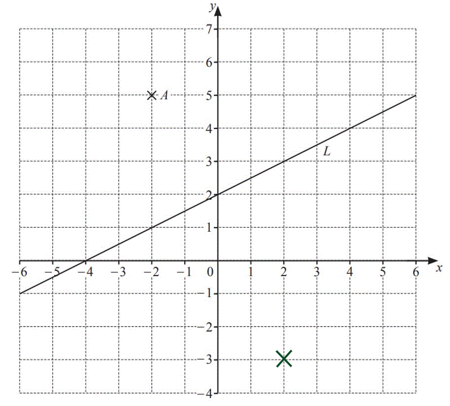

* ***[1]**

(iii) *Find the gradient, *$m$*, of the line by dividing **rise **by **run**.*

> * *

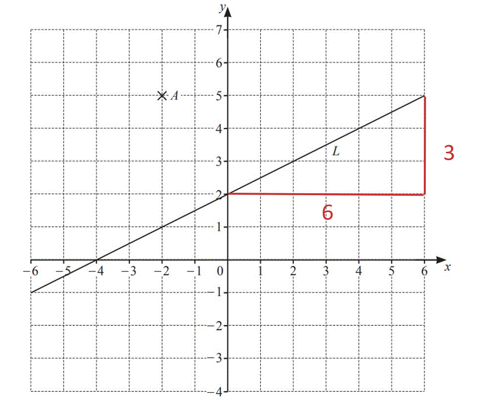

*Rise = *$3$
*Run = *$6$

> * *

$\frac{\mathrm{Rise}}{\mathrm{Run}}=\frac{3}{6}=0.5$

> * *

> *The gradient, *$m$*, of the line is 0.5. The line crosses the *$y$* axis at 2, so *$c=2$*.*
*Substitute these values into the equation of a line, *$y=mx+c$*.*

> * *

$y=0.5x+2$* ***[2]**

**1 mark for 0.5x, 1 mark for +2**** **

### Q10
> *For a line in the form *$y=mx+c$*, *$m$* is the gradient and *$c$* is the *$y$*-intercept*

> *As the line is parallel, it will have the same gradient*

$m=8$

**Either gradient or intercept correct ****[1]**

> *The line passes through (0,6) which is on the *$y$*-axis, so this is the *$y$*-intercept*

$c=6$

> *We can now write down the full equation of the line*

$y=8x+6$ **[1]**

### Q11
> *Work out the gradient of the line, *$m$*, by identifying two points the line passes through and dividing the rise by the run.*

> * *

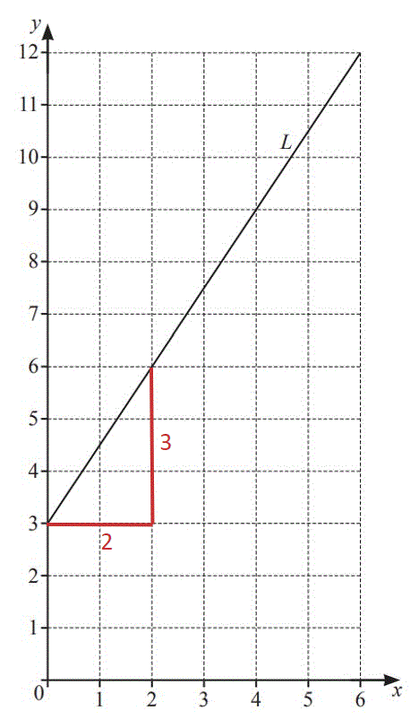

> * *

$\begin{gathered} \text{rise} & = 3 \\ \text{run} & = 2 \end{gathered}$

$\frac{\mathrm{rise}}{\mathrm{run}}=\frac{3}{2}=1.5$

**[1]**

> *The gradient of the line is 1.5, *$m=1.5$*. The line crosses the *$y$* axis at 3, so *$c=3$*.*

> *Substitute these values into the equation of a line, *$y=mx+c$*.*

$y=1.5x+3$* ***[1]**

### Q12
> *The line crosses the *$y-$*axis when *$x=0$*. *

> *Substitute *$x=0$* into the equation and solve for *$y$*.*

$y=3\times0-8=0-8=-8$

> *Write the coordinate.*

$(0,-8)$ **[1]**

### Q13
> *The gradient of the line is calculated using *$m=$$\frac{\mathrm{rise}}{\mathrm{run}}$*.*

$m=\frac{0-3}{6-0}=-\frac{3}{6}=-\frac{1}{2}$

**[1]**

> *The *$y-$*intercept is the point where the straight line crosses the *$y-$*axis. *
*This is the point*

$( 0 , 3 )$

> *The *$y-$*intercept is therefore *

$c=3$

**[1]**

> *Write the equation of the straight line.*

$y=-\frac{1}{2}x+3$ **[1]**

### Q14
> *The gradient of the line is calculated using *$m=$$\frac{\mathrm{rise}}{\mathrm{run}}$*.*

$m=\frac{0-3}{6-0}=-\frac{3}{6}=-\frac{1}{2}$

**[1]**

> *The *$y-$*intercept is the point where the straight line crosses the *$y-$*axis. *
*This is the point*

$( 0 , 3 )$

> *The *$y-$*intercept is therefore *

$c=3$

**[1]**

> *Write the equation of the straight line.*

$y=-\frac{1}{2}x+3$ **[1]**

### Q15
> *The gradient is the coefficient of *$x$* when the equation of the line is written in the form *$y=mx+c$*.*

$2$* ***[1]**
> *Substitute each value of *$x$* into the equation of the straight line.*

$2(-2)-3=-7$

$2 ( 0 ) - 3 = - 3$

$2 ( 3 ) - 3 = 3$

> *Complete the table of values for *$y=2x-3$*.*

| $x$ | -2 | 0 | 3 |
|---|---|---|---|
| $y$ | $-7$ | $-3$ | $3$ |

**1 mark for at least 2 values correct, 2 marks for all values correct*** ***[2]**
> *The coordinates to plot from part (b) are:*

$( - 2 , - 7 ) , ( 0 , - 3 ) , ( 3 , 3 )$

> *Plot the coordinates from part (b) onto the set of axes and connect them with a straight line.*

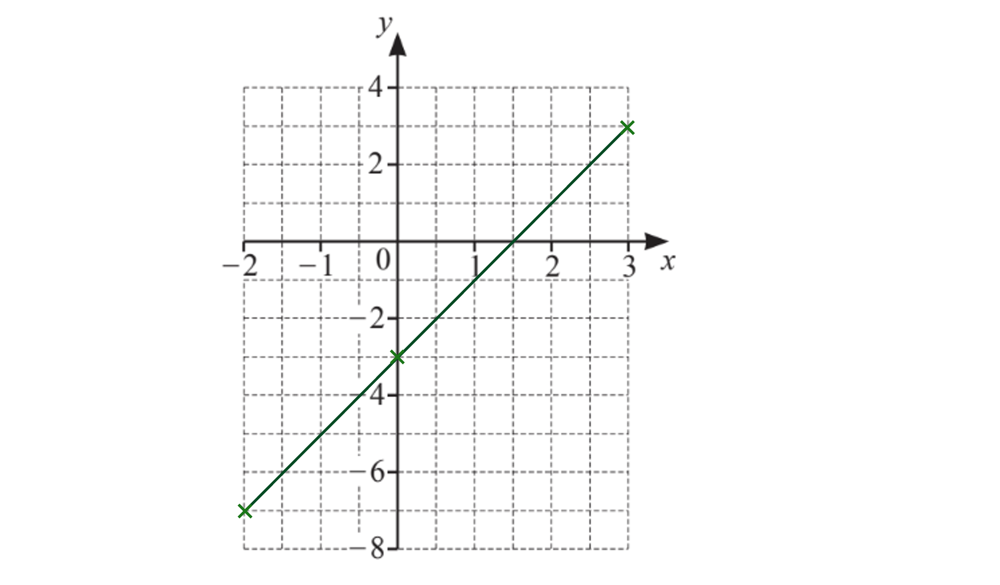

** ****[1]**

### Q16
> *For a line in the format *$y=mx+c$*, *$m$* is the gradient*

**The gradient is ****4**** ****[1]**
> *For a line in the format *$y=mx+c$*, *$c$* is the *$y$*-intercept*

**The **$y$**-intercept is ****-6**** ****[1]**

### Q17
> *The horizontal *$x-$*coordinate of *$P$* is *

$-3$

> *The vertical *$y-$*coordinate of *$P$* is*

$-1$

$(-3,-1)$ **[1]**
> *The gradient is calculated by finding the *$\frac{\mathrm{rise}}{\mathrm{run}}$* where the rise is the change in the vertical direction and the run is the change in the horizontal direction.*

$\frac{2--1}{2-0}$

**[1]**

$=\frac{2+1}{2}$

$=\frac{3}{2}$

$1.5$* ***[1]**
> *The equation of a straight line is given as *$y=mx+c$* where *$m$* is the gradient of the line and *$c$* is the *$y-$*intercept.*

> *As the gradient is *$m=1.5$

$y=1.5x+c$

**[1]**

> *The *$y-$*intercept is the *$y-$*coordinate of the point where the straight line crosses the *$y-$*axis.*

> *This point is*

$( 0 , - 1 )$

> *The value of *$c$* is*

$c=-1$

> *Write the equation of the straight line*

$y=1.5x-1$ **[1]**

### Q18
> *Work out the gradient of the line, *$m$*, by identifying two points the line passes through and dividing the rise by the run. *

> *Be careful with the scale, because the **y**-axis goes up by 2 for every square, but the **x**-axis only goes up by 1. *

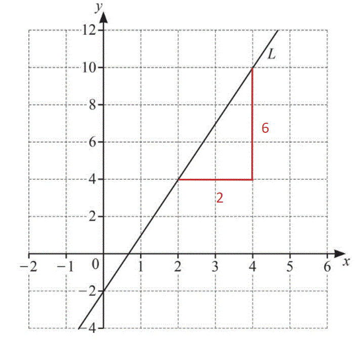

> * *

$\begin{gathered} \text{rise} & = 6 \\ \text{run} & = 2 \end{gathered}$

$\frac{\mathrm{rise}}{\mathrm{run}}=\frac{6}{2}=3$

**[1]**

**3**** ****[1]**
> *The gradient of the line is 3, *$m=3$*. The line crosses the *$y$* axis at -2, so *$c=-2$*.*

> *Substitute these values into the equation of a line, *$y=mx+c$*.*

$y=3x-2$* ***[1]**

### Q19
> *To work out the gradient, calculate the *$\frac{\mathrm{rise}}{\mathrm{run}}$*. *
*Find two points that the line passes through and draw a right-angled triangle.*

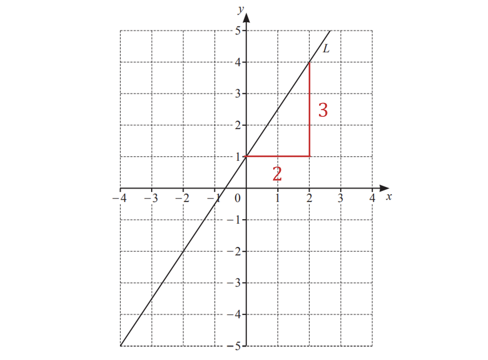

**[1]**

> *The rise is 3 and the run is 2, therefore*

$\frac{\mathrm{rise}}{\mathrm{run}}=\frac{3}{2}=1.5$

**1.5 ****[1]**
> *The gradient of the line is 1.5. The **y**-intercept is 1, so the equation of the line is*

$y=1.5x+1$ **[1]**

### Q20
> *Sketching a diagram can help. You can form a right angled triangle between points **A** and **B**.*

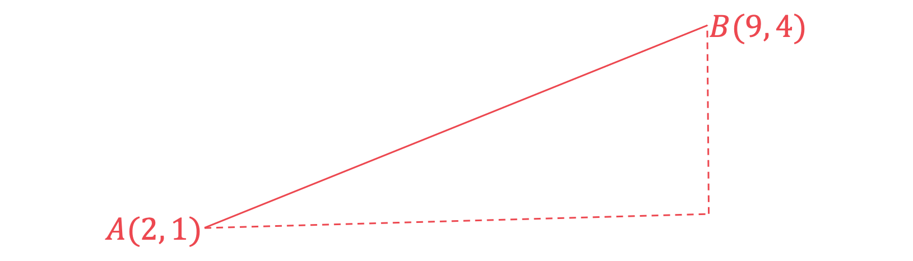

> *Work out the horizontal and vertical distances between the two points and substitute them into Pythagoras' theorem, *$a^{2}+b^{2}=c^{2}$*, to find the length **AB**.*

$( 9 - 2 )^{2} + ( 4 - 1 )^{2} = A B^{2}$

**[1]**

> *Simplify the left hand side.*

$7^{2}+3^{2}=AB^{2}$

> *Simplify the left hand side further.*

$58=AB^{2}$

> *Take the square root of both sides.*

$7.61577...=AB$

**[1]**

$7.62$** ****[1]**
**Answers between 7.615 and 7.616 will be accepted.**

### Q21
*Sketch the two points, and draw a right-angled triangle between them*

*Find the difference in their x-coordinates and y-coordinates to find the length and height of the triangle*

> *We can then use Pythagoras to find the distance between the two points*

**[1]**

> *Using Pythagoras to find longest side*

$\sqrt{12^{2}+4^{2}}=12.64911064...$

**[1]**

$12.6$ **[1]** 
**Round to 3 significant figures**
*The midpoint of two coordinates can be thought of as the average (mean) of the two points*

> *We can find the mean of the x-coordinates using *$\frac{x_{1}+x_{2}}{2}$* and find the mean of the y-coordinates using *$\frac{y_{1}+y_{2}}{2}$

*Midpoint =* $( \frac{8 + - 4}{2} , \frac{5 + 1}{2} )$

**Final answer:** **Midpoint = **$(2,3)$** **

> *Mark for each of 2 and 3** [2]*

### Q22
> *Method 1*

> *Use the formula distance = *$\sqrt{( x_{1} - x_{2} )^{2} + ( y_{1} - y_{2} )}$*. This formula is not on the formula sheet, but it's worth knowing- and is really just an application of Pythagoras' Theorem (see Method 2 below)*

*distance = *$\sqrt{( 7 - ( - 5 ) )^{2} + ( 2 - 8 )^{2}}$

*for correct numbers inside the square root sign** ***[1]** 
*for square root of** ***[1]**

$= \sqrt{12^{2} + ( - 6 )^{2}} 
= \sqrt{144 + 36} 
= \sqrt{180} 
= 13.4164079...$

> *Round to at least 3 significant figures*

**13.4 ****or**** 13.41 to 13.42** [**1]**

> *Method 2*

> *Sketch a diagram of the points and work out the horizontal and vertical distances between them, as below*

> *As the lines in the diagram form a right-angle triangle, we can use Pythagoras' Theorem to calculate the distance between the points*

*distance = *$\sqrt{12^{2}+6^{2}}$

*for correct numbers inside the square root sign** ***[1]**
* **for square root of*** [1]**

$=\sqrt{144+36}\,=\sqrt{180}\,=13.4164079...$

> *Round to at least 3 significant figures*

**13.4 ****or**** 13.41 to 13.42** [**1]**

### Q23
*The length of a line between the points *$( x_{1} , y_{1} )$* and *$( x_{2} , y_{2} )$* is *$\sqrt{( x_{2} - x_{1} )^{2} + ( y_{2} - y_{1} )^{2}}$ 
*A** has coordinates (5,6) and **C** has coordinates (8,14)* 
*Substitute these numbers into the formula* * *

$A C = \sqrt{( 8 - 5 )^{2} + ( 14 - 6 )^{2}}$

*(8-5) and (14-6) seen*** [1]**
* *$(8-5)^{2}+(14-6)^{2}$* seen*** ****[1]**

> *Use a calculator to find this value and give your answer to 3 significant figures*

**8.54**** [1]**
*The mid-point of the points *$( x_{1} , y_{1} )$* and *$( x_{2} , y_{2} )$* has coordinates *$( \frac{ x_{1} + x_{2} }{2} , \frac{ y_{1} + y_{2} }{2} )$

*B** has coordinates (0,-2) and **C** has coordinates (8,14)* *Substitute these numbers into the formula*

$( \frac{0 + 8}{2} , \frac{- 2 + 14}{2} )$

*One coordinate correct*** ****[1]** 
**The mid-point of ****BC**** is (4,6)** **[1]**

### Q24
> *The formula for the length between the points (**x**1**, **y**1**) and (**x**2**, **y**2**) is *$\sqrt{( x_{2} - x_{1} )^{2} + ( y_{2} - y_{1} )^{2}}$*. Use this formula with the points (-3, 8) and (9, -2). Use brackets around negatives.*

$\sqrt{( 9 - ( - 3 ) )^{2} + ( ( - 2 ) - 8 )^{2}}$

* One correct bracket*** [1]*** *
*Correct expression*** [1]**

> *You could simplify before typing it into your calculator or just type it straight in.*

$\begin{array}{rcl} \sqrt{( 12 )^{2} + ( - 10 )^{2}} \\ = \sqrt{144 + 100} \\ = \sqrt{244} \\ = 2 \sqrt{61} \\ = 15.6204... \end{array}$

> *Round to 3 significant figures.*

**15.6**** ****[1]**

### Q25
> *The midpoint of two points, *$( x_{1} , y_{1} )$* and *$( x_{2} , y_{2} )$*, is the mean of the **x**-coordinates and the mean of the **y**-coordinates. This can be found using the formula *$( \frac{x_{1} + x_{2} }{2} , \frac{y_{1} + y_{2} }{2} ).$* Use brackets around negative numbers.*

$( \frac{2 + 7}{2} , \frac{3 + ( - 5 )}{2} )$

> * Simplify the fractions.*

**(4.5, -1)** 
*1** **mark for each correct number in the co-ordinate*** [2]**

### Q26
> *Use the distance between two points, *$( x_{1} , y_{1} )$* and *$( x_{2} , y_{2} )$* formula, *$" d = \sqrt{( x_{2} - x_{1} )^{2} + ( y_{2} - y_{1} )^{2}} "$*.*

$A B = \sqrt{( 6 - - 3 )^{2} + ( - 2 - 4 )^{2}}$

*Correct subtraction of coordinates ***[1]**** **
*Square root ***[1]**

$AB=\sqrt{81+36}=3\sqrt{13}=10.816653...$

**10.8 units*** ***[1]**

### Q27
> *Using the distance of a line formula, *$" d = \sqrt{( x_{2} - x_{1} )^{2} + ( y_{2} - y_{1} )^{2}} "$*to find the length **AC**.*

$A C = \sqrt{( 4 - - 3 )^{2} + ( - 4 - 10 )^{2}}$

*Part under the square root*** ****[1] **
*Including the square root*** [1]**

$A C = \sqrt{( 7 )^{2} + ( - 14 )^{2}} 
A C = \sqrt{245} 
A C = 15.652 475 ...$

**The length ****AC**** is 15.7 units**** [1]**

### Q28
> *The midpoint of two coordinates can be thought of as the average (mean) of the two points.*

*We can find the mean of the x-coordinates using *$\frac{x_{1}+x_{2}}{2}$* and find the mean of the y-coordinates using *$\frac{y_{1}+y_{2}}{2}$*.*

*Midpoint =* $( \frac{5 + 13}{2} , \frac{- 4 + 1}{2} )$

**[1]**

**Midpoint = **$(9,-1.5)$** ****[1]**

### Q29
> *Use the midpoint formula, *$( \frac{x_{1} + x_{2} }{2} , \frac{y_{1} + y_{2} }{2} )$

$M = ( \frac{2 + 6}{2} , \frac{3 + 8}{2} )$

**[1]**

> *Simplify by hand, or work out the **x** and then the **y** coordinate using your calculator*

$= ( \frac{8}{2} , \frac{11}{2} )$

$M=(4,5.5)$**[1]**
**You're not asked to plot the midpoint- but check against the diagram that your answer looks right**
