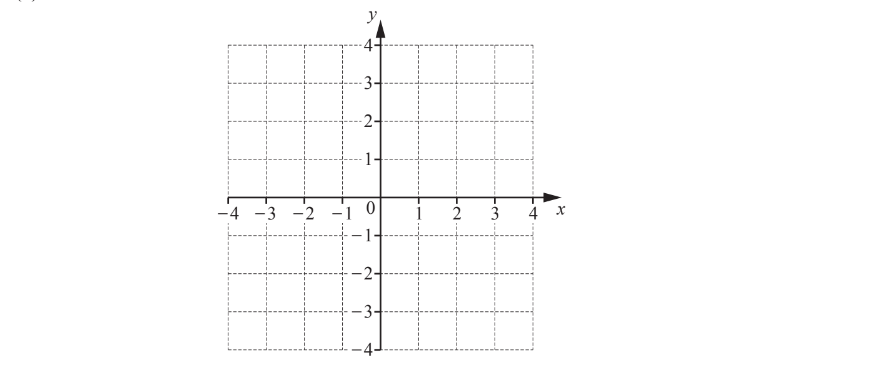
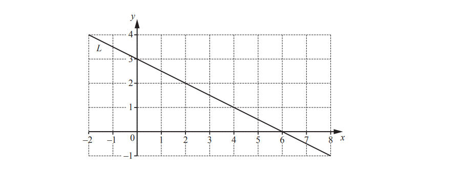
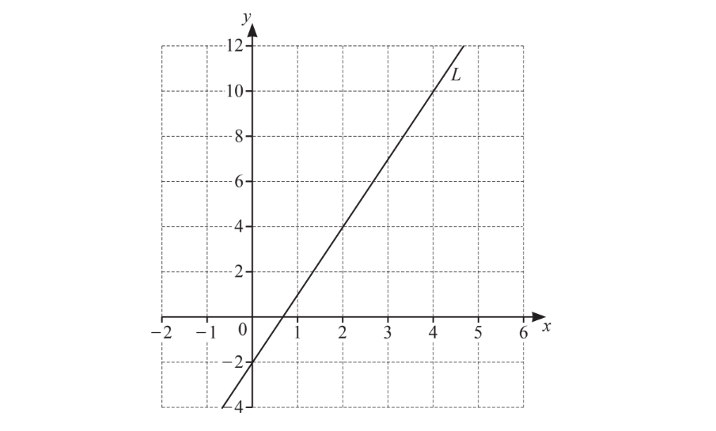
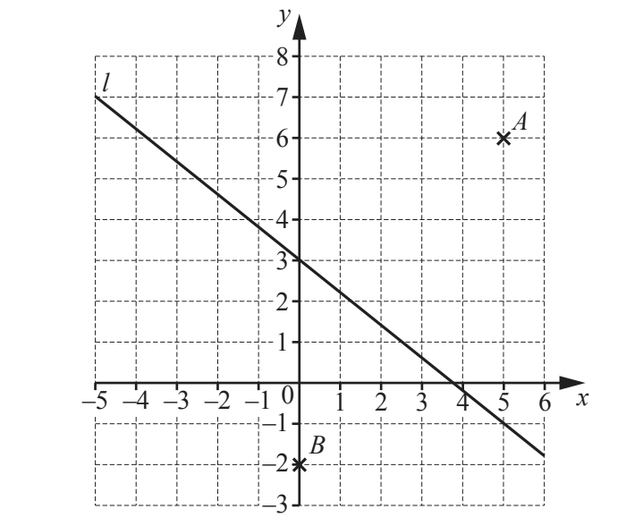
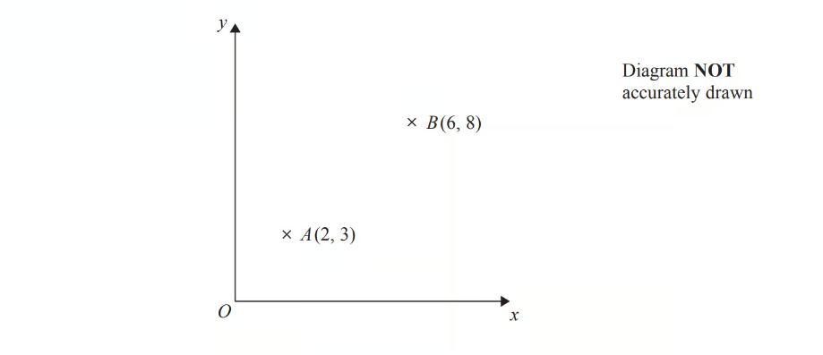

# Exam Questions — Coordinates & Straight Line Graphs
**Coordinate Geometry & Graphs** · Cambridge (CIE) IGCSE maths (0607)
> Source: [https://www.savemyexams.com/igcse/maths/cie/international-maths/23/core/topic-questions/](https://www.savemyexams.com/igcse/maths/cie/international-maths/23/core/topic-questions/) · 29 questions across 1 sets

## Exam Questions (29 questions)

### Q1 — medium — 2 marks

**Q1** [2 marks]

$A$ is the point $(2,7)$ and $B$ is the point $(--4,11)$.

Find the coordinates of the midpoint of the line $AB$.

(.................... , ....................)

*Source: 2025 Specimen 4 Q5*

### Q2 — hard — 8 marks

**Q2** [3 marks]

The line $L$ is shown on the grid.

Find the equation of the line $L$ in the form $y=mx+c.$

y = ...................................................

*Source: Nov 2019 0580/31 Q6A*

**Q2** [2 marks]

The equation of a different line is $y=3x-4$.

i) Write down the gradient of this line.

[1]

ii) Write down the co-ordinates of the point where this line crosses the $y$˗axis.

[1]

*Source: Nov 2019 0580/31 Q6B*

**Q2** [3 marks]

On the grid, draw the graph of $y=-2x+1$ for `negative 4 less-than or slanted equal to x less-than or slanted equal to 5`.

*Source: Nov 2019 0580/31 Q6C*

### Q3 — hard — 5 marks

**Q3** [5 marks]

$A,B,C$ and $D$ are four equations of straight line graphs.

i) Write down the letter of the graph that

a) passes through the point $( 1 , - 1 )$,

[1]

b) has a $y$- intercept of 4,

[1]

c) has a gradient of -4.

[1]

ii) The point $( p , - 26 )$ lies on the line $y=-3x+4$.

Work out the value of $p$.

$p$ = ................................ [2]

*Source: March 2018 0580/32 Q11A*

### Q4 — hard — 4 marks

**Q4** [2 marks]

i) Write down the co-ordinates of the point where the line $y=6x-3$ crosses the $y$-axis.

[1]

ii) Write down the equation of the straight line that

- passes through the origin

and

- is parallel to $y=6x-3$.

[1]

*Source: June 2019 0580/32 Q8A*

**Q4** [2 marks]

i) On the grid, draw the line through the point $( - 3 , - 2 )$ that is perpendicular to the $y$-axis.

[1]

ii) On the grid, draw the line $y=-2x$ .

[1]

*Source: June 2019 0580/32 Q8B*

### Q5 — hard — 7 marks

**Q5** [3 marks]

Line $L$ is drawn on the grid.

Find the equation of line $L.$ 
Give your answer in the form $y=mx+c.$

$y=$ .............................

*Source: March 2019 0580/32 Q8A*

**Q5** [4 marks]

The points (9, $a$) and ($b$, 3) lie on the line $y=\frac{2}{3}x-7.$

Work out the value of

i) $a$,

$a=$.......................... [2]

ii) $b.$

$b=$.......................... [2]

*Source: March 2019 0580/32 Q8B*

### Q6 — hard — 3 marks

**Q6** [2 marks]

Find the equation of line $L$ in the form $y=mx+c$

$y$ = ..................................................

*Source: June 2020 0580/11 Q22*

**Q6** [1 mark]

**Extract:**

Find the equation of line L in the form y = mx + c
y = ..................................................

On the grid, draw a line that is perpendicular to line $L$.

*Source: June 2020 0580/11 Q22B*

### Q7 — hard — 3 marks

**Q7** [1 mark]

A straight line, $l$, has equation $y=5x+12$

Write down the gradient of line $l$.

*Source: Nov 2020 0580/13 Q11A*

**Q7** [2 marks]

**Extract:**

A straight line, l, has equation y equals 5 x plus 12

Find the coordinates of the point where line $l$ crosses the $x$-axis.

*Source: Nov 2020 0580/13 Q11B*

### Q8 — hard — 1 marks

**Q8** [1 mark]

Write down the equation of the line parallel to $y=5x+6$ that passes through (0, -7).

$y=$..................................

*Source: Nov 2020 0580/12 Q16B*

### Q9 — medium — 1 marks

**Q9** [1 mark]

i) Write down the coordinates of point $A$.

[1]

ii) On the grid, plot the point (2, -3).

[1]

iii) The line $L$ is shown on the grid.

Find the equation of the line L in the form $y=mx+c$.

$y=$...............................[2]

*Source: Nov 2020 0580/12 Q16A*

### Q10 — medium — 2 marks

**Q10** [2 marks]

A line, $M$, has the equation $y=8x+3$.

Write down the equation of the line parallel to line $M$ that passes through the point (0, 6).

*Source: May/June 2018 0580/13 Q20B*

### Q11 — medium — 2 marks

**Q11** [2 marks]

Find the equation of line $L$in the form $y=mx+c$.

$y=$..........................

*Source: Nov 2020 0580/11 Q20*

### Q12 — medium — 1 marks

**Q12** [1 mark]

Find the co-ordinates of the point where the line $y=3x-8$ crosses the $y$-axis.

*Source: May/June 2019 0580/13 Q4*

### Q13 — medium — 3 marks

**Q13** [3 marks]

Line $L$ is drawn on the grid.

Find the equation of line $L.$ 
Give your answer in the form $y=mx+c.$

$y=$ .............................

*Source: March 2019 0580/32 Q8A*

### Q14 — medium — 3 marks

**Q14** [3 marks]

Line $L$ is drawn on the grid.

Find the equation of line $L.$ 
Give your answer in the form $y=mx+c.$

$y=$ .............................

*Source: March 2019 0580/32 Q8A*

### Q15 — easy — 4 marks

**Q15** [1 mark]

Write down the gradient of the line $y=2x-3$.

*Source: March 2020 0580/12 Q9A*

**Q15** [2 marks]

Complete the table of values for  $y=2x-3$

| $x$ | -2 | 0 | 3 |
|---|---|---|---|
| $y$ |   |   |   |

*Source: March 2020 0580/12 Q9B*

**Q15** [1 mark]

**Extract:**

Complete the table of values for  y = 2x - 3

| x | -2 | 0 | 3 |
| y |   |   |   |

On the grid, draw the graph of  $y=2x-3$  for  `negative 2 less-than or slanted equal to x less-than or slanted equal to 3.`

*Source: March 2020 0580/12 Q9C*

### Q16 — easy — 2 marks

**Q16** [1 mark]

For the line $y=4x-6$, write down the gradient,

*Source: Oct/Nov 2018 0580/13 Q16A*

**Q16** [1 mark]

**Extract:**

y = 4x - 6

the $y$-intercept.

*Source: Oct/Nov 2018 0580/13 Q16B*

### Q17 — easy — 5 marks

**Q17** [1 mark]

The diagram shows a point $P$ and a line $L$.

Write down the co-ordinates of point $P$.

*Source: June 2019 0580/11 Q22A*

**Q17** [2 marks]

**Extract:**

The diagram shows a point P and a line L.

Find the gradient of line $L$.

*Source: June 2019 0580/11 Q22B*

**Q17** [2 marks]

**Extract:**

Find the gradient of line ![L].

Write down the equation of line $L$ in the form $y=mx+c$.

$y$ = ......................................

*Source: June 2019 0580/11 Q22C*

### Q18 — easy — 3 marks

**Q18** [2 marks]

Find the gradient of line$L$.

*Source: June 2020 0580/12 Q23A*

**Q18** [1 mark]

Write down the equation of line $L$ in the form $y=mx+c$.

$y=$..........................

*Source: June 2020 0580/12 Q23B*

### Q19 — easy — 3 marks

**Q19** [2 marks]

The line $L$ is shown on the grid.

Find the gradient of the line $L$.

*Source: Nov 2019 0580/12 Q20A*

**Q19** [1 mark]

**Extract:**

The line L is shown on the grid.
Find the gradient of the line L.

Find the equation of the line $L$ in the form $y=mx+c$.

*Source: Nov 2019 0580/12 Q20B*

### Q20 — easy — 3 marks

**Q20** [3 marks]

*A* is the point (2, 1) and *B* is the point (9, 4).

Find the length of *AB*.

*Source: 2019	Oct/Nov 0580/23 Q12-*

### Q21 — medium — 5 marks

**Q21** [3 marks]

$A$ is the point $(8,5)$ and $B$ is the point $(-4,1)$.

Calculate the length of $AB.$

*Source: 2019	May/June 0580/42 Q4C*

**Q21** [2 marks]

**Extract:**

A is the point (8, 5) and B is the point (-4, 1).

Find the co-ordinates of the midpoint of $AB.$

( ..................... , ..................... )

*Source: 2019	May/June 0580/42 Q4C*

### Q22 — medium — 3 marks

**Q22** [3 marks]

*A* is the point (7, 2) and *B* is the point (−5, 8).

Calculate the length of *AB.*

*Source: Specimen 2025 0580/04 Q16A*

### Q23 — easy — 5 marks

**Q23** [3 marks]

*C* is the point (8, 14).

Calculate the length of *AC*.

*Source: 2018	Oct/Nov 0580/41 Q8D*

**Q23** [2 marks]

**Extract:**

C is the point (8, 14).

Find the co-ordinates of the mid-point of *BC*.

( ..................... , ......................)

*Source: 2018	Oct/Nov 0580/41 Q8D*

### Q24 — medium — 3 marks

**Q24** [3 marks]

The coordinates of *P* are $(-3,8)$ and the coordinates of *Q* are $(9,-2)$.

Calculate the length *PQ*.

*Source: 2020 May/June 0580/43 Q9B*

### Q25 — hard — 2 marks

**Q25** [2 marks]

*A* is the point $(2,3)$ and *B* is the point $(7,-5)$.

Find the co-ordinates of the midpoint of *AB*.

( ........................, ........................)

*Source: 2019 March 0580/22 Q23A*

### Q26 — medium — 3 marks

**Q26** [3 marks]

Calculate the length of *AB*.

*Source: 2018	Feb/Mar 0580/42 Q10A*

### Q27 — hard — 3 marks

**Q27** [3 marks]

A rhombus $ABCD$ has a diagonal $AC$ where $A$ is the point $(-3,10)$ and C is the point $(4,-4).$

Calculate the length $AC.$

*Source: 2020	May/June 0580/41 Q10A*

### Q28 — medium — 2 marks

**Q28** [2 marks]

The point* *$A$ has coordinates (5, −4) 
The point $B$ has coordinates (13, 1)

Work out the coordinates of the midpoint of $AB$.

*Source: Jan 2020 4MA1/1H Q1A*

### Q29 — easy — 2 marks

**Q29** [2 marks]

The point $A$ has coordinates (2, 3).
The point $B$ has coordinates (6, 8).

$M$ is the midpoint of the line $AB$.
Find the coordinates of $M$.

*Source: 2014	June 1MA0/2H Q1*

