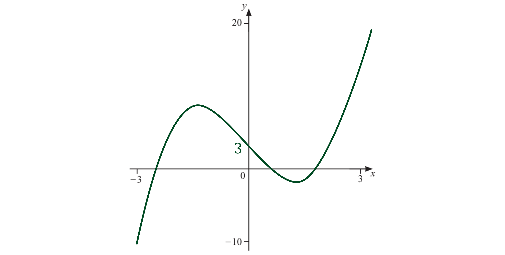
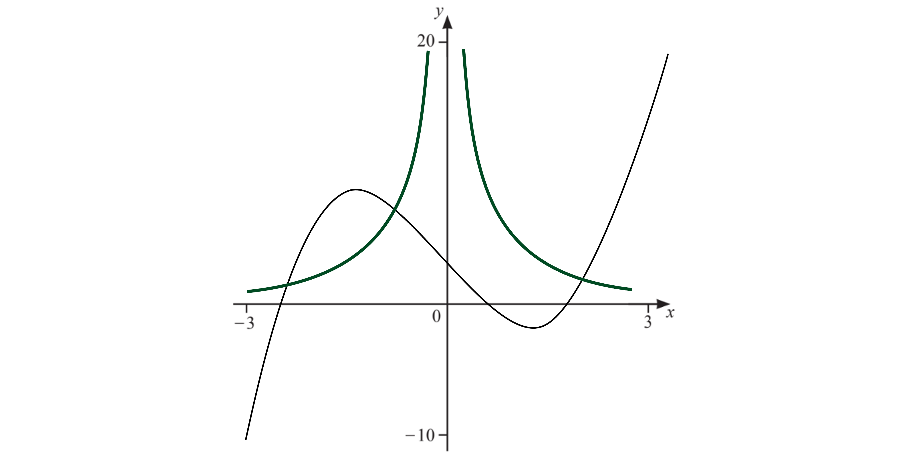

# Mark Schemes — Using Calculators for Graphs & Equations
**Coordinate Geometry & Graphs** · Cambridge (CIE) IGCSE maths (0607)

## Exam Questions (12 questions)

### Q1
> *Open graph mode on your calculator and enter *$f(x)=x^{3}-5x+3$* *
*Changing the axis to *$-3\leqx\leq3$* and *$-10\leqy\leq20$* will help*

> *Copy the graph onto the diagram  carefully*

**Cubic shape [1]**
**Correct position [1]**
> *On the same graph on your calculator enter *$f_{2}(x)=\frac{2}{x^{2}}$* *

> *Copy the graph onto the diagram  carefully*

**1 mark for each correct branch [2]**
> *There are 3 points of intersection*

> *Choose the option to analyse the graph and select "intersection"*

> *Read off the *$x$*-coordinate of each point of intersection*

> *Round your answers to 3 significant figures*

$x=-2.47$** [1]**
$x=-0.590$** [1]**
$x=1.93$** [1]**
**Unrounded answers accepted**

### Q2
> *Start a new graph on your graphic display calculator and enter *`straight f open parentheses x close parentheses equals 0.1 x cubed plus 0.25 x squared minus 2 x minus 1`* to generate the graph*

> *Changing the values of the **x-**axis to a value less than -7 and greater than 5, and the values of the **y-**axis to be from -10 to 8 will help  *

> *Select the option to analyse the graph (this may be labelled as G-Solv) and check the **x-** and **y**-intercepts*

> *On your calculator navigate to the *$y$*-intersection of the graph, where *$P$* is*

$P=-1$

> *This is  the *$y$*-coordinate, the *$x$*-coordinate will be zero*

`P equals open parentheses 0 comma space minus 1 close parentheses`**[1]**

> *On your calculator navigate to the *$x$*-intersections of the graph, looking for the point where *$Q$* is*

$Q=3.6776...$

> *This are the *$x$*-coordinate, the *$y$*-coordinates will be zero*

> *Round your answer to 3 significant figures*

`Q equals open parentheses 3.68 comma space 0 close parentheses`**[1]**
**Unrounded answer accepted**
> *Select the option to analyse the graph and *

(i) *select maximum point*

> *A local maximum is the turning point where the gradient of the graph changes from positive to negative*

> *Check that your answer looks correct, the maximum point is the highest point on the upside down U shape part of the graph*

$(-3.55,4.78)$** ****[2]**
**1 mark for each correct coordinate**
**Unrounded answers accepted**

(ii) *select minimum point*

> *A local minimum is the turning point where the gradient of the graph changes from negative to positive*

> *Check that your answer looks correct, the minimum point is the lowest point on the U shape part of the graph*

$(1.88,-3.21)$** ****[2]**
**1 mark for each correct coordinate**
**Unrounded answers accepted**
> *The value of *$a$* must be at a point on the graph where a horizontal line would intersect with the graph exactly 3 times*

> *This can only happen in between the maximum and minimum points on the graph*

> *The values for the range of  *$a$* will be the *$y$* coordinates of the maximum and minimum points*

$-3.21<a<4.78$** [2]**
**1 mark each correct**
**Follow through from (b)**

### Q3
> *Input each of the values of *$x$* in the mapping diagram into the given function, *`straight f open parentheses x close parentheses equals fraction numerator 3 open parentheses x plus 4 close parentheses over denominator 2 end fraction`* separately*

> *For *$x=0$*:*

`straight f open parentheses 0 close parentheses equals fraction numerator 3 cross times open parentheses 0 plus 4 close parentheses over denominator 2 end fraction equals 12 over 2 equals 6`

> *For *$x=1$*:*

`straight f open parentheses 1 close parentheses equals fraction numerator 3 cross times open parentheses 1 plus 4 close parentheses over denominator 2 end fraction equals 15 over 2 equals 7.5`

> *For *$x=2$*:*

`straight f open parentheses 2 close parentheses equals fraction numerator 3 cross times open parentheses 2 plus 4 close parentheses over denominator 2 end fraction equals 18 over 2 equals 9`

**2 correct [1]**
**All correct [1]**

### Q4
> *The 'zeros' means the points at which the graph crosses the *$x$*-axis*

> *Open graph mode on your calculator and enter *$f(x)=-2x^{2}+5x+6$* *
*Changing the axis to *$-2\leqx\leq4$* and *$-12\leqy\leq10$* will help*

> *On your calculator navigate to the *$x$*-intersections of the graph, where the *$y$*-coordinates are 0*

> *Round your answers to 3 significant figures*

**-0.886** **[1]**
**3.39** **[1]**
**Unrounded answers accepted**
> *Select the option to analyse the graph and select maximum point*

> *A local maximum is the turning point where the gradient of the graph changes from positive to negative*

> *Check that your answer looks correct, the maximum point is the highest point on the upside down U shape part of the graph*

$(1.25,9.13)$** ****[2]**
**1 mark for each correct coordinate**
> *The equation of the line of symmetry is the vertical line through the maximum point*

> *Use the *$x$*- coordinate from your answer to part (b)*

$x=1.25$** [1]**
**Follow through mark from (b) given**

### Q5
> *Look at the given numbers to find the relationship between the first column of numbers and the second*

$6\div3=2$*   or   *$6-4=2$

> *Looking at the rest of the numbers shows that the correct function is *$\div3$

$15\div3=5\,27\div3=9\,42\div3=14$

> *Apply this function, *$\div3$*, to the final number*

$60\div3=12$

**[1]**

### Q6
> *Input each of the values of *$x$* in the mapping diagram into the given function, *`straight f open parentheses x close parentheses equals 3 x minus 5`* separately*

> *For *$x=0$*:*

`straight f open parentheses 0 close parentheses equals 3 cross times 0 minus 5 equals negative 5`

> *For *$x=1$*:*

`straight f open parentheses 1 close parentheses equals 3 cross times 1 minus 5 equals negative 2`

> *For *$x=2$*:*

`straight f open parentheses 2 close parentheses equals 3 cross times 2 minus 5 equals 1`

> *For *$x=3$*:*

`straight f open parentheses 3 close parentheses equals 3 cross times 3 minus 5 equals 4`

**2 or 3 correct [1]**
**All correct [1]**

### Q7
> *Start a new graph on your calculator and enter *`straight f subscript 1 open parentheses x close parentheses equals x cubed minus 4 x`* and *`straight f subscript 2 open parentheses x close parentheses equals x squared minus 4`* to generate the two graphs on the same axes*

> *It helps to change the axis to *$-2.5\leqx\leq2.5$* and *$-6\leqy\leq6$

**Correct cubic sketch [1]**

**Correct quadratic sketch [1]**

> *The solutions to the equation in the question are the *$x$*-coordinates of the points of intersection between the two curves*

> *Choose the option to analyse the graph and select "intersection" to find these *$x$*-coordinates *

**Final answer:** **The three solutions are **$x=-2$**, **$x=1$** and **$x=2$

**At least one solution correct [1]**

**All three solutions correct [1]**

### Q8
> *Start a new graph on your calculator and enter *`straight f open parentheses x close parentheses equals x cubed`* to generate the graph*

> *It helps to change the axis to *$-2\leqx\leq2$* and *$-8\leqy\leq8$

**Correct cubic shape [1]**

**Going through origin [1]**
> *On the same axes on your calculator, sketch the graph of *`straight f subscript 2 open parentheses x close parentheses equals 2 minus x`

> *This is a straight line graph with a *$y$*-intercept of 2 and a gradient of -1*

**[1]**
> *Choose the option to analyse the graph and select "intersection"*

> *Give your answer as a set of coordinates*

`open parentheses 1 comma space 1 close parentheses`

**correct **$x$** coordinate [1]**

**correct **$y$** coordinate [1]**
> *The solution to the equation is the *$x$*-coordinate of the point of intersection between the graphs *$y=x^{3}$* and *$y=2-x$* in part (c)*

$x=1$** [1]**

### Q9
> *Start a new graph on your calculator and enter *`straight f open parentheses x close parentheses equals x cubed minus 12 x`* to generate the graph*

> *It helps to change the axis to *$-4\leqx\leq4$* and *$-20\leqy\leq20$

**Correct cubic shape [1]**

**Going through origin [1]**
> *On your calculator, navigate to the *$x$*-intersections of the graph (where the *$y$*-coordinates are 0)*

> *Write these as coordinates and round to 2 decimal places*

**Final answer:** `open parentheses negative 3.46 comma space 0 close parentheses`**, **`open parentheses 0 comma space 0 close parentheses`** and **`open parentheses 3.46 comma space 0 close parentheses`

**3.46(41...) seen [1]**

**All three coordinates correct [1]**
> *Select the option to analyse the graph and select maximum point to find its coordinates*

> *A local maximum is the turning point where the gradient of the graph changes from positive on the left to negative on the right*

> *From the sketch, the maximum point should have a negative *$x$* coordinate*

`open parentheses negative 2 comma space 16 close parentheses`

**correct **$x$** coordinate [1]**

**correct **$y$** coordinate [1]**
> *Select the option to analyse the graph and select minimum point to find its coordinates*

> *A local minimum is the turning point where the gradient of the graph changes from negative on the left to positive on the right*

> *From the sketch, the minimum point should have a positive *$x$* coordinate*

`open parentheses 2 comma space minus 16 close parentheses`

**correct **$x$** coordinate [1]**

**correct **$y$** coordinate [1]**

### Q10
> *Start a new graph on your calculator and enter *`straight f open parentheses x close parentheses equals 2 minus open parentheses x minus 1 close parentheses squared`* to generate the graph*

> *It helps to change the axis to *$-1\leqx\leq3$* and *$-2\leqy\leq2$

**Correct symmetric negative quadratic shape [1]**

**Maximum to the right of the **$y$**-axis [1]**

### Q11
> *Start a new graph on your calculator and enter *`straight f open parentheses x close parentheses equals 0.25 x to the power of 4`* to generate the graph*

> *Select the option to analyse the graph (this may be labelled as G-Solv) and check for any *$x$*-** and *$y$*-intercepts*

> *It helps to change the axis to *$-2\leqx\leq2$* and *$-1\leqy\leq4$

**Correct symmetric shape [1]**

**Correct minimum point at the origin [1]**

### Q12
> *Start a new graph on your calculator and enter *`straight f open parentheses x close parentheses equals x cubed minus 4 x`* to generate the graph*

> *Select the option to analyse the graph (this may be labelled as G-Solv) and check for any *$x$*-** and *$y$*-intercepts*

> *It helps to change the axis to *$-2\leqx\leq2$* and *$-4\leqy\leq4$

**Correct cubic shape [1]**

**Correct intercepts with axes [1] **
