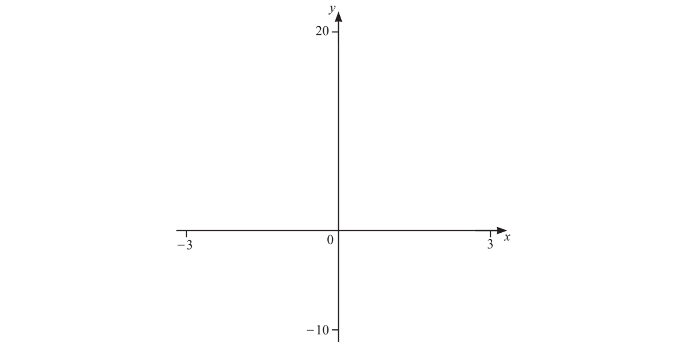
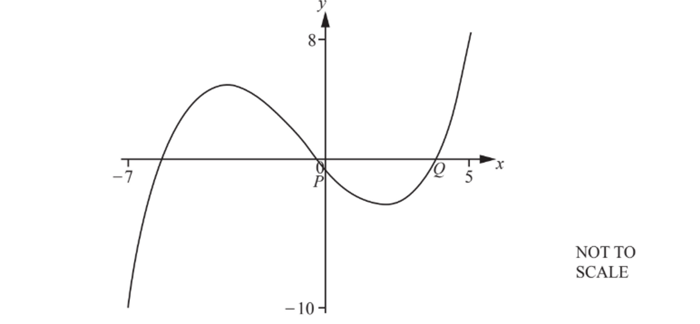
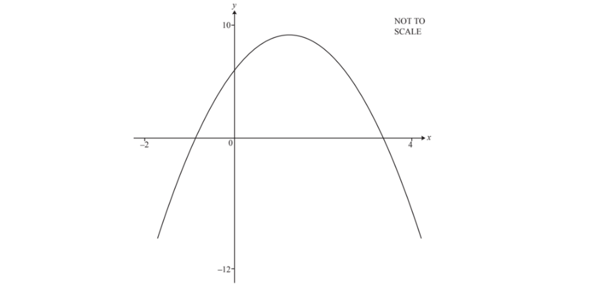

# Exam Questions — Using Calculators for Graphs & Equations
**Coordinate Geometry & Graphs** · Cambridge (CIE) IGCSE maths (0607)
> Source: [https://www.savemyexams.com/igcse/maths/cie/international-maths/23/core/topic-questions/](https://www.savemyexams.com/igcse/maths/cie/international-maths/23/core/topic-questions/) · 12 questions across 1 sets

## Exam Questions (12 questions)

### Q1 — hard — 7 marks

**Q1** [2 marks]

On the diagram, sketch the graph of $y=x^{3}-5x+3$  for  $-3\leqx\leq3.$

**Q1** [2 marks]

On the diagram, sketch the graph of  $y=\frac{2}{x^{2}}$ for values of   $x$ from $-3$ to $3.$

**Q1** [3 marks]

Find the $x$-coordinate of each point of intersection of $y=x^{3}-5x+3$ and  $y=\frac{2}{x^{2}}.$

### Q2 — hard — 6 marks

**Q2** [2 marks]

The diagram shows a sketch of the graph of $y=0.1x^{3}+0.25x^{2}-2x-1$  for  $-7\leqx\leq5.$

Two points, $P$ and $Q,$ are also marked.

Draw the graph of $y=0.1x^{3}+0.25x^{2}-2x-1$ on your calculator and use it to answer the following questions.

Find the coordinates of point $P$ and point$Q$.

$P=$ ( ...................... , ......................)

$Q=$ ( ...................... , ......................)

*Source: Nov 23 0607/23 Q13A*

**Q2** [2 marks]

**Extract:**

The diagram shows a sketch of the graph of y = 0.1 x^3 + 0.25 x^2 - 2 x - 1 for -7 ≤ x ≤ 5.
Draw the graph of y = 0.1 x^3 + 0.25 x^2 - 2 x - 1 on your calculator and use it to answer the following questions.

Find the coordinates of

(i) the local maximum point

( ...................... , ......................) [2]

(ii) the local minimum point.

( ...................... , ......................) [2]

*Source: Nov 23 0607/31 Q13B*

**Q2** [2 marks]

**Extract:**

y equals 0.1 x cubed plus 0.25 x squared minus 2 x minus 1

The line  $y=a$  intercepts the graph of $y=0.1x^{3}+0.25x^{2}-2x-1$ at 3 points.

Complete the range of values for $a$.

.................. $<a<$..................

*Source: NOv 23 0607/31 Q13C*

### Q3 — medium — 2 marks

**Q3** [2 marks]

Complete the mapping diagram for  `straight f open parentheses x close parentheses equals fraction numerator 3 open parentheses x plus 4 close parentheses over denominator 2 end fraction`.

### Q4 — medium — 5 marks

**Q4** [2 marks]

The diagram shows the graph of `y equals straight f open parentheses x close parentheses` where `straight f open parentheses x close parentheses equals negative 2 x squared plus 5 x plus 6`  for  $-2\leqx\leq4.$

Use your calculator to find the zeros of `straight f open parentheses x close parentheses` .

*Source: Nov 18 0607/32 Q13A*

**Q4** [2 marks]

**Extract:**

f(x) = -2x^2 + 5x + 6 for -2 ≤ x ≤ 4.

Use your calculator to find the co-ordinates of the local maximum.

(....................... , .......................)

*Source: Nov 18 0607/32 Q13B*

**Q4** [1 mark]

**Extract:**

Use your calculator to find the co-ordinates of the local maximum.

Write down the equation of the line of symmetry.

*Source: Nov 18 0607/31 Q13C*

### Q5 — easy — 1 marks

**Q5** [1 mark]

Complete the mapping diagram.

*Source: Nov 18 0607/11 Q15*

### Q6 — easy — 1 marks

**Q6** [1 mark]

Complete the mapping diagram for the function  `straight f open parentheses x close parentheses equals 3 x minus 5`.

### Q7 — hard — 4 marks

**Q7** [4 marks]

Find all three solutions to the equation

$x^{3}-4x=x^{2}-4$

Show your working on the axes below.

### Q8 — medium — 6 marks

**Q8** [2 marks]

On the diagram, sketch the graph of $y=x^{3}$ for $-2\leqx\leq2$

**Q8** [1 mark]

On the same diagram as part (a), sketch the graph of $y=2-x$ for $-2\leqx\leq2$

**Q8** [2 marks]

Find the coordinates of the point of intersection of $y=x^{3}$ and $y=2-x$.

**Q8** [1 mark]

**Extract:**

Find the coordinates of the point of intersection of y = x^3 and y = 2 - x.

Solve the equation

$x^{3}=2-x$

### Q9 — medium — 8 marks

**Q9** [2 marks]

On the diagram, sketch the graph of $y=x^{3}-12x$ for $-4\leqx\leq4$

**Q9** [2 marks]

**Extract:**

y equals x cubed minus 12 x

Find the coordinates of the points where the curve crosses the $x$-axis.

Give your answers to 2 decimal places, where relevant.

**Q9** [2 marks]

**Extract:**

y equals x cubed minus 12 x

Find the coordinates of the local maximum.

**Q9** [2 marks]

**Extract:**

y equals x cubed minus 12 x

Find the coordinates of the local minimum.

### Q10 — easy — 2 marks

**Q10** [2 marks]

On the diagram, sketch the graph of `y equals 2 minus open parentheses x minus 1 close parentheses squared` for $-1\leqx\leq3$

You are not required to find any axes intercepts.

### Q11 — easy — 2 marks

**Q11** [2 marks]

On the diagram, sketch the graph of $y=0.25x^{4}$ for $-2\leqx\leq2$.

### Q12 — easy — 2 marks

**Q12** [2 marks]

On the diagram, sketch the graph of $y=x^{3}-4x$ for $-2\leqx\leq2$.

