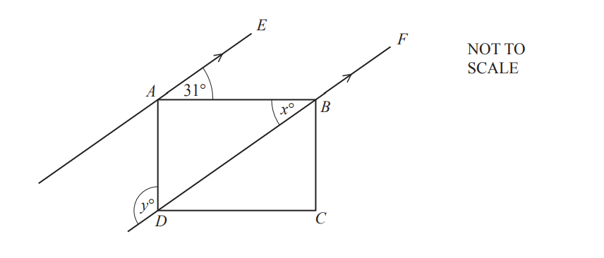
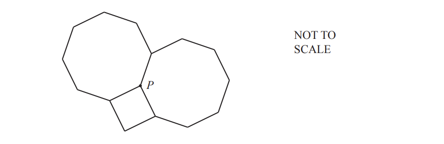
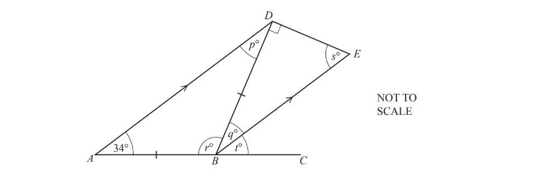
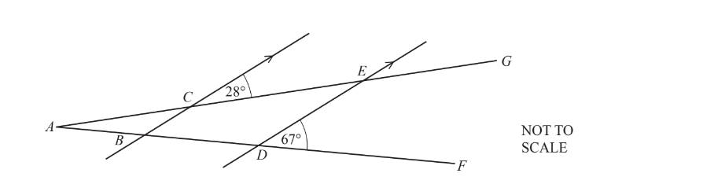
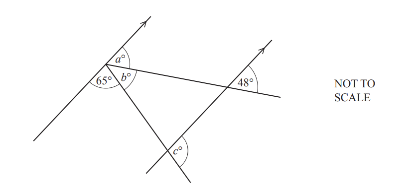
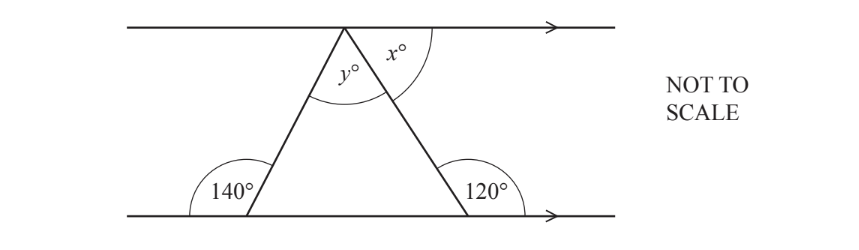

# Exam Questions — Angles in Polygons & Parallel Lines
**Geometry** · Cambridge (CIE) IGCSE maths (0607)
> Source: [https://www.savemyexams.com/igcse/maths/cie/international-maths/23/core/topic-questions/](https://www.savemyexams.com/igcse/maths/cie/international-maths/23/core/topic-questions/) · 25 questions across 1 sets

## Exam Questions (25 questions)

### Q1 — hard — 2 marks

**Q1** [2 marks]

A regular polygon has $n$ sides.

Find an expression in terms of $n$ for the size of one interior angle of the polygon.

### Q2 — medium — 2 marks

**Q2** [1 mark]

Work out the value of $a$.

[1]

**Q2** [1 mark]

Work out the value of $b$.

### Q3 — hard — 2 marks

**Q3** [2 marks]

$ABCD$ is a rectangle. 
$AE$ is parallel to $DBF$.

Find the value of $x$ and the value of $y$.

$x$ = ......................................................

$y$ = ................................................. .....

*Source: Nov 2020 0580/31 Q7B*

### Q4 — hard — 4 marks

**Q4** [4 marks]

The diagram shows part of a different regular polygon.

$e$ is an exterior angle.
 $i$ is an interior angle. 
The ratio $e:i=2:13$.

i) Work out angle $e$.

[3]

ii) Work out the number of sides of this regular polygon.

[1]

*Source: June 2020 0580/33 Q7B*

### Q5 — hard — 4 marks

**Q5** [4 marks]

The diagram shows two regular pentagons. 
Pentagon $FGHJK$ is an enlargement of pentagon $ABCDE$, centre $O$.

Find angle $AEK$.

Angle $AEK$ = ..............................

*Source: May/June 2019 0580/13 Q23*

### Q6 — hard — 3 marks

**Q6** [3 marks]

Two regular octagons and a square meet at point $P$. 
Show, by calculation, that the three interior angles at $P$ add up to 360°.

*Source: Nov 2020 0580/31 Q7D*

### Q7 — hard — 3 marks

**Q7** [3 marks]

Each interior angle of a regular polygon is 162°.

Calculate the number of sides of the polygon.

*Source: March 2019 0580/32 Q10C*

### Q8 — hard — 3 marks

**Q8** [3 marks]

The diagram shows two pairs of parallel lines.

Find the value of $a$, the value of $b$ and the value of $c$.

$a=.................................................\,b=.................................................\,c=.................................................$

*Source: June 2020 0580/32 Q7B*

### Q9 — hard — 8 marks

**Q9** [8 marks]

In the diagram, $ABC$ is a straight line. 
$AD$ is parallel to $BE$, angle $BAD$ = 34° and $AB=BD.$

i) Complete the statements.

a) $p=$ ................ because ................................

[2]

b) $q=$ ................ because .................................

[2]

ii) Work out the value of $r$ and the value of $s$.

$r=$....................

$s=$ .................... [2]

iii) Find the value of t and give a reason for your answer.

$t=$................ because ........................

[2]

*Source: May/June 2019 0580/33 Q6A*

### Q10 — hard — 2 marks

**Q10** [2 marks]

In the diagram $AG$and $AF$ are straight lines. 
Lines $BC$ and $DE$ are parallel.

Find angle $CED$ and give a reason for your answer.

Angle $CED$ = ................................. because ...................................

*Source: June 2019 0580/31 Q4D*

### Q11 — hard — 1 marks

**Q11** [1 mark]

$ABCDE$ is a pentagon.

Explain why the diagram shows that the sum of the interior angles of a pentagon is 540°. Do not measure any angles.

*Source: Specimen 2020 0580/01 Q13*

### Q12 — medium — 6 marks

**Q12** [6 marks]

The diagram shows two parallel lines and two straight lines.

i) Find the value of $a$.
Give a reason for your answer.
a = ................ because ..................................................................................................... [2]

ii) Find the value of $b$. 
Give a reason for your answer.
b = ................ because ......................................................................................................[2]

iii) Find the value of $c$.

$c$ = ................................................. [2]

*Source: Nov 2020 0580/33 Q8B*

### Q13 — medium — 3 marks

**Q13** [3 marks]

The diagram shows a triangle between two parallel lines, $AB$ and $CD$.

Find the value of

i) $v,$

$v$=............................. [1]

ii) $w,$

$w=$............................. [1]

iii) $y$.

$y$ = .............................  [1]

*Source: Nov 2019 0580/33 Q7B*

### Q14 — medium — 3 marks

**Q14** [3 marks]

The diagram shows a triangle drawn between a pair of parallel lines.

Find the value of $x$ and the value of $y$.

$x=..............................\,y=..............................$

*Source: Nov 2020 0580/12 Q10*

### Q15 — medium — 1 marks

**Q15** [1 mark]

A regular polygon has an exterior angle of 20°.

Work out the number of sides of this polygon.

*Source: Nov 2020 0580/13 Q19*

### Q16 — medium — 2 marks

**Q16** [2 marks]

Work out the value of

i) $x,$

$x$=..........................[1]

ii) $y.$

$y=$...........................[1]

*Source: Specimen 2020 0580/03 Q8A*

### Q17 — medium — 4 marks

**Q17** [4 marks]

Complete the statements.

$a=$ ............................ because ............................

$b=$ ........................... because ............................

*Source: Feb/March 2018 0580/12 Q20*

### Q18 — medium — 4 marks

**Q18** [2 marks]

In the diagram, $AB$ is parallel to $CD$.

Find the value of$x$. 
Give a geometrical reason for your answer.

$x$= ......................... because ....................................

*Source: June 2020 0580/13 Q8A*

**Q18** [2 marks]

**Extract:**

In the diagram, AB is parallel to CD.

Work out the value of $y$. 
Give a geometrical reason for your answer.

$y=$.................because ......................

*Source: June 2020 0580/13 Q8B*

### Q19 — easy — 2 marks

**Q19** [2 marks]

Work out the size of one interior angle of a regular 9-sided polygon.

*Source: June 2020 0580/11 Q10*

### Q20 — easy — 2 marks

**Q20** [2 marks]

Work out the size of one interior angle of a regular 16-sided polygon.

*Source: Nov 2020 0580/32 Q2D*

### Q21 — easy — 3 marks

**Q21** [3 marks]

Find the size of one interior angle of a regular octagon.

*Source: Nov 2019 0580/31 Q3D*

### Q22 — easy — 3 marks

**Q22** [3 marks]

Work out the size of one interior angle of a regular polygon with 20 sides.

*Source: June 2019 0580/32 Q7C*

### Q23 — easy — 2 marks

**Q23** [1 mark]

The diagram shows two parallel lines and a straight line crossing them.

Write down, using letters from $a$ to $g$,

the angle that is alternate to angle $X$,

*Source: June 2019 0580/12 Q8*

**Q23** [1 mark]

**Extract:**

The diagram shows two parallel lines and a straight line crossing them. Write down, using letters from a to g, the angle that is alternate to angle X.

the angle that is corresponding to angle $X$.

*Source: June 2019 0580/12 Q8B*

### Q24 — easy — 3 marks

**Q24** [3 marks]

Find the size of one interior angle of a regular 10-sided polygon.

*Source: June 2019 0580/31 Q4B*

### Q25 — easy — 1 marks

**Q25** [1 mark]

i) Write down the mathematical name for an 8-sided polygon.

[1]

ii) Work out the size of an interior angle of a regular 24-sided polygon.

[2]

*Source: March 2020 0580/32 Q3B*

