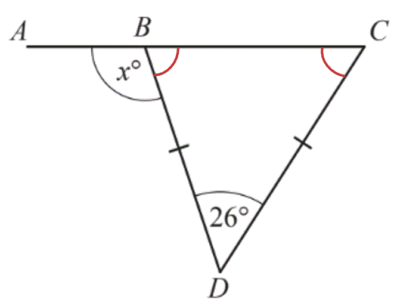
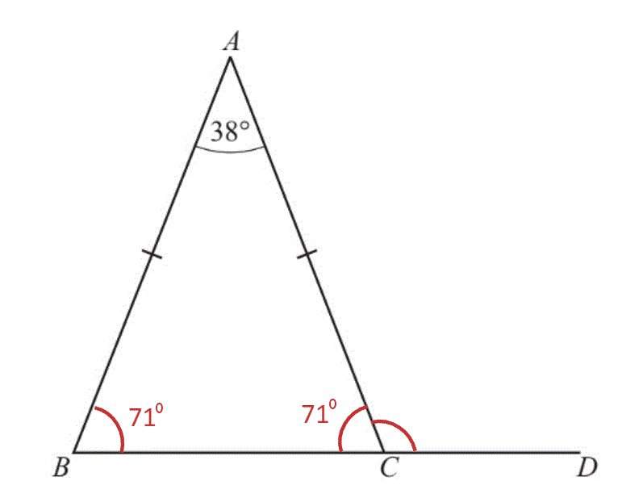
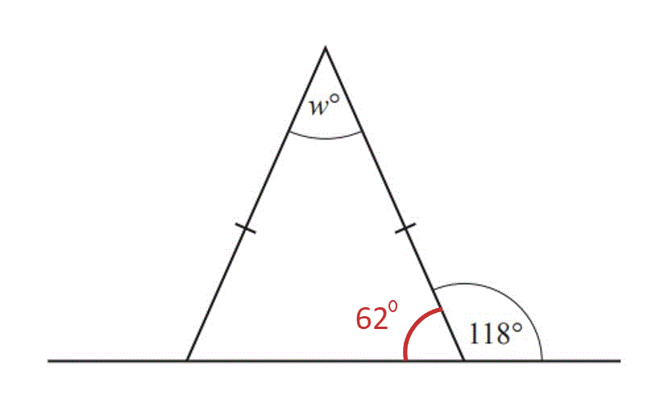
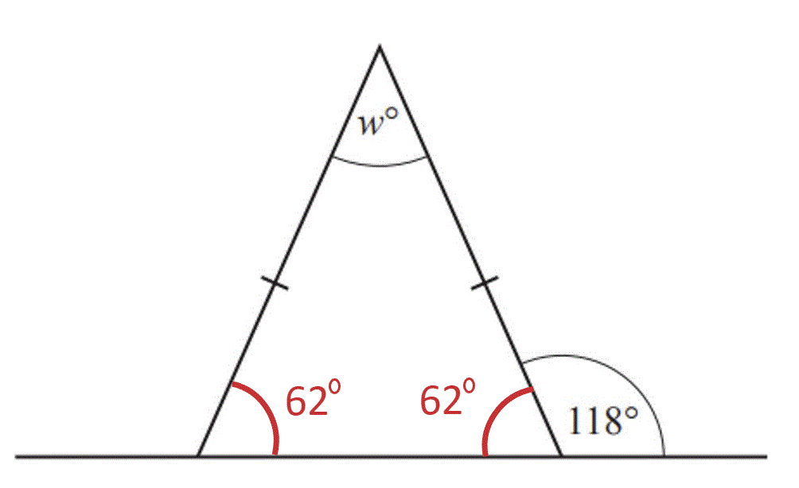

# Mark Schemes — Basic Angle Properties
**Geometry** · Cambridge (CIE) IGCSE maths (0607)

## Exam Questions (17 questions)

### Q1
i)*Angles in a triangle sum to 180°, work out angle RQS. .*

$180-32-25=123^{\circ}$

**[1]**

> *Angles on a straight line sum to 180°, work out angle PQS.  *

$180-123=57^{\circ}$

**57° ****[1]**

ii)*Triangle PQS is isosceles so angle QPS is also 57° because base angles in an isosceles triangle are equal.*
*Work out angle PSQ by subtracting these from 180°.  *

$180-57-57=66^{\circ}$

**[1]**

> *To find angle PSR, add on 32°.  *

$66+32=98$

**98°**** ****[1]**

### Q2
> *Because of the two parallel lines, the two angles given are **co-interior **(or **allied**).*

> *Add the angles together and set equal to *$180^{\circ}$* (co-interior angles add up to *$180^{\circ}$*). *

$97-3x+69+5x=180$

**[1]**

> *Rewrite the equation so that all of the *$x$* terms are together and then combine like terms. *

`table row cell negative 3 x plus 5 x plus 97 plus 69 end cell equals 180 row blank blank blank row cell 2 x plus 166 end cell equals 180 end table`

**[1]**

> *Solve the equation by subtracting 166 from both sides, then divide both sides by 2. *

`table attributes columnalign right center left columnspacing 0px end attributes row cell 2 x end cell equals cell 180 minus 166 end cell row blank blank blank row cell 2 x end cell equals 14 row blank blank blank row x equals cell 14 divided by 2 end cell row blank blank blank row x equals 7 end table`

> * *

$x=7$* ***[1]**

### Q3
> *Write an expression of the sum of the three angles given *

`open parentheses x plus 15 close parentheses plus 3 x plus 3`

**[1]**

> *Make it equal to *$180$* as angles in a triangle add up to *$180^{\circ}$

`open parentheses x plus 15 close parentheses plus 3 x plus x equals 180`

**[1]**

> *Simplify by collecting like terms*

$5x+15=180$

> *Subtract *$15$* from both sides*

$5x=165$

**[1]**

> *Divide both sides by 5*

$x=33$** [1]**

### Q4
> *An isosceles triangle has two equal angles*

> *If the two equal angles are *$48^{\circ}$* each, then*

`180 minus open parentheses 48 plus 48 close parentheses`

**[1]**

$=84^{\circ}$

**The other angle could be**** **$84^{\circ}$ **[1]**

### Q5
> *Angles along a straight line add up to *$180^{\circ}$

> *Find angle *$BCA$*by subtracting angle *$ACD$* from *$180$

$\mathrm{Angle}BCA=180-132=48$

> *Triangle *$ABC$* is an isosceles triangle*

$\mathrm{Angle}BCA=\mathrm{Angle}ABC=48$

> *Angles in a triangle add up to *$180^{\circ}$

> *Find *$x$* by subtracting angles *$ABC$* and *$ACB$* from *$180$

$180-48-48=x$

**[1]**

$x=84$* ***[1]**

### Q6
> *The little lines on sides QS and RS tell us that QRS is an isosceles triangle. Angles in a triangle sum to 180° so subtract what we have so far.*

$180^{\circ}-18^{\circ}=162^{\circ}$

> *Base angles in an isosceles triangle are equal.*

$162^{\circ}\div2=81^{\circ}$

**[1]**

> *Angles RQS and QRS are equal to 81°.*

> *Adjacent angles on a straight line sum to 180° *

$180^{\circ}-81^{\circ}=99^{\circ}$

**99°**** ****[1]**

### Q7

> *Subtract *$26^{\circ}$* from *$180^{\circ}$* and divide by 2 to find the size of the base angles (**base angles** in an **isosceles** triangle are equal, and **angles** in a **triangle** add up to *$180^{\circ}$*).*

> * *

$180-26=154$

$154\div2=77$

* ***[1]**

> *So angle *$CBD$* is *$77^{\circ}$*.  Subtract *$77^{\circ}$* from *$180^{\circ}$* to find *$x$* (**angles** on a **straight line** add up to *$180^{\circ}$*).*

> * *

$180-77=103$

$103^{\circ}$* ***[1]**

### Q8
> *Method 1*

> *Use the angle fact angles on a straight line sum to *$180^{\circ}$

$180-128=52^{\circ}$

> *Use the angle fact, angles in a triangle sum to *$180^{\circ}$

`180 minus open parentheses 85 plus 52 close parentheses equals 43`

$w=43^{\circ}$** [1] **
**because angles in a triangle sum to **$180^{\circ}$** [1] **
**and angles along a straight line sum to **$180^{\circ}$** ****[1]**

> *Method 2*

> *Use the angle fact, the exterior angle of a triangle is equal to the sum of the two opposing interior angles  *

`table attributes columnalign right center left columnspacing 0px end attributes row cell w plus 85 end cell equals 128 row w equals cell 128 minus 85 end cell end table`

**[1] **

$w=43^{\circ}$** [1]**
** ****because the exterior angle of a triangle is equal to the sum of the two opposing interior angles**** ****[1]**

### Q9
> *The angle *$ACB$* is on a straight line with the angle *$ACD$*.*

> *As angles a straight line sum to *$180^{\circ}$

`angle A C B equals 180 minus 118 equals 62 degree`

**[1]**

> *Triangle *$ABC$* is an isosceles triangle as *$AB=AC$* and so*

`angle A B C equals angle A C B equals 62 degree`

> *Angles in a triangle sum to *$180^{\circ}$* and so*

`a equals 180 minus open parentheses 62 plus 62 close parentheses equals 56 degree`

$a=56$** [1]**

### Q10
> *As one angle is *$96^{\circ}$* within an isosceles triangle, the remaining two angles must be equal.*

> *As angles in a triangle sum to *$180^{\circ}$

`open parentheses 180 minus 96 close parentheses divided by 2 equals 42 degree`

$42^{\circ}$** ****and**** **$42^{\circ}$**[1]**
> *The sum of angles around a point is *$360^{\circ}$*. Use this to form the equation and solve for *$x$

$6x+5x+3x+45=360$

**1 mark for**** **$6x+5x+3x+45$** ****[2]**

$14x+45=360$

$14x=360-45$

$14x=315$

**[1]**

$x=\frac{315}{14}=22.5$

**22.5**** ****[1]**

### Q11
> *ABC is an isosceles triangle (because sides **AB** and **AC** have the same length).*

> *Base angles in an isosceles triangle are equal.*

> *Subtract 38 from 180 (degrees in a triangle) and divide by 2 to find the size of one base angle. *

`table attributes columnalign right center left columnspacing 0px end attributes row cell 180 minus 38 end cell equals 142 row blank blank blank row cell 142 divided by 2 end cell equals 71 end table`

* ***[1]**

*Subtract 71 from 180 (degrees on a straight line) to find the missing angle. *

> $180-71=109$* *

$109^{\circ}$* ***[1]**

### Q12
> *Angles on a straight line add up to *$180^{\circ}$*. Subtract 118 from 180 to find the base angle of the triangle. *

$180-118=62$

> *Base angles in an isosceles triangle are equal, so the other missing angle is also *$62^{\circ}$* *

> * *

> *Angles in a triangle add up to *$180^{\circ}$*. Subtract the two angles from 180. *

$180-62-62=56$

**[1]**

$56^{\circ}$* ***[1]**

### Q13
> *Base angles in an isosceles triangle are equal. *

$\mathrm{Angle}ACB=32^{\circ}$

**[1]**

> *Add together both base angles and subtract from *$180^{\circ}$* (angles in a triangle add up to *$180^{\circ}$*). *

`180 minus open parentheses 32 plus 32 close parentheses equals 116`

* *$116^{\circ}$* ***[1]**

### Q14
> *Subtract the given angle, *$70^{\circ}$*, from the total degrees in a triangle, *$180^{\circ}$*. *

$180-70=110$

* ***[1]**

> *Divide by 2 (because base angles in an isosceles triangle are equal). *

> $110\div2=55$* *

$x=55$* ***[1]**

### Q15
> *Adjacent angles on a straight line sum to 180° so subtract the angles that we are given from 180°.*

$180^{\circ}-85^{\circ}-56^{\circ}=39^{\circ}$

**39°**** ****[1]**

### Q16
> *The sum of angles given is*

$55+85+50=190^{\circ}$

**The sum of angles in a triangle is**** **$180^{\circ}$** but the angles add to **$190^{\circ}$** [1]**

### Q17
> *Use the angle fact for angles around a point sum to 360*

> *Subtract the known angles from *$360$

`360 minus open parentheses 107 plus 124 close parentheses`

$x=129^{\circ}$* ***[1]*** *

**because angles around a point sum to*** *$360^{\circ}$*  ***[1]**
