# Exam Questions — Basic Angle Properties
**Geometry** · Cambridge (CIE) IGCSE maths (0607)
> Source: [https://www.savemyexams.com/igcse/maths/cie/international-maths/23/core/topic-questions/](https://www.savemyexams.com/igcse/maths/cie/international-maths/23/core/topic-questions/) · 17 questions across 1 sets

## Exam Questions (17 questions)

### Q1 — hard — 4 marks

**Q1** [4 marks]

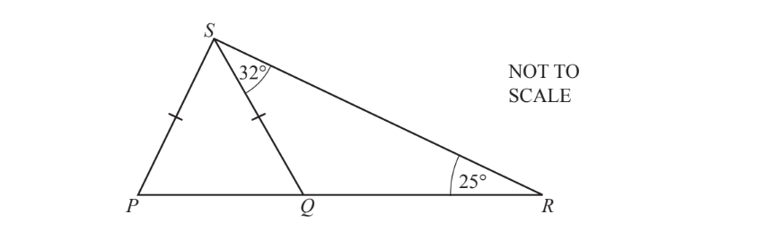

The diagram shows triangle $PRS$ and a straight line $QS$. 
$Q$ is a point on $PR$. 
Angle $QRS$ = 25°, angle $RSQ$ = 32° and $PS=QS$.

i) Find angle $PQS.$

Angle $PQS$ = ................................................... [2]

ii)Find angle $PSR$.

Angle $PSR$ = ................................................... [2]

*Source: Nov 2019 0580/32 Q5B*

### Q2 — hard — 3 marks

**Q2** [3 marks]

The diagram shows a trapezium.

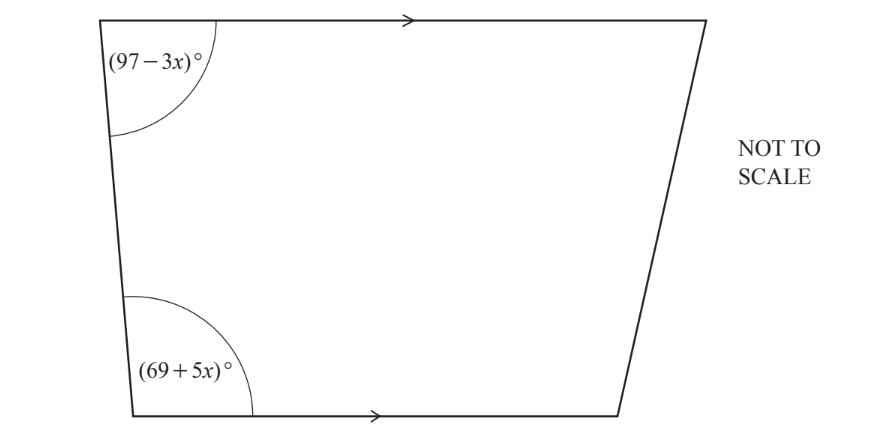

Work out the value of $x$.

$x$ = ..................................................

*Source: June 2020 0580/11 Q14*

### Q3 — hard — 4 marks

**Q3** [4 marks]

The diagram shows a triangle.

Use the diagram to write down an equation and solve it to find the value of $x$.

$x$ = .................................. [4]

*Source: Oct/Nov 2018 0580/31 Q8E*

### Q4 — hard — 2 marks

**Q4** [2 marks]

Kim knows that one angle of an isosceles triangle is 48°. 
He says that one of the other angles must be 66°.

Explain why Kim is wrong.

*Source: Specimen 2020 0580/01 Q16*

### Q5 — hard — 2 marks

**Q5** [2 marks]

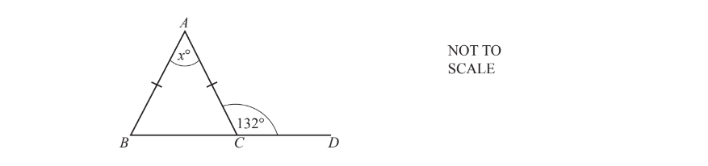

The diagram shows an isosceles triangle, $ABC$. $BCD$ is a straight line.

Find the value of $x$.

$x=$ ................................ [2]

*Source: Oct/Nov 2018 0580/32 Q5D*

### Q6 — medium — 2 marks

**Q6** [2 marks]

$QRS$is an isosceles triangle and $PQR$ is a straight line.

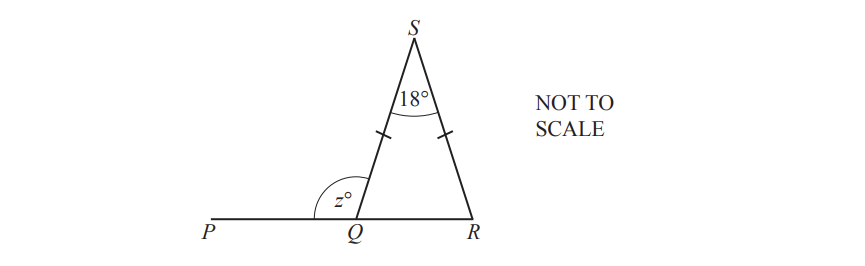

Find the value of $z$.

$z$ = ...................................................

*Source: Nov 2019 0580/31 Q3C*

### Q7 — medium — 2 marks

**Q7** [2 marks]

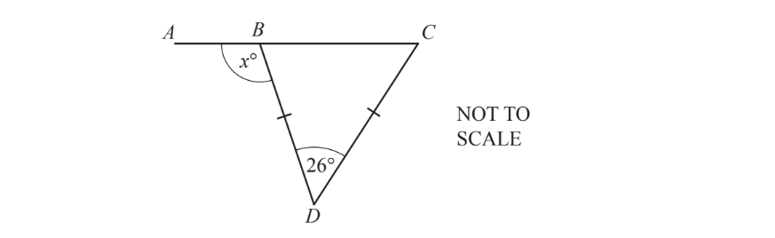

$ABC$is a straight line and $BCD$ is an isosceles triangle.
Find the value of$x$.

$x$= .................................................

*Source: Nov 2020 0580/32 Q2C*

### Q8 — medium — 3 marks

**Q8** [3 marks]

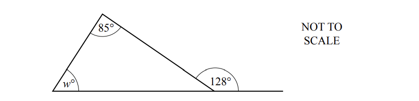

Work out the value of $w.$ 
Give reasons for your answer.

$w=$ ............................ because ....................................................................................................

*Source: Specimen 2020 0580/03 Q8B*

### Q9 — medium — 2 marks

**Q9** [2 marks]

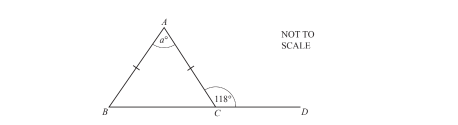

$ABC$ is an isosceles triangle. 
$BCD$ is a straight line.

Find the value of $a$.

$a$ = ..............................................

*Source: June 2019 0580/31 Q4A*

### Q10 — medium — 5 marks

**Q10** [1 mark]

A triangle is isosceles. 
One of its angles is 96°.

Find the other two angles.

........................ and ........................

*Source: June 2019 0580/32 Q7A*

**Q10** [4 marks]

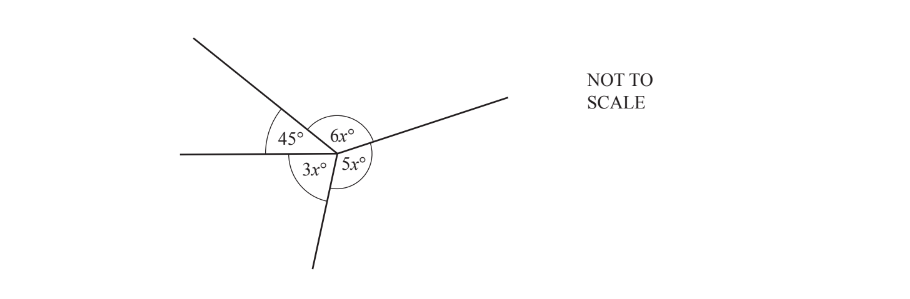

Find the value of $x$.

$x$ = ...................................................

*Source: June 2019 0580/32 Q7B*

### Q11 — medium — 3 marks

**Q11** [3 marks]

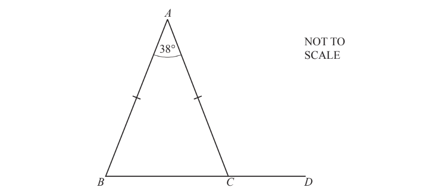

In the triangle $ABC,AB=AC$ and angle $BAC=38^{\circ}$.

$BCD$is a straight line.

Work out angle $ACD$.

Angle $ACD$ = ..................................................

*Source: June 2020 0580/11 Q5*

### Q12 — medium — 2 marks

**Q12** [2 marks]

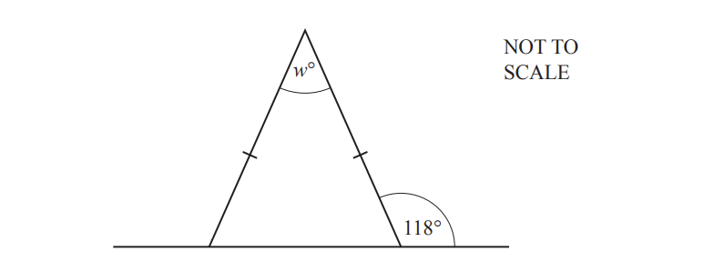

The diagram shows an isosceles triangle and a straight line. 
Work out the value of $w$.

$w=$...............................[2]

*Source: Nov 2020 0580/31 Q7A*

### Q13 — easy — 2 marks

**Q13** [2 marks]

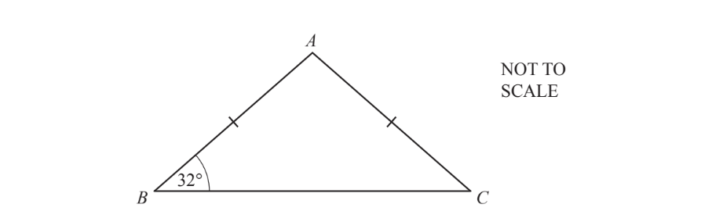

Triangle $ABC$ is isosceles. 
Angle $ABC$ = 32° and $AB=AC$.

Find angle $BAC$.

Angle $BAC$ = .................................................

*Source: June 2020 0580/13 Q11*

### Q14 — easy — 2 marks

**Q14** [2 marks]

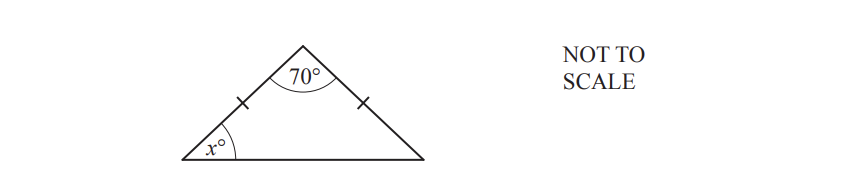

The diagram shows an isosceles triangle.

Find the value of $x$.

$x$= .................................................

*Source: June 2020 0580/32 Q7A*

### Q15 — easy — 1 marks

**Q15** [1 mark]

$ABC$ is a straight line.

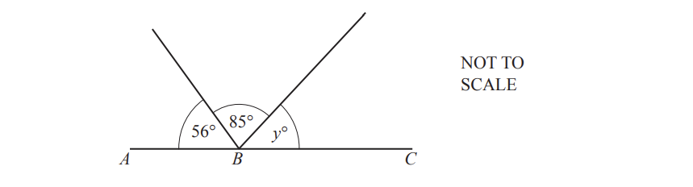

Find the value of $y$.

$y=$ ...................................................

*Source: Nov 2019 0580/31 Q3B*

### Q16 — easy — 1 marks

**Q16** [1 mark]

A student measures the angles in a triangle as 55°, 85° and 50°.

Explain why the student is incorrect.

*Source: March 2019 0580/12 Q6*

### Q17 — easy — 2 marks

**Q17** [2 marks]

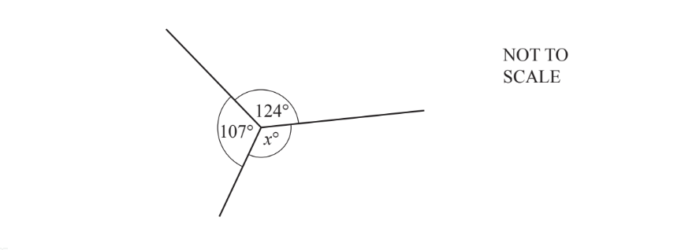

Work out the value of$x$. 
Give a geometrical reason for your answer.

$x$ = .................... because ......................................................................

*Source: March 2020 0580/12 Q4*

