# Mark Schemes — Bearings
**Geometry** · Cambridge (CIE) IGCSE maths (0607)

## Exam Questions (14 questions)

### Q1
> *Align *$0cm$* of the ruler with *$T$* and measure the length to *$A$*.*

$9.6\mathrm{cm}$

**[1]**

> *Multiply this value by the scale factor.*

$9.6\times2=19.2$

**19.2 km ****[1]**
> *Centre a protractor at *$T$* with *$0^{\circ}$* aligned with the north line at *$T$*. *
*Read the value the line between *$T$* and *$A$* from the correct scale on the protractor and write as a three figure bearing.  *

$045^{\circ}$** [1]**
> *Find the bearing of the train station from the bus station by subtracting 180 from the bearing.*

$318-180$

** [1]**

**138°**** [1]**

### Q2
> *Centre the protractor on town *$B$* with *$0^{\circ}$* in the same direction as the north line at *$B$*.*

> *Read the angle on the scale clockwise in the direction of *$A$*.*

> *If you only have a semi-circular protractor, find the angle anti-clockwise which is 38, and then subtract from 360.*

$322^{\circ}$ **[1]**
> *Measure the length of the line AB.*

$12\mathrm{cm}$

**[1]**

> *Multiply this by the scale factor.*

$12\times8=96\mathrm{km}$

**96 km**** ****[1]**
> *Centre the protractor at town *$C$* and align *$0^{\circ}$* with the north line. Measure the angle of *$246^{\circ}$* clockwise and mark this onto the diagram.*

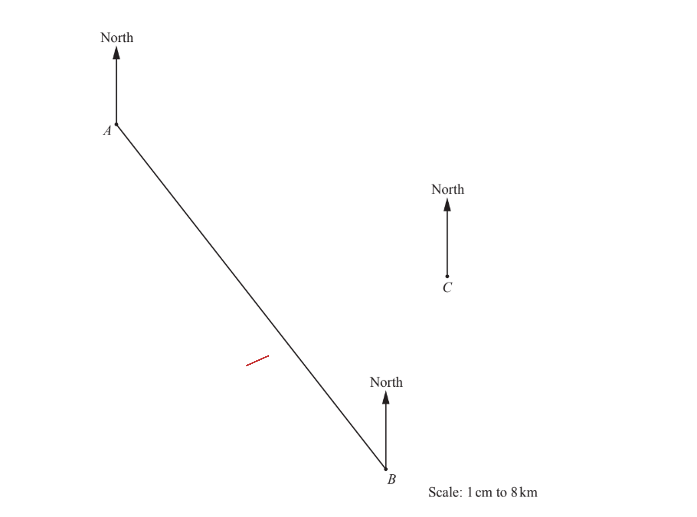

> *Draw a straight line from town *$C$* to the mark made on the diagram labelling the point *$X$* where the line intersects the line *$AB$*.*

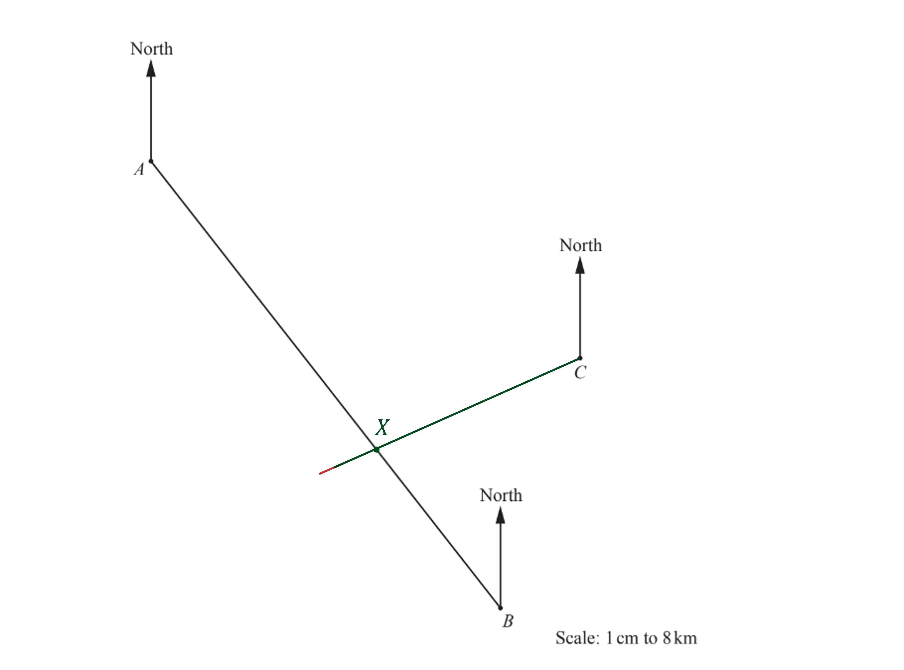

**[1]**

### Q3
i) *Use your protractor to measure the bearing, with the 0 on the North line and measuring clockwise.  *

**115**** ****[1]**

ii) *Use your ruler to measure the distance from A to B.  *

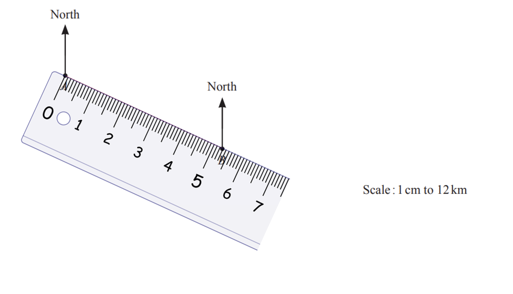

> *The distance is 5.3cm.*

**[1]**

> *Each cm represents 12km so multiply by 12.  *

$5.3\times12=63.6\mathrm{cm}$

**63.6 cm**** ****[1]**

iii) *Measure the bearing from A and draw a long line. Measure the bearing from B and draw a long line to meet the first line.   *

**1 bearing correct**** [1] **
**C is in the correct position**** [1]**
> *Draw a sketch to help you visualise which bearing to calculate.*

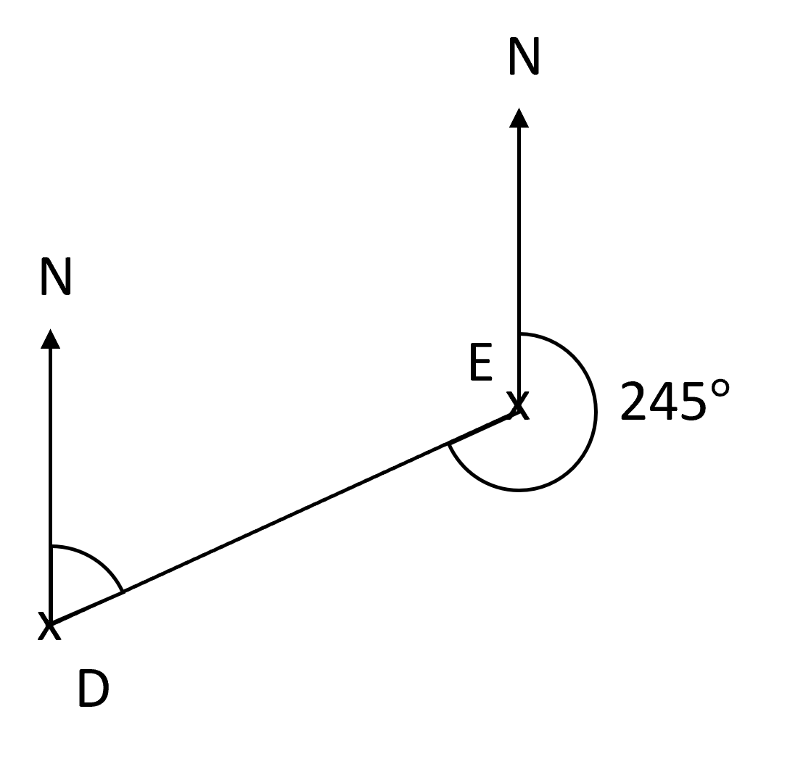

**[1]**

$245-180=065^{\circ}$

**065**$^{\circ}$** ****[1]**

### Q4
i) *Use your ruler to measure the actual distance between A and B. *
*Each 1cm is 20km so write this as a ratio to work out the real-life length represented by 11 cm.*

$\mathrm{cm}:\mathrm{km}\,1:20$

> *Multiply both sides by 11 *

$11:220$

** ****For indicating a length of 11 cm ****[1]**
**220 km**** ****[1]**

ii) *Bearings should be measured from North, clockwise, and use 3 figures. *
*Use a protractor to measure the bearing of B from A.  *

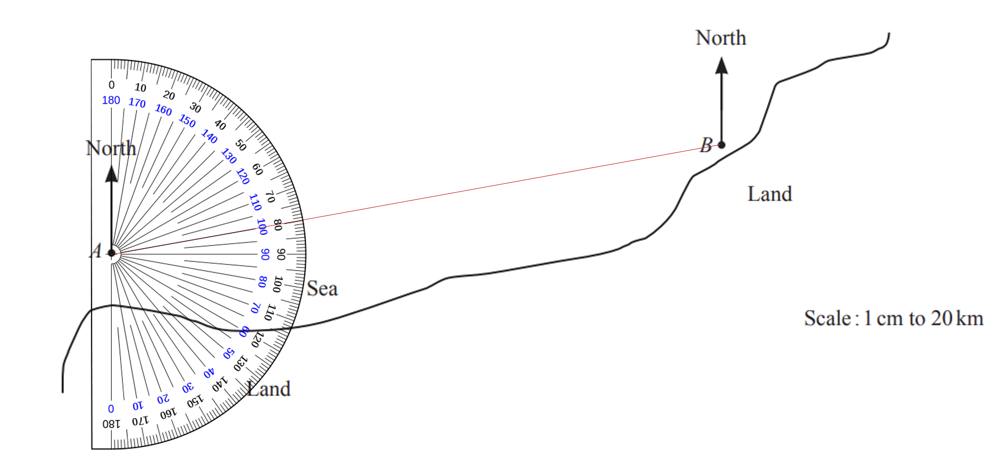

**  080°**** ****[1]**

iii) *Use the ratio to work out how far 120km would be on the scale diagram.*

$\mathrm{cm}:\mathrm{km}\,1:20\,x:120$

> *To work out the value of **x, **multiply by 6.  *

$\mathrm{cm}:\mathrm{km}\,1:20\,6:120$

> *Measure a bearing of 300° by measuring an angle of 60° anti-clockwise from B (because angles around a point sum to 360°, and then draw a line of 6cm.  *

**Correct line of 6 cm or correct bearing ****[1]**

> *Then mark the position of C at the end of the 6cm line.  *

**C in correct position ****[1]**

### Q5
> *Centre the protractor on North Gate with *$0^{\circ}$* aligned with the North line at North Gate.*

> *Read the angle that crosses the scale in the direction of South Gate.*

$150^{\circ}$ **[1]**

### Q6
i) *Measure the length between *$R$* and *$S$* using a ruler.*

$9\mathrm{cm}$

**[1]**

> *Multiply the measured length by the scale factor.*

$9\times6$

**54 m**** [1]**

ii) *Subtract the bearing from *`180 ˚`* .*

* *$180-164=16$

> *This is an angle in the anticlockwise direction so subtract from *$360^{\circ}$* for a bearing in the clockwise direction. *

$360-16$

**[1]**

**344**$^{\circ}$** [1]**

iii) *Place the centre of the protractor on *$R$* and turn the protractor so that *$0^{\circ}$* is aligned with the North line at *$R$*.*

> *Measure an angle in the clockwise direction of *$76^{\circ}$* and mark this angle on the page.*

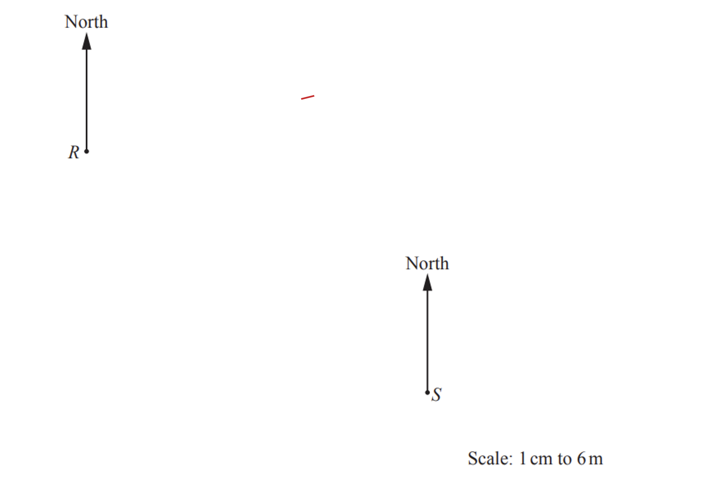

> *Draw a straight line directly from *$R$* through this plotted point.*

**[1]**

> *As the bearing of *$T$* is greater than *$180^{\circ}$* from *$S$*, subtracting *$337^{\circ}$* from *$360^{\circ}$* will find the angle of *$T$* from *$S$* in the anticlockwise direction. *

$360-337=023^{\circ}$

> *Re-centre the protractor in the anticlockwise direction over *$S$* with *$0^{\circ}$* aligned with the North line at *$S$*.*

> *Measure an angle in the anticlockwise direction of *$23^{\circ}$* and mark this angle on the diagram.  *

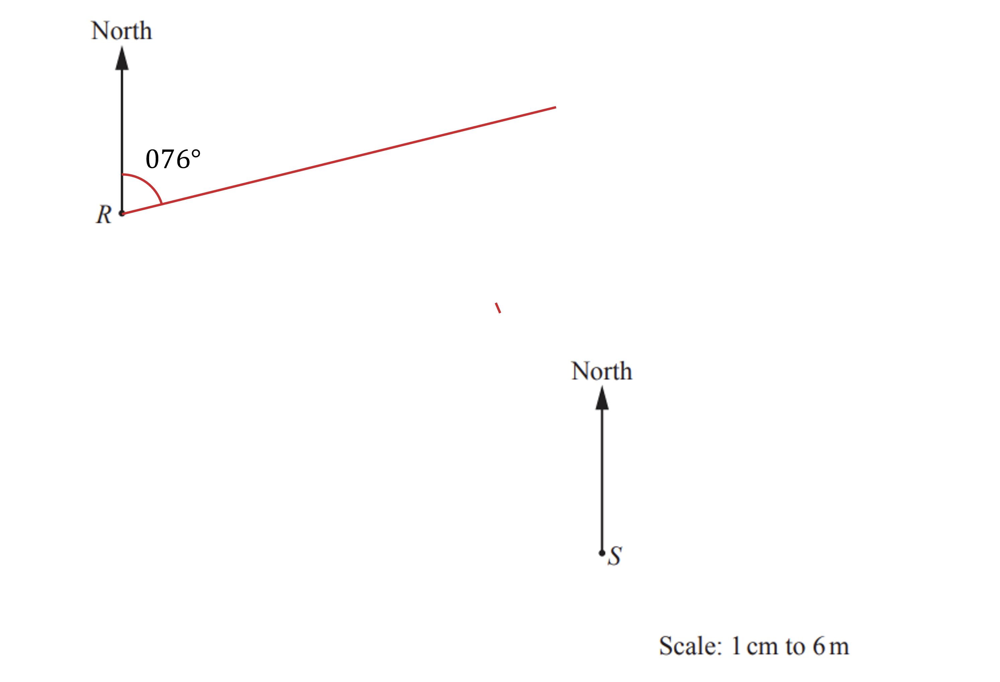

> *Draw a straight line directly from *$S$* through this plotted point, and continue until it crosses the line drawn for the bearing of *$076^{\circ}$* from *$R$*.  *

*Label the point of intersection of these two lines with the letter *$T$**   **

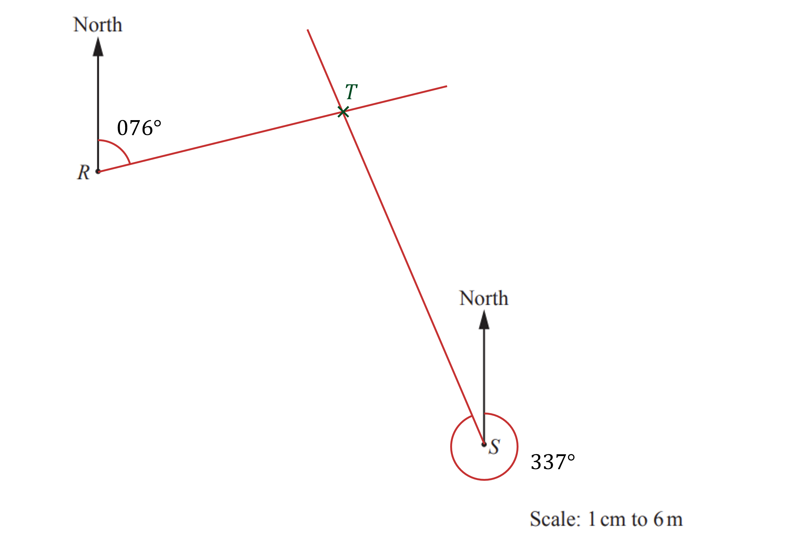

**[1]**

### Q7
> *Use the scale to convert 36 km into cm.  *

$36\div4=9$

> *Use a protractor to measure and mark a *$140^{\circ}$* angle clockwise from the north line at **A, **and draw a line**.*

> *Measure 9 cm along the line and label the point **B**.*

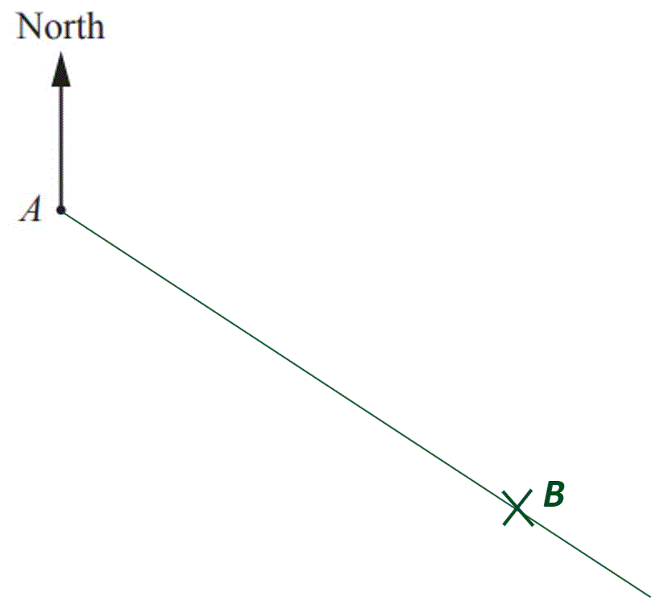

**1 mark for correct angle, 1 mark for correct distance [2]**

### Q8
> *As *$073^{\circ}$* is the bearing of Bartown from Whitestoke, the reverse bearing is *$180^{\circ}$* greater than this. *

$73+180$

**[1]**

$253^{\circ}$* ***[1] **

**A sketch of  and the correct bearing marked or a sketch with alternate angles marked is accepted**

### Q9
i) *Measure accurately the line between *$Y$* and *$R$* on the diagram.*

> *  *$6.4\mathrm{cm}$

**[1]**

> * Multiply the length by the scale factor in kilometres. *

$6.4\times15$

**96 km**** [1]**

ii) *Line the centre of the protractor on *$Y$* and turn the protractor so that *$0^{\circ}$* is aligned with the North line at *$Y$*.*
*Read the angle on the same scale of the line that is in the direction of *$R$*. *

$117^{\circ}$* ***[1]**

### Q10
> *Centre the protractor at *$R$* with *$0^{\circ}$* aligned with the north line at *$R$*.*

> *Measure the angle of *$125^{\circ}$* in the clockwise direction and mark this angle on the diagram.*

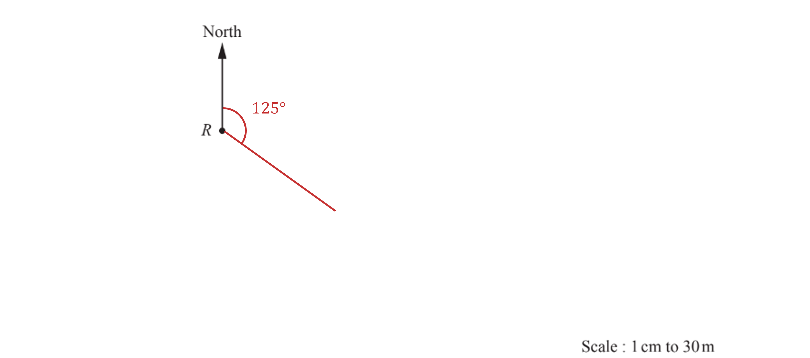

**[1]**

> *Use the scale to determine the distance that *$L$* is from *$R$*.*

$210\div30=7\mathrm{cm}$

> *Mark the point on the diagram along the bearing drawn that is *$7\mathrm{cm}$* from *$R$*.*

**[1]**

### Q11
> *To find a reverse bearing, either add or subtract 180° (whichever will give an answer between 0° and 360°). *

$105+180$

**[1]**

$285^{\circ}$** ****[1]**

### Q12
(i) *Use a ruler to measure the distance between **A** and **B**. *

$9.5\mathrm{cm}$

**9.3 - 9.7 cm**** ****[1]**

> * Multiply by 10 (because every 1 cm represents 10 km). *

$9.5\times10=95$

**95 km** **[1]**
**93 - 97 accepted**

(ii) *Divide 85 by 10 (because every 10 km is drawn using 1 cm). *

$85\div10=8.5\mathrm{cm}$

* Use a protractor to measure an angle of *$100^{\circ}$* **from the north line **at **A**, and draw a line. ** *

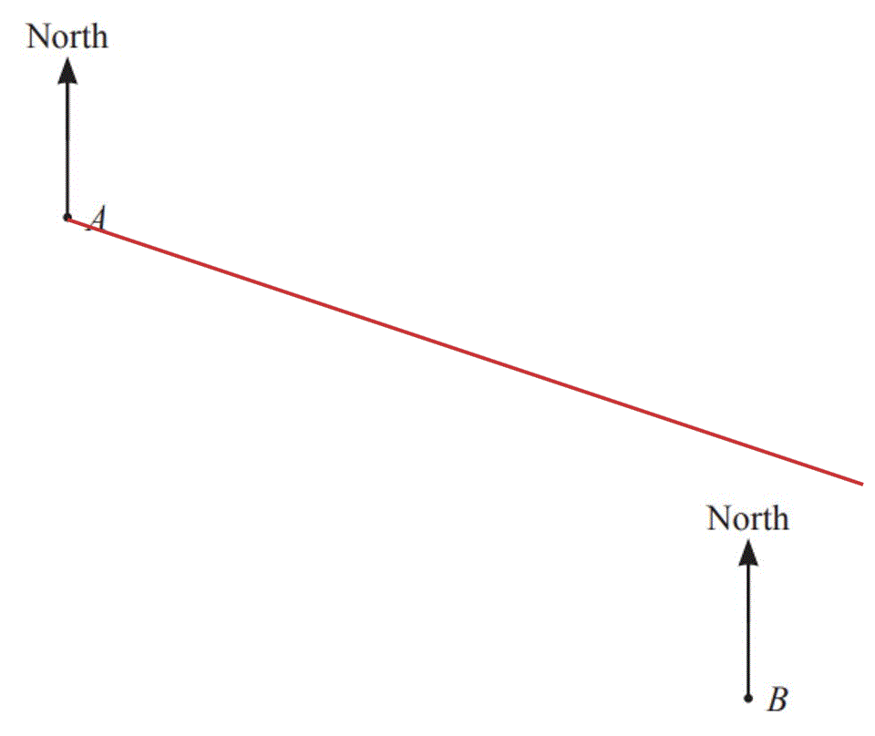

> *Measure 8.5cm along this line **from **A**,** mark with a cross and label **C**. *

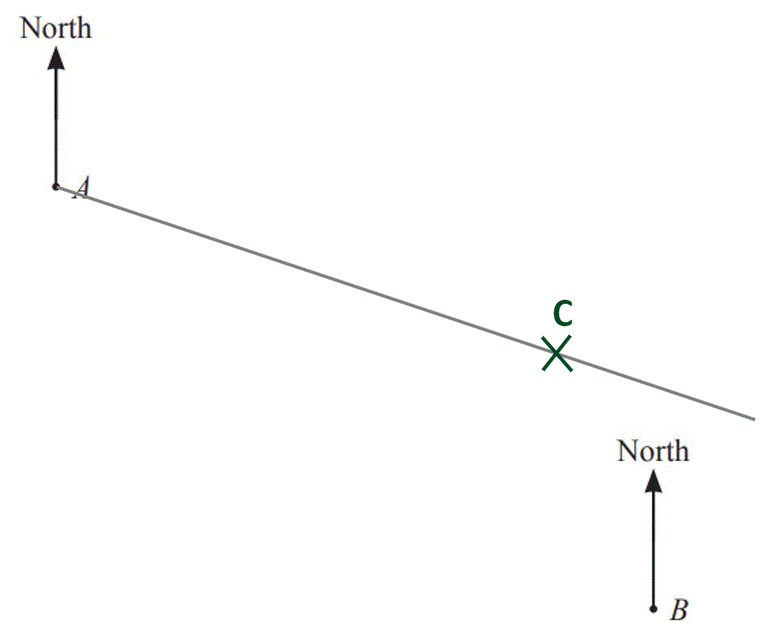

** 1 mark for correct bearing**
**1 mark for 8.5cm [2]**

### Q13
i) *Align *$0\mathrm{cm}$* of a ruler with the point *$S$* and turn the ruler to the direction of *$T$*.*
*Read the value from the scale.*

$7.8\mathrm{cm}$

**[1]**

> *Multiply by the scale factor to determine the actual distance.*

$7.8\times15=117$

**117 km**** ****[1]**

ii) *As the bearing is from *$S$*, centre a protractor at *$S$* and align *$0^{\circ}$* in a clockwise direction with the north line at this point.*

> *Read the angle of *$T$* and write as a three figure bearing.*

$137^{\circ}$ **[1]**

### Q14
> *To find the bearing of *$B$* from *$A$*, start at *$A$* and measure clockwise from the North line, making sure that the *$0^{\circ}$* on your protractor is lying on the North line.*

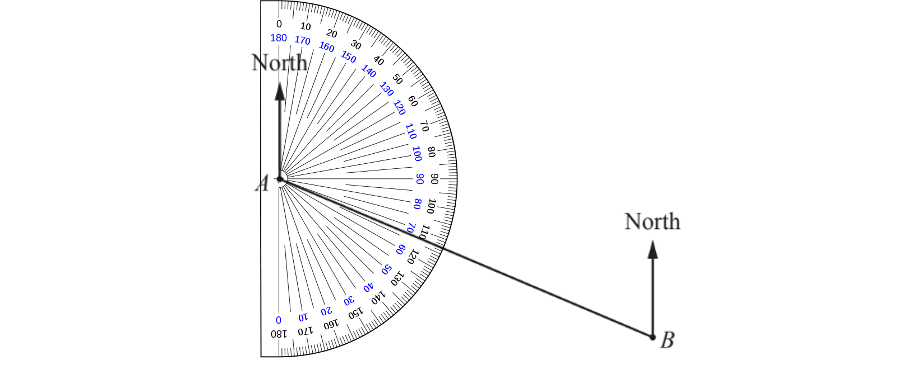

> *The angle is an obtuse angle.*

$113^{\circ}$ **[1]**
