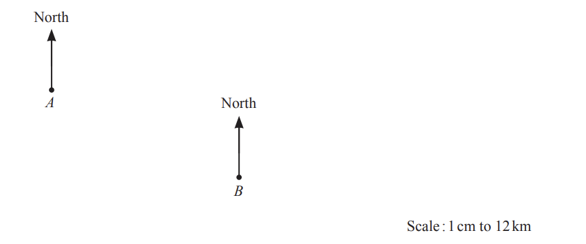
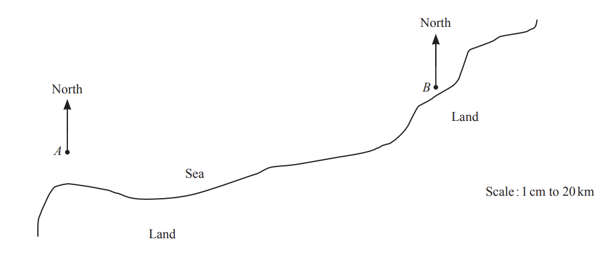
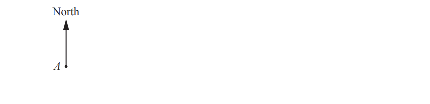
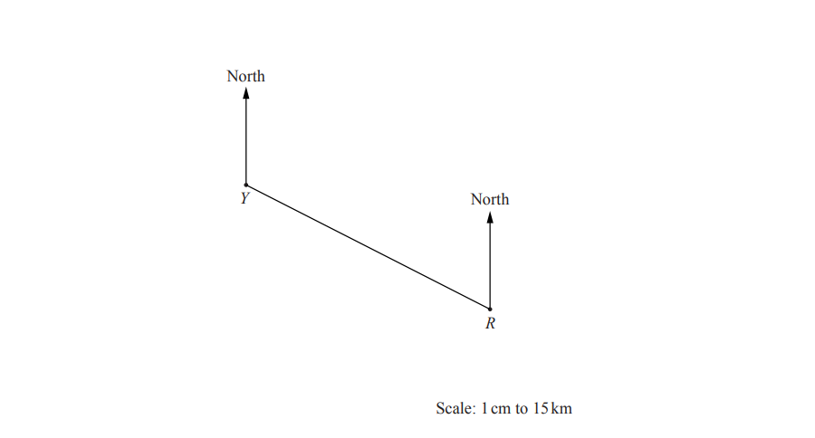
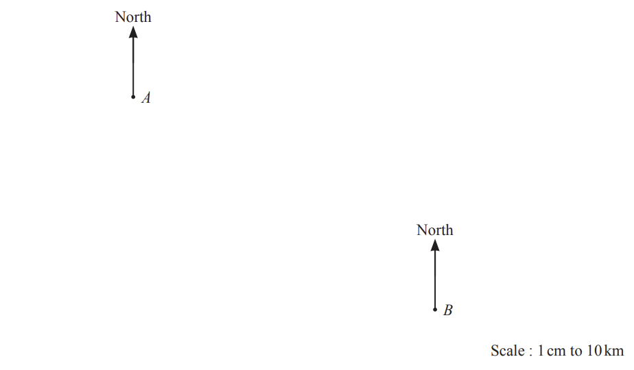
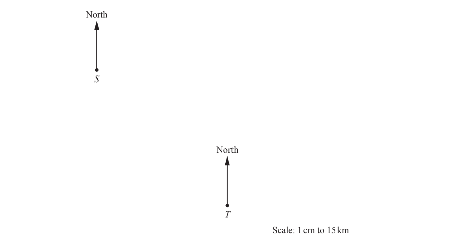

# Exam Questions — Bearings
**Geometry** · Cambridge (CIE) IGCSE maths (0607)
> Source: [https://www.savemyexams.com/igcse/maths/cie/international-maths/23/core/topic-questions/](https://www.savemyexams.com/igcse/maths/cie/international-maths/23/core/topic-questions/) · 14 questions across 1 sets

## Exam Questions (14 questions)

### Q1 — medium — 5 marks

**Q1** [2 marks]

The diagram shows the positions of an airport ($A$) and a train station ($T$) on a map.

The scale is 1 centimetre represents 2 kilometres.

Work out the actual distance, in kilometres, of the train station from the airport.

.............................. km

*Source: March 2019 0580/32 Q7A*

**Q1** [1 mark]

**Extract:**

The diagram shows the positions of an airport (![A]) and a train station (![T]) on a map.

Measure the bearing of the airport from the train station.

*Source: March 2019 0580/32 Q7B*

**Q1** [2 marks]

The bus station is not shown on the map. The bearing of the bus station from the train station is 318°.

Work out the bearing of the train station from the bus station.

*Source: March 2019 0580/32 Q7E*

### Q2 — hard — 4 marks

**Q2** [1 mark]

The diagram shows town $A$, town $B$ and town $C$ on a map. 
There is a straight road between town $A$ and town $B$. 
The scale of the map is 1 centimetre represents 8 kilometres.

Measure the bearing of town $A$ from town $B$.

*Source: June 2019 0580/32 Q4A*

**Q2** [2 marks]

**Extract:**

The scale of the map is 1 centimetre represents 8 kilometres.

Work out the actual distance, in kilometres, between town $A$ and town $B$.

............................................... km

*Source: June 2019 0580/32 Q*

**Q2** [1 mark]

**Extract:**

The diagram shows town ![A], town ![B] and town ![C] on a map. There is a straight road between town ![A] and town ![B]. The scale of the map is 1 centimetre represents 8 kilometres.

A straight road from town $C$ is on a bearing of 246°. 
It meets the road from town $A$ to town$B$at point $X$.

On the map, draw the road from town $C$ to point $X$. 
Label the position of $X$.

*Source: June 2019 0580/32 Q4D*

### Q3 — hard — 6 marks

**Q3** [5 marks]

The diagram shows the positions of town $A$ and town $B$.

The scale is 1 centimetre represents 12 kilometres.

i) Measure the bearing of town $B$ from town $A.$

[1]

ii) Find the actual distance from town $A$ to town $B$.

.............................................. km [2]

iii) Town $C$ is on a bearing of 064° from town $A$ and 028° from town $B$.

On the diagram, mark the position of town $C$.

[2]

*Source: Nov 2019 0580/33 Q6A*

**Q3** [1 mark]

The bearing of town $D$ from town $E$ is 245°.

Work out the bearing of town $E$ from town $D$.

### Q4 — hard — 5 marks

**Q4** [5 marks]

The diagram shows the positions of two buoys,$A$and $B$, in the sea. 
The scale is 1 centimetre represents 20 kilometres.

i) Work out the actual distance between buoy $A$ and buoy $B$.

.............................................. km [2]

ii) Measure the bearing of buoy$B$ from buoy $A$.

[1]

iii) Buoy $C$ is 120 km from buoy $B$ on a bearing of 300°.

On the , mark the position of buoy $C$.

[2]

*Source: Nov 2019 0580/31 Q8A*

### Q5 — easy — 1 marks

**Q5** [1 mark]

The diagram shows a map of Kingswood Park. 
There are two straight paths and one circular path. 
The scale is 1cm represents 200m.

Measure the bearing of South Gate from North Gate.

### Q6 — hard — 1 marks

**Q6** [1 mark]

The diagram shows the positions of a rock, $R$, and a statue, $S$, on a map. 
The scale is 1 centimetre represents 6 metres.

i) Work out the actual distance between$R$ and $S$.

............................................. m [2]

ii) A flagpole, $F$, is on a bearing of 164° from $S$.

Work out the bearing of $S$ from $F$.

[2]

iii) Ishaan uses the map to find some treasure, $T$.
$T$ is on a bearing of 076° from $R$ and on a bearing of 337° from $S$.

Mark the position of $T$ on the map.

[2]

### Q7 — medium — 2 marks

**Q7** [2 marks]

Point $B$ is 36 km from point $A$on a bearing of 140°.

Using a scale of 1 centimetre to represent 4 kilometres, mark the position of $B$.

Scale: 1cm to 4 km

*Source: June 2020 0580/31 Q10A*

### Q8 — medium — 2 marks

**Q8** [2 marks]

The bearing of Bartown from Whitestoke is 073°.

Work out the bearing of Whitestoke from Bartown.

*Source: March 2018 0580/32 Q8B*

### Q9 — medium — 3 marks

**Q9** [3 marks]

The diagram shows the positions of two towns, Yatterford ($Y$) and Rexley ($R$), on a map. 
The scale is 1 centimetre represents 15 kilometres.

i) Work out the actual distance of Rexley from Yatterford.

............................. km [2]

ii) Measure the bearing of Rexley from Yatterford.

[1]

*Source: March 2018 0580/31 Q8A*

### Q10 — easy — 2 marks

**Q10** [2 marks]

The diagram shows a rock, $R$.

1 centimetre represents 30 metres.

A lighthouse, $L$, is 210m from $R$, on a bearing of 125°.

On the diagram, mark the position of $L$.

*Source: May/June 2019 0580/13 Q13*

### Q11 — easy — 2 marks

**Q11** [2 marks]

The bearing of $B$ from $A$ is 105°. 
Find the bearing of $A$ from $B$.

*Source: June 2020 0580/12 Q10*

### Q12 — medium — 4 marks

**Q12** [4 marks]

The diagram shows the positions of two towns, $A$ and $B$. 
1 centimetre on the diagram represents 10 kilometres.

i) Work out the actual distance between town $A$ and town $B$.

............................................ km [2]

ii) Town C is 85 km from town A on a bearing of 100°.

On the diagram, mark the position of town C.

[2]

*Source: Nov 2020 0580/32 Q4B*

### Q13 — easy — 3 marks

**Q13** [3 marks]

The  diagram shows the positions of town $S$ and town $T$. 
1 centimetre on the diagram represents 15 kilometres.

i) Find the actual distance between these two towns.

....................................... km  [2]

ii) Measure the bearing of town $T$ from town $S$.

[1]

*Source: June 2019 0580/11 Q20B*

### Q14 — easy — 1 marks

**Q14** [1 mark]

Measure the bearing of $B$ from $A$.

*Source: Nov 2019 0580/12 Q3*

