# Mark Schemes — Circle Theorems
**Geometry** · Cambridge (CIE) IGCSE maths (0607)

## Exam Questions (21 questions)

### Q1
> *Congruent means 'identical to'*

> *Triangles **AOC** and triangles **BOC** are both **right-angled triangles *

*Angle *$OAC=OBC=90^{\circ}$ 
*(angle between tangent and radius *$=90^{\circ}$*)*

**[1]**

> *The side **OC** is in both triangles*

**OC ***is a common side in both triangles*

> * **OA **and **OB **are both radiuses of the same circle*

* ***OA*** = ***OB**
*(they are both radiuses of the same circle)*

**[1]**

> *AC **and **BC **are tangents to a circle from the same point*

* ***AC*** = ***BC**
*(tangents to a circle from the same point are equal)*

**All reasons must be given clearly for full marks [1]**

### Q2
i) *Locate the angle requested by following the line from point *$B$* to point *$O$* to point *$D$* and choosing the angle that is greater than 180**o*

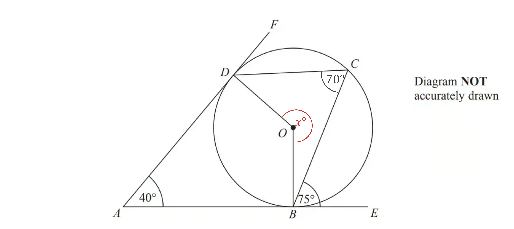

> *Find the angles **ABO** and angle **ADO*

*Angle ***ABO*** = Angle ***ADO*** = 90**o**   *
*(Angle between a tangent and a radius is 90**o**)*

**Either right angle marked [1]**

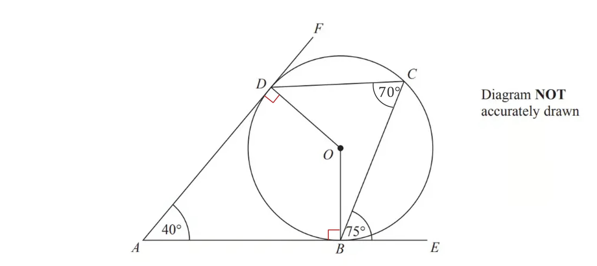

> *Find angle **BOD*

*Two tangents from a point are equal so ***AD = AB*** *

*Angle ***BOD*** + Angle ***BAD*** + Angle ***ADO*** + Angle ***ABO*** = 360**o**   (Angles in a quadrilateral = 360**o**)*

*Angle ***BOD*** + 40 + 90 + 90 = 360 *
*Angle ***BOD*** = 140**o*

** [1]**

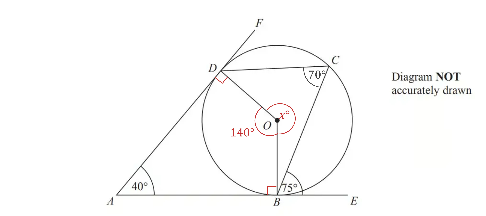

> *Find the reflex angle **BOD*

*Reflex Angle ***BOD ***+ Obtuse Angle ***BOD*** = 360**o**   *
*(Angles around a point = 360**o**)*

**Reflex Angle ****BOD**** + 140 = 360 **
**Reflex Angle ****BOD**** = 220****o*** ***[1]**
**Clear working needed for marks to be gained**

ii) *Find angle **CBO*

*Angle ***CBO*** + Angle ***ABO*** + Angle ***CBE*** = 180**o**   *
*(Angles along a straight line = 180**o**)*

*Angle ***CBO*** + 90 **o**+ 75**o** = 180**o*
*Angle ***CBO*** = 15**o*

**[1]**

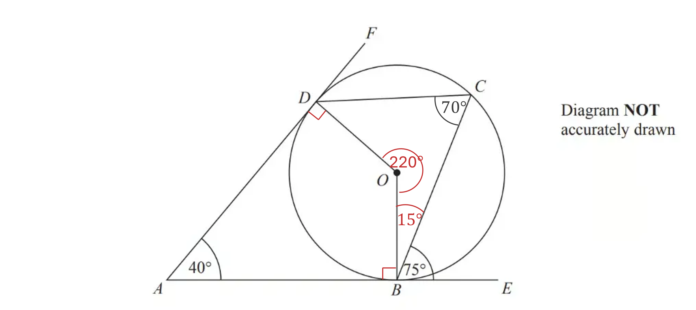

> *Find angle **ODC*

*Angle ***ODC*** + Angle ***DCB*** + Angle ***CBO*** + Reflex Angle ***BOD***  = 360**o*
*(Angles in a quadrilateral = 360**o**)*

*Angle ***ODC ***+ 70 + 15 + 220 = 360*

**Angle ****ODC ****= 55****o** **[1]**

### Q3
i) *Locate the angle requested by following the line from point *$A$* to point *$B$* to point *$P$

> *Two tangents from a circle to the same point outside of the circle are equal lengths*

> *This means that triangle *$ABP$* **is isosceles*

*Angle *$ABP=$* Angle *$BAP$*   *
*(Base angles in an isosceles triangle are equal)*

**Angle **$ABP=71^{\circ}$** ****[1]**
**Two tangents from a point to a circle are equal**** [1]**

ii) *Locate the angle requested by following the line from point *$A$* to point *$P$* to point *$B$

> *Find the angle *$APB$*using the sum of the angles in a triangle*

*Angle *$APB$* + Angle *$ABP$* + Angle *$BAP=180^{\circ}$*   *
*(Angles in a triangle = 180**o**)*

*Angle *$APB+71+71=180$

*Angle *$APB=180-2(71)$

**Angle **$APB=38^{\circ}$ **[1]**
**The angles in a triangle add up to **$180^{\circ}$ **[1]**

### Q4
> *Find angle **OBC*

*Angle ***OBC*** = 90**o**   *
*(Angle between a tangent and a radius = 90**o**)*

**[1]**

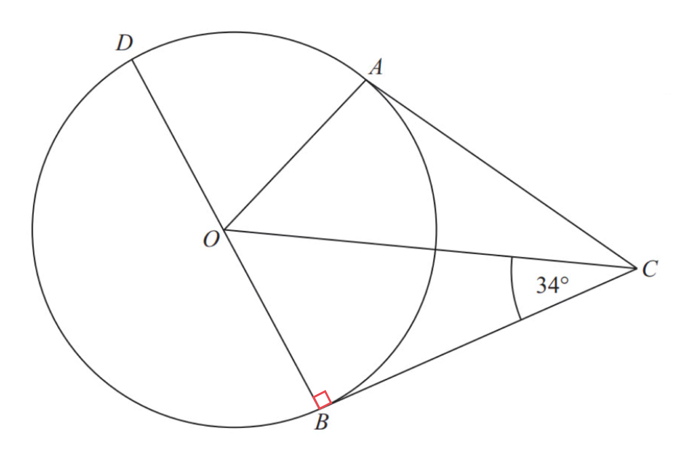

> *Find angle **BOC*

*Angle ***BOC*** + Angle ***OBC*** + Angle ***BCO*** = 180**o**   *
*(Angles in a triangle = 180**o**)*

**[1]**

*Angle ***BOC*** + 90 + 34 = 180*
* Angle ***BOC*** = 56**o*

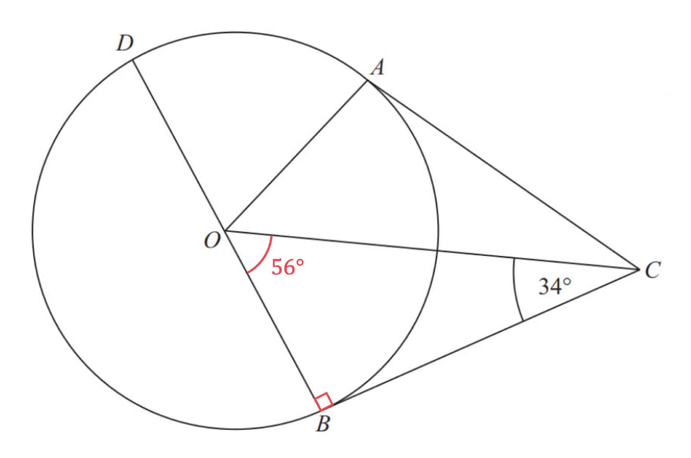

> *Find angle **AOC*

*Angle ***AOC*** = Angle ***BOC*** = 56**o**   *
*(Triangles ***AOC*** and ***OBC*** are identical because two tangents are equal)*

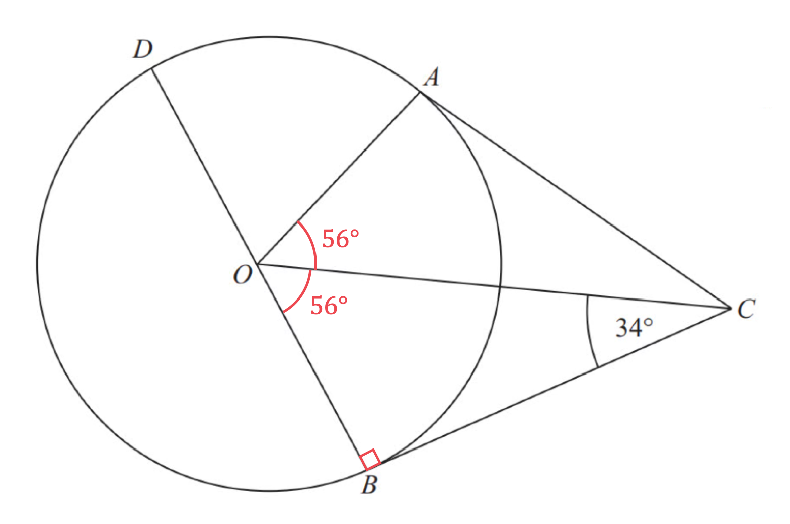

> *Find angle **DOA*

*Angle ***DOA*** + Angle ***AOC*** + Angle ***BOC*** = 180**o**   *
*(Angles along a straight line = 180**o**)*

*Angle ***DOA*** + 56 + 56 = 180*

**Angle ****DOA**** = 68****o**** [1]**

### Q5
> *Find angle **PTO*

*Angle *$PTO=90^{\circ}$*  *
*(Angle between a tangent and a radius = 90**o**)*

**Value of 90****o**** seen ****[1]**

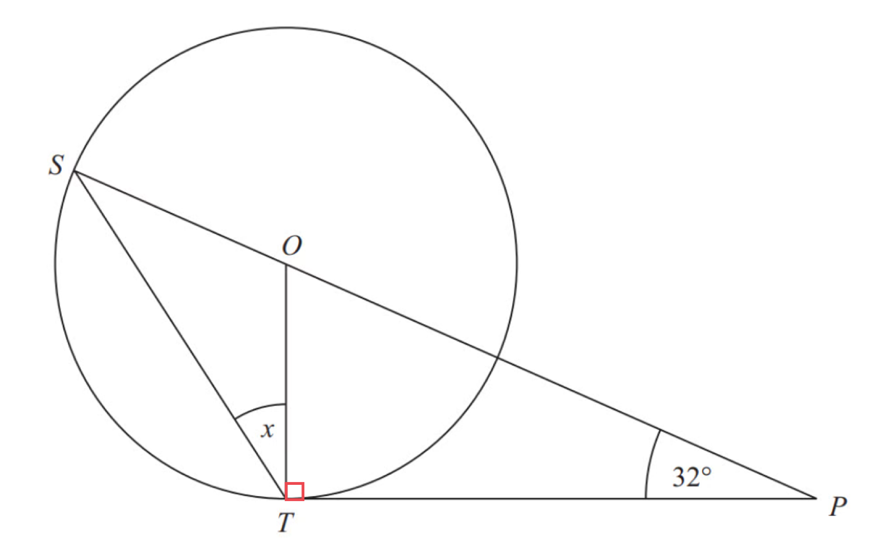

> *Find angle **TOP*

*Angle ***TOP*** + Angle ***OTP*** + Angle ***TPO*** = 180**o**   *
*(Angles in a triangle *$=180^{\circ}$*)*

*Angle *$TOP+90^{\circ}+32^{\circ}=180^{\circ}$
*Angle *$TOP=58^{\circ}$

**Correct method to find TOP or value of 58****o**** seen ****[1]**

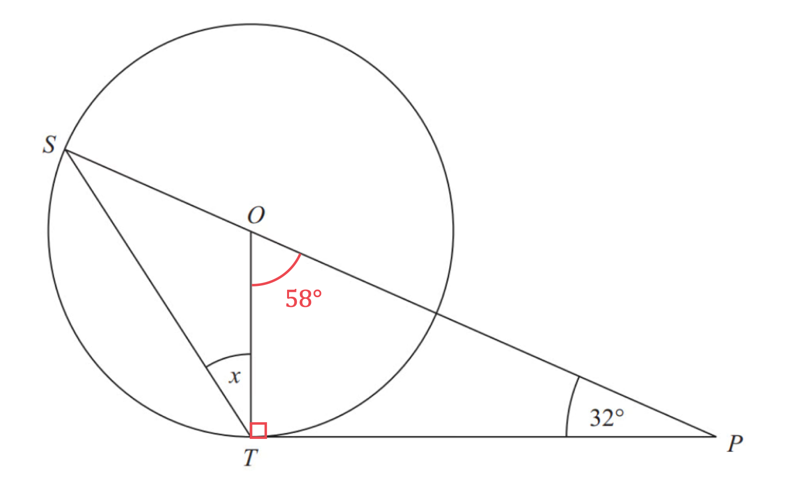

> *Find angle **TOS*

*Angle *$TOS$* + Angle*$TOP=180^{\circ}$
*(Angles along a straight line *$=180^{\circ}$*)*

*Angle*$TOS+58^{\circ}=180^{\circ}$
*Angle *$TOS=122^{\circ}$

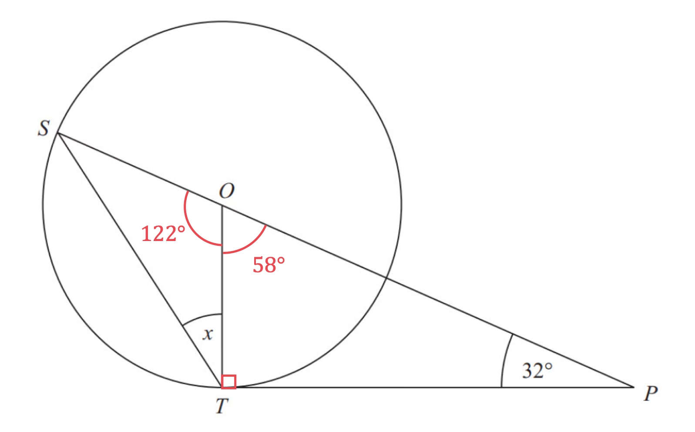

> *Look at triangle **OST*

*Angle *$OST=$* Angle *$STO=x^{\circ}$* *
*(Triangle ***OST*** is an isosceles triangle)*

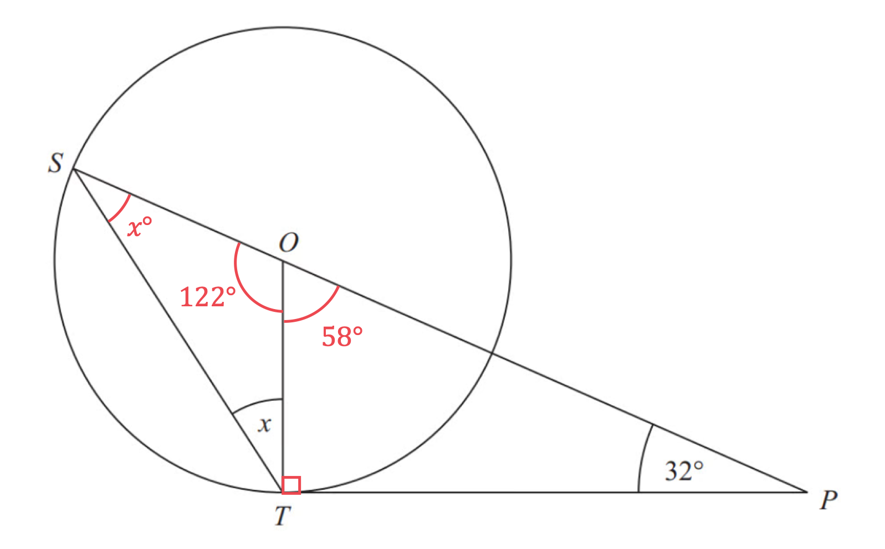

> *Find angle *$x$

$122+x+x=180$* *
* (Angles in a triangle = 180**o**)*

`table row cell 122 plus 2 x end cell equals cell 180 space space end cell row cell 2 x end cell equals 58 end table`

**Method to find **$x$**[1]**

$x$** ****= 29****o*** ***[1]**

### Q6
(i) *Locate the angle requested by following the line from point *$O$* to point *$B$* to point *$A$

> *A tangent and a radius always meet at *$90^{\circ}$

$90^{\circ}$** [1]**

(ii) *Locate the angle requested by following the line from point *$B$* to point *$O$* to point *$C$

> *Angle *$BOC$* is the only unknown angle in the quadrilateral *$ABOC$* as angle *$OCA$* is also *$90^{\circ}$

> *Angles in a quadrilateral add up to *$360^{\circ}$

$360-90-90-38$

$142^{\circ}$** [1]**

### Q7
i) *The line *$OB$* is a straight line going from the centre of the circle to a point on the circumference*

**The line **$OB$** is a radius**** ****[1]**

ii) *The angle between a tangent and a radius is always *$90^{\circ}$

**The angle **$ABO$** is **$90^{\circ}$** because the angle between a radius (**$OB$**) ****and a tangent (**$AB$**)**** is always**** **$90^{\circ}$ **[1]**

iii) *Angles in a triangle add up to *$180^{\circ}$

$\mathrm{Angle}AOB=180-90-49$

$\mathrm{Angle}AOB=41^{\circ}$ **[1]**

iv) *Lines *$OB$* and *$DC$* are parallel*

**Angle**** **$ADC$** = angle **$AOB$** as the****y are corresponding angles ****[1]**

v) *Triangle *$ADC$* is an enlargement of triangle *$AOB$

**Triangle **$AOB$** is similar to triangle **$ADC$ **[1]**

via) *Triangle *$AOB$* is a right-angled triangle, use SOHCAHTOA to find length *$OB$

> *Label the sides of the triangle: hypotenuse, adjacent and opposite  *

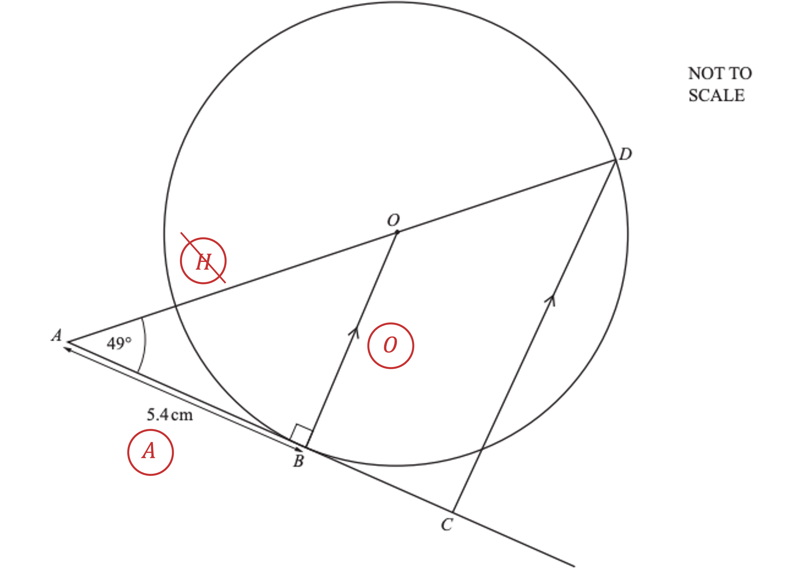

> *You know the adjacent side and want to calculate the opposite side, so use the tangent ratio, *$\mathrm{tan}θ=\frac{O}{A}$

> *Substitute in the values that you know*

$\mathrm{tan}49=\frac{OB}{5.4}$

**[1]**

> *Multiply both sides by 5.4 to find length *$OB$

$5.4\times\mathrm{tan}49=OB$

$OB=6.21198...$

> *Round*

$OB=6.21\mathrm{cm}$ **[1]**

**Final answer:** **Answers between 6.211 and 6.212 will be accepted**

> * *

vib) *Use Pythagoras' theorem, *$a^{2}+b^{2}=c^{2}$* to calculate the length *$OA$ 
*It may help you to label the triangle first*

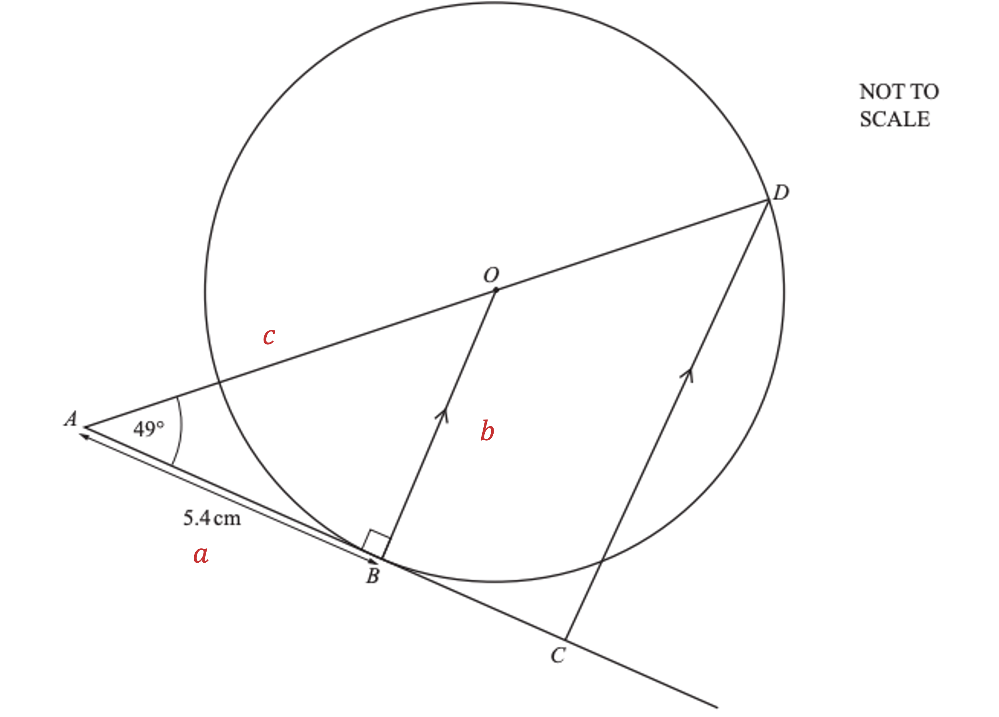

> *Substitute in the lengths that you know, use the unrounded value for *$OB$

$5.4^{2}+6.21198...^{2}=OA^{2}$

**[1]**

> *Take the square root of both sides*

$\sqrt{5.4^{2}+6.21198...^{2}}=OA$

> *Evaluate*

$OA=8.23096...$

> *Round*

$OA=8.23\mathrm{cm}$ **[1]**

**Final answer:** **Answers between 8.229 and 8.231 will be accepted**

> * *

vic) *Use the formula for the area of a triangle, *$A=\frac{1}{2}\times\mathrm{base}\times\mathrm{height}$ 
*Use the unrounded value of *$OB$

$A=\frac{1}{2}\times5.4\times6.21198...$

**[1]**

$A=16.77237...$

> *Round*

$16.8\mathrm{cm}^{2}$ **[1]**

**Final answer:** **Answers between 16.76 and 16.77 will be accepted**

### Q8
> *The circle theorem states that if the corners of a triangle lie on the circle and one of its sides is the diameter then the triangle is right-angled*

*Angle ***KLM ***= 90°*

**[1]**

> *Interior angles in a triangle add up to 180°*

*Angle ***MKL*** + Angle ***KML ***+ 90° = 180°*

*Angle ***MKL*** + Angle ***KML ***= 90°*

> *Triangle **KLM **is isosceles so the other two angles (**MKL **and **KML**) are equal Therefore they are each half of 90°*

*Angle ***MKL ***= Angle ***KML ***= 90° ÷ 2 = 45°*

> *The circle theorem states that the angle between a radius (or diameter) and a tangent is 90° Therefore angle MKS is 90° which means angles MKL and LKS add up to 90°*

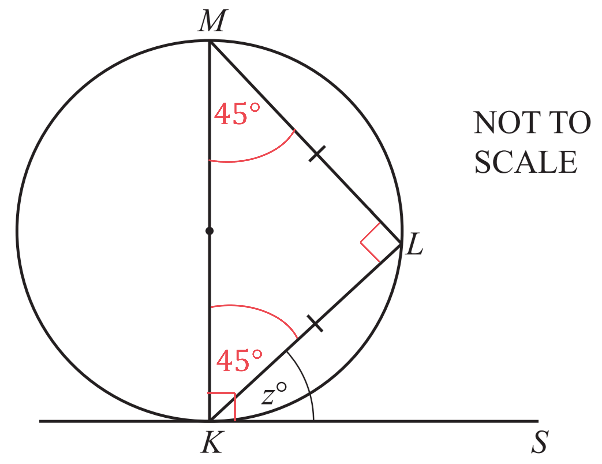

`table row cell 45 plus z end cell equals 90 row z equals cell 90 minus 45 end cell end table`

$z=45$ **[1]**

### Q9
(i) *PQ **is a **chord**.*

** **** Chord**** ****[1]**

(ii) *AB** is a tangent and **OP** is a radius. **OPB **is *$90^{\circ}$* because the **angle** between a **tangent** and a **radius** is *$90^{\circ}$*. *

**The angle between a tangent and a radius is **$90^{\circ}$** ****[1]**

(iii) *Triangle **QOP **is isosceles, because two of its sides are radii of the circle. *
*Work out one of the base angles by subtracting *$53^{\circ}$* from *$90^{\circ}$* (radius and a tangent meet at *$90^{\circ}$*). ** *

$\mathrm{angle}OPQ=90-53=37$

* ***[1]**

> *Add together the base angles and subtract from 180 (total degrees in a triangle). *

`180 minus open parentheses 37 plus 37 close parentheses equals 106`

**[1]**

** **$106^{\circ}$** [1]**

### Q10
i) *The angle in a semi-circle is a right angle, so angle FDE is 90°.*

**[1]**

> *Angles in a triangle sum to 180 so subtract what we know from 180.  *

$180-90-63=27$

**27°** **[1]**

ii) *EF** is the hypotenuse and **DF** is the side adjacent to the given angle. Use trigonometry to work out side **DF.  *

`cos open parentheses 63 close parentheses space equals fraction numerator space D F over denominator 12 end fraction`

**[1]**

> *Multiply both sides by 12 and type this into your calculator.  *

`12 space cross times space cos open parentheses 63 close parentheses space equals space D F space
D F thin space equals space 5.447...`

> *Round to three significant figures.  *

**5.45 cm**** ****[1]**

### Q11
i) $OA=OB$* (radii of the circle), therefore *$OAB$* **is an isosceles triangle.*

> *The size of *`angle O B A`* is the same as *`angle O A B`* and so*

> * *`angle O B A equals angle O A B equals 24 degree`

**[1]**

> *Using the rule that angles in a triangle sum to *$180^{\circ}$*, the missing angle *$x$* is equal to*

> * *`180 minus open parentheses 24 plus 24 close parentheses`

* *

**x**** = 132**$^{\circ}$** ****because triangle **$OAB$** is an isosceles triangle*** ***[2] **

**1 mark for angle, 1 mark for reason**

** **

ii) *Use the circle theorem: the angle in a semicircle is *$90^{\circ}$*.*

> * *`angle C D E equals 90 degree`

> *Angles in a triangle sum to *$180^{\circ}$* so subtract the two known angles to find *$y$*. *

`180 minus open parentheses 90 plus 73 close parentheses`

** **** ****y**** =**** ****17**$^{\circ}$** ****because the angle in a semicircle is 90**$^{\circ}$** [2] **

**1 mark for angle, 1 mark for reason**

** **

iii) *A tangent is a line that is perpendicular to the radius of a circle at point *$A$*.*

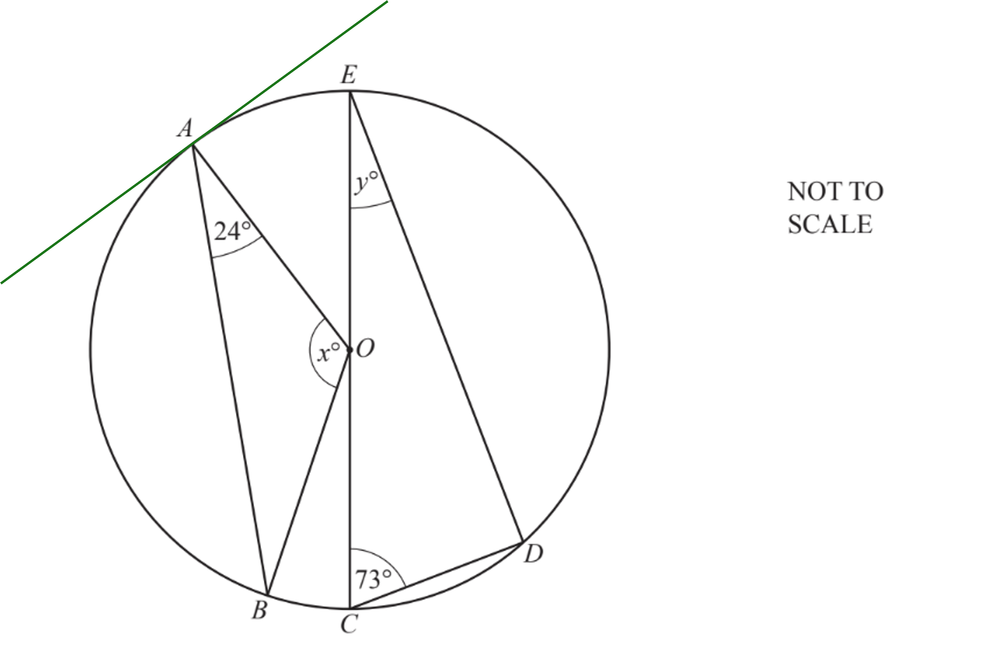

**[1]**

### Q12
> *Triangle *$ABC$* is a triangle in a semicircle, therefore angle *$ACB$* is *$90^{\circ}$

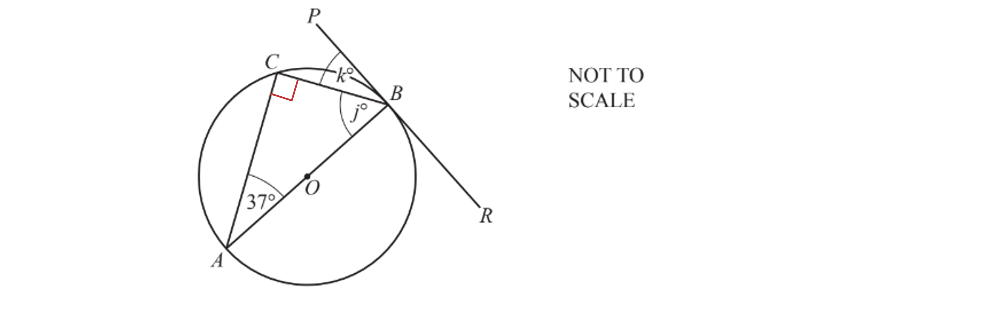

**[1]**

*Angles in a triangle add up to *$180^{\circ}$ 
*Subtract angles *$CAB$* and *$ACB$* from *$180^{\circ}$* to find *$j$

`table row cell 180 minus 37 minus 90 end cell equals j row j equals 53 end table`

> *The angle between a radius *`open parentheses O A close parentheses`* and a tangent *`open parentheses R P close parentheses`* is always *$90^{\circ}$* so angle *$OBP=90^{\circ}$

`table attributes columnalign right center left columnspacing 0px end attributes row cell j plus k end cell equals 90 row cell 53 plus k end cell equals 90 row k equals 37 end table`

$j=53$** [1]**
 $k=37$ **[1]**

### Q13
> *Use the circle theorem the angle in a semicircle is *$90^{\circ}$*.*

> *As the sum of angles in a triangle is *$180^{\circ}$*.  *

`180 minus open parentheses 90 plus 61 close parentheses equals 29 degree`

**  **$b=29^{\circ}$** ****because the angle in a semicircle is**** **$90^{\circ}$** [2] **

**1 mark for angle, 1 mark for reason**

### Q14
> *The** angle** in a **semicircle** is *$90^{\circ}$*.*

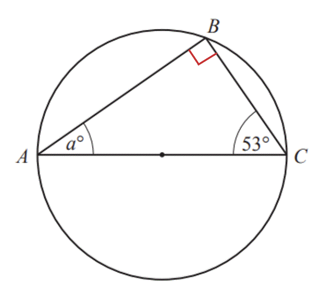

**[1]**

> *Angles** in a **triangle** add up to *$180^{\circ}$*.*

> *Subtract *$90^{\circ}$* and *$53^{\circ}$* from *$180^{\circ}$*.*

$180-90-53=37$

$37^{\circ}$* ***[1]**

### Q15
*The angle between a radius and a tangent is always *$90^{\circ}$ 
*To find angle *$BAC$*, subtract *$42$* from the right-angle*

$BAC=90-42$

$\mathrm{Angle}BAC=48^{\circ}$** [1]**
> *A triangle in a semicircle is a right-angled triangle, so angle *$ACB=90^{\circ}$

> *Angles in a triangle sum to *$180^{\circ}$* so subtract angles *$ACB$* and *$BAC$* from *$180^{\circ}$*to find angle *$ABC$

$\mathrm{Angle}ABC=180-90-48$

**[1]**

$\mathrm{Angle}ABC=42^{\circ}$ **[1]**

### Q16
> *The tangent *$HJ$* is perpendicular to the radius *$OG$*.*

$x=90-58=32^{\circ}$

$x=32$** [1]**

> *The angle *$y$* is in the alternate segment to the angle *$FGH$* and so they are equal.*

$y=58$ **[1]**

### Q17
(i) *The perimeter of a circle is called the **circumference**.*

> *Points **X, Y **and **Z **are on the **circumference **of the circle.  *

**Circumference** **[1]**

(ii) *The **angle **in a **semicircle** is **90°** *

> *The words **angle**, **semicircle **and **90°** are key words which must be used.  *

**The angle in a semicircle is 90°*** ***[1]*** *

### Q18
i) $AC$ *is a straight line that meets the circumference of the circle at two different points and passes through the centre of the circle*

$AC$* ***is a diameter*** ***[1]**

ii) $AB$ *is a straight line that meets the circumference of the circle at two different points but does **not** pass through the centre of the circle*

$AB$** ****is chord**** [1]**
> *Triangle *$ABC$* is a triangle in a circle where one of the edges lie along the diameter of the circle so it is a right-angled triangle*

**The angle in a semicircle is**** **$90^{\circ}$ **[1]**

### Q19
i) *A chord is a straight line that joins any two points on the circumference of a circle.  *

**Any line that joins two points on the circumference**** ****[1]**

ii) *Angle ABC is a right angle because of the circle theorem.  *

**The angle in a semi-circle is 90°** **[1]**

### Q20
> *The tangent and the radius are perpendicular at the point where they meet.  *

**Angle**** **$ABD=90^{\circ}$** because the tangent meets the radius at a right-angle**** ****[2] **

**1 mark for angle, 1 mark for reason**

### Q21
> *A straight line that touches a single point on the circumference of a circle is called a tangent*

**Line **$DE$** is a tangent**** [1]**
> *A radius is a straight line between the centre of a circle and a point on its circumference*

> *Draw any radius on the diagram*

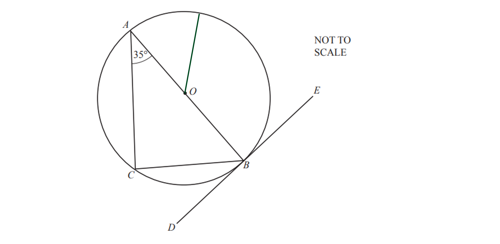

**[1]**
i) *Angle *$ABD$* is a point on the circumference of the circle at which a radius and a tangent meet*

**Final answer:** **Angle **$ABD=90^{\circ}$** ****because the angle between a radius and a tangent is always **$90^{\circ}$** **

**1 mark for the angle, 1 mark for correct reason ****[2]**

ii) *Triangle *$ABC$* is a triangle inside a circle where one length lies along the diameter*
*Angle *$ACB$* is the angle opposite the length that lies along the diameter (the longest side)*

**Final answer:** **Angle **$ACB=90^{\circ}$** ****because the angle of a triangle in a semicircle is always **$90^{\circ}$** **

**1 mark for the angle, 1 mark for correct reason ****[2]**
