# Mark Schemes — Symmetry & Shapes
**Geometry** · Cambridge (CIE) IGCSE maths (0607)

## Exam Questions (31 questions)

### Q1
> *The shape currently has no lines of symmetry. *
*We would need to shade more than two squares for there to be a horizontal or vertical line of symmetry, so the line of symmetry must be diagonal. *
*A line of symmetry acts as a mirror line so the shape must be identical on either side of the line. *
*Drawing in the line of symmetry will help.*

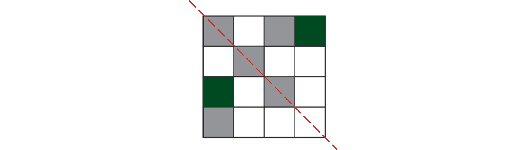

> *Or*

**Either pattern ****[1]**

### Q2
> *Co-ordinates should be in the form (**x , y**)*

**(7 , 3)**** ****[1]**
> *Draw the mirror line and plot the point the same distance away from the mirror line as B.*

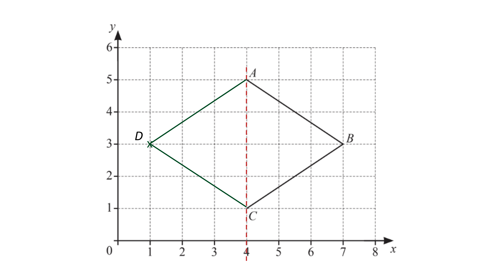

**[1]**
> *The shape has 4 equal sides but no right-angles.*

**Rhombus** **[1]**
> *The order of rotational symmetry refers to the number of times the shape will look the same when rotated about the centre. *
*The shape will look identical after 180° and 360°. After 90°, the shape will look different because the length AC is smaller than the length BD.*

**2**** ****[1]**

### Q3
> *For the shape to have rotational symmetry of order 2, it must look the same 2 times if rotated through *$360^{\circ}$*.*

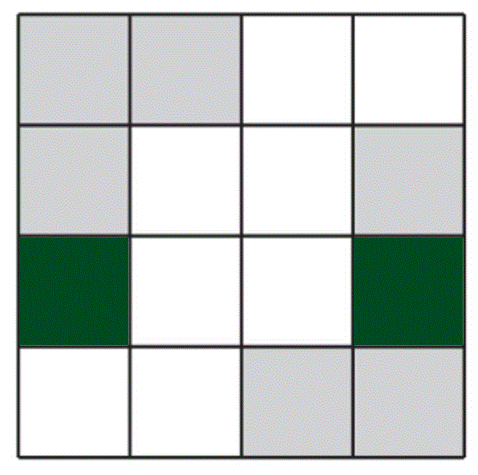

** [1]**

### Q4
> *As the shape has a rotational symmetry of order 4, the shape must be identical to the original after every rotation of*

$\frac{360}{4}=90^{\circ}$

> *Shade the appropriate two squares*

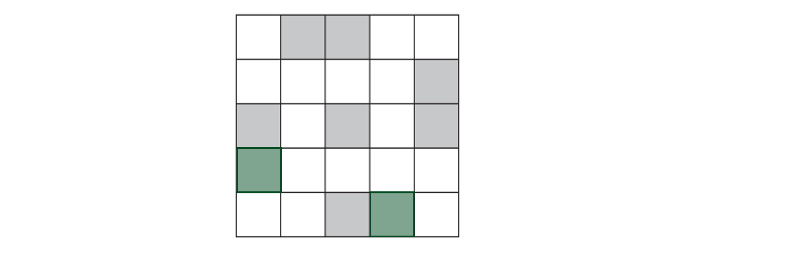

**[1]**

### Q5
> *The quadrilateral has two pairs of equal side lengths, and the diagonals meet at *$90^{\circ}$

**Kite** **[1]**

### Q6
i) *Any line of symmetry must split the shape into two equal halves that are opposite to each other*

**[1]**

ii) *Any line of symmetry must split the shape into two equal halves that are opposite to each other*

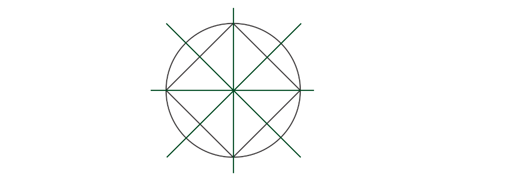

**Minimum 2 correct lines of symmetry**** ****[1]**
**All 4 correct lines of symmetry**** [1]**
> *Rotational symmetry describes the number of times the image of a shape is identical to the original as it is rotated through one full turn about its centre.*

> *The quadrilaterals that have a rotational symmetry of 2 are:*

*Rectangle*

*Parallelogram*

*Rhombus*

> *Of these, the rectangle and the rhombus have 2 lines of symmetry*

**Rectangle*** ***[1]**

**Rhombus is accepted**

### Q7
> *There are only two shapes which have rotational symmetry of order 1 and only one line of symmetry, a **kite **and an **isosceles trapezium**.*

> * *

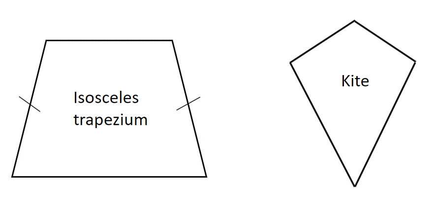

> * *

**Isosceles trapezium**** or ****kite ****[1]**

### Q8
> *Angles less than *$90^{\circ}$* are called **acute **angles.*

**Acute**** ****[1]**
> *A **polygon **is a shape with straight sides.*

> *A polygon** **with 5 sides is called a **pentagon**.*

**Pentagon**** ****[1]**
> *A **quadrilateral **is a 4 sided shape.*

> *Note that **rectangles**, **squares**, and **parallelograms **all have 2 pairs of parallel sides.*

> *A 4 sided shape with exactly one pair of parallel sides is called a **trapezium**.*

**Trapezium**** ****[1]**

### Q9
> *A quadrilateral** **with no parallel sides, two pairs of equal sides, and one line of symmetry is called a **kite**.*

> * *

**Kite** **[1]**

### Q10
> *A quadrilateral with only one pair of parallel sides is a trapezium. A rectangle has two pairs of parallel sides.*

**Trapezium** **[1]**
> *An angle that is greater than *$90^{\circ}$* and smaller than *$180^{\circ}$* is called obtuse*

**Obtuse** **[1]**

### Q11
> *Use a ruler to measure the line. Give your answer in mm.*

$48\mathrm{mm}$* ***[1]**

**46 - 50 accepted**
(i) *Use a protractor to measure the angle.*

$223^{\circ}$* ***[1]**

**221 - 225 accepted**

(ii) *A **reflex **angle is greater than *$180^{\circ}$* and less than *$360^{\circ}$*.*

**Reflex** **[1]**

### Q12
> *An angle less than *$90^{\circ}$* is called an **acute **angle.*

> * *

**Acute** **[1]**
(i) *Line **AB **is a **chord**.*** **

**Chord** **[1]**

(ii) *OA **is the **radius **of the circle. Double the **radius **to find the **diameter**. *

> $8\times2=16$* *

**16 cm** **[1]**

### Q13
> *Line up 0 on the ruler at the point A and turn the ruler so that point B lies further up the scale and read off the measurement in millimetres*

**Final answer:** **94 mm**** [1]**

**Centre of **$AB$** ****marked**** [1]**
**Correct circle drawn**** [1]**

### Q14
> *A line of symmetry means that the shape is identical either side of it, like a mirror line. This shape has a vertical line of symmetry and a horizontal line of symmetry. It can help to draw the lines of symmetry on the shape and check that it is identical either side.*

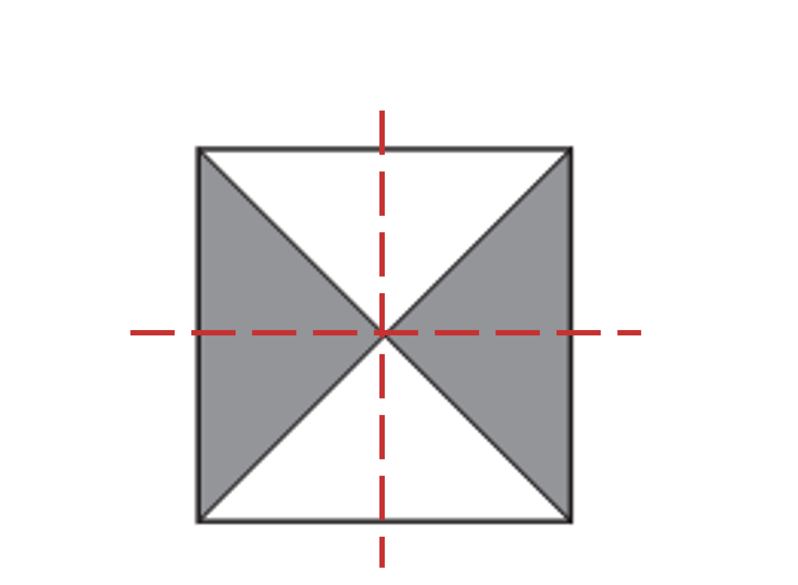

**2 lines of symmetry**** ****[1]**

> *Rotational symmetry refers to how many times a shape looks identical when it has been rotated. Take care to consider which triangles have been shaded for this shape. If we rotated the shape by 90°, it would not look the same because the shaded triangles would be in a different place, so we would need to rotate it by 180°, and then 180° again. It would only look the same twice.*

**order of rotational symmetry 2** **[1]**

### Q15
> *The order of rotational symmetry is the number of times the shape is identical to the original after a rotation about its centre through one full turn*

**3**** ****[1]**
> *Draw in a mirror line through each pair of opposite vertices*

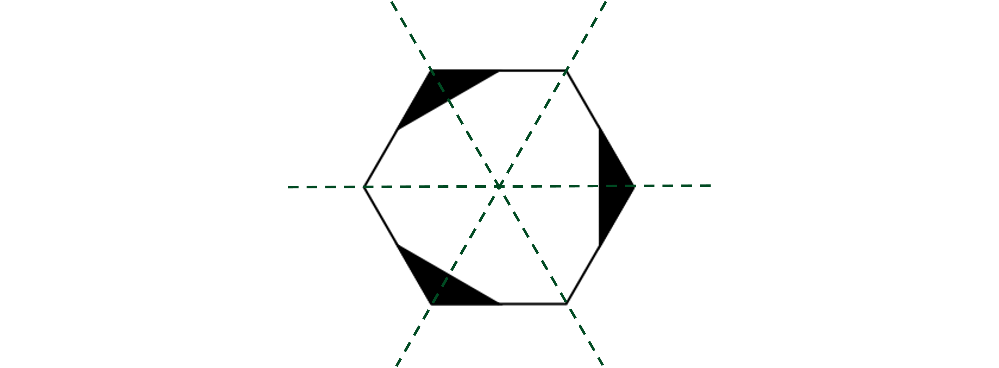

**[1]**

### Q16
> *If the first shape was rotated, it would look the same **4 times** as it passed through a full *$360^{\circ}$* turn.*

> *The second shape would look the same **2 times.*

> * *

**4      2** **[2]**

**one mark for each**

### Q17
> *A rhombus has 4 sides of equal size but no right-angles. It looks like a slanted square.*

**Shape C ****[1]**
> *Quadrilateral A has one pair of parallel sides.*

**Trapezium**** ****[1]**

### Q18
> *A **regular octagon **will look the same 8 times as it is rotated through *$360^{\circ}$*.*

> * *

**8**** ****[1]**

### Q19
> *An **equilateral **triangle has three lines of symmetry, one through each vertex.*

> *The second shape only has one line of symmetry.*

> *Draw the lines onto the shapes with a ruler.*

> * *

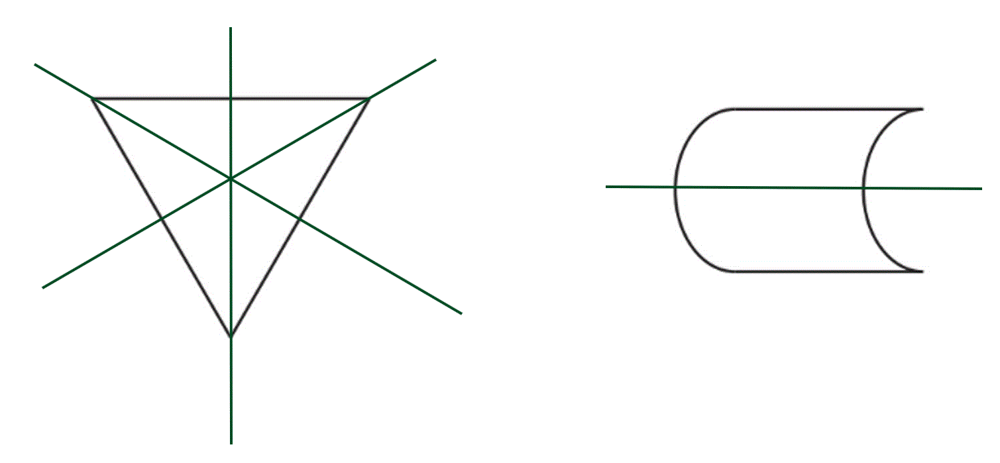

**All correct with no extras**** ****[3]**
> *The shape will look the same **2 **times as it is rotated though *$360^{\circ}$*.*

** ****2** **[1]**

### Q20
i) *An obtuse angle has a size within the range* $90^{\circ}<x<180^{\circ}$*.*

**Obtuse** **[1]**

** **

ii) *Place the centre of the protractor at the vertex of the angle and turn so that *$0^{\circ}$* is aligned with one of the straight lines.*

> *Read the angle off the correct scale on the protractor where the other line crosses the same scale.*

**134**$^{\circ}$ **[1]**

### Q21
> *A quadrilateral with one pair of parallel sides is a trapezium.*

**Trapezium**** [1]**

### Q22
> *The shape will look the same **two **times as it is rotated *$360^{\circ}$*about its centre.*

> * *

**2**** [1]**

### Q23
i) *Line up the protractor so that the 0 is on one of the lines and the centre is at the point where the two lines meet.*

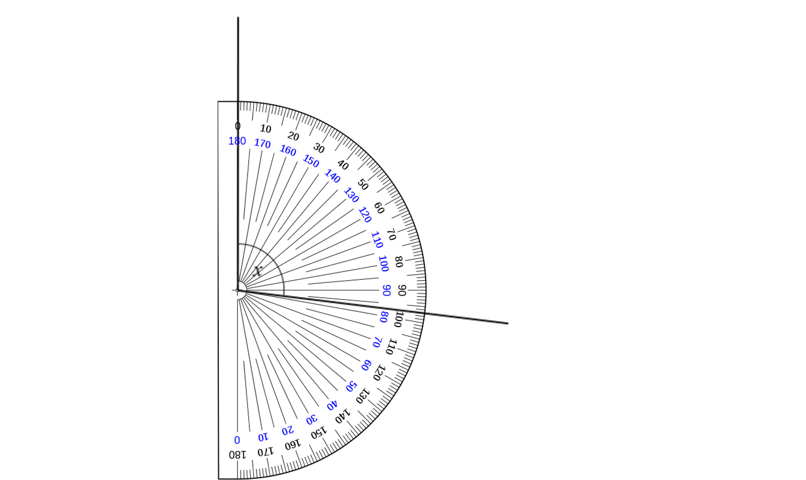

> *Start from the 0 that is on the line, count up until you reach the second line.*

$97^{\circ}$** [1]**

ii) *The angle is greater than 90° but less than 180°.*

**Obtuse**** ****[1]**

### Q24
> *Rotational symmetry refers to the number of times a shape looks the same as it is rotated *$360^{\circ}$* about its centre. If we put a pencil in the centre of the pentagon and turn it, it will look the same 5 times.*

**5**** ****[1]**

### Q25
> *A reflex angle is greater than *$180^{\circ}$*.*

**Angle **$C$** is a reflex angle** **[1]**

### Q26
(i) *A quadrilateral with one pair of parallel sides is called a **trapezium**.*

> * *

**Trapezium** **[1]**

(ii) *A 3D shape with a circular or oval cross section is called a **cylinder**.*

> * *

**Cylinder** **[1]**

### Q27
> *The diameter of a circle is twice the length of the radius.*

> *Divide the diameter by 2 to get the radius of the circle.*

$7\div2=3.5$

> *Set a pair of compasses to a radius *$3.5\mathrm{cm}$* and draw a full circle.*

**[1]**
> *A chord is any straight line within a circle, that starts and ends at the circumference.*

**[1]**

### Q28
> *On a rhombus, the only places we can draw lines of symmetry are on the diagonals.*

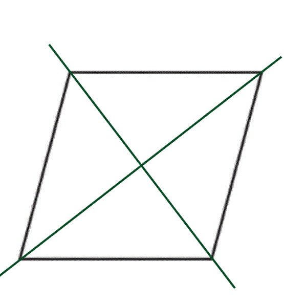

**one mark for each line*** ***[2]**

### Q29
> *Any regular polygon has the same number of lines of symmetry as the number of sides.*

**5** **[1]**
> *The rotational symmetry of a polygon is the number of times the shape is identical to the original whilst rotating through a full turn about its centre*

> *The diamond only looks identical to the original position when it has turned *$360^{\circ}$

** ****1** **[1]**

### Q30
> *The angle is smaller than a right angle.*

**Acute**** ****[1]**

### Q31
(i) *A shape with 6 sides is called a **hexagon**. *

**Hexagon** **[1]**

(ii) *The shape will look the same 6 times as its turned through *$360^{\circ}$*. *

**6** **[1]**
