# Exam Questions — Symmetry & Shapes
**Geometry** · Cambridge (CIE) IGCSE maths (0607)
> Source: [https://www.savemyexams.com/igcse/maths/cie/international-maths/23/core/topic-questions/](https://www.savemyexams.com/igcse/maths/cie/international-maths/23/core/topic-questions/) · 31 questions across 1 sets

## Exam Questions (31 questions)

### Q1 — hard — 1 marks

**Q1** [1 mark]

Shade two more small squares to give a pattern with exactly one line of symmetry.

*Source: Nov 2019 0580/12 Q14A*

### Q2 — hard — 4 marks

**Q2** [1 mark]

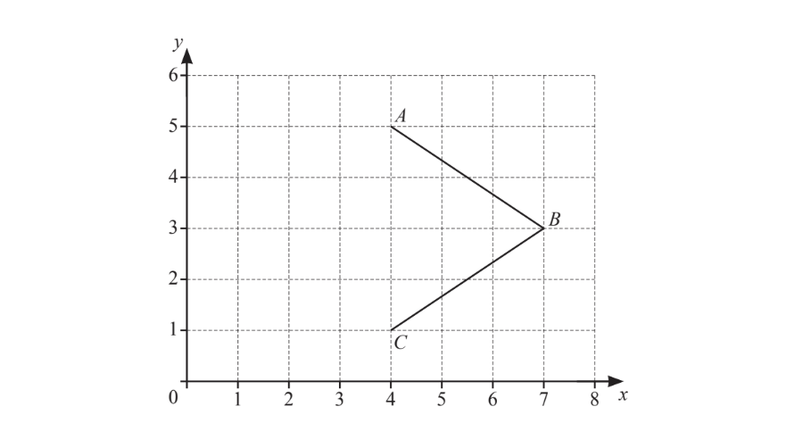

Write down the co-ordinates of point $B$.

*Source: Nov 2019 0580/13 Q20A*

**Q2** [1 mark]

The quadrilateral $ABCD$ has$x=4$  as a line of symmetry.

On the grid, plot point $D$.

*Source: Nov 2019 0580/13 Q20B*

**Q2** [1 mark]

**Extract:**

The quadrilateral ABCD has x = 4 as a line of symmetry. On the grid, plot point D.

Write down the mathematical name of quadrilateral $ABCD$.

*Source: Nov 2019 0580/13 Q20C*

**Q2** [1 mark]

**Extract:**

Write down the mathematical name of quadrilateral ![A B C D].

Write down the order of rotational symmetry of quadrilateral $ABCD$.

*Source: Nov 2019 0580/13 Q20D*

### Q3 — hard — 1 marks

**Q3** [1 mark]

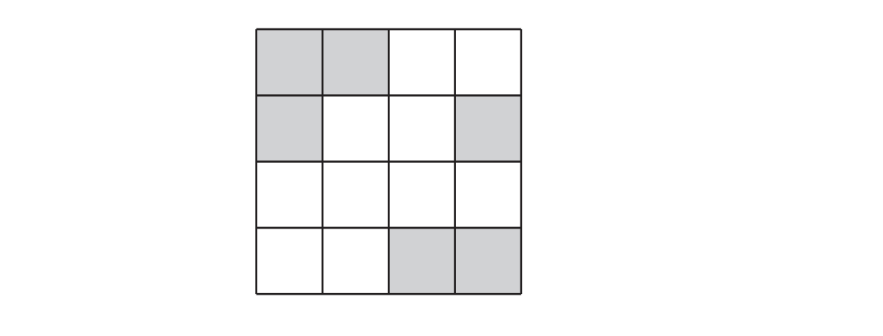

Shade two squares so that the diagram has rotational symmetry of order 2.

*Source: Nov 2020 0580/11 Q5B*

### Q4 — hard — 1 marks

**Q4** [1 mark]

Shade two more squares so that this grid has rotational symmetry of order 4.

*Source: June 2019 0580/12 Q7B*

### Q5 — medium — 1 marks

**Q5** [1 mark]

The diagram shows a quadrilateral on a 1 cm2 grid.

Write down the mathematical name of this quadrilateral.

*Source: March 2019 0580/12 Q23A*

### Q6 — medium — 4 marks

**Q6** [3 marks]

On each shape, draw all the lines of symmetry.

i)

[1]

ii)

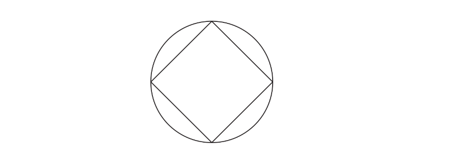

[2]

*Source: June 2019 0580/11 Q19A*

**Q6** [1 mark]

Write down the name of a quadrilateral that has

- rotational symmetry of order 2

and

- exactly two lines of symmetry.

*Source: June 2019 0580/11 Q19B*

### Q7 — medium — 1 marks

**Q7** [1 mark]

Write down the mathematical name of a quadrilateral that has

- rotational symmetry of order 1

and

- only one line of symmetry.

*Source: June 2020 0580/13 Q7A*

### Q8 — medium — 3 marks

**Q8** [1 mark]

Write down the mathematical name for an angle which is less than 90°.

*Source: Nov 2020 0580/11 Q1A*

**Q8** [1 mark]

Write down the mathematical name for a polygon with 5 sides.

*Source: Nov 2020 0580/11 Q1B*

**Q8** [1 mark]

Write down the mathematical name for a quadrilateral with exactly one pair of parallel sides.

*Source: Nov 2020 0580/11 Q1C*

### Q9 — medium — 1 marks

**Q9** [1 mark]

The grid shows a point $E$ and four quadrilaterals, $A,B,C$ and $D$.

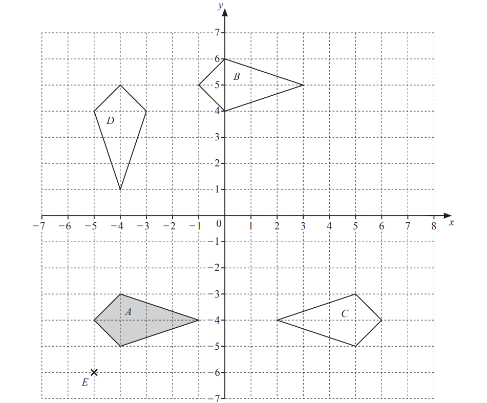

Write down the mathematical name of shape $A$.

*Source: June 2020 0580/31 Q2A*

### Q10 — medium — 2 marks

**Q10** [1 mark]

Complete each statement.

A quadrilateral with only one pair of parallel sides is called a ...............................................

*Source: June 2019 0580/12 Q6A*

**Q10** [1 mark]

An angle greater than 90° but less than 180° is called ...............................................

*Source: June 2019 0580/12 Q6B*

### Q11 — medium — 3 marks

**Q11** [1 mark]

Measure the length of this line in millimetres.

........................................... mm

*Source: Nov 2020 0580/32 Q2A*

**Q11** [2 marks]

i) Measure the size of angle $x$.

[1]

ii) Write down the mathematical name of this type of angle.

[1]

*Source: Nov 2020 0580/32 Q2B*

### Q12 — medium — 3 marks

**Q12** [1 mark]

Write down the mathematical name for this type of angle.

*Source: June 2020 0580/12 Q2A*

**Q12** [2 marks]

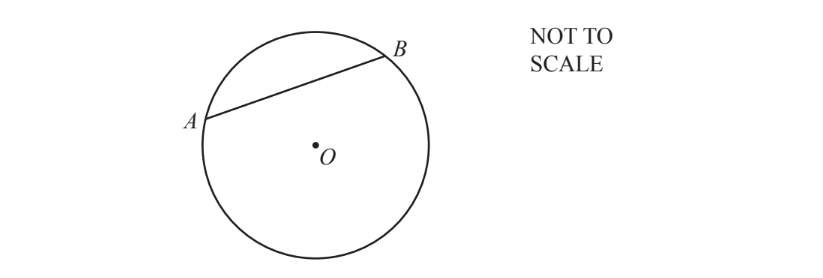

$A$and $B$ lie on a circle, centre $O$.

i) .Write down the mathematical name for line $AB$.

[1]

ii) $OA=8\mathrm{cm}$

Write down the length of the diameter of this circle.

............................................ cm [1]

*Source: June 2020 0580/12 Q2B*

### Q13 — medium — 3 marks

**Q13** [1 mark]

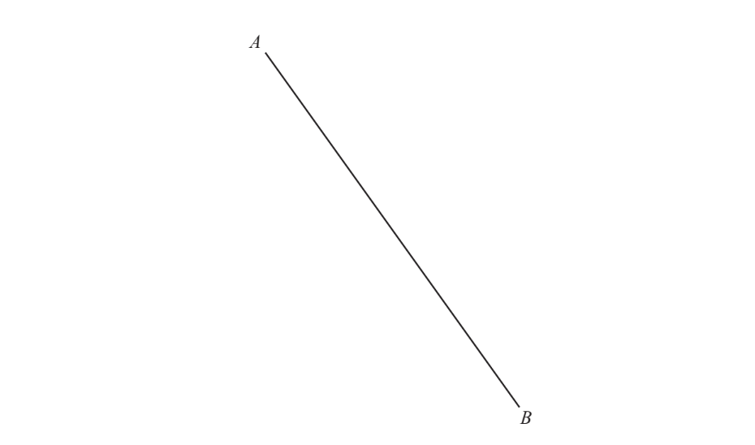

Measure the length of the line $AB$ in millimetres.

.......................................... mm

*Source: March 2020 0580/12 Q2A*

**Q13** [2 marks]

$AB$ is the diameter of a circle.

Draw this circle.

*Source: March 2020 0580/12 Q2B*

### Q14 — medium — 2 marks

**Q14** [2 marks]

Complete the description of this pattern.

The pattern has ................ lines of symmetry

and order of rotational symmetry ................

*Source: Nov 2019 0580/12 Q14B*

### Q15 — medium — 2 marks

**Q15** [1 mark]

Write down the order of rotational symmetry of the shape.

*Source: Specimen 2020 0580/01 Q6A*

**Q15** [1 mark]

Draw all the lines of symmetry on the shape.

*Source: Specimen 2020 0580/01 Q6B*

### Q16 — medium — 2 marks

**Q16** [2 marks]

Write down the order of rotational symmetry of each shape.

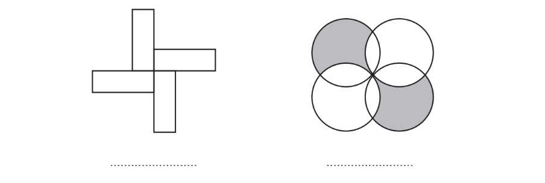

*Source: Nov 2020 0580/13 Q4*

### Q17 — easy — 2 marks

**Q17** [1 mark]

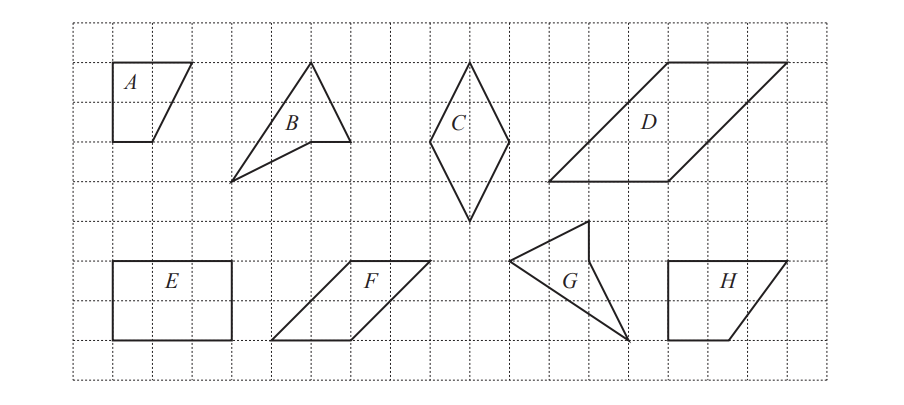

The diagram shows some quadrilaterals.

Complete the statements.

Quadrilateral ................. is a rhombus.

*Source: Nov 2019 0580/12 Q21A*

**Q17** [1 mark]

**Extract:**

The diagram shows some quadrilaterals.

Quadrilateral $A$ is a ..........................................

*Source: Nov 2019 0580/12 Q21B*

### Q18 — easy — 1 marks

**Q18** [1 mark]

Write down the order of rotational symmetry of this regular octagon.

*Source: Nov 2020 0580/12 Q3*

### Q19 — easy — 4 marks

**Q19** [3 marks]

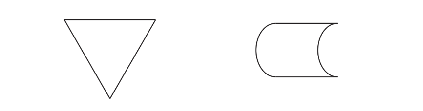

On each shape draw all the lines of symmetry.

*Source: June 2020 0580/11 Q4A*

**Q19** [1 mark]

Write down the order of rotational symmetry of this shape.

*Source: June 2020 0580/11 Q4B*

### Q20 — easy — 2 marks

**Q20** [2 marks]

i) Write down the mathematical name for this type of angle.

[1]

ii) Measure this angle.

[1]

*Source: March 2020 0580/32 Q3A*

### Q21 — easy — 1 marks

**Q21** [1 mark]

Three quadrilaterals are shown on a 1 cm2 grid.

Write down the mathematical name of the shaded quadrilateral.

*Source: May/June 2019 0580/33 Q2A*

### Q22 — easy — 1 marks

**Q22** [1 mark]

Write down the order of rotational symmetry of the diagram.

*Source: June 2020 0580/12 Q9*

### Q23 — easy — 2 marks

**Q23** [2 marks]

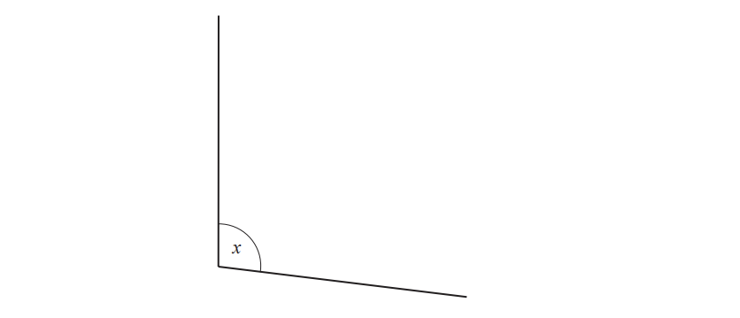

i) Measure the size of angle $x$.

[1]

ii) Write down the mathematical name of this type of angle.

[1]

*Source: Nov 2019 0580/31 Q3A*

### Q24 — easy — 1 marks

**Q24** [1 mark]

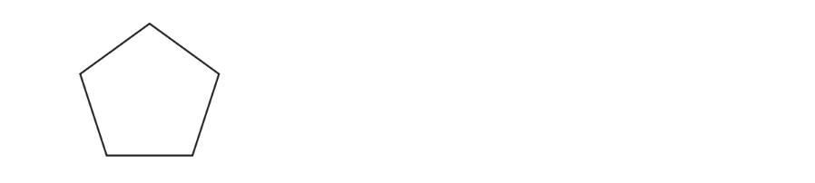

Write down the order of rotational symmetry of this regular pentagon.

*Source: June 2019 0580/11 Q2*

### Q25 — easy — 1 marks

**Q25** [1 mark]

Complete the statement.

Angle ...................... is a reflex angle.

*Source: March 2019 0580/12 Q3*

### Q26 — easy — 2 marks

**Q26** [2 marks]

Write down the mathematical name for this

i)   quadrilateral,

[1]

ii) solid.

[1]

*Source: Nov 2020 0580/32 Q3A*

### Q27 — easy — 2 marks

**Q27** [1 mark]

In the space below, draw a circle with diameter 7cm.

*Source: Feb/March 2018 0580/12 Q21A*

**Q27** [1 mark]

**Extract:**

In the space below, draw a circle with diameter 7cm.

On your diagram, draw a chord.

*Source: Feb/March 2018 0580/12 Q21B*

### Q28 — easy — 2 marks

**Q28** [2 marks]

The diagram shows a rhombus

On the diagram, draw all the lines of symmetry

*Source: Nov 2020 0580/11 Q5A*

### Q29 — easy — 2 marks

**Q29** [1 mark]

The diagram shows a regular pentagon and a kite.

Complete the following statements.

The regular pentagon has ................................... lines of symmetry.

*Source: Feb/March 2018 0580/12 Q7A*

**Q29** [1 mark]

The kite has rotational symmetry of order ................................... .

*Source: Feb/March 2018 0580/12 Q7B*

### Q30 — easy — 1 marks

**Q30** [1 mark]

Write down the mathematical name of this type of angle.

*Source: Nov 2019 0580/13 Q1*

### Q31 — easy — 2 marks

**Q31** [2 marks]

The diagram shows a regular polygon.

i) Write down the mathematical name for this shape.

[1]

ii) Write down the order of rotational symmetry of this shape.

[1]

*Source: June 2020 0580/33 Q7A*

