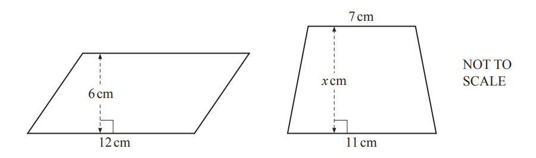
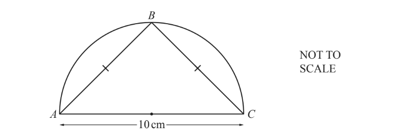
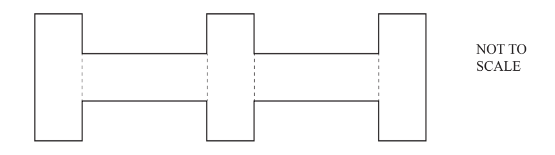
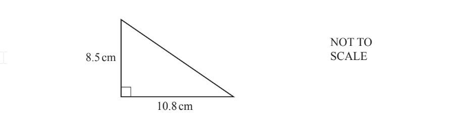
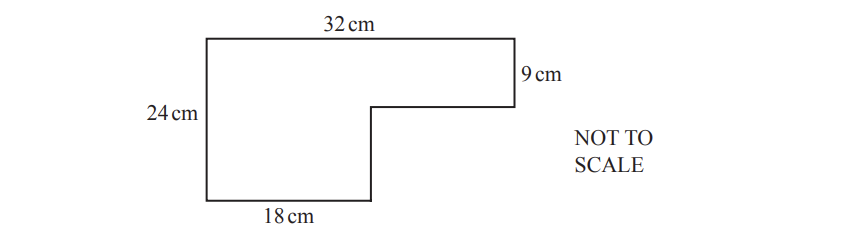
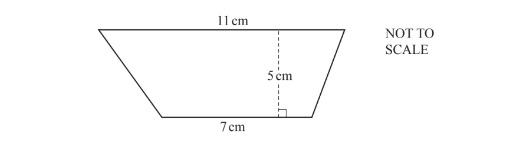
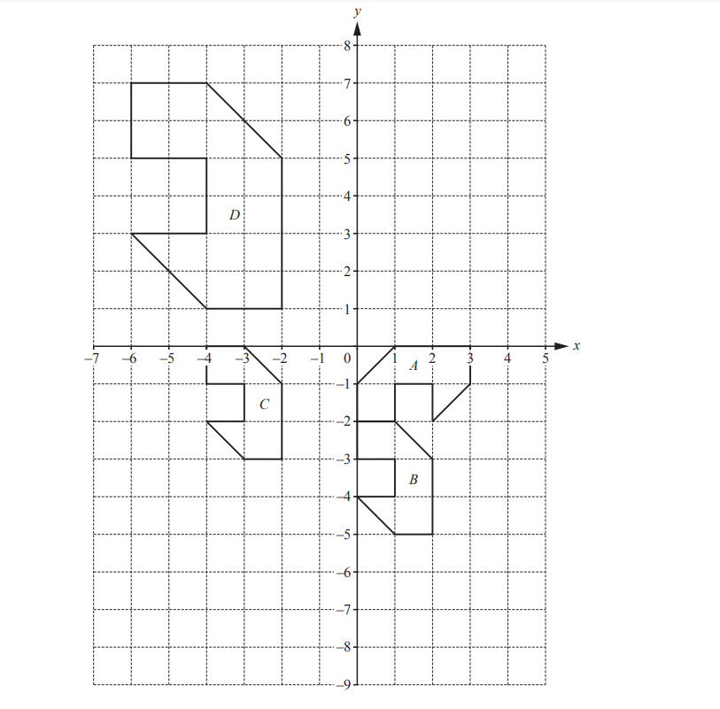

# Exam Questions — Area & Perimeter
**Lengths, Areas & Volumes** · Cambridge (CIE) IGCSE maths (0607)
> Source: [https://www.savemyexams.com/igcse/maths/cie/international-maths/23/core/topic-questions/](https://www.savemyexams.com/igcse/maths/cie/international-maths/23/core/topic-questions/) · 27 questions across 1 sets

## Exam Questions (27 questions)

### Q1 — medium — 3 marks

**Q1** [1 mark]

Calculate the perimeter.

**Q1** [2 marks]

Calculate the area.

### Q2 — hard — 3 marks

**Q2** [3 marks]

The area of the parallelogram is the same as the area of the trapezium.

Work out the value of $x$.

$x$= ................................................

*Source: Nov 2020 0580/13 Q13*

### Q3 — hard — 6 marks

**Q3** [3 marks]

A square has perimeter 12$x$.

Find an expression, in terms of $x$, for the area of the square. Give your answer in its simplest form.

*Source: June 2020 0580/33 Q3C*

**Q3** [3 marks]

The diagram shows a semicircle with diameter$AC$. B is a point on the circumference and $AB=BC$.

Work out the area of triangle $ABC$.

.......................................... cm2

*Source: June 2020 0580/33 Q3D*

### Q4 — hard — 3 marks

**Q4** [3 marks]

The area of this triangle is 363cm2.

Calculate the value of $h$.

$h=$ ..............................

*Source: March 2019 0580/32 Q10D*

### Q5 — hard — 2 marks

**Q5** [2 marks]

Rectangle$A$measures 3 cm by 8 cm.

Five rectangles congruent to $A$ are joined to make a shape.

Work out the perimeter of this shape.

........................................... cm

*Source: June 2020 0580/11 Q7*

### Q6 — hard — 2 marks

**Q6** [2 marks]

The area of triangle $ABC$ is 27 cm2 and $AB$ = 6 cm.

Calculate the value of $h$.

$h$ = .................................................

*Source: Nov 2020 0580/12 Q15*

### Q7 — hard — 3 marks

**Q7** [3 marks]

The diagram shows the front of Pranav’s house.

i) Work out the total area of the front of his house.

............................................ m2 [3]

ii) The door is 0.9 m wide and 2.1 m high. Each of the four windows are 1.5 m wide and 1.2 m high.

Work out the total area of the door and the four windows.

............................................ m2 [3]

iii) Pranav paints the front of his house but not the door and not the four windows.

Work out the area he paints.

............................................ m2 [1]

*Source: March 2020 0580/32 Q4A*

### Q8 — hard — 3 marks

**Q8** [3 marks]

The diagram shows a right-angled triangle.

Calculate the perimeter.

............................................ cm

*Source: March 2020 0580/12 Q14B*

### Q9 — medium — 2 marks

**Q9** [2 marks]

Find an estimate for the area of the shape drawn on this 1 cm2 grid.

............................... cm2

*Source: Feb/March 2018 0580/12 Q11*

### Q10 — medium — 2 marks

**Q10** [2 marks]

Calculate the area of this trapezium.

.................................. m2

*Source: March 2019 0580/32 Q10B*

### Q11 — medium — 3 marks

**Q11** [3 marks]

The length, $l$, of a rectangle is 3 cm longer than the width, $w$.

The perimeter of the rectangle is 26 cm.

Calculate the length, $l$, and the width, $w$.

$l=....................................\mathrm{cm}\,w=...................................\mathrm{cm}$

*Source: Nov 2020 0580/32 Q3C*

### Q12 — medium — 4 marks

**Q12** [4 marks]

The diagram shows a shape made from two rectangles.

i) Work out the perimeter.

.............................................. cm [2]

ii) Work out the area.

............................................. cm2 [2]

*Source: Nov 2019 0580/33 Q7A*

### Q13 — medium — 6 marks

**Q13** [4 marks]

The diagram shows the floor of a room.

i) Calculate the area of the floor.

............................................... m2 [2]

ii) Henry buys varnish for the floor of the room. 500ml of varnish covers 8m2 of floor.

Calculate the amount of varnish Henry needs.

............................................... ml [2]

*Source: Nov 2019 0580/32 Q2B*

**Q13** [2 marks]

The diagram shows one wall of the room.

Calculate the area of the wall.

............................................... m2

*Source: Nov 2019 0580/32 Q2D*

### Q14 — medium — 5 marks

**Q14** [2 marks]

The scale drawing shows a play area, $ABCDE$.

The scale is 1 centimetre represents 3 metres.

Find the actual distance $h$ in metres.

$h=$ .............................m

*Source: May/June 2019 0580/33 Q5A*

**Q14** [3 marks]

**Extract:**

The scale is 1 centimetre represents 3 metres.

Find the actual area of triangle $CDE$.

............................................ m2

*Source: May/June 2019 0580/33 Q5B*

### Q15 — medium — 3 marks

**Q15** [3 marks]

The diagram shows a rectangular patio with sides 6m and 8m.

i) Work out the perimeter of the patio.

............................................. m [1]

ii) Henri covers the patio floor with square tiles. The tiles are 0.5m by 0.5m.

Work out the number of tiles he needs.

[2]

*Source: June 2020 0580/33 Q3A*

### Q16 — medium — 3 marks

**Q16** [3 marks]

Find an expression for the perimeter of this triangle. 
Give your answer in its simplest form.

*Source: June 2020 0580/32 Q5C*

### Q17 — medium — 2 marks

**Q17** [2 marks]

Calculate the area of the trapezium.

......................................... cm2

*Source: June 2020 0580/12 Q15*

### Q18 — medium — 3 marks

**Q18** [3 marks]

The diagram shows the plan of part of Rachel’s garden.

Calculate the area.

........................................... m2

*Source: Nov 2020 0580/33 Q4A*

### Q19 — easy — 4 marks

**Q19** [4 marks]

The diagram shows a rectangle with length 7$a$ and width 2$a$.

Write an expression, in its simplest form, for

i) the perimeter,

[2]

ii) the area.

[2]

*Source: June 2019 0580/31 Q5A*

### Q20 — easy — 1 marks

**Q20** [1 mark]

The diagram shows four shapes, $A,B,C$ and $D$, drawn on a 1 cm2 grid.

Find the area of shape $B$.

................................. cm2

*Source: March 2018 0580/32 Q7A*

### Q21 — easy — 2 marks

**Q21** [2 marks]

Soraya makes rectangular flags.

i) On the rectangle, draw the lines of symmetry.

[2]

ii) Each flag measures 1.2m by 1.8m.

Calculate the area of one flag.

............................................... m2 [2]

*Source: Nov 2019 0580/31 Q7A*

### Q22 — easy — 2 marks

**Q22** [2 marks]

Three quadrilaterals are shown on a 1 cm2 grid.

For the shaded quadrilateral

i) **measure** the perimeter,

............................ cm [1]

ii) work out the area.

............................ cm2 [1]

*Source: May/June 2019 0580/33 Q2B*

### Q23 — easy — 2 marks

**Q23** [2 marks]

The diagram shows a right-angled triangle.

Calculate the area.

.......................................... cm2

*Source: March 2020 0580/12 Q14*

### Q24 — easy — 1 marks

**Q24** [1 mark]

The area of a square is 64 cm2.

Work out the length of one side of the square.

............................................ cm

*Source: Nov 2020 0580/32 Q3B*

### Q25 — easy — 2 marks

**Q25** [2 marks]

Calculate the area of this triangle.

........................................ cm2

*Source: June 2019 0580/12 Q12*

### Q26 — easy — 3 marks

**Q26** [3 marks]

The diagram shows a quadrilateral on a 1 cm2 grid.

Work out the area of this quadrilateral.

Give the units of your answer.

*Source: March 2018 0580/12 Q23B*

### Q27 — easy — 2 marks

**Q27** [2 marks]

The diagram shows four shapes $A,B,C$and $D$ and a point $P$ on a 1cm2 grid.

Find

i) the perimeter of shape $A$,

............................................... cm [1]

ii) the area of shape $A$.

..............................................cm2 [1]

*Source: June 2019 0580/32 Q5A*

