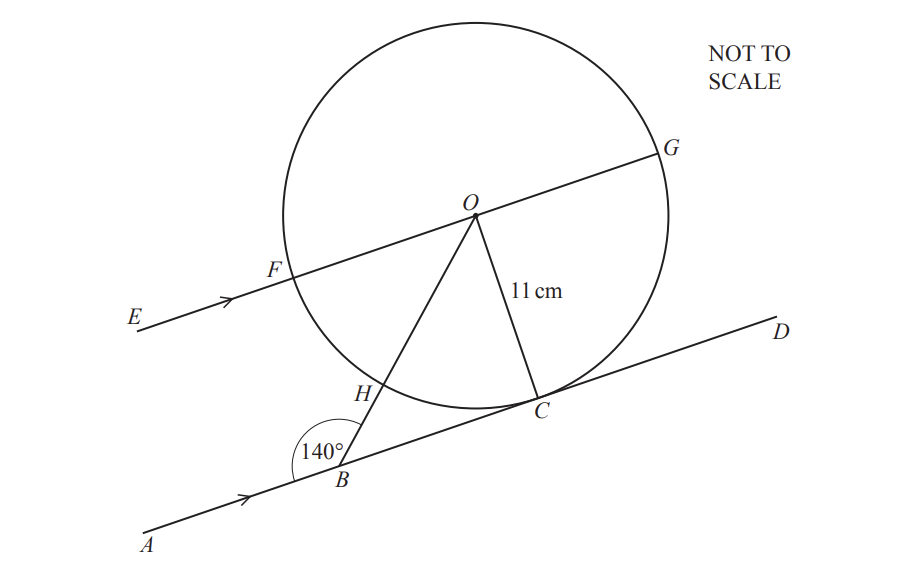
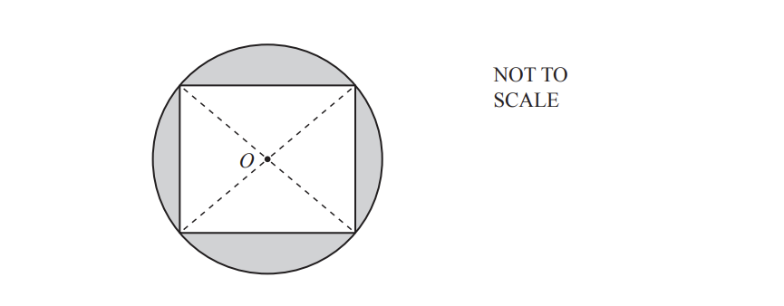
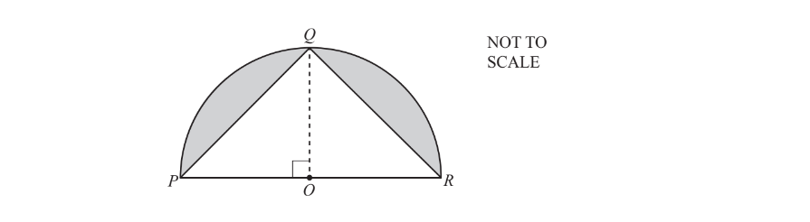
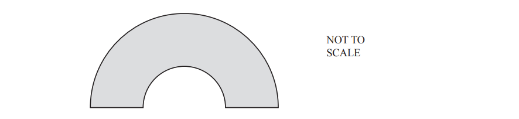
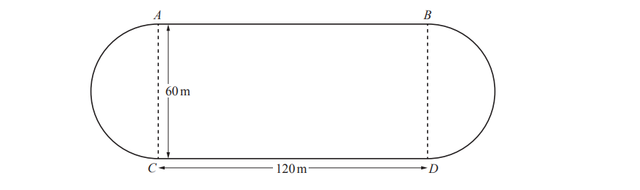
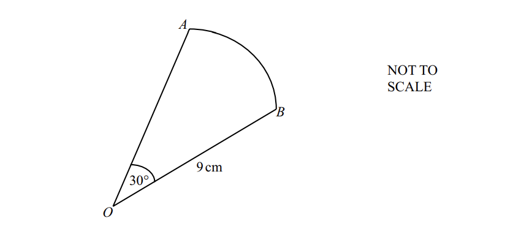

# Exam Questions — Circles, Arcs & Sectors
**Lengths, Areas & Volumes** · Cambridge (CIE) IGCSE maths (0607)
> Source: [https://www.savemyexams.com/igcse/maths/cie/international-maths/23/core/topic-questions/](https://www.savemyexams.com/igcse/maths/cie/international-maths/23/core/topic-questions/) · 16 questions across 1 sets

## Exam Questions (16 questions)

### Q1 — hard — 4 marks

**Q1** [2 marks]

A semicircle has a radius of 7 cm.

Find the area in terms of $π$.

**Q1** [2 marks]

Find the perimeter of the semicircle in terms of $π$.

### Q2 — hard — 7 marks

**Q2** [1 mark]

The diagram shows a circle, centre $O$, radius 11 cm. $C,F,G$ and $H$ are points on the circumference of the circle.

The line $AD$ touches the circle at $C$ and is parallel to the line $EG$.

$B$ is a point on $AD$ and angle $ABO$ = 140°.

Write down the mathematical name of the straight line$AD$.

*Source: June 2020 0580/31 Q6A*

**Q2** [6 marks]

**Extract:**

The diagram shows a circle, centre O, radius 11 cm. C, F, G and H are points on the circumference of the circle.

i) Find, in terms of $π$, the circumference of the circle.

[2]

ii)Work out angle $FOH$.

Angle $FOH$ = ................................................. [2]

iii) Calculate the length of the minor arc $FH$.

............................................ cm [2]

*Source: June 2020 0580/31 Q6B*

### Q3 — hard — 5 marks

**Q3** [5 marks]

The diagram shows a square with vertices on the circumference of a circle, centre $O$. 
The radius of the circle is 6 cm.

Work out the shaded area.

.......................................... cm2

*Source: June 2020 0580/32 Q7D*

### Q4 — hard — 5 marks

**Q4** [5 marks]

Points $P,Q$ and $R$ are on the circumference of a semicircle, centre $O$ and radius 8 cm. 
Angle $POQ$ = 90°.

Calculate the shaded area.

.........................................cm2

*Source: June 2019 0580/31 Q8B*

### Q5 — hard — 3 marks

**Q5** [3 marks]

This shape is drawn using two semicircles that have the same centre.

The large semicircle has radius 7 cm.

The small semicircle has radius 3 cm.

Calculate the area of the shape.

.............................. cm2

*Source: March 2019 0580/32 Q10E*

### Q6 — hard — 8 marks

**Q6** [8 marks]

The diagram shows a rectangle and two semicircles with diameters $AC$ and $BD$. 
This diagram is a scale drawing of a running track. $AC=BD=60m\,AB=CD=120m$

i) Complete the statement.

1 centimetre represents ............................ metres.

[2]

ii) Work out the total length of the running track in metres.

............................. m [3]

iii) Shreva walks at 1.4m/s.

Work out how long it will take her to walk once around the track. Give your answer in minutes and seconds, correct to the nearest second.

.................... minutes .................... seconds [3]

*Source: March 2019 0580/32 Q9A*

### Q7 — medium — 3 marks

**Q7** [3 marks]

The diagram shows a semicircle with diameter 9 cm.

Calculate the total perimeter of this semicircle.

......................................... cm

*Source: June 2019 0580/12 Q21*

### Q8 — medium — 2 marks

**Q8** [2 marks]

A circle has a circumference of 56mm.

Work out the radius of this circle.

.............................mm

*Source: Nov 2020 0580/11 Q19*

### Q9 — medium — 4 marks

**Q9** [4 marks]

There is a circular pool in the play area at a park. 
The pool has a diameter of 8m.

Calculate

i) the circumference of the pool,

..........................m [2]

ii) the area of the pool.

........................... m2 [2]

*Source: May/June 2019 0580/33 Q5D*

### Q10 — medium — 2 marks

**Q10** [2 marks]

$OAB$ is a sector of a circle with radius 9 cm and centre $O$. 
The angle at $O$ is 30°.

Calculate the area of this sector. 
Give your answer in terms of $π$.

......................................... cm2 

*Source: Specimen 2020 0580/01 Q28*

### Q11 — medium — 3 marks

**Q11** [3 marks]

Rachel has a pond in her garden in the shape of a circle. 
The circumference of the pond is 4.25m.

Calculate the diameter of the pond. 
Give your answer in centimetres.

............................................ cm

*Source: Nov 2020 0580/33 Q4B*

### Q12 — easy — 2 marks

**Q12** [2 marks]

A circle has diameter 7 cm.

Show that the circumference of the circle is 21.99cm, correct to 2 decimal places.

*Source: Feb/March 2018 0580/12 Q21C*

### Q13 — easy — 2 marks

**Q13** [2 marks]

Calculate the area of a circle with radius 12cm.

............................................. cm2

*Source: June 2019 0580/11 Q13*

### Q14 — easy — 2 marks

**Q14** [2 marks]

Calculate the circumference of a circle with radius 4.5cm.

.............................................. cm

*Source: Nov 2019 0580/13 Q10*

### Q15 — easy — 2 marks

**Q15** [2 marks]

Henry buys a circular mirror for the room. 
The diameter of the mirror is 80 cm.

Calculate the circumference of the mirror.

.............................................. cm

*Source: Nov 2019 0580/32 Q2E*

### Q16 — easy — 3 marks

**Q16** [3 marks]

A circle has diameter 6 cm.

Calculate the area of the circle.

Give the units of your answer.

*Source: Nov 2020 0580/32 Q2F*

