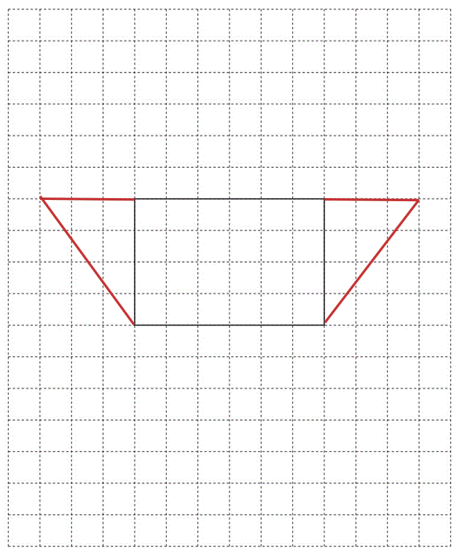
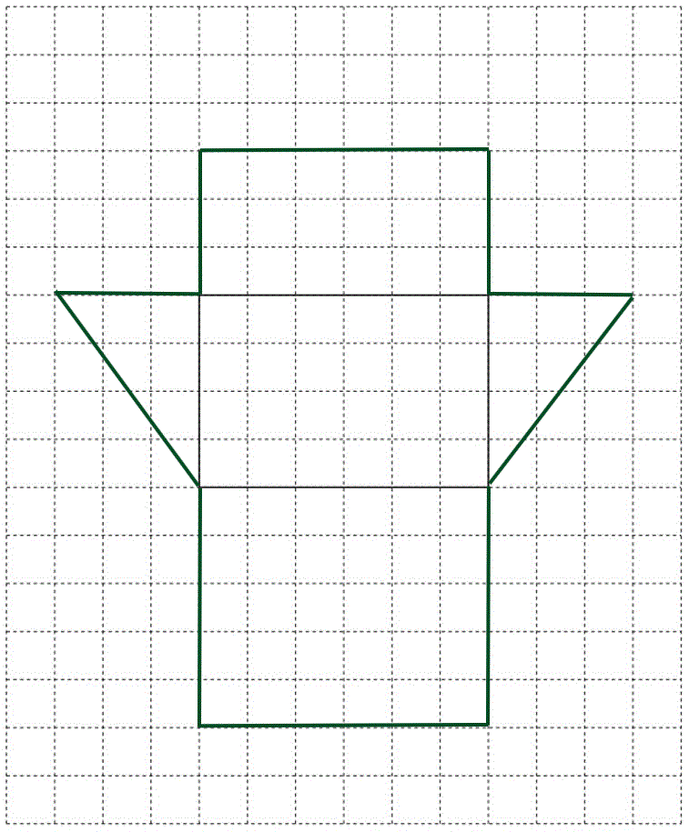
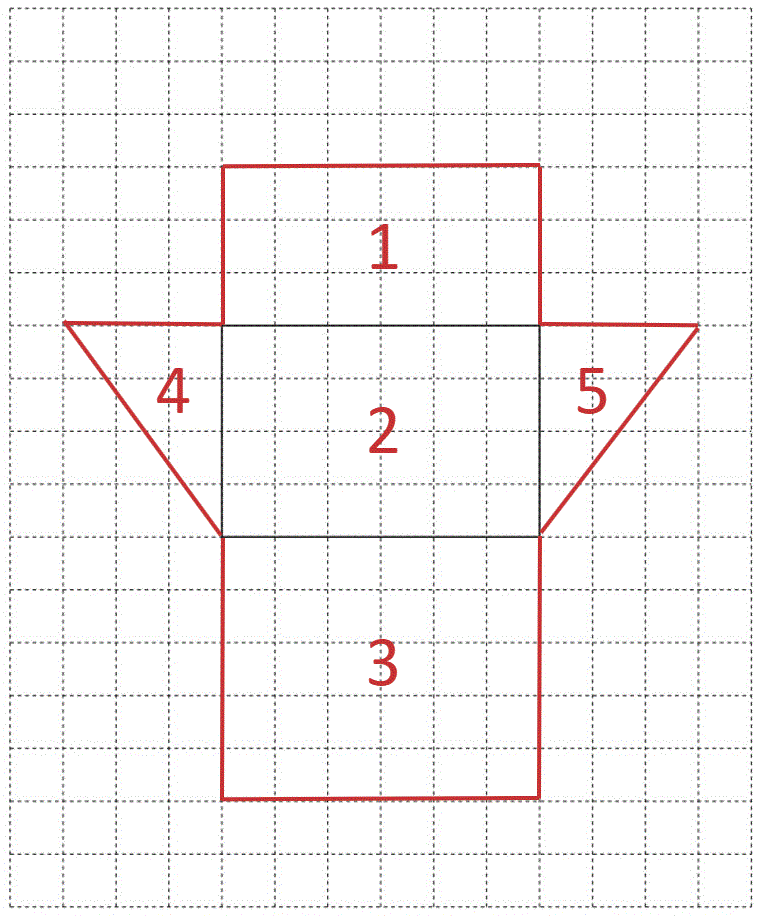

# Mark Schemes — Volume & Surface Area
**Lengths, Areas & Volumes** · Cambridge (CIE) IGCSE maths (0607)

## Exam Questions (23 questions)

### Q1
> *To calculate the volume of a cuboid, multiply the lengths together*

$5\times4\times2$

**[1]**

**40 cm****3**** **
**40 correct**** [1]**
**Units correct**** ****[1]**

### Q2
i) *Calculate the volume of both cylinders using the formula, *$V=πr^{2}h$

$\mathrm{Small} \mathrm{cylinder}=π\times8^{2}\times10=640π$

**[1]**

$\mathrm{Large} \mathrm{cylinder}=π\times15^{2}\times10=2250π$

> *Add the two cylinders together to find the total volume*

$640π+2250π$

**[1]**

$=9079.2027...$

$9080\mathrm{cm}^{3}$ **[1]**

**Answers between 9079 and 9081 will be accepted**

ii) *Calculate the circumference of the larger cylinder using the formula,* $C=2πr$

$C=2\timesπ\times15=30π$

**[1]**

> *Add *$4$* cm to the length*

$30π+4$

**[1]**

$=98.2477...$

$98.2\mathrm{cm}$* ***[1]**

**Answers between 98.24 and 98.26 are accepted, an answer of 98.3 is also accepted**

### Q3
> *The surface area of a cylinder is made up of two identical circles and a rectangle.*

> * Find the area of one circle by substituting *$r=3$* into *$\mathrm{area}=\mathrm{πr}^{2}$*. *

`table row Area equals cell straight pi cross times 3 squared end cell row blank equals cell 9 straight pi end cell end table`

> * Multiply by 2 to find the total area of both circles.*

> * *$9π\times2=18π$

**[1]**

> *Find the circumference of the circle, which is also the width of the rectangle, by substituting *$r=3$* into *$\mathrm{circumference}=2\mathrm{πr}$*.*

> * *`table row cell Circumference space end cell equals cell space 2 cross times straight pi cross times 3 end cell row blank equals cell 6 straight pi end cell end table`

* ***[1]**

> *Find the area of the rectangle by multiplying *$6π$* by the length of the rectangle (the height of the cylinder), 4.5 cm. *

$6π\times4.5=27π$

* ***[1]**

> *Add together the area of the circles and rectangle. *

> $18π+27π=45π$* *

> *Type into a calculator and write to 3 significant figures. *

$45π=141.37166...$

**141 cm****2** **[1]**

### Q4
> *Determine the side length of the cube by cube rooting the volume  *

`cube root of 1000`

**[1]**

$=10\mathrm{cm}$

> *Square the side length of the cube  *

> $10^{2}=100$*  *

> *A cube has 6 identical square faces so multiply the area of one face by 6 to find the total surface area  *

$6\times100$

**[1]**

$600\mathrm{cm}^{2}$ **[1]**

### Q5
i) *Calculate the area of the outer circle using the formula, *$A=πr^{2}$

$A_{outer}=π\times7.5^{2}=56.25π$

**[1]**

> *Calculate the area of the inner circle*

$A_{inner}=π\times6^{2}=36π$

> *Subtract the area of the inner circle from the area of the outer circle to find the shaded area*

$56.25π-36π$

**[1]**

$=63.6172...$

$63.6\mathrm{cm}^{2}$ **[1]**

**Answers between 63.61 and 63.63 are accepted**

ii) *Multiply the shaded area by the length of the cylinder to find the volume of the metal*

$63.6\times18=1144.8$

> *Round appropriately*

$1140\mathrm{cm}^{3}$ **[1]**

**Answers between 1144 and 1146 or an answer of 1150 will be accepted**

iii) *Find the curved surface area of the outer cylinder using the formula, *$A=2πrh$

$A=2\timesπ\times7.5\times18$

*1 mark for *$2\timesπ\times7.5$*, 1 mark for multiplying by its length*** [2]**

$=848.2300...$

> *Round appropriately*

$848\mathrm{cm}^{2}$** [1]**

**Answers between 848.2 and 848.4 will be accepted**

### Q6
> *To find the volume of a cylinder, first find the area of the circular face using the formula *$\mathrm{πr}^{2}$*.*
* The diameter is 7 cm so the radius is half of this, which is 3.5 cm.*

$π\times3.5^{2}=38.4845...$

**[1]**

> *Then multiply by the length of the cylinder to find the volume.*

$15\times38.48...=577.267...$

** ****[1]**

> *Round this to three significant figures.*

**577 cm****3**** ****[1]**

### Q7
> *Substitute known values into the formula and calculate the value using a calculator*

$A=4\timesπ\times5.2^{2}$

**[1]**

$=339.7946614...$

> *Round to a sensible degree of accuracy*

$340\mathrm{cm}^{2}$ **[1]**

**Any value between 339.7 and 339.84 will also be accepted**

### Q8
> *The net will be made up of 3 rectangles and 2 triangles. Use the given dimensions to find the size of each rectangle and triangle needed. *

> *Two triangles = 4 cm base x 3 cm height.*

> *Base rectangle = 6 cm long x 4 cm wide (This is already drawn).*

> *Back rectangle = 6 cm long x 3 cm wide.*

> *Top rectangle = 6 cm long x 'hypotenuse' wide. *

> *The given rectangle is 6cm x 4cm, draw the triangles connecting to the 4cm sides. Measure the longest side to find the missing length of the top rectangle = 5cm (or use Pythagoras' Theorem).*

> $'\mathrm{hypotenuse}'=\sqrt{3^{2}+4^{2}}=5\mathrm{cm}$*  *

> *Draw the back and top rectangles connected to each 6 cm side.*

*  *

**    [3]**

> *one mark for one correct face in the correct place*

> *two marks for two or three correct faces in the correct places*
> *Work out the areas of all the shapes in the net and add them together.*

> *Rectangle 1:*

$6\times3=18\mathrm{cm}^{2}$

**one correct area**** [1]**

> *Rectangle 2:*

$6\times4=24\mathrm{cm}^{2}$

> *Rectangle 3:*

$6\times5=30\mathrm{cm}^{2}$

> *Triangle 4:*

$\frac{1}{2}\times4\times3=6\mathrm{cm}^{2}$

> *Triangle 5:*

$\frac{1}{2}\times4\times3=6\mathrm{cm}^{2}$

> *Add together.*

$18+24+30+6+6=84\mathrm{cm}^{2}$

**[1]**

$84\mathrm{cm}^{2}$* ***[1]**
> *To find the area of a prism, multiply the** area of the cross section** by the **length of the prism**.   *

> *Find the area of the **triangular cross section**.*

$\frac{1}{2}\times4\times3=6\mathrm{cm}^{2}$

> *Multiply the **area** by the **length of the prism**.*

$6\times6=36\mathrm{cm}^{3}$

**[1]**

$36\mathrm{cm}^{3}$* ***[1]**

### Q9
> *Substitute **r** = 15** and **h** = 24** into *$V=πr^{2}h$*.  *

`V equals pi cross times open parentheses 15 close parentheses squared cross times 24`

**[1]**

> *Type into a calculator. *

> $V=16964.6003...$* *

> *Round to 3 significant figures. *

$17000\mathrm{cm}^{3}(3s.f.)$ **[1]**

**Answers in range 16960 - 16970 also accepted**

### Q10
> *The area of the square base is*

$6\times6=36\mathrm{cm}^{2}$

> *As the volume of any prism is the area of the base, multiplied by the height, divide the volume by the area of the base to determine the height of the cuboid*

$180\div36=5\mathrm{cm}$

**[1]**

**5 cm**** [1]**

### Q11
> *Divide the surface area by 6 to work out the area of one of the faces of the cube.  *

$384\div6=64$

* ***[1]**

> *Take the square root of the area of one of the faces, 64 cm**2**, to find the length of the sides. *

$\sqrt{64}=8$

* ***[1]**

**8 cm** **[1]**
> *Find the area of the triangular cross section by substituting **base = 7** and** height = 4 **into **area = *$\frac{1}{2}$* x base x height**. *

$\frac{1}{2}\times7\times4=14$

**[1]**

> *Multiply the area of the cross section, 14 cm**2** by the length of the prism, 12 cm, to find the volume. *

$14\times12=168$

* ***[1]**

**168 cm****3** **[1]**

### Q12
> *Substitute **r = 4.5** and **h = 10.4** into *$V=\frac{1}{3}πr^{2}h$*.  *

`V equals 1 third cross times pi cross times open parentheses 4.5 close parentheses squared cross times 10.4`

**[1]**

> *Type into a calculator. Leave the answer in terms of *$π$*. *

$V=\frac{351}{5}π$

$\frac{351}{5}π$**  ****(or **$70.2π$**)**** [1]**

### Q13
> *The volume of a cylinder is calculated using the formula *$V=πr^{2}h$* where *$r$* is the radius of the cylinder, and *$h$* is the height of the cylinder.*

> *Substitute the known values into the formula*

$V=π\times6^{2}\times17$

**[1]**

$=1922.654704$

[1]

> *Round to 4 significant figures*

**Final answer:** **1923 cm****3**** **

### Q14
> *Use a ruler to measure the sides of the triangle. (Don't just answer based on 'what it looks like'!)*

> *All the sides are equal, so the triangle is **equilateral**.*

> * *

**Equilateral**** ****[1]**
(i) *Use a ruler to measure the height of the triangle. *

**4.3 cm ****[1]**

**4.1 - 4.5 accepted**

(ii) *Multiply the base of the triangle, 5 cm, by the perpendicular height from part (i), and halve (area of a triangle = *$\frac{1}{2}$* x base x height). *

`open parentheses 5 cross times 4.3 close parentheses divided by 2 equals 10.75`

* ***[1]**

** **$10.75\mathrm{cm}^{2}$* ***[1]**

**10.25 - 11.25 accepted**

(iii) *Measure the length of the prism (the distance between the triangles). *

*length = 6 cm*

* ***[1]**

** ***Multiply the area of the triangle from part (ii) by the length of the prism (volume of a prism = area of cross-section x length). *

> $10.75\times6=64.5$* *

$64.5\mathrm{cm}^{3}$* ***[1]**

**61.5 - 67.5 accepted**

### Q15
> *A cube has six equal faces. The area of one face is given by*

$8\times8=64$

**[1]**

> *Find the total of all six faces*

$64\times6=384$

**384 cm****2**** ****[1]**

### Q16
> *Work out the area of each face*

$\mathrm{Top}:5\times9.5=47.5$

$\mathrm{Bottom}:5\times9.5=47.5$

$\mathrm{Left} \mathrm{side}:5\times7=35$

$\mathrm{Right} \mathrm{side}:5\times7=35$

$\mathrm{Front}:9.5\times7=66.5$

$\mathrm{Back}:9.5\times7=66.5$

**one correct area ****[1]**

> *Find the sum of the surface areas*

$47.5+47.5+35+35+66.5+66.5=298$

**correct sum**** [1]**

**298 cm****2** **[1]**

### Q17
> *The volume of a cuboid is calculated using the formula *$V=h\timesw\timesd$* where *$h$* is the height, *$w$* is the width, and *$d$* is the depth of the cuboid.*

> *Substitute known values into the formula and evaluate*

$V=4\times10\times4=160$

**160 cm****3** **[1]**

### Q18
> *The volume of a cuboid is calculated using the formula: *$V=l\timesw\timesh$* where *$l=5cm$*, *$w=4cm$* and *$h=2cm$

$V=5\times4\times2$

**[1]**

**40 cm****3** **[1]**

### Q19
> *Work out the volume of both cuboids (**Volume of a cuboid = length × width × height**). *

`table row cell Volume italic space A end cell equals cell 8 cross times 5 cross times 12 end cell row blank equals 480 end table`

**[1]**

`table row cell Volume italic space B end cell equals cell 16 cross times 10 cross times h end cell row blank equals cell 160 h end cell end table`

> * *

> *The volumes of the cuboids are the same, so set them equal to each other.*

$160h=480$

> * *

> *Solve the equation for *$h$* by dividing both sides by *$160$*.*

$h=480\div160$

**[1]**

$h=3\mathrm{cm}$* ***[1]**

### Q20
> *Find the volume of the first cuboid*

$18.6\times16.4\times10.2=3111.408\mathrm{cm}^{3}$

**[1]**

> *Form an equation to find the missing length*

$30.6\times8.2\timesh=3111.408$

> *Simplify*

$250.92h=3111.408$

> *Divide both sides by 250.92*

**[1]**

$h=12.4$

$h=12.4$** ****[1]**

### Q21
> *To calculate the surface area, work out the area of each face in turn, writing them in a list so that you don't miss any.*

$\mathrm{Top}=15\times12=180\mathrm{cm}^{2}\,\mathrm{Bottom}=15\times12=180\mathrm{cm}^{2}\,\mathrm{Front}=15\times4=60\mathrm{cm}^{2}\,\mathrm{Back}=15\times4=60\mathrm{cm}^{2}\,\mathrm{Left} \mathrm{side}=12\times4=48\mathrm{cm}^{2}\,\mathrm{Right} \mathrm{side}=12\times4=48\mathrm{cm}^{2}$

**one area correct**** [1]**

> *To calculate the total surface area, add the area of each side together*

$180+180+60+60+48+48$

**[1]**

**576cm****2 ****[1]**

### Q22
i) *The surface area is the sum of the area of each face of the cuboid  *

*Area of the base = *$6\times3=18$

*Area of the left face = *$4\times3=12$

*Area of the front face = *$6\times4=24$

**[1]**

> *The area of the base is the same as the area of the top The area of the left face is the same as the area of the right face The area of the front face is the same as the area of the back face*

> *Therefore, double the area of each face, and then add these values to get the total surface area  *

`A equals open parentheses 18 cross times 2 close parentheses plus open parentheses 12 cross times 2 close parentheses plus open parentheses 24 cross times 2 close parentheses`

**[1] **

$A=36+24+48$* ** *

$108\mathrm{cm}^{2}$* ***[1]**

** **ii) *The volume of a cuboid is calculated using the formula: *$V=b\timesh\timesd$*  *

$V=6\times4\times3=72$

**[1]  **

$72\mathrm{cm}^{3}$ **[1]  **

iii) *The product of 3 numbers must be equal to 72*

**  ****2 cm by 9 cm by 4 cm**** [1]**

**Any correct multiplication of three different numbers with a product of 72 is accepted**

### Q23
> *A cuboid has 3 pairs of congruent faces. Determine the area of each of the 3 different faces*

*Front: *$12\times7.5=90$

*Right: *$5\times7.5=37.5$

*Top: *$12\times5=60$

**[1]**

> *Double each of these values and add all 6 areas together*

`2 cross times open parentheses 90 plus 37.5 plus 60 close parentheses`

**[1]**

**375 cm****2**** [1]**
