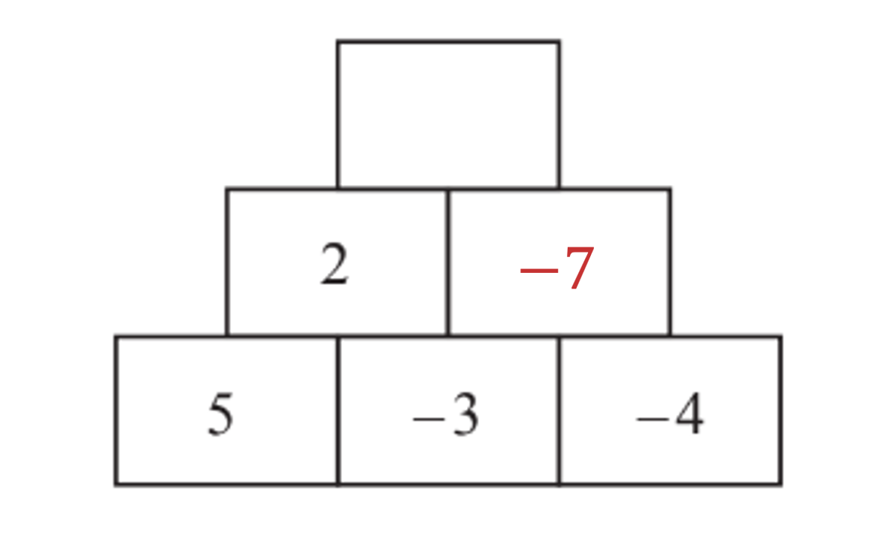
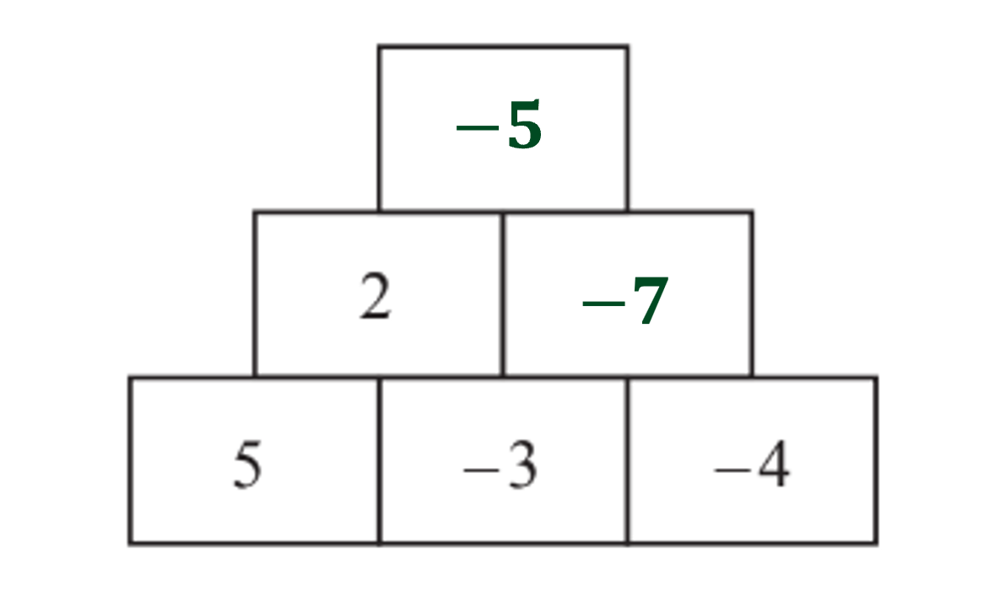
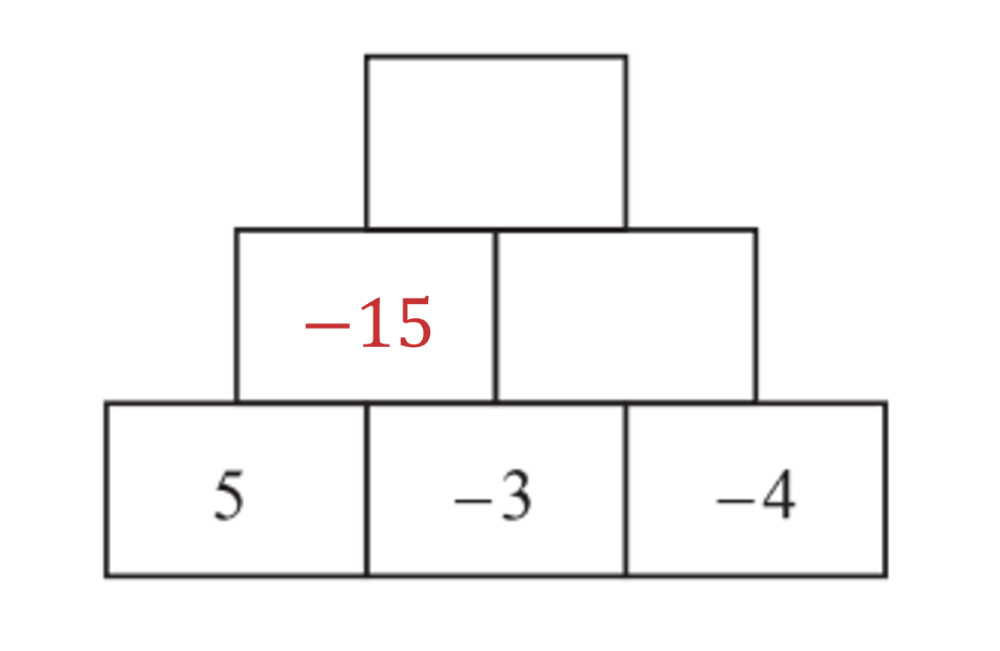
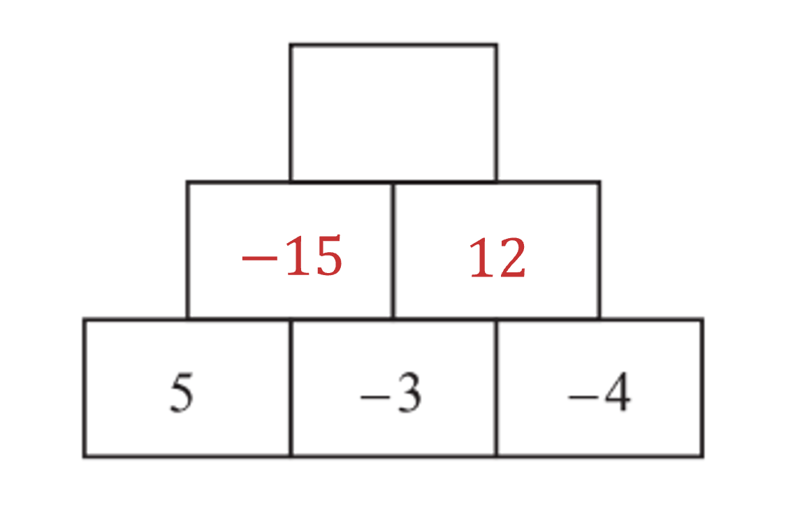
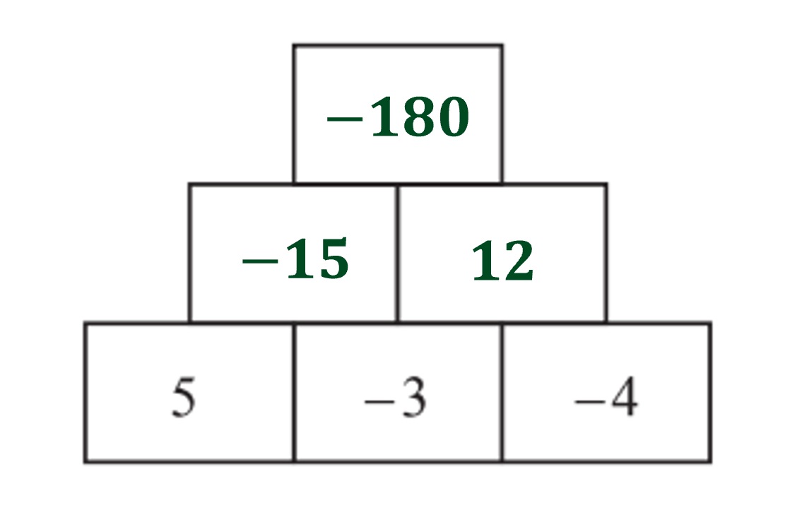

# Mark Schemes — Operations with Numbers & Decimals
**Number** · Cambridge (CIE) IGCSE maths (0607)

## Exam Questions (16 questions)

### Q1
> *To make 1, 16 needs to be divided by 16.*

> $8+4\times2=16$* (because we perform the multiplication before the addition):*

$8+4\times2=8+8=16$

> * So the brackets need to go around *$8+4\times2$*.*

> * *

$16\div(8+4\times2)=1$* ***[1]**
$16\div8+4=6$ *(because we perform the division before the addition):*

$16\div8+4=2+4=6$

> $6\times2=12$*, so the brackets need to go around *$16\div8+4$*.*

> * *

$(16\div8+4)\times2=12$* ***[1]**

### Q2
> *As *$5+27=32$*, *$3\times9=27$* and *$10-1=9$* place brackets around *$10-1$

$5+3\times(10-1)=32$* ***[1]**
> *As *$6--3=9$* and *$4-7=-3$*, place brackets around *$4-7$

$3\times2-(4-7)=9$* ***[1]**

### Q3
> *i) Try putting brackets around different groups of numbers. Follow the order of operations (brackets, division/multiplication, addition).*

$( 24 \div 6 ) + 2 \times 3 = 4 + 2 \times 3 = 4 + 6 = 10$

$24 \div ( 6 + 2 ) \times 3 = 24 \div 8 \times 3 = 3 \times 3 = 9$

> *This is the number we want.*

$24\div(6+2)\times3$ **[1]**

> *ii) Continue to try different groups*

$24 \div 6 + ( 2 \times 3 ) = 24 \div 6 + 6 = 4 + 6 = 10$

> *Try putting brackets around a group of 3 numbers.*

$( 24 \div 6 + 2 ) \times 3 = ( 4 + 2 ) \times 3 = 6 \times 3 = 18$

$24 \div ( 6 + 2 \times 3 ) = 24 \div ( 6 + 6 ) = 24 \div 12 = 2$

$24\div(6+2\times3)$ **[1]**

### Q4
*Use BIDMAS to decide on the order of operations* 
*Find the value of the brackets first*

$18 \div ( 6 ) - 11 \times 4 + 9 ( 7 )$

> *Carry out the division next*

$3 - 11 \times 4 + 9 ( 7 )$

> *Carry out the multiplications next*

$3-44+63$

> *Finally, work out the subtraction and addition working from left to right*

$22$ **[1]**

### Q5
**In line 1,  **$(3^{2}\times2+3)$** has been incorrectly calculated to be **$40$**     **** ****The addition has incorrectly been carried out first**** ****[1]**

**In line 3,  **$3\times2^{3}$** has been incorrectly calculated to be **$6^{3}$**     **** ****The multiplication has incorrectly been applied first**** ****[1]**

> *Carry out the correct working*

> *Inside the bracket first, starting with the index, then the multiplication, then the addition*

$3 \times 2^{3} + \sqrt{25} ( 3^{2} \times 2 + 3 )
3 \times 2^{3} + \sqrt{25} ( 9 \times 2 + 3 )
3 \times 2^{3} + \sqrt{25} ( 18 + 3 )
3 \times 2^{3} + \sqrt{25} ( 21 )$

> *Evaluate the indices, then multiplication, then addition*

$3 \times 8 + 5 ( 21 )
24 + 5 ( 21 )
24 + 105$

$129$ **[1]**

### Q6
> *1 million is written as 1 000 000.*

> *Subtract 123 from this number using a formal written method*

> *Or subtract in stages*

*1 000 000 - 100 = 999 900*

*999 900 - 20 = 999 880*

*999 880 - 3 = 999 877*

**999 877**** ****[1]**
> *Carry out the subtraction*

*2 - 9 = -7*

**-7 ****[1]**

### Q7
i) *Calculate the box above *$-3$* and *$-4$

$( - 3 ) + ( - 4 ) = - 3 - 4 = - 7$

**[1]**

> *Calculate the box above *$2$* and *$-7$

$2 + ( - 7 ) = 2 - 7 = - 5$

**[1]**

ii) *Calculate the box above *$5$* and *$-3$

$5 \times ( - 3 ) = - ( 5 \times 3 ) = - 15$

**[1]**

> *Calculate the box above *$-3$* and *$-4$

$( - 3 ) \times ( - 4 ) = 3 \times 4 = 12$

**[1]**

> *Calculate the box above *$-15$* and *$12$

$( - 15 ) \times 12 = - ( 15 \times 12 ) = - 180$

**[1]**

### Q8
> *As *$3+16=19$* and *$2\times8=16$*, insert the brackets around *$12-4$* as *$12-4=8$

$3+2\times(12-4)=19$* ***[1]**

### Q9
> *Test by putting brackets around different pairs of numbers until you get 28. Remember to follow the order of operations (brackets, multiplication, subtraction/addition).*

$( 8 + 6 ) - 2 \times 5 = 14 - 2 \times 5 = 14 - 10 = 4$

$8 + ( 6 - 2 ) \times 5 = 8 + 4 \times 5 = 8 + 20 = 28$

$8+(6-2)\times5=28$ **[1]**
> *Test the final pair*

$8 + 6 - ( 2 \times 5 ) = 8 + 6 - 10 = 4$

> *Now try putting brackets around groups of 3*

$( 8 + 6 - 2 ) \times 5 = 12 \times 5 = 60$

$(8+6-2)\times5=60$ **[1]**

### Q10
> *As  *$42=7\times6$*,  place brackets around the 5 and the 3 as*

$5-2+3=6$

$7\times(5-2+3)=42$ **[1]**

### Q11
> *Try putting the brackets in different places*

$( 4 \times 6 ) - 2 + 1 = 24 - 2 + 1 = 23
4 \times ( 6 - 2 ) + 1 = 4 \times 4 + 1 = 17
4 \times 6 - ( 2 + 1 ) = 24 - 3 = 21$

$4\times(6-2)+1=17$* ***[1]**

### Q12
> *Use BIDMAS to calculate in the correct order*

> *First calculate the bracket*

$3+2\times2$

> *Next, the multiplication*

$3+4$

> *Lastly the addition*

$7$ **[1]**

### Q13
> *Calculations above and below the division need to be kept separate to follow order of operations/BIDMAS.*
* *

** She's ignored the order of operations. She needs to add brackets to make it correct, it should be **$(68+18)\div(9-5)$** ****[1]**
> *Type *$( 68 + 18 ) \div ( 9 - 5 )$* into a calculator. *

> $( 68 + 18 ) \div ( 9 - 5 ) = 21.5$* *

**21.5** **[1]**

### Q14
> *The first operation to calculate is division*

$48\div3=16$

> *The calculation is now*

$16-5\times2$

> *The next operation to calculate is multiplication*

$5\times2=10$

> *The calculation is now*

$16-10$

**6**** ****[1]**

### Q15
> *When there is an addition or subtraction as the numerator or denominator in a fraction, it can be considered as a bracket*

$1.09 + \frac{7.85}{( 6.21 - 4.37 )}$

*Now apply the order of operations; BIDMAS* *You can use your calculator in this question* *First the bracket*

$1.09+\frac{7.85}{1.84}$

> *Next the division*

$1.09+4.266304348...$

**[1]**

> *Lastly the addition*

$5.356304348...$

> *Round to 1 decimal place*

$5.4$ **[1]**

### Q16
> *Use BIDMAS to calculate in the correct order*

> *First calculate the values inside the brackets*

$7 ( 8 ) + 8 ( 8 )$

> *This is now two multiplications, added together*

> *Calculate the results of the multiplications*

$56+64$

> *Calculate the addition*

$120$* ***[1]**
