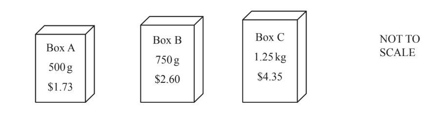

# Exam Questions — Ratio & Proportion
**Number** · Cambridge (CIE) IGCSE maths (0607)
> Source: [https://www.savemyexams.com/igcse/maths/cie/international-maths/23/core/topic-questions/](https://www.savemyexams.com/igcse/maths/cie/international-maths/23/core/topic-questions/) · 22 questions across 1 sets

## Exam Questions (22 questions)

### Q1 — hard — 2 marks

**Q1** [2 marks]

A bag contains red marbles, green marbles and blue marbles only. 
The ratio of the number of marbles of each colour is

red : green : blue = 12 : 5 : 2.

There are 112 more red marbles than green marbles.

Work out the number of blue marbles.

*Source: March 2020 0580/12 Q12*

### Q2 — hard — 3 marks

**Q2** [3 marks]

Nadira has some T-shirts that are either white or blue or green. The numbers of T-shirts are in the ratio white : blue : green = 5 : 4 : 1. 48 of the T-shirts are blue.

Work out the total number of T-shirts.

*Source: Nov 2019 0580/32 Q1D*

### Q3 — hard — 2 marks

**Q3** [2 marks]

A bag contains yellow balls, pink balls and green balls only.

The ratio yellow balls : pink balls : green balls = 7 : 3 : 5. 
There are 42 yellow balls in the bag.

Work out the total number of balls in the bag.

*Source: June 2020 0580/13 Q12*

### Q4 — hard — 8 marks

**Q4** [2 marks]

Gabriela designs the seating layout for a new theatre.
 There are three sections of seats, A, B and C.

Section A has 152 seats. 
Section B has 171 seats. 
Section C has 57 seats.

Write down and simplify the ratio of the number of seats in each section A : B : C.

A : B : C = ............. : ............. : .............

*Source: June 2020 0580/31 Q1B*

**Q4** [6 marks]

For a concert in the theatre, the ticket prices are in the ratio

A : B : C = 9 : 7 : 4.

A ticket for Section C costs \$6.

i) Show that a ticket for Section B costs \$10.50 .

[1]

ii) Find the cost of a ticket for Section A.

\$ .................................................. [1]

iii) The table shows the number of tickets sold in each section.

| Section | Number of tickets sold |
|---|---|
| A | 120 |
| B | 136 |
| C | 30 |

Calculate the total amount received from the ticket sales.

\$ .................................................. [3]

iv) The concert costs \$4500 to organise.

Calculate the amount received from the ticket sales as a percentage of the \$4500.

[1]

*Source: June 2020 0580/31 Q1D*

### Q5 — hard — 3 marks

**Q5** [3 marks]

A farmer has 45 horses and 20 cows.

i) Write this as a ratio of horses : cows. 
Give your answer in its simplest form.

[1]

ii) The farmer wants the ratio of horses : cows to equal 5 : 3. 
He keeps his 45 horses and buys some more cows.

Work out the number of cows he must buy.

[2]

*Source: Specimen 2020 0580/03 Q4A*

### Q6 — hard — 2 marks

**Q6** [2 marks]

Raoul makes a profit when he sells his watch for \$36.
 The ratio of the price Raoul paid for the watch and the profit he makes is price paid : profit = 7 : 2.

Work out the profit that Raoul makes.

\$....................................................

*Source: Nov 2019 0580/33 Q4D*

### Q7 — hard — 6 marks

**Q7** [3 marks]

100 g of cereal contains 360 kilocalories. 
100ml of milk contains 45 kilocalories. 
For breakfast Sasha has 35 g of cereal with 180ml of milk.

Work out the number of kilocalories Sasha has for breakfast.

.......................................... kcal

*Source: June 2020 0580/33 Q6B*

**Q7** [3 marks]

A shop sells cereal in boxes A, B and C.

Work out which box is the best value. 
You must show all your working.

Box .................................................

*Source: June 2020 0580/33 Q6C*

### Q8 — medium — 2 marks

**Q8** [2 marks]

Alan and Beth share \$1190 in the ratio Alan : Beth = 5 : 2.

Work out how much Alan receives.

\$..........................

*Source: Nov 2020 0580/11 Q9*

### Q9 — medium — 5 marks

**Q9** [2 marks]

The music teacher at a school forms an orchestra. 
The instruments in the orchestra are 36 string, 15 woodwind and 12 brass.

Write the ratio string : woodwind : brass in its simplest form.

................ : ................ : ................

*Source: May/June 2019 0580/33 Q3A*

**Q9** [3 marks]

The 36 string instruments are violins, cellos and double basses in the ratio

violins : cellos : double basses = 9 : 2 : 1.

i) Show that the number of violins is 27.

[1]

ii) Work out the number of cellos and the number of double basses.

Cellos ..........................      
Double basses ........................... [2]

*Source: May/June 2019 0580/33 Q3B*

### Q10 — medium — 2 marks

**Q10** [2 marks]

Zach is looking at the costs of a holiday.

The ratio of the costs flights : hotels = 3 : 8. 
The cost of the flights is \$861.

Work out the total cost of flights and hotels.

\$ ...................................................

*Source: June 2019 0580/32 Q9B*

### Q11 — medium — 2 marks

**Q11** [2 marks]

Alex and Chris share sweets in the ratio Alex : Chris = 7 : 3. 
Alex receives 20 more sweets than Chris.

Work out the number of sweets Chris receives.

*Source: Nov 2020 0580/12 Q20*

### Q12 — medium — 3 marks

**Q12** [3 marks]

One week the café makes a profit of \$1027. 
George, Louis and Beatriz share this profit in the ratio George : Louis : Beatriz = 7 : 4 : 2.

Calculate the amount of money they each receive.

George \$ ...................................................... 
Louis   \$ ...................................................... 
Beatriz \$ ......................................................

*Source: Nov 2020 0580/32 Q1D*

### Q13 — medium — 3 marks

**Q13** [3 marks]

Here is a list of ingredients to make 12 pancakes.

| 110g | flour |
|---|---|
| 2 | eggs |
| 200 ml | milk |
| 50g | butter |

Complete the list of ingredients below to make 30 pancakes.

| ............................g | flour |
|---|---|
| ............................ | eggs |
| ............................ml | milk |
| ............................g | butter |

*Source: Nov 2019 0580/13 Q18*

### Q14 — medium — 2 marks

**Q14** [2 marks]

A car park has 880 parking spaces.

Some of the spaces are reserved.
 The ratio of reserved spaces : not reserved spaces = 1 : 10.

Work out the number of spaces that are not reserved.

*Source: March 2019 0580/32 Q4A*

### Q15 — medium — 2 marks

**Q15** [2 marks]

Asif and Ben share \$2100 in the ratio Asif : Ben = 3 : 7.

Work out how much Asif receives.

\$ .........................................

*Source: June 2019 0580/11 Q9*

### Q16 — medium — 3 marks

**Q16** [3 marks]

Alexa, Ben and Chloe share the profits from their restaurant in the ratio 2 : 6 : 7. 
One year the restaurant makes a profit of \$60000.

Work out how much each receives.

Alexa = \$ ................................................. 
Ben = \$ ................................................. 
Chloe = \$ .................................................

*Source: June 2020 0580/32 Q4B*

### Q17 — medium — 2 marks

**Q17** [2 marks]

Share 518 in the ratio 2 : 5.

*Source: June 2019 0580/11 Q10*

### Q18 — easy — 2 marks

**Q18** [2 marks]

Divide 120 in the ratio 1 : 2.

................. : .................

*Source: Feb/March 2018 0580/12 Q8*

### Q19 — easy — 5 marks

**Q19** [2 marks]

A car company has three sales people, Anna, Mustapha and Joshua.

During March, Anna sold 21 cars, Mustapha sold 12 cars and Joshua sold 15 cars.

Write down and simplify the ratio of the number of cars they sold during March.

Anna : Mustapha : Joshua = .......... : .......... : ...........

*Source: May/June 2018 0580/32 Q3A*

**Q19** [3 marks]

**Extract:**

During March, Anna sold 21 cars, Mustapha sold 12 cars and Joshua sold 15 cars.

Each month, they receive a bonus which is proportional to the number of cars they sell. 
The total bonus in March is \$1248.

i) Show that Anna receives a bonus of \$546.

[1]

ii) Calculate the bonuses received by Mustapha and Joshua.

Mustapha \$ ..........................      
Joshua \$ ............................. [2]

*Source: May/June 2018 0580/32 Q3B*

### Q20 — easy — 1 marks

**Q20** [1 mark]

When full, a cruise ship carries 880 guests and 360 crew.

Write the ratio guests : crew in its simplest form.

*Source: Nov 2020 0580/33 Q1B*

### Q21 — easy — 2 marks

**Q21** [2 marks]

Maia shares \$3000 between her three children. 
She gives the eldest child \$1200, the second eldest child \$1000 and the rest to the youngest child.

Write this information as a ratio in its simplest form.

................. : .............. : ..............    *eldest*                     *youngest*

*Source: March 2019 0580/32 Q3A*

### Q22 — easy — 2 marks

**Q22** [2 marks]

A box contains 22 coloured pencils. 
6 pencils are pink, 9 pencils are blue and 7 pencils are yellow.

Write down the ratio pink pencils : not pink pencils. 
Give your answer in its simplest form.

*Source: June 2019 0580/12 Q15A*

