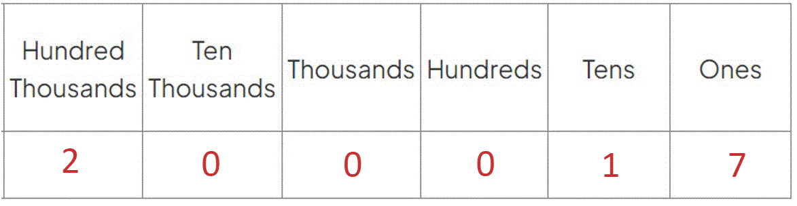
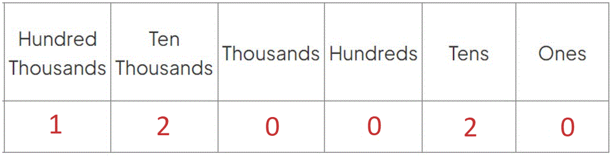
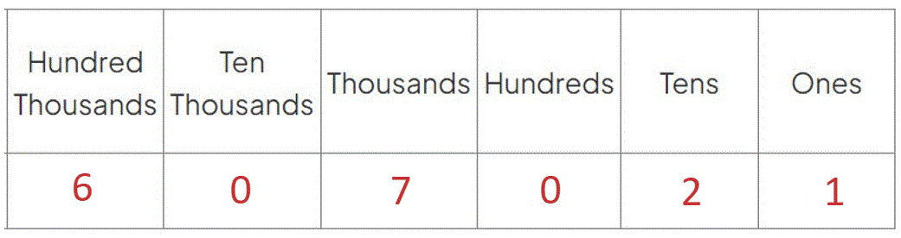
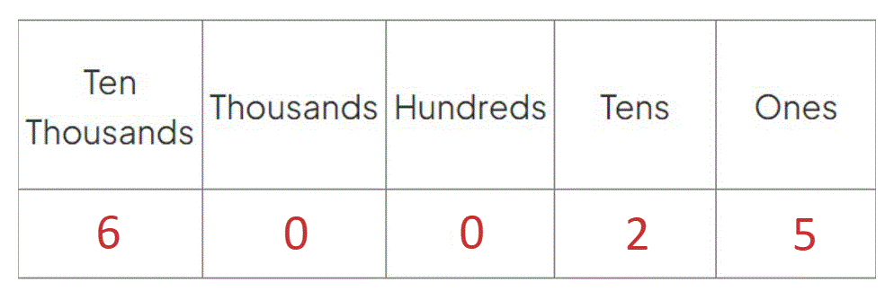

# Mark Schemes — Reading & Ordering Numbers
**Number** · Cambridge (CIE) IGCSE maths (0607)

## Exam Questions (27 questions)

### Q1
(i) *Subtract Wednesday's minimum temperature from Wednesday's maximum temperature. *

$15 - ( - 4 ) = 19$

$19^{\circ}C$* ***[1]**

(ii) *The minimum temperature on Monday was *$-5^{\circ}C$*.*

> *Add *$2^{\circ}C$*. *

$-5+2=-3$

$-3^{\circ}C$ **[1]**

(iii) *The range (*$23^{\circ}C$*) is the difference between the highest temperature (*$15^{\circ}C$*) and the lowest temperature.* * *

$15-23=-8$

$-8^{\circ}C$* ***[1]**

### Q2
> *Separate the millions and thousands with a space*

$1302596$ **[1]**

### Q3
i) *Group the number into thousands and ones using the spacing provided*

**Six hundred and four thousand, nine hundred and twenty-five**** ****[1]**

** **

ii) *A prime number has only two factors, itself and 1*

**  ****53 or 59**** ****[1]**

> * *

iii) *For all values of* $x,x^{0}=1$

$999^{0}=1$

$1$ **[1]**

### Q4
> *Change the temperature by subtracting *$5$

$-7-5=-12$

**[1]**

> *Then add 8 to the result*

$-12+8$

$-4^{\circ}C$ **[1]**

### Q5
> *The key word in the question is "more". Work out the number that is 63.8 **more** than -57.0*

$-57.0+63.8=6.8$

**6.8**** ****[1]**

### Q6
> *Work out the difference in temperature in all the cities by subtracting the temperature at midnight from the the temperature at 3pm.*

> *Sydney: *

$28-21=7$

> * *

> *Oslo:*

$1 - ( - 3 ) = 4$

> * *

> *Toronto:*

$( - 8 ) - ( - 18 ) = 10$

> * *

> *Seoul:*

$4 - ( - 5 ) = 9$

> * *

> *Toronto** has the biggest difference in temperature.*

*Toronto ***[1]**
* *$10^{\circ}C$* ***[1]**
> *Add 5 onto -11.*

> * *

$-11+5=-6$

> * *

$-6^{\circ}C$ **[1]**

### Q7
> *There are **two **hundred thousands, **zero **ten thousands, **zero **thousands, **zero **hundreds, **one **ten and **seven **ones.*

> * *

> * *

**200 017** **[1]**

### Q8
> *Subtract to find 7°C below -3°C *

$-3-7=-10$

**-10°C**** ****[1]**
> *To find the difference, subtract*

`4 - ( - 4 ) = 4 + thin 4 = 8`

**8**** ****[1]**

### Q9
> *The starting temperature is 5 and it has decreased by 7 so we need to subtract 7*

$5-7=-2$

**-2 ****[1]**

### Q10
(i) *Subtract the lower temperature (the cool box temperature of *$-3^{\circ}C$*) from the higher temperature (the fridge temperature of *$4^{\circ}C$*). *

> $4 - ( - 3 ) = 7$* *

$7^{\circ}C$* ***[1]**

(ii) *Subtract the lower temperature (the freezer temperature of *$-19^{\circ}C$*) from the higher temperature (the cool box temperature of *$-3^{\circ}C$*). *

> $- 3 - ( - 19 ) = 16$*  *

$16^{\circ}C$* ***[1]**

(iii) *Subtract the *$5^{\circ}C$* from the fridge temperature (*$4^{\circ}C$*). *

> $4-5=-1$* *

$-1^{\circ}C$* ***[1]**

### Q11
> *Write the number in a place value table. 4 would be in the hundred thousands column, 1 is in the ten thousands column, there are 8 thousands, no hundreds, 7 tens, and 2 ones.*

| *Hundred thousands* | *Ten thousands* | *Thousands* | *Hundreds* | *Tens* | *Ones* |
|---|---|---|---|---|---|
| *4* | *1* | *8* | *0* | *7* | *2* |

**418 072**** ****[1]**

### Q12
> *Subtract the smaller temperature from the larger one to find the difference.*

$5 - ( - 6 ) = 11$

$11^{\circ}C$* ***[1]**

### Q13
> *The temperate at 0100 is 11°C colder than the temperate at 0700*

> *Subtract 11 from the given temperature*

$-3-11=-14$

$-14^{\circ}C$** [1]**

### Q14
> *The difference is a subtraction of the two temperatures*

$4 - ( - 3 ) = 4 + 3 = 7$

**7° C**** [1]**
> *As the temperature has fallen by *$4^{\circ}C$*, subtract this from the temperature at midday*

$-1-4=-5$

**-5°**** C** **[1]**

### Q15
> *There are **one **hundred thousands, **two **ten thousands, **zero **thousands, **zero **hundreds, **two **tens and **zero **ones.*

> * *

$120020$* ***[1]*** *

### Q16
(i) *Difference in temperature = highest temperature (*$-11^{\circ}C$*) *$-$* lowest temperature (*$-23^{\circ}C$*).*

> * *

> $( - 11 ) - ( - 23 ) = 12$* *

$12^{\circ}C$* ***[1]**

(ii) *Add *$28^{\circ}C$* to the average temperature in March (*$-11^{\circ}C$*).*

> * *

> $-11+28=17$* *

$17^{\circ}C$* ***[1]**

### Q17
> *The 7 is in the** ten thousands **column.*

> * *$7\times10000=70000$* *

**70 000**** ****[1]**

### Q18
> *Remember to use a place holder 0 in the hundred column*

**17 017**** ****[1]**

### Q19
> *Fifty-three thousand means a **5** in the ten thousands column and a **3** in the thousands column. There are **0** hundreds.*

> *Thirty-five means a **3** in the tens column and a **5** in the ones.*

> * *

**53 035** **[1]**

### Q20
> *Considering the place value columns, we have*

*1 ten thousand*

*5 thousands*

*0 hundreds*

*6 tens*

*0 ones*

> *Writing this in words, we have*

**Fifteen thousand and sixty ****[1]**

### Q21
> *Add 7 on to -38.*

> * *

$-38+7=-31$

> * *

**-31**** ****[1]**

### Q22
i) *Group the digits into thousands and ones using the spacing as a guide*

**Eleven thousand, six hundred and seventy-eight** **[1]**

** **

ii) *The two place value columns we need to inspect are the hundreds and the tens*

*Tens digit is 7*
*Hundreds digit is 6*

> *Any value that is 5 or above must round up to 10. Any value 4 or less rounds down to 0*

*The tens digit is a 7 so round up to the next hundred*
*678 rounds up to 700**  *

> *The remaining digits in each place value column to the left of the hundreds column are not affected and so they remain unchanged and part of the solution*

> * *

**Final answer:** **11 700**** [1]**

### Q23
(i) *There is a **two **in the thousands column, a **six **in the tens column and a **seven **in the ones column. *

**Two thousand and sixty seven** **[1]**

(i) *Identify the digit to the **right **of the hundreds column.*

$20\underset{-}{6}7$

> *As this digit is 5 or greater, we will round the hundreds digit from a 0 to a 1.*

> *The tens and ones columns become 0.*

$2100$* ***[1]**

### Q24
> *Six hundred and seven thousand means that there is a **6 **in the hundred thousands column and a **7 **in the thousands column. Twenty-one means there is a **2** in the tens column and a **1 **in the ones column.*

> *There are **0 **ten thousands and **0 **hundreds.*

> * *

**607 021**** ****[1]**

### Q25
> *Write the number of thousands followed by the number of ones*

**Thirty thousand, six hundred and eighty-two**** ****[1]**

### Q26
> *Use a place value table and put the three in the hundreds column, and the four in the ten thousands column. The other columns should have a zero as a place holder.*

| Ten thousands | Thousands | Hundreds | Tens | Ones |
|---|---|---|---|---|
| *4* | *0* | *3* | *0* | *0* |

**40 300**** ****[1]**

### Q27
> *There **six **ten thousands, **zero **thousands, **zero **hundreds, **two **tens and **five **ones.*

> * *

> * *

> *Six ten thousands is **sixty thousand**. Two tens and five ones is **twenty five**.*

**sixty thousand and twenty five** **[1]**
