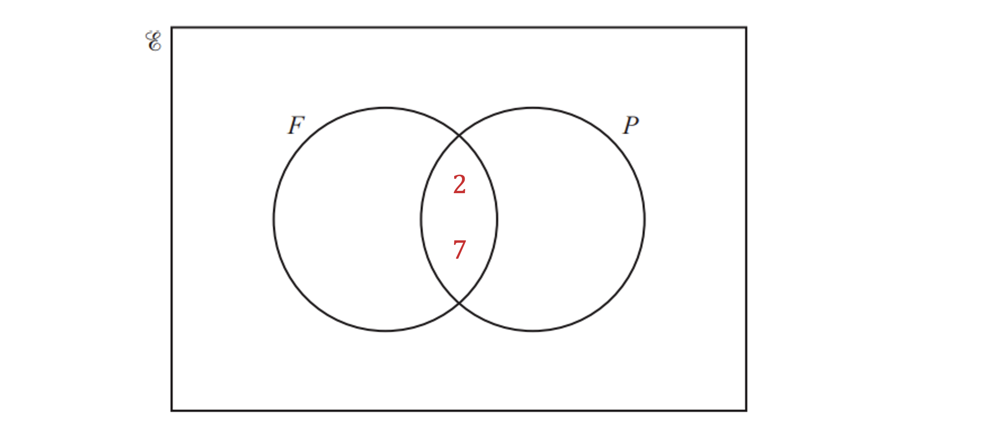
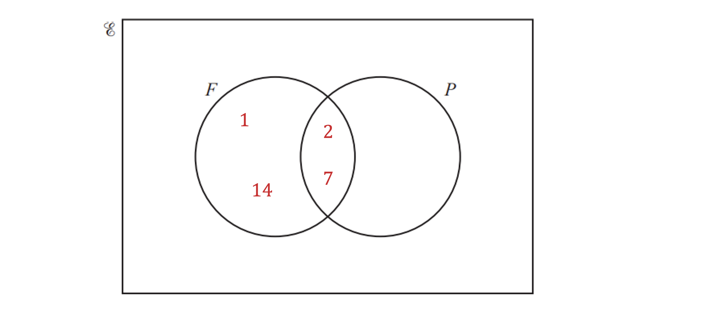
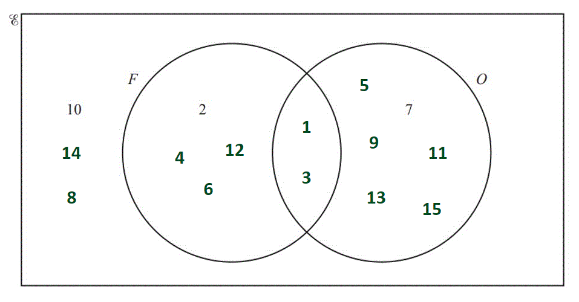
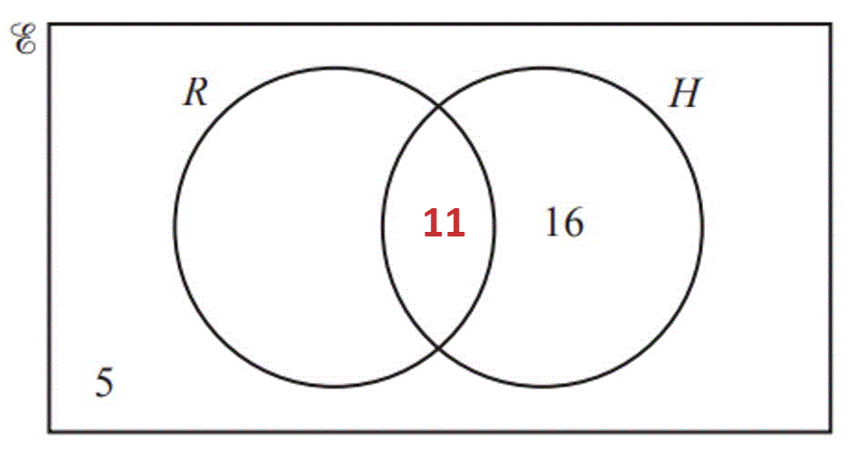
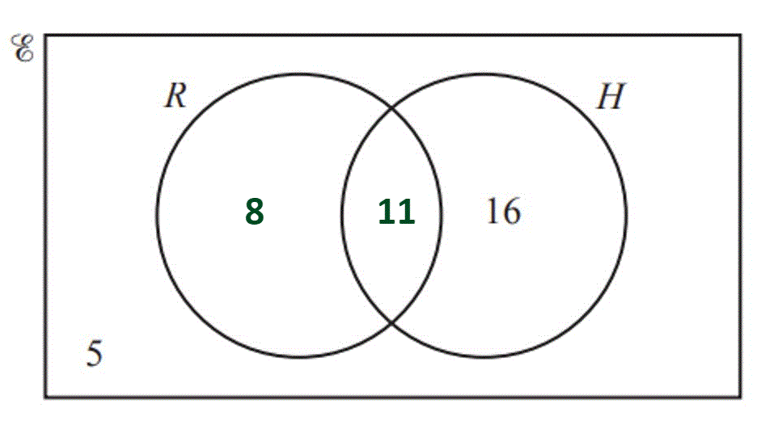
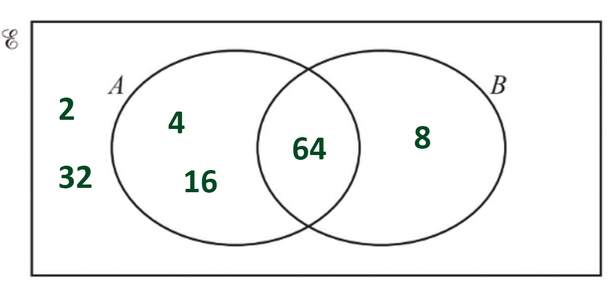
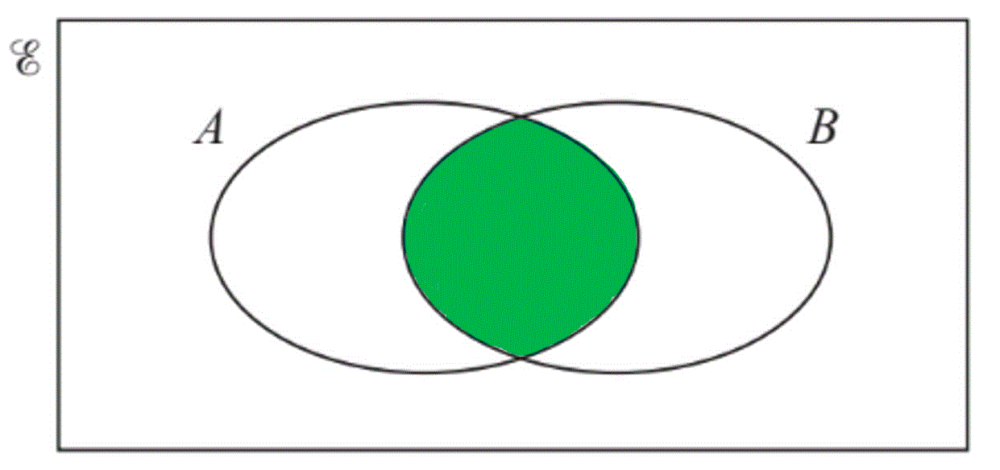
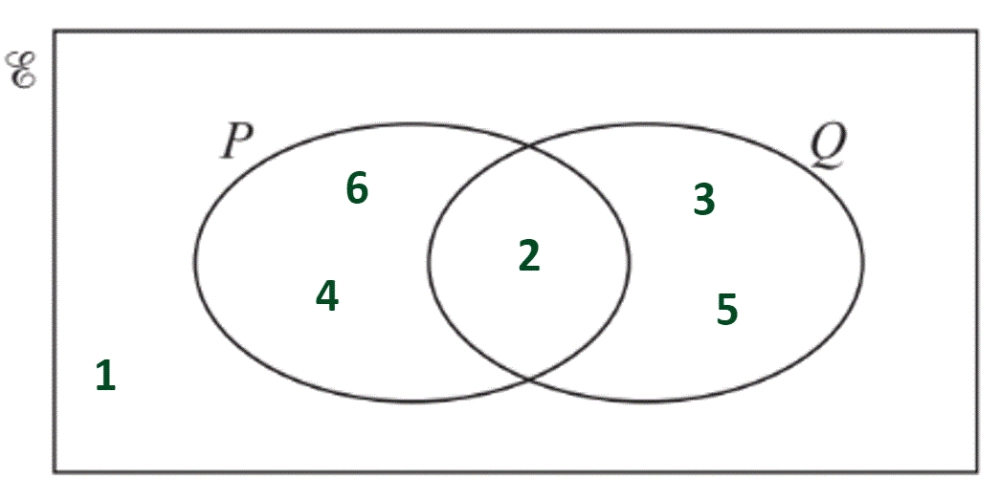

# Mark Schemes — Sets
**Number** · Cambridge (CIE) IGCSE maths (0607)

## Exam Questions (11 questions)

### Q1
i) *The elements of set *$F$* are factors of 14:*

**1, 2, 7, 14**** ****[2]**

> *1 mark if one number missing or one number extra*

*  *ii) *The elements in set *$P$* are the prime numbers less than 14:*

**2, 3, 5, 7, 11, 13** **[2]**

> *1 mark for one extra number or one number missing*

*  *iiia) *The elements of *$F$* and *$P$* are: *

*2 and 7*

> *These elements appear in the intersection of the two circles*

> *The elements of *$F$*  only are:  *

*1 and 14*

> *These elements appear in the left hand crescent of the circle for set *$F$

> *The elements of *$P$*  only are:*

*3, 5, 11 and 13*

> *These elements appear in the right hand crescent of the circle for set *$P$

> *The remaining numbers are not in *$F$* or *$P$* so these are placed outside of the two circles:*

*4, 6, 8, 9, 10, 12  *

* For 2 or 3 sections correct*** [1]**
*For all remaining sections correct*** [1]**

iib) $n$*(*$F\capP$*) represents the number of items in the set *$F$* and *$P$*.*

> *The items in set  *$F$* and *$P$*  are*

*2 and 7*

> *The number of items in the set  *$F$* and *$P$*  is*

*2** ***[1]**

### Q2
(i) *Write down the factors of 12 (**F**). *

*1, 2, 3, 4, 6, 12 *

> *Write down the odd numbers *$\leq$*15 (**O**). *

*1, 3, 5, 7, 9, 11, 13, 15 *

> *The numbers that are in both lists, **1 **and **3**, go in the intersection of the two circles. *

> *Write any numbers between 1 and 15 which are in neither of the lists outside of the circles (**10**, **8**, and **14**). *

**[1]**

> *  The factors of 12 except 1 and 3 go into the **F **circle. The odd numbers except 1 and 3 go into the **O **circle. *

* A**ll correct*** ****[1]**

** **

* *(ii)*Write down one of the numbers which is in the **O **circle, not including the intersection. *

**5** **[1]**

> *7, 9, 11, 13, 15 also accepted*

> * *

(iii) *Count how many numbers there are in both circles. *

**12** **[1]**

### Q3
(i) *Count how many numbers there are in the circle A.*

* ***9** **[1]**

** **

(ii) *List the numbers that are in the circle B. *

**3, 6, 9, 12, 15, 18** **[2]**

**One mark for 4 or 5 correct**

(iii) $A\capB$* is the numbers that are in both sets, so look at the numbers where the circles overlap.*

> *They are all even (because they are all in set *$A$*), and they are all multiples of 3 (because they are all in set *$B$*). *

**Even and a multiple of 3**** (which is a multiple of 6)****[1]**

** **

### Q4
> *The number of people who go to the park but do not play golf or tennis is *$25$*. *
*Write this into the Venn diagram*

> *The number of people who play golf or tennis is the difference between the number of people who go to the park, and the number of people who do not play golf or tennis*

$120-25=95$

> *Determine the number of people who play golf and tennis by finding the difference between the number of people who play golf (*$75$*) added to the number of people who play tennis (*$50$*), and the calculated number of people who play golf or tennis (*$95$*)*

$( 75 + 50 ) - 95 = 30$

> *Write this value into the Venn diagram at the intersection of the two sets*

* Any two correct values in the Venn diagram*** [1]**

> *As *$50$* people play tennis, subtract the *$30$* people who also play golf to determine the number of people who only play tennis*

$50-30=20$

> *Write this value into the Venn diagram in the left crescent*

> *Repeat this process for the number of people who only play golf*

$75-30=45$

> *Write this value into the Venn diagram in the right crescent*

*All four values in the Venn diagram correct*** [1]**
> *The number of people who play tennis and golf is the number in the intersection of the two circles in the diagram*

$30$ **[1]**

### Q5
(i) *Add up all the numbers in the Venn diagram. *

*12 + 8 + 7 + 4 = 31 *

**31**** ****[1]**

** **(ii) *Add together the two numbers in the **B** circle. *

*8 + 7 = 15 *

**15** **[1]**

** **(iii) $n ( A \cup B )$* means the number of students who like apples **or **bananas.*

> *Add together the three numbers from inside both circles. *

*12 + 8 + 7 = 27 *

**27**** ****[1]**

** **(iv) *Add together the numbers in the **A **circle to work out how many students like apples, then subtract the number of students who like bananas, 15. *

*(12 + 8) - 15 = 5 *

**5** **[1]**

### Q6
> *The hamster circle has to add up to 27.*

> *Subtract 16 from 27 to find the number of children who own both a hamster and a rabbit. *

> $27-16=11$* *

> *Put in the Venn diagram in the correct place.*

> *  *

> *The rabbit circle has to add up to 19.*

*Subtract 11 from 19 to find the number of children who only own a rabbit. *

$19-11=8$

> *Put in the Venn diagram in the right place. *

**One mark for each ****[2]**
> *This is the number of children who own both a hamster **and **a rabbit.  It is found where the circles overlap.*

> * *

**11** **[1]**

### Q7
> *Put 10 (the number who only like football) into the correct place in the Venn diagram.*

** **

> *Subtract 10 (the number who only like football) from 24 (the total number who like football) to find the number of students who like both sports. *

> $24-10=14$* *

> *Put 14 into the section where both circles overlap.*

**[1]**

> *Subtract 14 (the number who like both sports) from 19 (the total number who like cricket) to find out how many students like only cricket. *

$19-14=5$

> *Put 5 into the correct place in the Venn diagram.*

**[1] *** *

> *Add together all the numbers inside the circles and subtract from the total number of students, 40. *

> $40 - ( 10 + 14 + 5 ) = 11$* *

> *Put 11 into the box, outside the circles.*

**[1]**

### Q8
(i) *Identify the square numbers in the list: *

> $4,16,64$* *

> *Identify the cube numbers in the list: *

> $8,64$* *

> *64 is in both lists so it goes in the middle, where the two circles overlap.*

> *4 and 16 go into the A circle. 8 goes into the B circle. *

> *2 and 32 are neither square, or cube, so they both go outside the circles, within the box. *

**All correct ****[2]**
**One mark for 4 or 5 numbers in the correct place**

(ii) $P\cupQ$* means "P **or **Q", shade in both circles (including the overlap). *

**[1]**

### Q9
> $A\capB$* means **A **intersect **B **(**A **and **B**).*

> *Shade the intersection of the two circles.*

> * *

**[1]**
> *The only number which is **even **and **prime** is **2**. Write **2** in the intersection.*

> *The only number between 1 and 6 which is **neither** even nor prime is **1**. Write this outside the circles.*

> *Write the even numbers which are not prime, **4 **and **6**, in the **P **circle.*

> *Write the prime number which are not even, **3 **and **5**, in the **Q **circle.*

> * *

*4 or 5 numbers in the correct place*** [1]**
*All correct** ***[1]**

### Q10
> *The region shaded is all elements in *$A$

$A$ **[1]**
> *The region shaded is all of the elements in the set of *$A$* or *$B$*, this is the union of *$A$* and *$B$

$A\cupB$ **[1]**

### Q11
> *The top diagram shows **A **or **B **(**A **union **B**).*

$A\cupB$* ***[1]**

** **

> *The bottom diagram shows **A **and **B **(**A **intersect **B**).*

$A\capB$* ***[1]**
