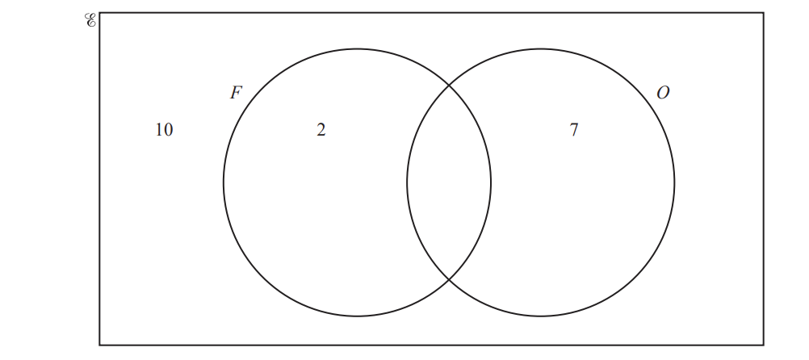
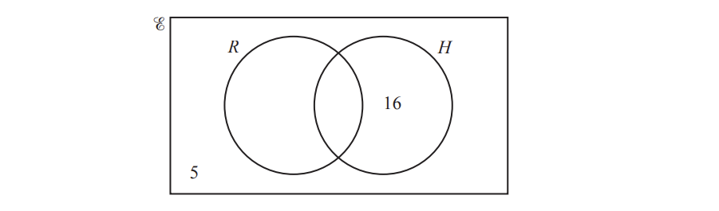
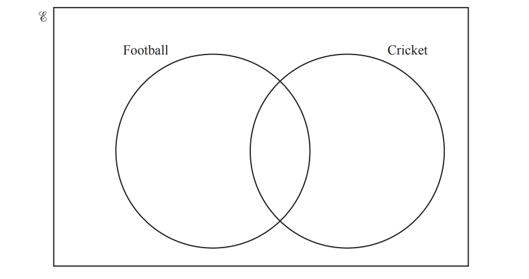
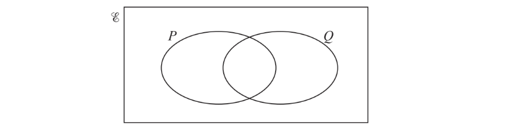
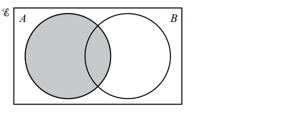
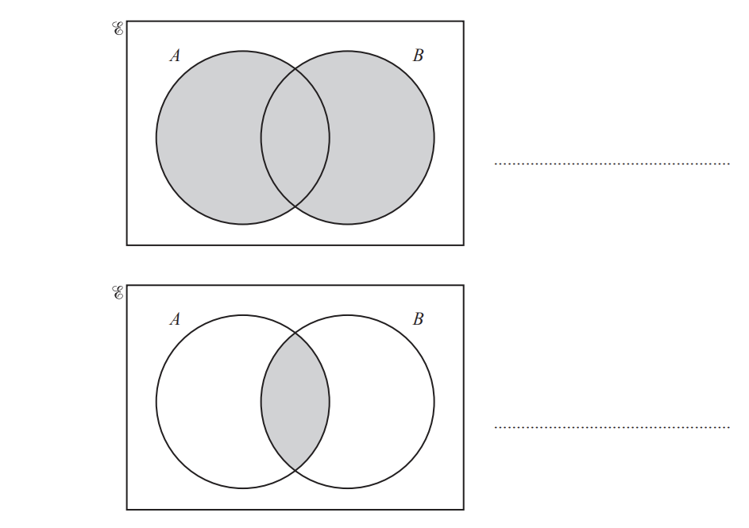

# Exam Questions — Sets
**Number** · Cambridge (CIE) IGCSE maths (0607)
> Source: [https://www.savemyexams.com/igcse/maths/cie/international-maths/23/core/topic-questions/](https://www.savemyexams.com/igcse/maths/cie/international-maths/23/core/topic-questions/) · 11 questions across 1 sets

## Exam Questions (11 questions)

### Q1 — hard — 7 marks

**Q1** [7 marks]

$E$ = {1, 2, 3, 4, 5, 6, 7, 8, 9, 10, 11, 12, 13, 14}
 $F$ = {$x$: $x$ is a factor of 14}
 $P$ = {$x$: $x$ is a prime number less than 14}

i) Write down the elements in set $F$.

$F$ = { ................................................ } [2]

ii) Write down the elements in set $P$.

$P$ = { ................................................ } [2]

iiia) Complete the Venn diagram.

[2]

iiib) Write down  $n$($F\capP$)

[1]

*Source: March 2020 0580/32 Q9A*

### Q2 — hard — 4 marks

**Q2** [4 marks]

$E$ = {$x$ : $x$ is a natural number `less-than or slanted equal to`15}

$F$ = {$x$ : $x$ is a factor of 12}

$O$ = {$x$ : $x$ is an odd number}

i) Complete the Venn diagram to show the elements of these sets.

[2]

ii) Write down one number that is in set $O$, but not in set $F$.

[1]

iii) Find $\mathrm{n} ( F \cup O )$.

[1]

*Source: June 2020 0580/31 Q9B*

### Q3 — medium — 4 marks

**Q3** [4 marks]

$E$ = {$x$ : $x$ is a positive integer less than 20} 
A = {$x$ : $x$ is an even number} 
B = {$x$ : $x$ is a multiple of 3}

i) Write down $\mathrm{n} ( A )$.

[1]

ii) List the elements of set $B$.

$B$= { ............................................... } [2]

iii) Complete the statement.

$A \cap B = \{ x : x \text{is} ............................... \}$

[1]

*Source: Nov 2020 0580/32 Q8D*

### Q4 — hard — 3 marks

**Q4** [2 marks]

$E$= {children who go to the park} 
$T$= {children who play tennis}
$G$ = {children who play golf}

120 children go to the park. 
50 play tennis. 
75 play golf. 
25 do not play tennis or golf.

Complete the Venn diagram.

[2]

*Source: Specimen 2020 0580/01 Q23A*

**Q4** [1 mark]

**Extract:**

![calligraphic E]= {children who go to the park} 

![space T space]= {children who play tennis}

![G] = {children who play golf}

120 children go to the park. 

50 play tennis. 

75 play golf. 

25 do not play tennis or golf.

Find n($T\capG$).

*Source: Specimen 2020 0580/01 Q23B*

### Q5 — medium — 4 marks

**Q5** [4 marks]

The Venn diagram shows information about the number of students in a class who like apples ($A$) and bananas ($B$).

i) Work out the number of students in the class.

[1]

ii) Work out the number of students who like bananas.

[1]

iii) Work out  $n ( A \cup B )$.

[1]

iv) How many more students like apples than like bananas?

[1]

*Source: June 2020 0580/33 Q5A*

### Q6 — medium — 3 marks

**Q6** [2 marks]

$E$ = {children in a group} 
$R$= {children who own a rabbit} 
$H$ = {children who own a hamster}

There are 40 children in the group.
 19 children own a rabbit. 
27 children own a hamster.

Complete the Venn diagram.

*Source: Nov 2020 0580/13 Q21A*

**Q6** [1 mark]

**Extract:**

![R space]= {children who own a rabbit} 

![H] = {children who own a hamster}

Write down $n ( R \cap H ).$

*Source: Nov 2020 0580/13 Q21B*

### Q7 — medium — 3 marks

**Q7** [3 marks]

In a group of 40 students,

- 24 students like football
- 19 students like cricket
- 10 students like football but not cricket.

Complete the Venn diagram.

*Source: Nov 2020 0580/32 Q8C*

### Q8 — medium — 3 marks

**Q8** [3 marks]

i) $E$= {2, 4, 8, 16, 32, 64}

$A$ = {square numbers}

$B$ = {cube numbers}

Use this information to complete the Venn diagram.

[2]

ii) On this Venn diagram, shade the region $P\cupQ$.

[1]

*Source: Nov 2020 0580/31 Q3D*

### Q9 — easy — 3 marks

**Q9** [1 mark]

On the Venn diagram, shade the region $A\capB$.

*Source: June 2020 0580/12 Q16A*

**Q9** [2 marks]

$E$ = {1, 2, 3, 4, 5, 6}

$P$= {$x$ : $x$ is an even number}

$Q$ = {$x$ : $x$ is a prime number}

Complete the Venn diagram.

*Source: June 2020 0580/12 Q16B*

### Q10 — easy — 2 marks

**Q10** [1 mark]

Use set notation to describe the shaded regions in each Venn diagram.

*Source: Specimen 2020 0580/01 Q20A*

**Q10** [1 mark]

*Source: Specimen 2020 0580/01 Q20B*

### Q11 — easy — 2 marks

**Q11** [2 marks]

Use set notation to describe the shaded region in each Venn diagram.

*Source: June 2020 0580/31 Q9A*

