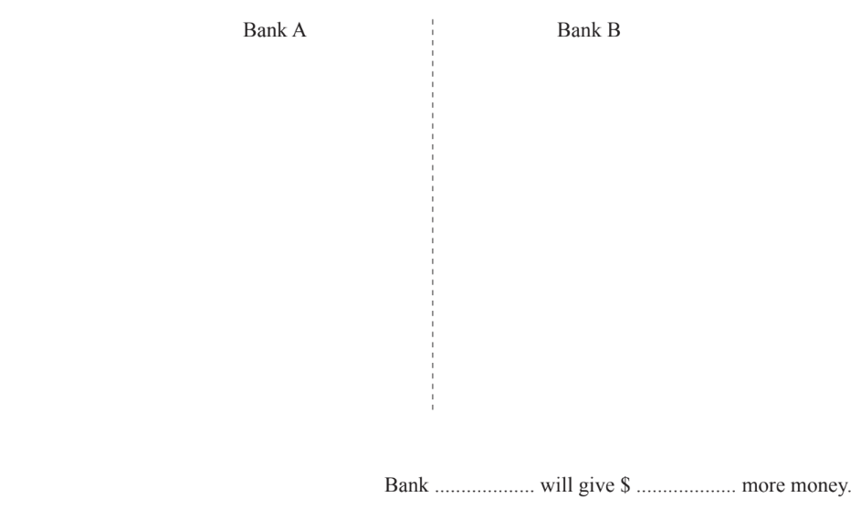

# Exam Questions — Simple & Compound Interest
**Number** · Cambridge (CIE) IGCSE maths (0607)
> Source: [https://www.savemyexams.com/igcse/maths/cie/international-maths/23/core/topic-questions/](https://www.savemyexams.com/igcse/maths/cie/international-maths/23/core/topic-questions/) · 20 questions across 1 sets

## Exam Questions (20 questions)

### Q1 — easy — 2 marks

**Q1** [2 marks]

Sophia invests \$500 at 6% simple interest per year for 3 years.

Work out the total interest earned.

### Q2 — hard — 2 marks

**Q2** [2 marks]

Paula invests \$600 at a rate of$r$% per year simple interest.

At the end of 10 years, the total interest earned is \$90.

Find the value of $r.$

$r$ =........................................

*Source: June 2019 0580/11 Q15*

### Q3 — hard — 3 marks

**Q3** [3 marks]

\$12000 is invested at a rate of n% per year simple interest. 
At the end of 3 years the value of the investment is \$12900.

Find the value of $n$.

$n$ = .................................

*Source: June 2020 0580/32 Q4C*

### Q4 — hard — 3 marks

**Q4** [3 marks]

\$8400 is invested for 2 years at a rate of 3.5% per year compound interest. 
Work out the total amount of interest earned by the end of the 2 years.

\$....................................................

*Source: Nov 2019 0580/33 Q1H*

### Q5 — hard — 8 marks

**Q5** [7 marks]

Six years ago a farmer invested \$3750 at a rate of 4% per year compound interest.

i) Calculate the total value of his investment after the 6 years. Give your answer correct to the nearest dollar.

\$ ............................................... [3]

ii) The farmer wants to spend his investment on buying goats. Goats cost \$126 each.

Work out the maximum number of goats he can buy **and **the amount of money left over.

Number of goats .............................................. Amount of money left over \$ ............................................... [4]

*Source: Specimen 2020 0580/03 Q4B*

**Q5** [1 mark]

The farmer grows carrots. 
In 2018 the selling price for carrots was \$96 per tonne. 
In 2019 this selling price increased by 18%.

Work out the increase in the selling price from 2018 to 2019.

\$ ..............................................

*Source: Specimen 2020 0580/03 Q4C*

### Q6 — hard — 3 marks

**Q6** [3 marks]

Riya invests \$30000 at a rate of 2.5% per year compound interest.

Calculate the value of her investment at the end of 7 years. 
Give your answer correct to the nearest dollar.

\$ .................................................

*Source: March 2020 0580/12 Q15*

### Q7 — hard — 3 marks

**Q7** [3 marks]

Harry invests \$800 for 2 years at a rate of 3% per year compound interest.

Calculate the amount of interest he receives at the end of the 2 years.

\$ ...........................

*Source: May/June 2019 0580/13 Q19*

### Q8 — hard — 5 marks

**Q8** [5 marks]

Sonia wants to invest \$5000 for 6 years.

Bank A pays compound interest at a rate of 3.5% per year. 
Bank B increases the \$5000 by 22% at the end of 6 years.

Which bank will give Sonia the most money at the end of 6 years and by how much? You must show all your working.

*Source: June 2020 0580/13 Q18*

### Q9 — hard — 3 marks

**Q9** [3 marks]

Tomas borrows \$5000 for 3 years at a rate of 2.5% per year compound interest. 
He pays back the whole amount, with interest, at the end of 3 years.

Calculate the total amount of money he pays back at the end of the 3 years.

\$ ..............................

*Source: Feb/March 2018 0580/12 Q18*

### Q10 — medium — 3 marks

**Q10** [3 marks]

Ella invests \$4000 for 3 years at a rate of 1.2% per year compound interest.

Calculate the value of her investment at the end of the 3 years.

\$...................................................

*Source: Nov 2019 0580/31 Q4H*

### Q11 — medium — 3 marks

**Q11** [3 marks]

Gino invests \$6000 for 5 years at a rate of 1.2% per year compound interest.

Calculate the value of his investment at the end of the 5 years. Give your answer correct to the nearest dollar.

\$ .................................................

*Source: Nov 2020 0580/32 Q6F*

### Q12 — medium — 3 marks

**Q12** [3 marks]

Hawa invests \$750 at a rate of 3.5% per year compound interest.

Calculate the value of his investment at the end of 3 years.

\$ ..............................

*Source: March 2019 0580/32 Q3C*

### Q13 — medium — 3 marks

**Q13** [3 marks]

Javier invests \$750 for 3 years at a rate of 1.8% per year compound interest.

Calculate the value of his investment at the end of the 3 years.

\$ ...................................................

*Source: Nov 2019 0580/12 Q18*

### Q14 — medium — 2 marks

**Q14** [2 marks]

Lucia invests \$5000 at a rate of 4.5% per year compound interest.

Calculate the value of her investment at the end of 7 years.

\$ ..................................................

*Source: June 2020 0580/11 Q21*

### Q15 — medium — 2 marks

**Q15** [2 marks]

Trina invests \$16000 at a rate of 5% per year compound interest.

Work out the value of her investment at the end of 4 years.

\$.........................

*Source: Nov 2020 0580/11 Q17*

### Q16 — easy — 3 marks

**Q16** [3 marks]

Ethan invests \$6400 at a rate of 2.6% per year simple interest.

Calculate the total value of his investment at the end of 3 years.

\$ ................................................

*Source: Nov 2020 0580/13 Q10*

### Q17 — easy — 3 marks

**Q17** [3 marks]

Jamie invests \$12000 at a rate of 5% per year compound interest.

Calculate the value of his investment at the end of 3 years.

\$ ..............................................

*Source: June 2019 0580/31 Q1F*

### Q18 — easy — 3 marks

**Q18** [3 marks]

Sam invests \$4500 into a savings account which pays 3.5% compound interest each year.

Find the total amount in the account after 6 years.

### Q19 — easy — 3 marks

**Q19** [3 marks]

Cody is aiming to save \$2000 in total.

They invest \$1750 in a savings account which pays 6.5% interest each year.

How many years will it take for the balance in the account to reach at least \$2000?

### Q20 — easy — 3 marks

**Q20** [3 marks]

Jan invests \$800 at a rate of 3% per year simple interest.

Calculate the value of her investment at the end of 4 years.

\$ ....................................

*Source: Oct/Nov 2018 0580/11 Q18*

