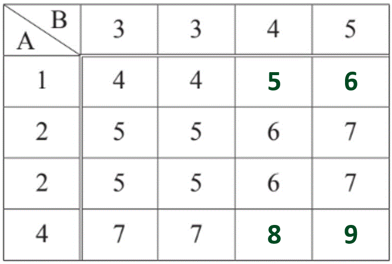
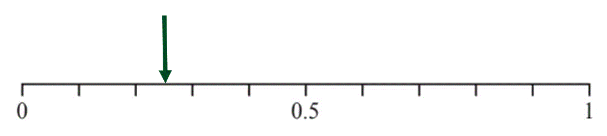
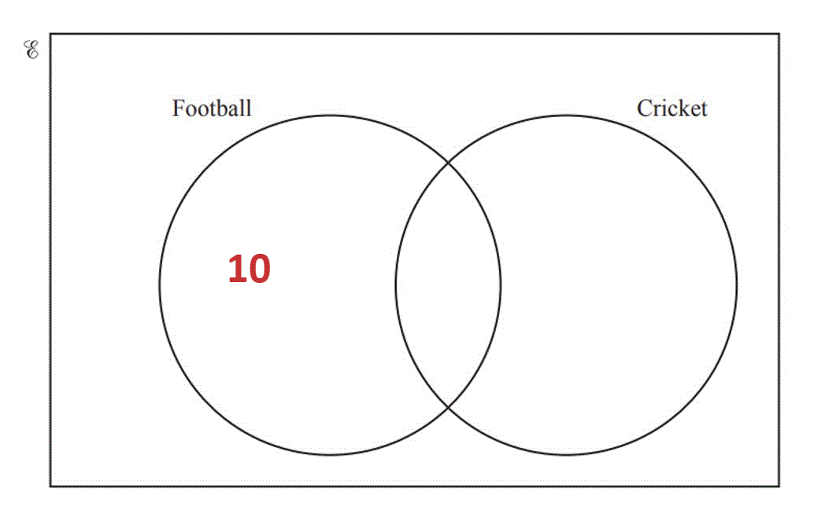
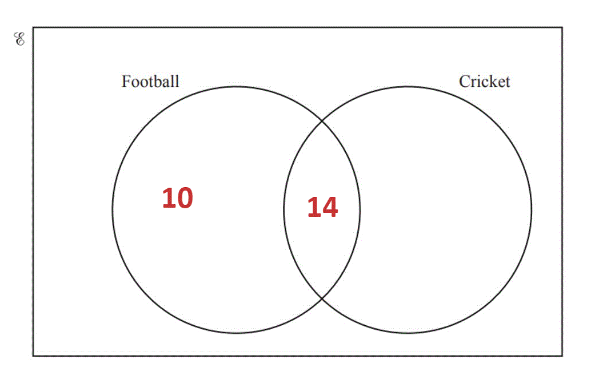
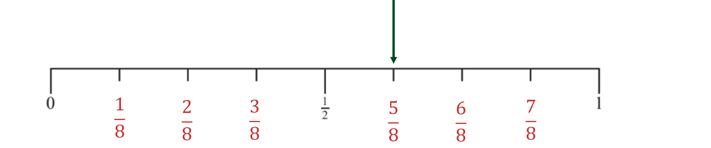
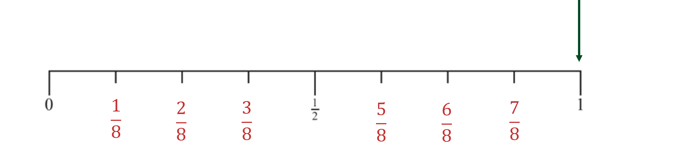

# Mark Schemes — Introduction to Probability
**Probability** · Cambridge (CIE) IGCSE maths (0607)

## Exam Questions (26 questions)

### Q1
(i) *Fill in the missing numbers by adding the outcome of A to the outcome of B.  *

$4+1=5\,5+1=6\,4+4=8\,5+4=9$

> * *

*2 or 3 correct in the correct places*** ****[1]**
*all others correct in the correct places*** ****[1]**

(iia) *There are 5 possible outcomes where the total is 5.*
   *There are 16 outcomes in total.*

$\frac{5}{16}$* ***[1]**

(iib) *There are 9 possible outcomes where the total is more than 5.*
*There are 16 outcomes in total.*

$\frac{9}{16}$* ***[1]**

### Q2
i) *The probability that a ball is green is the *$\frac{\mathrm{the} \mathrm{number} \mathrm{of} \mathrm{green} \mathrm{balls}}{\mathrm{total} \mathrm{number} \mathrm{of} \mathrm{balls}}$

$\frac{6}{6+5+3}$

> *Simplify*

$\frac{6}{14}$** [1]**

ii) *The probability that a ball is green or red is  *$\frac{\mathrm{the} \mathrm{number} \mathrm{of} \mathrm{red} \mathrm{and} \mathrm{green} \mathrm{balls}}{\mathrm{the} \mathrm{total} \mathrm{number} \mathrm{of} \mathrm{balls}}$

$\frac{6+5}{6+5+3}$

> *Simplify*

$\frac{11}{14}$ **[1]**

iii) *There are no yellow balls in the bag so it is impossible to pick one*

**0**** ****[1]**
i) *The probabilities must sum to 1* *Add together the probabilities and subtract the result from 1 to find the probability of picking a purple*

*1 - (0.46 + 0.22 + 0.14)*

**[1]**

*1 - 0.82 *

> *Complete the table*

| Colour | Brown | White | Black | Purple |
|---|---|---|---|---|
| Probability | 0.46 | 0.22 | 0.14 | **0.18** |

**[1]**

ii) *The colour most likely to be taken is the one with the highest probability (0.46)*

**Brown**** [1]**

iii) *If there are 50 balls in the bag, multiply the number of balls in the bag by the probability that a ball is black to find the number of black balls*

*50 x 0.14 *

**7**** ****[1]**

### Q3
> *Work out the total numbers of discs. *

$7+5+2=14$

> * **Five** discs are green, so the probability of getting a green is*

$\frac{5}{14}$

* ***[1]**

> *Multiply this by 140. *

$\frac{5}{14}\times140=50$

**50**** ****[1]**

### Q4
> *The probability that a pen chosen at random is green is the number of green pens divided by the total number of pens*

$\frac{8}{3+4+8}$

> *Simplify*

$\frac{8}{15}$ **[1]**

> *An equivalent answer will be accepted*
> *The probability that the cube will land on the yellow face is *$\frac{1}{6}$

> *Multiply the number of times it is rolled by the probability that it will land on yellow to find the expected number of times that it will land on yellow*

$240\times\frac{1}{6}$

**Final answer:** **40**** [1]**

### Q5
> *The probability that Zoe does not feed the ducks when she visits the lake is 1 - (the probability that she does feed the ducks)*

*1 - 0.82 = 0.18*

**[1]**

> *Multiply the probability that she does not feed the ducks when she visits the lake by the number of times that she visits the lake*

*200 x 0.18*

**[1]**

**36 ****[1]**

### Q6
> *Subtract the probability he will get a seat (0.93) from 1. *

$1-0.93=0.07$

> * *

**0.07** **[1]**
> *Multiply the number of school days in a year (200) by the probability he won't get a seat (0.07).*`blank`

$200\times0.07=14$

**14**** ****[1]**

### Q7
> *5 out of 20 ball are red.*

> *Write this as a fraction.*

$\frac{5}{20}$

> *Type into a calculator to express as a decimal.*

$\frac{5}{20}=0.25$

> *Draw an arrow at 0.25 (halfway between 0 and 0.5). *

> * *

*  ***[1]**

### Q8
> *There are 16 pens in total so the probability that Rui takes a red pen is *$\frac{8}{16}$*.*

> *The fraction can be simplified by dividing the numerator and denominator by 8.*

$\frac{8}{16}=\frac{1}{2}$

> *The arrow should be placed exactly halfway between 0 and 1.*

**[1]**
> *11 of the pens are either red or blue. The probability that Rui takes a red or blue pen is *$\frac{11}{16}$*.*

> *The number line is split into 8 sections so we can write equivalent fractions underneath.*

> *We can see that the arrow for *$\frac{11}{16}$* would be placed halfway between *$\frac{10}{16}$* and *$\frac{12}{16}$*.*

**[1]**

### Q9
> *Multiply the number of sweets by the probability*

$25000\times0.0028=70$

**[1]**

$70$ **[1]**

### Q10
> *Multiply the total number of maths lessons by the probability*

$120\times0.4=48$

**48**** ****[1]**

### Q11
> *Multiply the amount by the fraction*

$\frac{3}{14}\times168$

$36$* ***[1]**

### Q12
> *As Dan walks or cycles, the probability of him **not** cycling is equal to the probability of him walking*

> *Subtract the probability from 1 to obtain the probability that he walks  *

$1-\frac{1}{5}$

$\frac{4}{5}$ **[1]**
> *Multiply the probability of Dan cycling by the number of days in the school year*
* *

$\frac{1}{5}\times200$

$40$ **[1]**

### Q13
> *The probabilities of all outcomes must add up to 1. Adding up the numbers we have so far*

$0.35+0.04+0.2=0.59$

> *Subtracting this number from 1*

$1-0.59=0.41$

*Subtracting sum of probabilities from 1 ***[1]**

| Colour | Brown | White | Red | Green |
|---|---|---|---|---|
| Probability | 0.35 | **0.41** | 0.04 | 0.2 |

**[1]**

### Q14
> *There are 12 letters in the word, and 2 of them are M's.*

> *The probability of getting a letter M is*

$\frac{2}{12}$

** ****There are 2 M's*** ***[1]**

> *"There are 12 letters" also accepted*
> *Add up the probabilities and subtract from 1. *

$1 - ( 0.12 + 0.09 + 0.4 ) = 0.39$

* ***[1]**

**0.39** **[1]**
> *Put 10 (the number who only like football) into the correct place in the Venn diagram.*

** **

> *Subtract 10 (the number who only like football) from 24 (the total number who like football) to find the number of students who like both sports. *

$24-10=14$

> * Put 14 into the section where both circles overlap.*

**[1]**

> *Subtract 14 (the number who like both sports) from 19 (the total number who like cricket) to find out how many students like only cricket. *

$19-14=5$

> *Put 5 into the correct place in the Venn diagram.*

**[1] *** *

> *Add together all the numbers inside the circles and subtract from the total number of students, 40. *

> $40 - ( 10 + 14 + 5 ) = 11$* *

> *Put 11 into the box, outside the circles.*

**[1]**
(i) *Count how many numbers there are in the circle A.*

** ****9** **[1]**

** **

(ii) *List the numbers that are in the circle B.*

** ****3, 6, 9, 12, 15, 18** **[2]**

> *One mark for 4 or 5 correct*

** **

(iiia) *Count how many numbers are outside the circles and write it as a fraction out of 19 (because there are 19 numbers in total).*

* *$\frac{7}{19}$* ***[1]**

** **

(iiib) *Count how many numbers are in the circles (because *$A\cupB$* is everything that is in either circle) and write it as fraction out of 19 (because there are 19 numbers in total). *

$\frac{12}{19}$* ***[1]**

**   **

(iv) $A\capB$* are the numbers that are in both sets, so look at the numbers where the circles overlap.*

> *They are all even (because they are all in set *$A$*), and they are all multiples of 3 (because they are all in set *$B$*). *

**Even and a multiple of 3** **[1]**

**  **

### Q15
i) *To calculate the probability of an event, use the formula:*

*P(event) =* $\frac{\mathrm{Number} \mathrm{of} \mathrm{events}}{\mathrm{Total} \mathrm{outcomes}}$

*There are three 7's on the spinner and eight outcomes in total*

> *Place these values into the fraction*

$\frac{3}{8}$ **[1]**

ii) *Every outcome is greater than 2 so it is certain that this will happen*

$1$* ***[1]**
> *Multiply the number of times the spinner is spun by the probability that the spinner lands on a *$7$

$\frac{3}{8}\times160$

**60*** ***[1]**

### Q16
(i) *There are 2 cards with a 1 on, out of a total of 8 cards.*

> * *$\frac{2}{8}$

> * Divide the numerator (top of the fraction) and the denominator (bottom of the fraction) by 2 to simplify. *

$\frac{2\div2}{8\div2}=\frac{1}{4}$

* *$\frac{1}{4}$* ***[1]**

**Any other equivalent form of the answer, such as **$\frac{2}{8}$** or 0.25, would also get the mark**

(ii) *There are 6 cards with an odd number on, out of a total of 8 cards. *

$\frac{6}{8}$

> * Divide the numerator (top of the fraction) and the denominator (bottom of the fraction) by 2 to simplify.*

> $\frac{6\div2}{8\div2}=\frac{3}{4}$* *

$\frac{3}{4}$* ***[1]**

**Any other equivalent form of the answer, such as **$\frac{6}{8}$** or 0.75, would also get the mark**

(iii) *2, 3 **and **5 **are prime numbers. There are 5 cards with a prime number on, out of a total of 8 cards. *

$\frac{5}{8}$* ***[1]**

**Any other equivalent form of the answer, such as 0.625, would also get the mark**

(iv) *All of the cards have a number less than 6 on them. *

**1** **[1]**

### Q17
i) *The probability of an event is calculated using the formula:*

*P(event) = *$\frac{\mathrm{Number} \mathrm{of} \mathrm{events}}{\mathrm{Total} \mathrm{outcomes}}$

*The number of odd numbers is 2*

*The total number of outcomes is 5*

> *Substitute these values into the formula *

$\frac{2}{5}$** [1]**

* ***0.4 or 40% is also accepted **

ii) *Using the formula:*

> *Probability of an event = *$\frac{\mathrm{Number} \mathrm{of} \mathrm{events}}{\mathrm{Total} \mathrm{outcomes}}$

*The total number of primes is 3*

*The total number of outcomes is 5*

> *Substitute these values into the formula*

$\frac{3}{5}$ **[1]**

**0.6 or 60% is also accepted **

iii) *The number 7 is an impossible outcome*

$0$ **[1]**

### Q18
> *There are 8 balls in total and 4 of the balls are red. This means that*

$\mathrm{P} ( \text{red} ) = \frac{4}{8} = 1 \frac{1}{2}$

> *0.5 is equivalent to *$\frac{1}{2}$* so find the arrow pointing to this.*

**E**** ****[1]**
> *7 of the balls are colours other than blue, therefore*

$\mathrm{P} ( \text{not} \text{blue} ) = \frac{7}{8}$

> *The probability scale is split into eighths so each mark represents *$\frac{1}{8}$*. Counting up to *$\frac{7}{8}$* we can find the letter*

**H**** ****[1]**

### Q19
> *The sum of mutually exclusive events is *$1$*, so subtract the probability from *$1$

$1-0.97=0.03$

**0.03**** ****[1]**

### Q20
> *i) 11 of the 30 flags are pink, therefore *

$\frac{11}{30}$ **[1]**

> *ii) 5 of the flags are blue, which means that 25 are not blue, therefore*

$\frac{25}{30}$ **[1]**

> *iii) None of the flags are red, therefore*

**0** **[1]**

### Q21
> *The sum of probabilities of mutually exclusive events is *$1$*.*

> *Subtract the probability from *$1$

$1-0.27=0.73$

**0.73**** ****[1]**

### Q22
(i) *Out of 6 numbers, 4 are even.*

$\frac{4}{6}$

> * Simplify by dividing the numerator (top) and denominator (bottom) by 2. *

$\frac{4\div2}{6\div2}=\frac{2}{3}$

$\frac{2}{3}$* ***[1]**

**Equivalent fractions accepted**

(ii) *All 6 of the numbers are less than 6.*

$\frac{6}{6}=1$

$1$* ***[1]**

(iii) *It is impossible to spin a 1 because there is no 1 on the spinner.*

$0$* ***[1]**

### Q23
> *The probability of taking a red ball is the same as the probability of not taking a green ball*

$1-0.38$

$0.62$ **[1]**
> *It is impossible to take a blue ball*

$0$ **[1]**

### Q24
> *There are 16 balls in total, and 10 of them are blue. Work out the probability of picking a blue ball by writing this as a fraction in its simplest form*

$\frac{10}{16}=\frac{5}{8}$

> *The number line is split into eighths. The arrow should be at the 5th mark on the number line.*

**[1]**
> *All of the balls are either red or blue, so the probability of choosing red or blue is certain.*

**[1]**

### Q25
> *It is impossible to select a green pencil*

$0$ **[1]**

### Q26
> *Subtract the probability of it raining from 1 to determine the probability of it not raining*

*1 - 0.35*

**0.65** **[1]**
