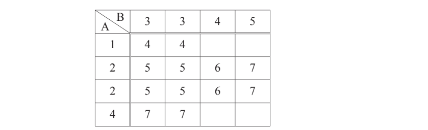
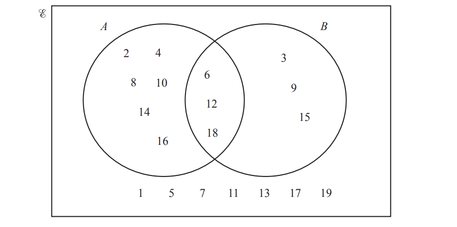

# Exam Questions — Introduction to Probability
**Probability** · Cambridge (CIE) IGCSE maths (0607)
> Source: [https://www.savemyexams.com/igcse/maths/cie/international-maths/23/core/topic-questions/](https://www.savemyexams.com/igcse/maths/cie/international-maths/23/core/topic-questions/) · 26 questions across 1 sets

## Exam Questions (26 questions)

### Q1 — hard — 4 marks

**Q1** [4 marks]

Mei has two fair square spinners, A and B. 
Spinner A is numbered 1, 2, 2, 4 and spinner B is numbered 3, 3, 4, 5.

She spins both spinners and adds the two numbers.

i) Complete the table to show all the possible outcomes.

Use the table to write down the probability that the total is

iia) 5.

[1]

iib) more than 5.

[1]

*Source: Nov 2020 0580/31 Q2B*

### Q2 — hard — 7 marks

**Q2** [3 marks]

A bag contains 6 green balls, 5 red balls and 3 blue balls only. A ball is taken from the bag at random.

Find the probability that the ball is

i) green,

[1]

ii) green or red,

[1]

iii) yellow.

[1]

*Source: May/June 2018 0580/33 Q8A*

**Q2** [4 marks]

Another bag contains brown balls, white balls, black balls and purple balls only. A ball is taken from this bag at random.

| Colour | Brown | White | Black | Purple |
|---|---|---|---|---|
| Probability | 0.46 | 0.22 | 0.14 |   |

i) Complete the table.

[2]

ii) Which colour is the most likely to be taken?

[1]

iii) There are 50 balls in this bag. Work out the number of black balls.

[1]

*Source: May/June 2018 0580/33 Q8B*

### Q3 — hard — 2 marks

**Q3** [2 marks]

A bag contains 7 red discs, 5 green discs and 2 pink discs.

Helen takes one disc at random, records the colour and replaces it in the bag. 
She does this 140 times.

Find how many times she expects to take a green disc.

*Source: Nov 2020 0580/13 Q16*

### Q4 — hard — 2 marks

**Q4** [1 mark]

A box contains 3 blue pens, 4 red pens and 8 green pens only. 
A pen is chosen at random from the box.

Find the probability that this pen is green.

[1]

*Source: May/June 2018 0580/11 Q17A*

**Q4** [1 mark]

A cube has only one of its six faces painted yellow. 
This cube is rolled 240 times.

Work out the expected number of times that it lands on the yellow face.

[1]

*Source: May/June 2018 0580/11 Q17B*

### Q5 — hard — 3 marks

**Q5** [3 marks]

The probability that Zoe feeds the ducks when she visits the lake is 0.82.

Zoe visits the lake 200 times in one year.

Work out an estimate of the number of times that Zoe does not feed the ducks  when she visits the lake.

### Q6 — medium — 2 marks

**Q6** [1 mark]

On any day, the probability that Marcus will get a seat on the school bus is 0.93 .

Write down the probability that he will **not **get a seat on the school bus today.

*Source: June 2020 0580/13 Q13A*

**Q6** [1 mark]

**Extract:**

On any day, the probability that Marcus will get a seat on the school bus is 0.93 .

There are 200 school days in a year.

Work out the expected number of days in a year that Marcus will **not **get a seat.

*Source: June 2020 0580/13 Q13B*

### Q7 — medium — 1 marks

**Q7** [1 mark]

A bag contains 20 balls. 
5 of these balls are red. 
A ball is picked at random from the bag.

On the probability scale, draw an arrow ($\downarrow$ ) to show the probability that this ball is red.

*Source: Nov 2020 0580/12 Q4*

### Q8 — medium — 2 marks

**Q8** [1 mark]

Rui has a bag containing 5 black pens, 8 red pens and 3 blue pens only. 
He takes a pen out of the bag at random.

Draw an arrow ($\downarrow$) on the probability scale to show the probability that Rui takes

a red pen,

*Source: June 2019 0580/11 Q5A*

**Q8** [1 mark]

**Extract:**

Rui has a bag containing 5 black pens, 8 red pens and 3 blue pens only. He takes a pen out of the bag at random.

a red pen or a blue pen.

*Source: June 2019 0580/11 Q5B*

### Q9 — medium — 2 marks

**Q9** [2 marks]

The probability that a sweet made in a factory is the wrong shape is 0.0028 .
 One day, the factory makes 25000 sweets.

Calculate the number of sweets that are expected to be the wrong shape.

*Source: March 2019 0580/12 Q18*

### Q10 — medium — 1 marks

**Q10** [1 mark]

The probability that Tommy has his calculator for his mathematics lesson is 0.4 .
There are 120 mathematics lessons in one year.

Work out an estimate of the number of mathematics lessons in one year that Tommy has his calculator.

*Source: June 2019 0580/12 Q4*

### Q11 — medium — 1 marks

**Q11** [1 mark]

Records show that $\frac{3}{14}$ of all mullet caught are underweight.

In one day, 168 mullet are caught.

Work out the expected number of mullet that are underweight.

*Source: March 2018 0580/32 Q4B*

### Q12 — medium — 2 marks

**Q12** [1 mark]

Dan either walks or cycles to school. The probability that he cycles to school is $\frac{1}{5}$.

Write down the probability that Dan walks to school.

*Source: Specimen 2020 0580/01 Q9A*

**Q12** [1 mark]

**Extract:**

The probability that he cycles to school is 1/5.
There are 200 days in a school year.

There are 200 days in a school year.

Work out the expected number of days that Dan cycles to school in a school year.

*Source: Specimen 2020 0580/01 Q9B*

### Q13 — medium — 2 marks

**Q13** [2 marks]

Marco has ropes of four different colours. He takes a rope at random.

| Colour | Brown | White | Red | Green |
|---|---|---|---|---|
| Probability | 0.35 |   | 0.04 | 0.2 |

Complete the table.

*Source: Nov 2019 0580/31 Q8C*

### Q14 — medium — 12 marks

**Q14** [1 mark]

COMMONWEALTH

Lindon picks a letter at random from this word. Explain why the probability that he picks a letter **M** is not $\frac{1}{10}$.

*Source: Nov 2020 0580/32 Q8A*

**Q14** [2 marks]

Tickets for athletics or swimming or hockey or diving are placed in a box. 
A ticket is picked at random from the box.

| Sport | Athletics | Swimming | Hockey | Diving |
|---|---|---|---|---|
| Probability | 0.12 |   | 0.09 | 0.4 |

Complete the table.

*Source: Nov 2020 0580/32 Q7B*

**Q14** [3 marks]

In a group of 40 students,

- 24 students like football
- 19 students like cricket
- 10 students like football but not cricket.

Complete the Venn diagram.

*Source: Nov 2020 0580/32 Q8C*

**Q14** [6 marks]

$E$ = {$x$ : $x$ is a positive integer less than 20} A = {$x$ : $x$ is an even number} B = {$x$ : $x$ is a multiple of 3}

i) Write down n $( A )$.

[1]

ii) List the elements of set $B$.

$B$= { ............................................... } [2]

One of these 19 numbers is picked at random.

Work out the probability that this number is

iiia) not in set $A$ and not in set $B$,

[1]

iiib) in $A\cupB$

[1]

iv) Complete the statement.

$A \cap B = \{ x : x \text{is} ............................... \}$

[1]

*Source: Nov 2020 0580/32 Q8D*

### Q15 — medium — 3 marks

**Q15** [2 marks]

The diagram shows a fair 8-sided spinner.

The numbers on the spinner are 3, 4, 4, 7, 7, 7, 8 and 9.

The spinner is spun once.

Write down the probability that the spinner lands on

i) the number 7,

[1]

ii) a number greater than 2.

[1]

*Source: March 2020 0580/12 Q5A*

**Q15** [1 mark]

**Extract:**

The numbers on the spinner are 3, 4, 4, 7, 7, 7, 8 and 9.

The spinner is spun 160 times.

Work out the expected number of times the spinner lands on the number 7.

.................................................

### Q16 — easy — 4 marks

**Q16** [4 marks]

Paul has a set of 8 cards, each with a number written on it.

The numbers on the cards are 1, 1, 2, 3, 3, 3, 4, 5. One card is taken at random.

Write down the probability that the number on the card is

i) 1,

[1]

ii) an odd number,

[1]

iii) a prime number,

[1]

iv) a number less than 6.

[1]

*Source: June 2020 0580/32 Q1A*

### Q17 — easy — 3 marks

**Q17** [3 marks]

Joel spins a fair five-sided spinner numbered 2, 3, 4, 5 and 6.

Write down the probability that the spinner lands on

i) an odd number,

[1]

ii) a prime number,

[1]

iii) the number 7.

[1]

*Source: Specimen 2020 0580/03 Q3A*

### Q18 — easy — 2 marks

**Q18** [1 mark]

A bag contains 3 green balls, 4 red balls and 1 blue ball only. Matt takes a ball from the bag at random.

Some probabilities are marked on the probability scale.

Write down the letter that shows the probability that

Matt takes a red ball,

*Source: Nov 2019 0580/12 Q5A*

**Q18** [1 mark]

**Extract:**

A bag contains 3 green balls, 4 red balls and 1 blue ball only. Matt takes a ball from the bag at random.

Matt does **not** take a blue ball.

*Source: Nov 2019 0580/12 Q5B*

### Q19 — easy — 1 marks

**Q19** [1 mark]

The probability that it will be sunny tomorrow is 0.97.

Work out the probability that it will not be sunny tomorrow.

*Source: March 2019 0580/12 Q2*

### Q20 — easy — 3 marks

**Q20** [3 marks]

Soraya makes 30 flags. 
11 flags are pink, 7 are yellow, 5 are blue, 4 are silver and 3 are green. 
Soraya takes a flag at random.

Find the probability that the flag she takes is

i) pink,

[1]

ii) not blue,

[1]

iii)red.

[1]

*Source: Nov 2019 0580/31 Q7C*

### Q21 — easy — 1 marks

**Q21** [1 mark]

The probability that Alex wins a prize is 0.27 .

Find the probability that Alex does not win a prize.

*Source: May/June 2019 0580/13 Q6*

### Q22 — easy — 1 marks

**Q22** [1 mark]

Jian has a fair spinner in the shape of a regular hexagon. The spinner is numbered 2, 2, 3, 4, 4, 5.

Jian spins the spinner. Find the probability that the spinner lands on

i) an even number,

[1]

ii) a number less than 6,

[1]

iii) the number 1.

[1]

*Source: Nov 2020 0580/31 Q2A*

### Q23 — easy — 2 marks

**Q23** [1 mark]

A bag contains green balls and red balls only.
 A ball is taken at random from the bag.
The probability of taking a green ball is 0.38.

Write down the probability of taking a red ball.

*Source: June 2019 0580/11 Q4A*

**Q23** [1 mark]

**Extract:**

A bag contains green balls and red balls only.

Write down the probability of taking a blue ball.

*Source: June 2019 0580/11 Q4B*

### Q24 — easy — 2 marks

**Q24** [1 mark]

A bag contains 6 red balls and 10 blue balls only.

On the probability scale, draw an arrow ( $\downarrow$) to show the probability that a ball taken at random is

blue,

*Source: Nov 2019 0580/13 Q8A*

**Q24** [1 mark]

**Extract:**

A bag contains 6 red balls and 10 blue balls only.

red or blue.

*Source: Nov 2019 0580/13 Q8B*

### Q25 — easy — 1 marks

**Q25** [1 mark]

A box contains 22 coloured pencils. 
6 pencils are pink, 9 pencils are blue and 7 pencils are yellow.

A pencil is taken at random from the box.

Write down the probability that this pencil is green.

*Source: June 2019 0580/12 Q15B*

### Q26 — easy — 1 marks

**Q26** [1 mark]

The probability that it rains tomorrow is 0.35 .

Work out the probability that it does not rain tomorrow.

*Source: Feb/March 2018 0580/12 Q4*

