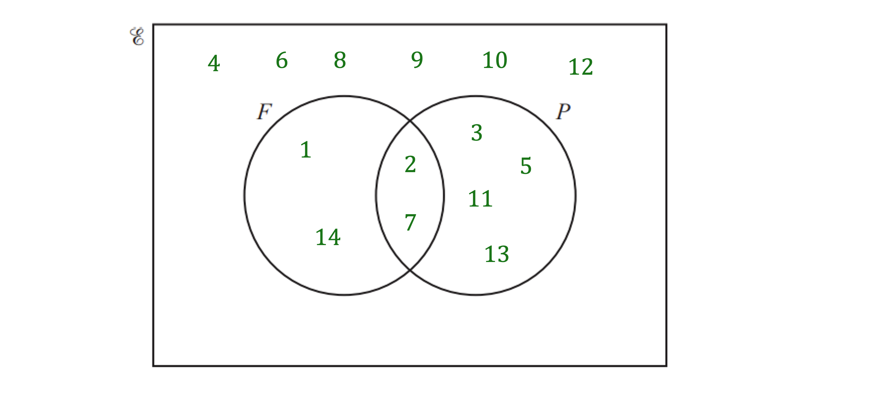
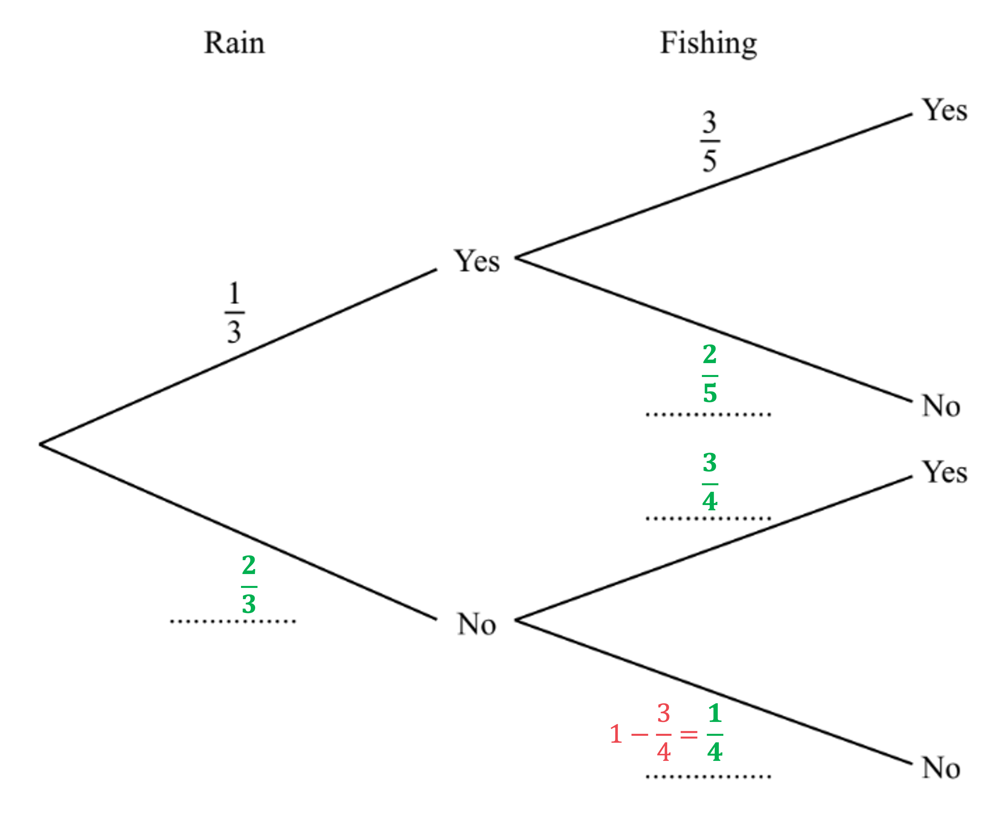
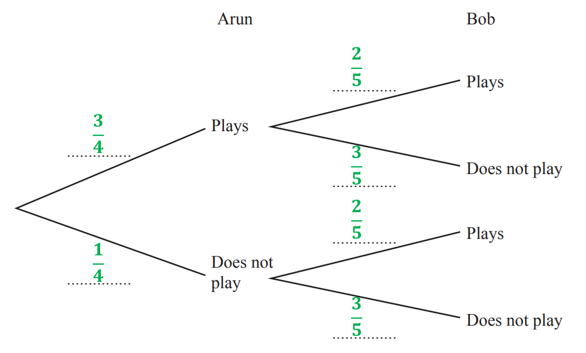
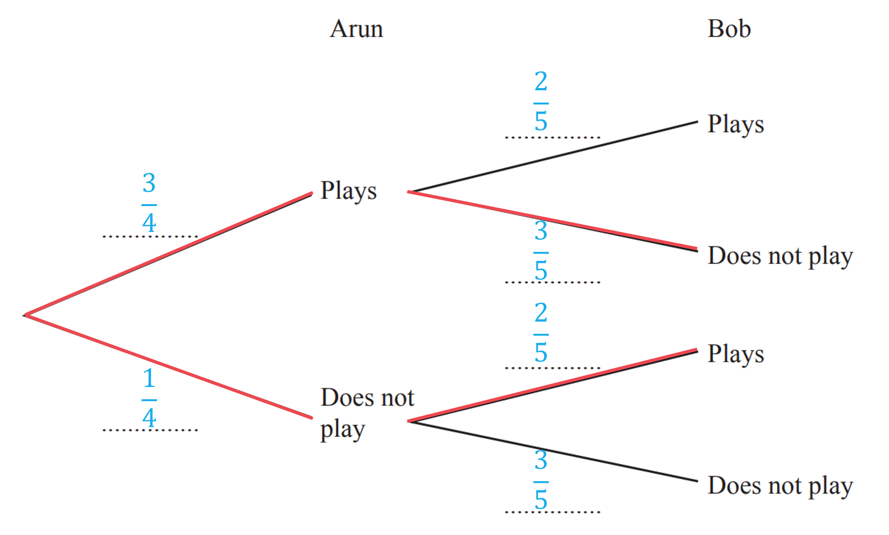
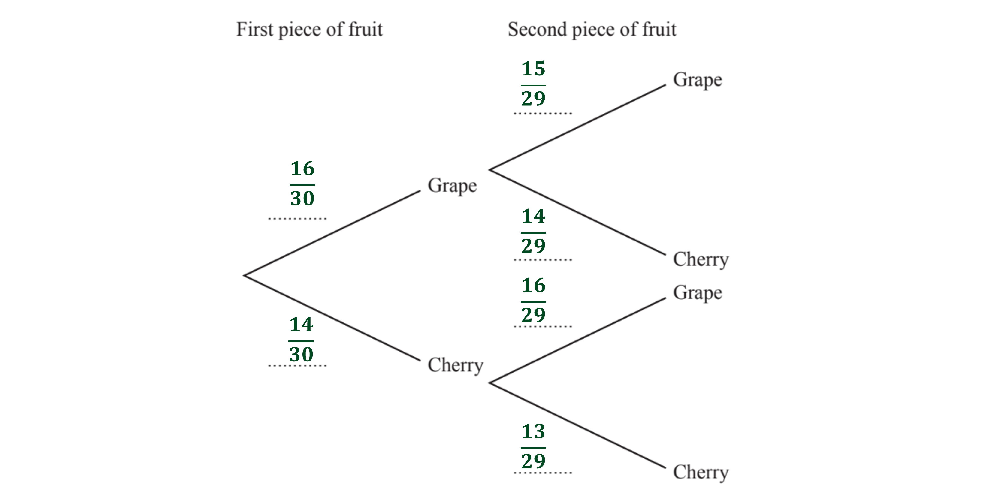
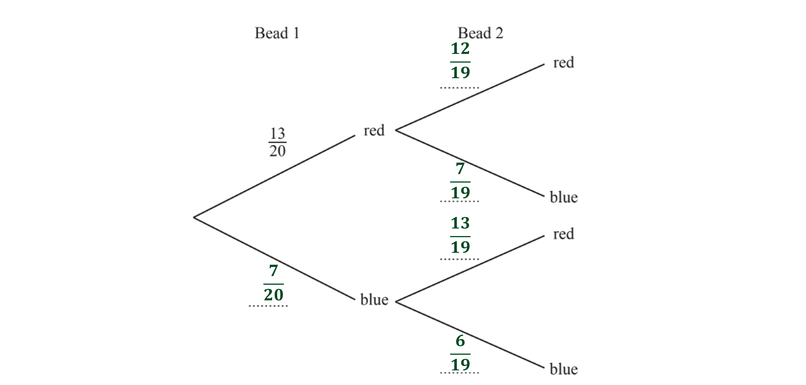

# Mark Schemes — Probability Diagrams & Multiple Events
**Probability** · Cambridge (CIE) IGCSE maths (0607)

## Exam Questions (13 questions)

### Q1
> *The marble is replaced each time, so the probability stays the same for each blue marble*

> *Find the probability of choosing one blue marble*

`straight P open parentheses Blue close parentheses equals fraction numerator 6 over denominator 6 plus 4 end fraction equals 6 over 10 equals 3 over 5`

> *To find the probability of two events happening, multiply their probabilities*

> *You could draw a tree diagram to help*

> *P(Both blue) = P(First blue and second blue) = P(First blue) × P(Second blue)*

`straight P open parentheses Both space blue close parentheses equals 3 over 5 cross times 3 over 5`

**[M1]**

> *Multiply the two fractions*

$\frac{9}{25}$

**[A1]**

> **[mark-scheme]**
> Equivalent answers are also accepted. E.g. 0.36 or $\frac{36}{100}$.
> *The two outcomes where Saira picks one green and one blue are either*

- *First marble is green, second is blue*
- *or first marble is blue, second is green*

> *Find the probability of picking a green marble, then a blue marble*

`straight P open parentheses Green space then space Blue close parentheses equals 4 over 10 cross times 6 over 10`

**[M1]**

`straight P open parentheses Green space then space Blue close parentheses equals 24 over 100 equals 6 over 25`

**[A1]**

> *Find the probability of picking a blue marble, then a green marble*

`straight P open parentheses Blue space then space Green close parentheses equals 6 over 10 cross times 4 over 10 equals 24 over 100 equals 6 over 25`

> *Notice that these probabilities are the same, as the marble is replaced each time*

> *Add together the probability of "green then blue", and "blue then green"*

`table row cell straight P open parentheses one space green space one space blue close parentheses end cell equals cell straight P open parentheses green space then space blue close parentheses plus straight P open parentheses blue space then space green close parentheses end cell row blank equals cell 6 over 25 plus 6 over 25 end cell end table`

$\frac{12}{25}$

**[A1]**

> **[mark-scheme]**
> Equivalent answers are also accepted. E.g. 0.48 or $\frac{48}{100}$.

### Q2
> *(i) List the numbers that appear in set **A  **AND in set **B  **(i.e., in the 'overlap' of the two sets in the Venn diagram)*

**2, 4, 6, 12**  **[1]**

> *(ii) List the numbers that are NOT in set **B  **(i.e., all the numbers anywhere in the Venn diagram outside of the **B** circle)*
*B'**  is the **complement** of set **B**, and includes everything in the universal set *$ℰ$* that isn't in set **B*

**5, 7, 8, 9, 10, 11, 13, 14**  **[1]**
> *There are three numbers that are in set **A** but not in set **B  **(8, 10, and 14). There are 14 numbers in total in the Venn diagram*

$\frac{3}{14}$**  [2]**

**1 mark for 3 in the numerator (with the denominator greater than 3) or for 14 in the denominator (with the numerator less than 14)**
**1 mark for a fully correct answer**

### Q3
> *The bead is replaced each time, so the probability stays the same for each red bead*

> *Find the probability of choosing one red bead*

> `straight P open parentheses Red close parentheses space equals space fraction numerator 15 over denominator 15 space plus space 10 end fraction space equals space 15 over 25`*   *

> *To find the probability of two things both happening, multiply the probabilities*
*You could draw a tree diagram to help*
*P(Both red) = P(first red) and P(second red)  = P(first red) × P(second red)*

`straight P open parentheses Both space red close parentheses space space equals space 15 over 25 space cross times space 15 over 25`

** [1]**

> *Use your calculator to multiply the two fractions*

$\frac{9}{25}$** [1] **
**The unsimplified fraction is accepted**
> *Ariana can either pick two red beads, or not pick two red beads*

> *The two events are mutually exclusive*
*The probabilities of mutually exclusive events add up to 1*

> *The probability of not picking two red beads will be 1 - the probability of picking two red beads*

`straight P open parentheses Not space both space red close parentheses space equals space 1 space minus space 9 over 25`

$\frac{16}{25}$** [1]**

### Q4
> *Subtract the number of girls studying German from the total number of students studying German to find the number of boys studying German*

*53 - 32 = 21*

> *Add together the number of boys and girls studying Spanish to find the total number of students studying Spanish*

*48 + 54 = 102*

> *Find the number of girls studying Italian by subtracting the number of boys studying Italian from the total number of students studying Italian*

*30 - 19 = 11*

> *Find the number of boys studying Japanese by subtracting the numbers of boys studying French, German, Italian and Spanish from the total number of boys*

*123 - 27 - 21 - 48 - 19 = 8*

> *Find the total number of students studying Japanese by adding together the number of boys and girls studying Japanese*

*8 + 12 = 20*

> *Find the total number of students studying French by subtracting the total number of students studying German, Spanish, Italian and Japanese from the total number of students*

*262 - 53 - 102 - 30 - 20 = 57*

> *Find the total number of girls studying French by subtracting the number of boys studying French from the total number of students studying French*

*57 - 27 = 30*

> *Find the total number of girls by subtracting the total number of boys from the total number of students*

*262 - 123 = 139*

> *Complete the two-way table with your values*

|   | French | German | Spanish | Italian | Japanese | Total |
|---|---|---|---|---|---|---|
| Boys | 27 | **21** | 48 | 19 | **8** | 123 |
| Girls | **30** | 32 | 54 | **11** | 12 | **139** |
| Total | **57** | 53 | **102** | 30 | **20** | 262 |

*1 mark for 3,4 or 5 correct values, *
*   ** **2 marks for 6 or 7 correct values,   *
* ** **3 marks for all correct values **[3]*
i) *The probability that a randomly picked female student studies Spanish is the total number of girls studying Spanish over the total number of girls*

$\frac{54}{139}$ **[1]**

ii) *The probability that a randomly picked male student studies French or Italian is the total number of boys studying French or Italian over the total number of boys*

$\frac{27+19}{123}$

$\frac{46}{123}$* ***[1]**

iii) *The probability that a randomly picked student does **not** study German is 1 - (the probability that a student **does** study German)*

$1-\frac{53}{262}$

$\frac{209}{262}$** [1]**

### Q5
i) *The elements of set *$F$* are factors of 14:*

**1, 2, 7, 14**** ****[2]**

> *1 mark if one number missing or one number extra*

*  *ii) *The elements in set *$P$* are the prime numbers less than 14:*

**2, 3, 5, 7, 11, 13** **[2]**

> *1 mark for one extra number or one number missing*

*  *iii) *The elements of *$F$* and *$P$* are: *

*2 and 7*

> *These elements appear in the intersection of the two circles*

> *The elements of *$F$*  only are:  *

*1 and 14*

> *These elements appear in the left hand crescent of the circle for set *$F$

> *The elements of *$P$*  only are:*

*3, 5, 11 and 13*

> *These elements appear in the right hand crescent of the circle for set *$P$

> *The remaining numbers are not in *$F$* or *$P$* so these are placed outside of the two circles:*

*4, 6, 8, 9, 10, 12  *

* For 2 or 3 sections correct*** [1]**
*For all remaining sections correct*** [1]**

iv) *The probability of an event is calculated using the formula:*

> *P(event) = *$\frac{\mathrm{Number} \mathrm{of} \mathrm{events}}{\mathrm{Total} \mathrm{outcomes}}$

> *As the total number of outcomes is 14,  *

*Probability of *$F\cupP=\frac{k}{14}$

**[1]**

> *where the number of events is *$k$

> *The set  *$F\cupP$*  represents those items in *$F$* or *$P$*  *

$1,2,3,5,7,11,13,14$

*The number of items in the set *$F\cupP$*  is  *

$8$

> *The probability that a number is in the set *$F\cupP$*  is  *

$\frac{8}{14}=\frac{4}{7}$* *

$\frac{4}{7}$** [1]**

### Q6
(i) *Write down the factors of 12 (**F**)*

*1, 2, 3, 4, 6, 12 *

> *Write down the odd numbers *$\leq$*15 (**O**)*

*1, 3, 5, 7, 9, 11, 13, 15 *

> *The numbers that are in both lists, **1 **and **3**, go in the intersection of the two circles*

> *Write any numbers between 1 and 15 which are in neither of the lists outside of the circles (**10**, **8**, and **14**)*

**[1]**

> *The factors of 12 except 1 and 3 go into the **F **circle*

> *The odd numbers except 1 and 3 go into the **O **circle*

* A**ll correct*** ****[1]**

(ii) *Count how many numbers there are in the **O **circle, including the intersection*

> *Write as a fraction of the total number of numbers in the Venn diagram, 15*

$\frac{8}{15}$ **[1]**

### Q7
(i) *Count how many numbers are outside the circles and write it as a fraction out of 19 (because there are 19 numbers in total)*

$\frac{7}{19}$ **[1]**

(ii) *Count how many numbers are in the circles (because *$A\cupB$* is everything that is in either circle) and write it as fraction out of 19 *

$\frac{12}{19}$ **[1]**

### Q8
> *Add together all of the numbers in the Venn diagram to work out how many students there are in total*

*12 + 8 + 7 + 4 = 31 *

> *Express the number of students who liked neither apples or bananas, 4 (outside the circles), as a fraction of the total number of students, 31*

$\frac{4}{31}$ **[1]**

### Q9
i) *Subtract the number of female adults from the total number of adults to find the umber of male adults*

*225 - 129 = 96*

> *Subtract the number of male children from the total number of children to find the number of female children*

*275 - 144 = 131*

> *Complete the values in the table*

|   | Adult | Child | Total |
|---|---|---|---|
| Male | **96** | 144 | 240 |
| Female | 129 | **131** | 260 |
| Total | 225 | 275 | 500 |

**[1]**

ii) *Subtract the total number of adults from the total number of children to find out how many more children there were than adults*

*275 - 225 *

*50*** [1]**

iii) *The fraction of visitors you are adults is the total number of adults over the total number of visitors*

$\frac{225}{500}$

**[1]**

> *Simplify by dividing both parts by 25*

$\frac{9}{20}$ **[1]**

iv) *Write the total number of males : total number of females*

*240 : 260*

**[1]**

> *Simplify by dividing both parts by 20*

**12 : 13**** ****[1]**

v) *The probability that a visitor picked at random will be a male child, will be the total number of male children over the total number of visitors*

$\frac{240}{500}$

> *Simplify by dividing both parts by 20*

$\frac{12}{25}$ **[1]**

> *Equivalent values will be accepted*

### Q10
> *For each pair of branches, the probability must add up to 1 *

> *Use this to calculate the two missing probabilities below*

**[1]**

> *We can use the information that "when it does not rain the probability that Amira goes fishing is *$\frac{3}{4}$*" to complete the final two spaces*

**[1]**

### Q11
> *The probabilities of all possible outcomes of an event add up to 1.*

> *The probability that Arun plays football on a Saturday is *$\frac{3}{4}$*, the only other option for Arun is that he does not play football. *
*To find the probability that Arun does not play, subtract the probability that he does plays from 1.*

`straight P open parentheses Arun space does space not space play close parentheses equals 1 minus 3 over 4 equals 1 fourth`

> *The probability that Bob plays football on a Saturday is *$\frac{2}{5}$*, the only other option for Bob is that he does not play football. *
*To find the probability that Bob does not play, subtract the probability that he does plays from 1.*

`straight P open parentheses Bob space does space not space play close parentheses equals 1 minus 2 over 5 equals 3 over 5`

> *The probability that Bob plays is not affected by whether or not Arun plays football.*

**1 correct pair of branches**** [1] **
**All pairs of branches correct**** [1]**
> *To find the probability that both Arun and Bob play, find the route on the tree diagram and multiply the probabilities of each event together.*

$\frac{3}{4}\times\frac{2}{5}$

**[1]**

$\frac{3}{10}$** [1]** 
**It is acceptable to write as a decimal: 0.3**
> *To find the probability that only one of them plays, find the possible routes on the tree diagram.*

> *Find the probability of each route by multiplying the two probabilities together along the route.*

`straight P open parentheses Arun space plays space and space Bob space does space not space play close parentheses equals 3 over 4 cross times 3 over 5 equals 9 over 20`

`straight P open parentheses Arun space does space not space play space and space Bob space plays close parentheses equals 1 fourth cross times 2 over 5 equals 1 over 10`

**1 route correct ****[1]**

> *To get the probability that only one of them plays, add together the probabilities for the two possible routes.*

$\frac{9}{20}+\frac{1}{10}$

**[1]**

$\frac{11}{20}$** [1]** 
**It is acceptable to write as a decimal: 0.55**

### Q12
> *There are 16 grapes out of a total of 30 possible pieces of fruit*

> *Write the answer as a fraction, it can be simplified but this is not necessary in this question*

$\frac{16}{30}$** [1]**
**Mark given for any equivalent fraction or decimal answer**
> *The probabilities of all possible outcomes of an event add up to 1*

> *The probability that the first piece of fruit is a grape is *$\frac{16}{30}$

> *Working with the unrounded probability is easier when using a probability tree*

> *The probability that the first piece of fruit is not a grape is 1 minus the probability the first piece of fruit is a grape*

* *$1-\frac{16}{30}=\frac{14}{30}$

> *When the second piece of fruit is taken there are only 29 pieces left in the bag*

> *If the first piece of fruit was a grape there will be 15 grapes and 14 cherries left in the bag *

> *The probability the second piece of fruit is a grape, given that the first piece was a a grape is *

$\frac{15}{29}$

> *The probability the second piece of fruit is a cherry, given that the first piece was a grape is *

$\frac{14}{29}$

> *If the first piece of fruit was a cherry there will be 16 grapes and 13 cherries left in the bag *

> *The probability the second piece of fruit is a grape, given that the first was a cherry is *

$\frac{16}{29}$

> *The probability the second piece of fruit is a cherry, given that the first was a cherry is *

$\frac{13}{29}$

**At least 2 probabilities given in the correct place [1]**
**At least 4 probabilities given in the correct place [1]**
**All correct [1]**
> *Multiply the probability for cherry on the first set of branches with the probability for cherry following on from this on the second set of branches*

$\frac{14}{30}\times\frac{13}{29}$

**[1]**

> *Use your calculator to find the answer*

$\frac{91}{435}$**[1]**
**Any equivalent answer accepted**

### Q13
> *The probabilities of all possible outcomes of an event add up to 1*

> *The probability that the first bead is not red is 1 minus the probability the first bead is red*

* *$1-\frac{13}{20}=\frac{7}{20}$

> *When the second bead is taken there are only 19 beads left in the bag*

> *If the first bead was red there will be 12 red beads and 7 blue beads left in the bag *

> *The probability the second bead is red, given that the first bead was a red is *

$\frac{12}{19}$

> *The probability the second bead is blue, given that the first bead was a red is *

$\frac{7}{19}$

> *If the first bead was blue there will be 13 red beads and 6 blue beads left in the bag *

> *The probability the second bead is red, given that the first bead was a blue is *

$\frac{13}{19}$

> *The probability the second bead is blue, given that the first bead was a blue is *

$\frac{6}{19}$

**At least 2 probabilities given in the correct place [1]**
**All correct [1]**
