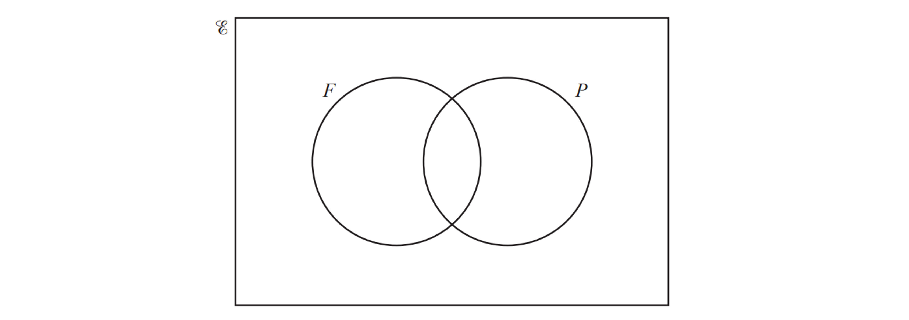
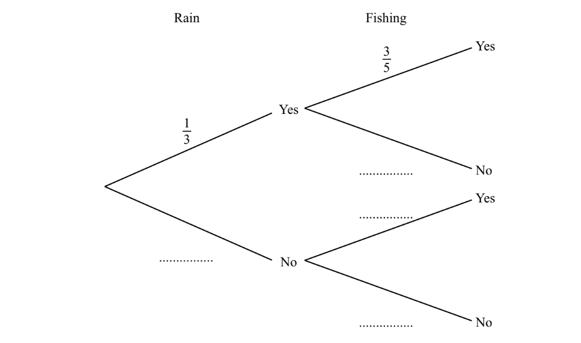
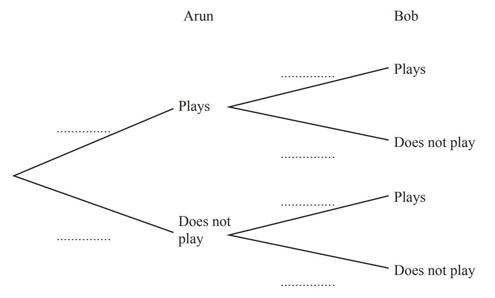
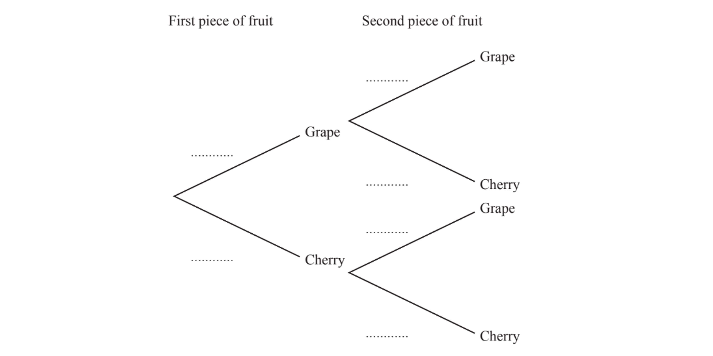
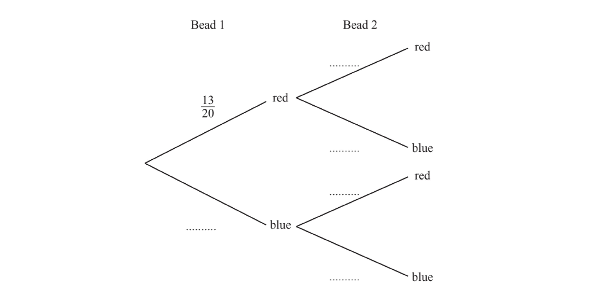

# Exam Questions — Probability Diagrams & Multiple Events
**Probability** · Cambridge (CIE) IGCSE maths (0607)
> Source: [https://www.savemyexams.com/igcse/maths/cie/international-maths/23/core/topic-questions/](https://www.savemyexams.com/igcse/maths/cie/international-maths/23/core/topic-questions/) · 13 questions across 1 sets

## Exam Questions (13 questions)

### Q1 — hard — 5 marks

**Q1** [2 marks]

A box contains 6 blue marbles and 4 green marbles.

Saira picks a marble at random, records its colour and replaces it in the box.

She then picks another marble at random.

Find the probability that she picks two blue marbles.

**Q1** [3 marks]

Work out the probability that Saira picks one green marble and one blue marble.

### Q2 — medium — 4 marks

**Q2** [2 marks]

The numbers from $1$ to $14$ are shown in the Venn diagram.

i) List the members of the set $A\capB$

[1]

ii) List the members of the set $Bʹ$

[1]

*Source: Nov 2020 4MA1/1H Q1A*

**Q2** [2 marks]

**Extract:**

The numbers from 1 to 14 are shown in the Venn diagram.

A number is picked at random from the numbers in the Venn diagram.

Find the probability that this number is in set $A$but is **not** in set $B$.

*Source: Nov 2020 4MA1/1H Q1B*

### Q3 — medium — 3 marks

**Q3** [2 marks]

A bag contains 15 red beads and 10 yellow beads. 
Ariana picks a bead at random, records its colour and replaces it in the bag. 
She then picks another bead at random.

Find the probability that she picks two red beads.

*Source: 2020 Oct/Nov 0580/41 Q9C*

**Q3** [1 mark]

**Extract:**

A bag contains 15 red beads and 10 yellow beads. 

Ariana picks a bead at random, records its colour and replaces it in the bag. 

She then picks another bead at random.

Find the probability that she does not pick two red beads.

*Source: 2020 Oct/Nov 0580/41 Q9B*

### Q4 — hard — 6 marks

**Q4** [3 marks]

The 262 students at a college each study one of the languages shown in the table.

|   | French | German | Spanish | Italian | Japanese | Total |
|---|---|---|---|---|---|---|
| Boys | 27 |   | 48 | 19 |   | 123 |
| Girls |   | 32 | 54 |   | 12 |   |
| Total |   | 53 |   | 30 |   | 262 |

Complete the table.

[3]

*Source: May/June 2018 0580/32 Q6A*

**Q4** [3 marks]

**Extract:**

The 262 students at a college each study one of the languages shown in the table.

|   | French | German | Spanish | Italian | Japanese | Total |
| Boys | 27 |   | 48 | 19 |   | 123 |
| Girls |   | 32 | 54 |   | 12 |   |
| Total |   | 53 |   | 30 |   | 262 |

Find the probability that

i) a girl, chosen at random, studies Spanish,

[1]

ii)a boy, chosen at random, studies French or Italian,

[1]

iii)a student, chosen at random, does not study German.

[1]

*Source: May/June 2018 0580/32 Q6B*

### Q5 — hard — 8 marks

**Q5** [8 marks]

$E$ = {1, 2, 3, 4, 5, 6, 7, 8, 9, 10, 11, 12, 13, 14}
 $F$ = {$x$: $x$ is a factor of 14}
 $P$ = {$x$: $x$ is a prime number less than 14}

i) Write down the elements in set $F$.

$F$ = { ................................................ } [2]

ii) Write down the elements in set $P$.

$P$ = { ................................................ } [2]

iii) Complete the Venn diagram.

[2]

iv) A number is chosen at random from the universal set $E$.

Write down the probability that the number is in the set  $F\cupP$ .

[2]

*Source: March 2020 0580/32 Q9A*

### Q6 — hard — 3 marks

**Q6** [3 marks]

$E$ = {$x$ : $x$ is a natural number `less-than or slanted equal to`15}

$F$ = {$x$ : $x$ is a factor of 12}

$O$ = {$x$ : $x$ is an odd number}

i) Complete the Venn diagram to show the elements of these sets.

[2]

ii) A number is chosen at random from $E$.

Work out the probability that this number is in set $O$.

[1]

*Source: June 2020 0580/31 Q9B*

### Q7 — medium — 2 marks

**Q7** [2 marks]

$E$ = {$x$ : $x$ is a positive integer less than 20} 
A = {$x$ : $x$ is an even number} 
B = {$x$ : $x$ is a multiple of 3}

One of these 19 numbers is picked at random.

Work out the probability that this number is

i) not in set $A$ and not in set $B$,

[1]

ii) in $A\cupB$

[1]

*Source: Nov 2020 0580/32 Q8D*

### Q8 — easy — 1 marks

**Q8** [1 mark]

The Venn diagram shows information about the number of students in a class who like apples ($A$) and bananas ($B$).

One of the students is chosen at random.

Find the probability that this student does not like apples and does not like bananas.

[1]

*Source: June 2020 0580/33 Q5AV*

### Q9 — medium — 7 marks

**Q9** [7 marks]

The table gives some information about the numbers of visitors at a leisure centre one day.

|   | Adult | Child | Total |
|---|---|---|---|
| Male |   | 144 | 240 |
| Female | 129 |   | 260 |
| Total | 225 | 275 | 500 |

i) Complete the table.

[1]

ii) Work out how many more child visitors than adult visitors there are.

[1]

iii) Write down the fraction of visitors that are adults. Give your answer in its lowest terms.

[2]

iv) Write the ratio number of males : number of females. Give your answer in its simplest form.

..................... : ................... [2]

v) One of these visitors is selected at random. Find the probability that this visitor is a male child.

[1]

*Source: Oct/Nov 2018 0580/31 Q3A*

### Q10 — easy — 2 marks

**Q10** [2 marks]

On any day the probability that it rains is $\frac{1}{3}$.

When it rains the probability that Amira goes fishing is $\frac{3}{5}$.

When it does not rain the probability that Amira goes fishing is $\frac{3}{4}$.

Complete the tree diagram.

*Source: Specimen 2025 0580/04 Q7B*

### Q11 — hard — 7 marks

**Q11** [2 marks]

On any Saturday, the probability that Arun plays football is $\frac{3}{4}.$

On any Saturday, the probability that Bob plays football is $\frac{2}{5}.$

Complete the tree diagram.

*Source: 2020 May/June 0580/43 Q7A*

**Q11** [2 marks]

**Extract:**

On any Saturday, the probability that Arun plays football is ![3 over 4.] 

On any Saturday, the probability that Bob plays football is ![2 over 5.]

Calculate the probability that, one Saturday, Arun and Bob both play football.

*Source: 2020 May/June 0580/43 Q7B*

**Q11** [3 marks]

**Extract:**

On any Saturday, the probability that Arun plays football is 3 over 4. 
On any Saturday, the probability that Bob plays football is 2 over 5.

Calculate the probability that, one Saturday, either Arun plays football or Bob plays football, but not both.

*Source: 2020 May/June 0580/43 Q7C*

### Q12 — medium — 6 marks

**Q12** [1 mark]

*unpublished as core only has replacement Qs*

A bag contains 30 pieces of fruit.
There are 16 grapes and 14 cherries.

Fumi takes one piece of fruit at random from the bag and eats it.

Find the probability that she takes a grape.

*Source: Nov 21 0607/31 Q7A*

**Q12** [3 marks]

**Extract:**

A bag contains 30 pieces of fruit.

There are 16 grapes and 14 cherries.

Fumi takes one piece of fruit at random from the bag and eats it.

Fumi takes a second piece of fruit at random from the bag.

Complete the tree diagram.

*Source: Nov 21 0607/31 Q7BI*

**Q12** [2 marks]

**Extract:**

A bag contains 30 pieces of fruit.

There are 16 grapes and 14 cherries.

Fumi takes one piece of fruit at random from the bag and eats it.

Work out the probability that Fumi takes 2 cherries.

*Source: Nov 21 0607/31 Q7BII*

### Q13 — easy — 2 marks

**Q13** [2 marks]

*unpublished as core only has replacement Qs*

A bag contains 13 red beads and 7 blue beads.
Two beads are taken out of the bag at random.

Complete the tree diagram.

*Source: Nov 21 0607/12 Q22-*

