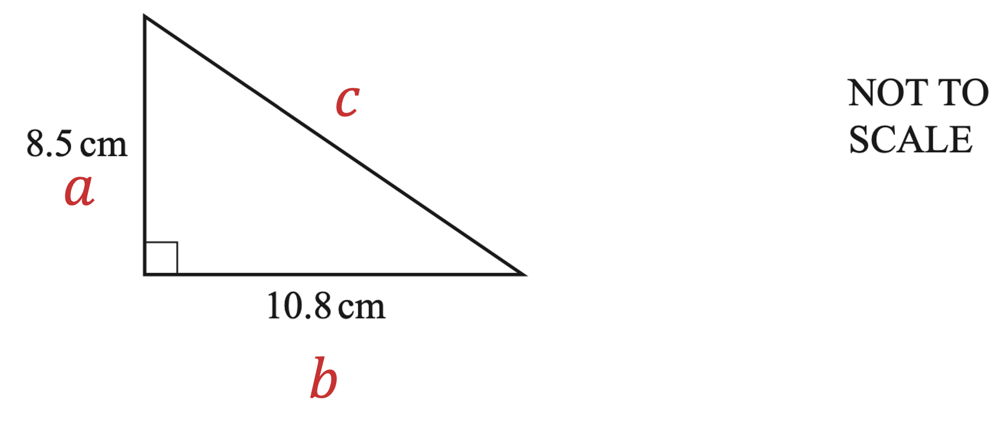
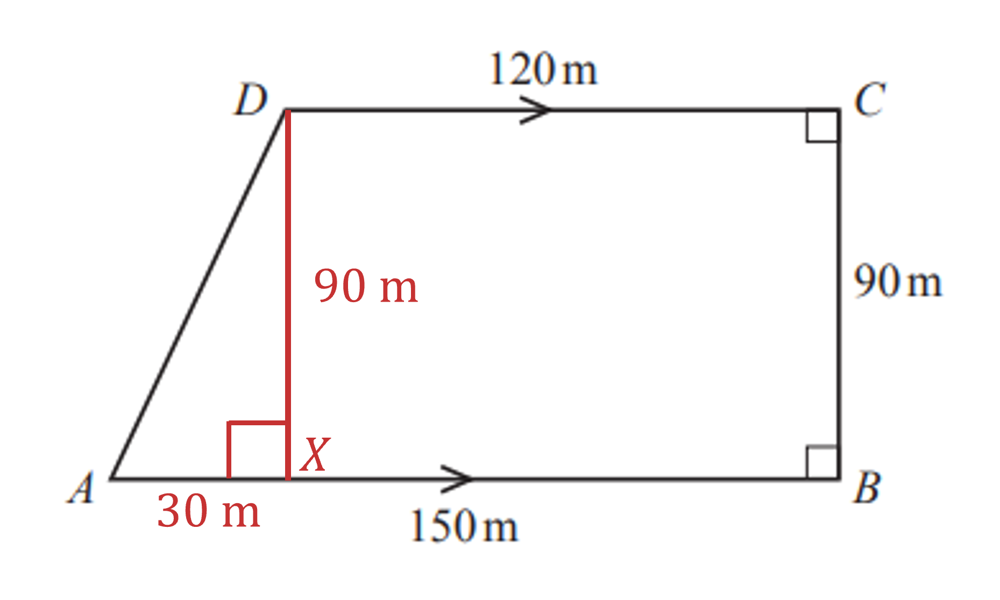
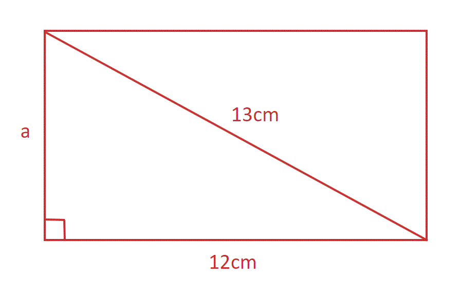

# Mark Schemes — Pythagoras
**Pythagoras & Trigonometry** · Cambridge (CIE) IGCSE maths (0607)

## Exam Questions (16 questions)

### Q1
> *Find the missing length of the rectangle using Pythagoras in reverse*

$\sqrt{10^{2}-6^{2}}$

**[M1]**

> *Simplify*

$\begin{gathered} = \sqrt{100 - 36} \\ = \sqrt{64} \\ = 8 \text{cm} \end{gathered}$

**[M1]**

> *Find the area of the rectangle by multiplying the length by the width*

$8\times6$

**Final answer:** **48 cm****2**

**[A1]**

### Q2
i) *Find the length of *$BC$* using Pythagoras' theorem, *$a^{2}+b^{2}=c^{2}$

$7^{2}+BC^{2}=12^{2}$

**[1]**

> *Subtract *$7^{2}$* from both sides*

$BC^{2}=12^{2}-7^{2}$

> *Take the square root of both sides*

$BC=\sqrt{12^{2}-7^{2}}$

**[1]**

$BC=9.75m$ **[1]**

**Answers between 9.746 and 9.747 will be accepted**

ii) *The length of the fence will be the same as the perimeter of the rectangle* *Add up the lengths of all of the sides of the rectangle*

$7+7+9.75+9.75$

$33.5m$ **[1]**

**Answers between 33.492 and 33.494 or an answer of 33.49 will be accepted**

### Q3
> *Use Pythagoras' theorem *$a^{2}+b^{2}=c^{2}$* where *$a$* and *$b$* are the two perpendicular sides and *$c$* is the hypotenuse.*

> *Here,*

$a=4.4,b=y$ *and *$c=5.3$

> *Substitute these values into Pythagoras' theorem and solve for *$y$

$4.4^{2}+y^{2}=5.3^{2}$

**[1]**

$y^{2}=5.3^{2}-4.4^{2}$

$y=\sqrt{5.3^{2}-4.4^{2}}$

**[1]**

$=2.954657341$

> *Round to 3 significant figures*

**2.95**** ****[1]**

** or 2.954 to 2.955**

### Q4
*First find the length of the diagonal side using Pythagoras' theorem *$( a^{2} + b^{2} = c^{2} )$ *It may help to label the diagram first*

$8.5^{2}+10.8^{2}=c^{2}$

**[1]**

$\begin{gathered} c^{2} & = 188.89 \\ c = 13.743 725 ... \end{gathered}$

> *Do not round but store the number using your calculator's memory to keep accuracy Add up the three sides to find the perimeter*

$P=8.5+10.8+13.743725...$

**[1]**

$P=33.043725...$

**33.0 cm**** [1]**

### Q5
(i)*Draw a triangle **ADX **as shown below* *DX **will be 90 m as it is the same as **CB* *AX **will be 30 m as it is the difference between **DC** and **AB*

> *Apply Pythagoras to the triangle **AXD **to find length **AD*

$AD=\sqrt{30^{2}+90^{2}}=94.86832981...m$

**Method ****[2]**

**Unrounded answer**** [1]**

> *Round to the nearest metre*

**95 m** *This is a "show that" question, so full working needs to be shown  *

(ii) *Find the total perimeter (distance around the edge)* *Use the 95 m value for the length of **AD*

*120 + 90 + 150 + 95 = 455 m*

**[1]**

*It costs \$48 per 5 metres* *So find how many 5 metres are in 455 m*

*455 ÷ 5 = 91 (lots of 5 m)*

**[1]**

> *Find the cost for 91 lots of \$48*

*91 × 48 = \$4368*

**\$4368** **[1]**

### Q6
> *Use Pythagoras' Theorem to find the width of the rectangle.*

> *We need to find one of the shorter sides of the triangle, so substitute into *$a=\sqrt{c^{2}-b^{2}}$* *

$a = \sqrt{( 13 )^{2} - ( 12 )^{2}} = 5$

* ***[1]**

> *Area of a rectangle = length x width*

> *Multiply the length of the rectangle by the width to find the area of the rectangle. *

$12\times5=60\mathrm{cm}^{2}$

* ***[1]**

$60\mathrm{cm}^{2}$* ***[1]**

### Q7
> *Use Pythagoras' Theorem.*

> *Substitute *$a=w$*, *$c=23$* and *$b=14$* into *$a=\sqrt{c^{2}-b^{2}}$* (because we need to find one of the shorter lengths). *

$w=\sqrt{23^{2}-14^{2}}$

**[2]**

> *Type into a calculator. *

> $w=18.2482...$* *

> *Round to 3 significant figures. *

$w=18.2$* ***[1]**

### Q8
> *Use Pythagoras' Theorem, which states that *$a^{2}+b^{2}=c^{2}$*, where **c** is the hypotenuse of a right-angled triangle.*

$23.4^{2} + ( B C )^{2 } = 35.1^{2}$

**[1]**

> *Subtract 23.4**2 **from both sides*

$( B C )^{2} = 35.1^{2} - 23.4^{2}$

**[1]**

> *Type this into your calculator*

$( B C )^{2} = 684.45$

> *Square root both sides*

$BC=\sqrt{684.45}=26.16199534...$

> *Round to three significant figures*

**26.2** **[1]**

### Q9
> *Use Pythagoras' theorem *$a^{2}+b^{2}=c^{2}$* where *$c$* is the hypotenuse and *$a$* and *$b$* are the two perpendicular sides to calculate the length of *$AB$

$AB^{2}=7.4^{2}+2.3^{2}$

**[1]**

$AB=\sqrt{7.4^{2}+2.3^{2}}=7.749193506$

> *Round to 3 significant figures*

**7.75 cm**** ****[1] **

**7.75 or 7.74 accepted**

### Q10
> *Use Pythagoras' Theorem.*

*PQ** is one of the short sides, so use *$a=\sqrt{c^{2}-b^{2}}$* *

$\begin{gathered} P Q & = \sqrt{11.5^{2} - 7.2^{2}} \end{gathered}$

**[2]**

> *Enter into a calculator.*

$PQ=8.967...$

> * *

> *Round to 3 significant figures.*

$PQ=8.97\mathrm{cm}$* ***[1]**

### Q11
> *Use Pythagoras' Theorem, which states that *$a^{2}+b^{2}=c^{2}$*, where **c** is the hypotenuse of a right-angled triangle.*

$3.9^{2}+x^{2}=8.5^{2}$

**[1]**

> *Subtract 3.9**2 **from both sides*

$x^{2}=8.5^{2}-3.9^{2}$

**[1]**

> *Type this into your calculator*

$x^{2}=57.04$

> *Square root both sides*

$x=\sqrt{57.04}=7.552...$

> *Round to three significant figures*

**7.55** **[1]**

### Q12
> *The length of *$PR$* is calculated using Pythagoras' theorem *$c^{2}=a^{2}+b^{2}$* where *$c$* is the hypotenuse of the right-angled triangle, and *$a$* and *$b$* are the two perpendicular sides.*

> *Substitute these known values into the formula*

$PR^{2}=21^{2}+28^{2}$

**[1]**

> *Solve for *$PR$

$PR=\sqrt{21^{2}+28^{2}}$

$PR$ **=**** 35**** ****cm** **[1]**

### Q13
> *Use Pythagoras' Theorem, which states that *$a^{2}+b^{2}=c^{2}$*, where **c** is the hypotenuse of a right-angled triangle.*

$31^{2}+28^{2}=x^{2}$

> *Type this into your calculator*

$1745=x^{2}$

> *Square root both sides*

$\sqrt{1745}=x$

**[1]**

$41.773...=x$

> *Round to 3 significant figures*

$x=41.8$ **[1]**

### Q14
> *The length of *$AC$* is calculated using Pythagoras' Theorem *$a^{2}+b^{2}=c^{2}$* where *$c$* is the hypotenuse of the right-angled triangle and *$a$* and *$b$* are the two perpendicular sides  *

$AC^{2}=1.6^{2}+2.8^{2}$

**[1] **

$AC=\sqrt{1.6^{2}+2.8^{2}}$

> *Evaluate using your calculator*

$AC=3.224903...$

> *Round   *

$AC=3.22m$** [1]**

### Q15
> *Use Pythagoras' Theorem.*

$k$* is the longest side, the hypotenuse, so use *$c=\sqrt{a^{2}+b^{2}}$

$\begin{gathered} k = \sqrt{8^{2} + 15^{2}} \end{gathered}$

**[1]**

> *Enter into a calculator.*

$\begin{gathered} k = \sqrt{289} \\ \\ k = 17 \end{gathered}$

$17\mathrm{cm}$* ***[1]**

### Q16
> *The diagrams shows a right-angled triangle. To find the missing side, use Pythagoras' Theorem *$a^{2}+b^{2}=c^{2}$*, where **c** is the hypotenuse. *

$8^{2}+25^{2}=c^{2}$

**[1]**

> *Type this into a calculator*

$689=c^{2}$

> *Square root both sides*

$\sqrt{689}=c$

$c=26.248...$

**c**** = 26.2 cm**** ****[1]**
