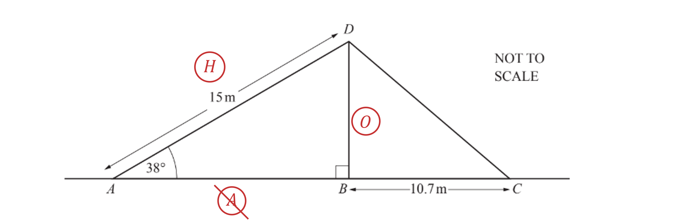
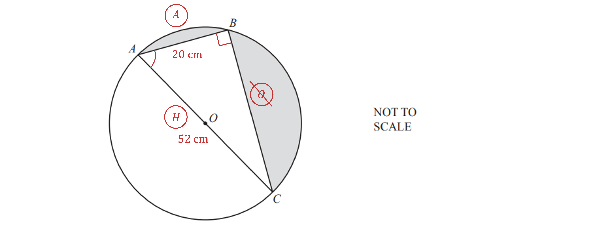
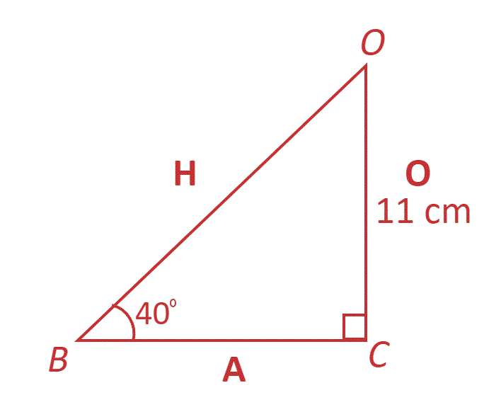
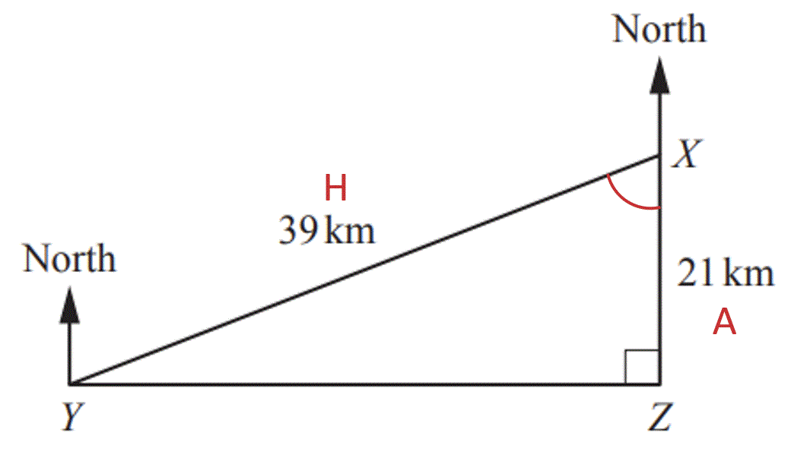
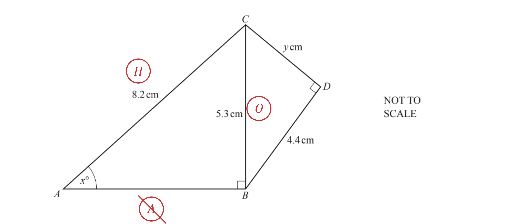
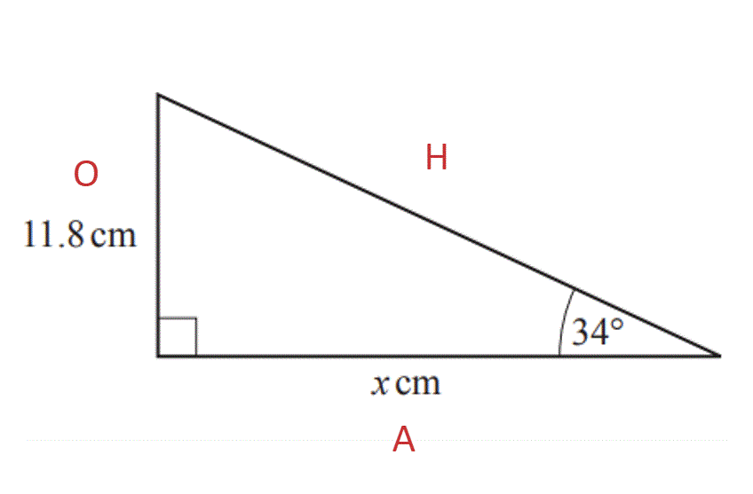
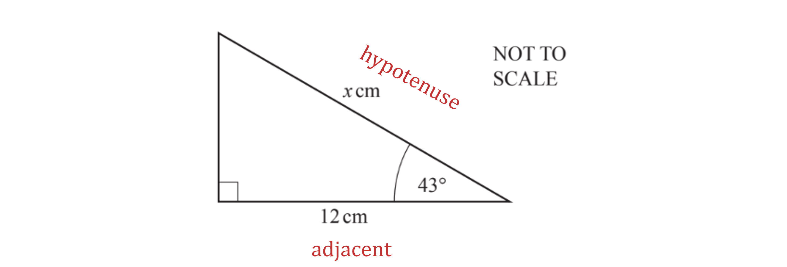
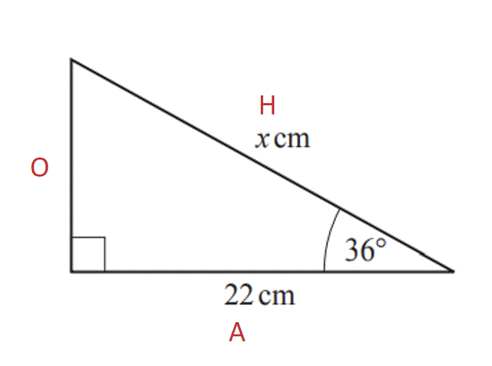
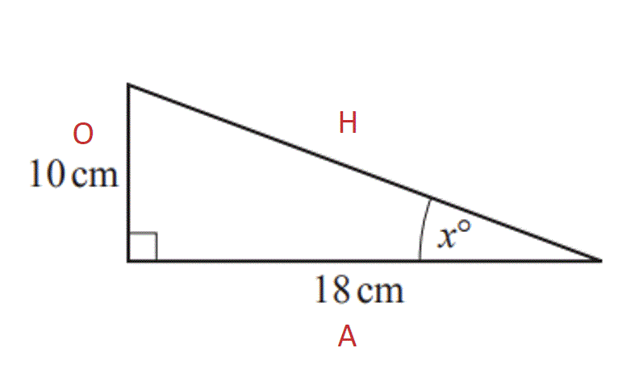
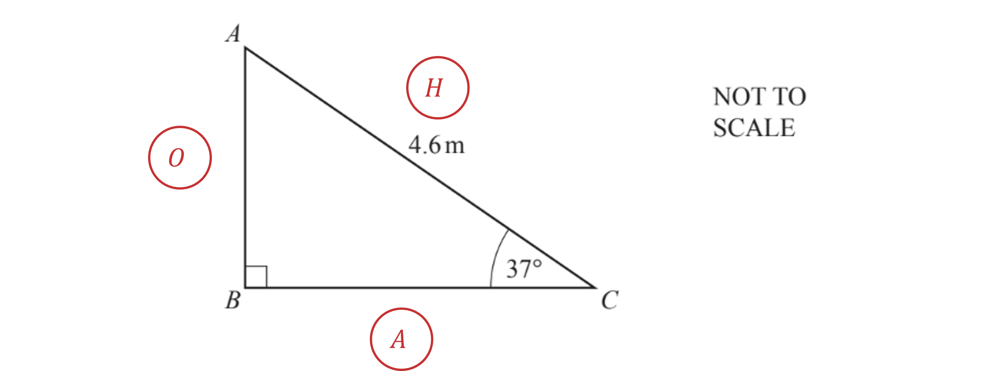

# Mark Schemes — Trigonometry
**Pythagoras & Trigonometry** · Cambridge (CIE) IGCSE maths (0607)

## Exam Questions (16 questions)

### Q1
> *Label the sides of the triangle *$ABD$* in relation to the angle at *$A$

> *The trigonometric function of an angle that is equal to the ratio of the opposite side and the hypotenuse is the sine function*

`sin open parentheses theta close parentheses equals O over H`

> *Substitute the known values into the equation and solve for *$BD$

`sin open parentheses 38 close parentheses equals fraction numerator B D over denominator 15 end fraction`

**[1]**

`B D equals sin open parentheses 38 close parentheses cross times 15 equals 9.23492213...`

> *Round to 3 significant figures*

**9.23 m**** ****[1]**

** 9.234 to 9.235 also accepted**
> *Use Pythagoras' Theorem *$a^{2}+b^{2}=c^{2}$* where *$a$* and *$b$* are the perpendicular sides and *$c$* is the hypotenuse*

$CD^{2}=9.23^{2}+10.7^{2}$

**[1]**

$CD=\sqrt{9.23^{2}+10.7^{2}}$

$CD=14.13092...m$

> *Round to 3 significant figures*

**14.1 m**** ****[1] **

**14.13... also accepted**

### Q2
i) *Label the lengths of *$AB$* and *$AC$* on the diagram Highlight the angle*

> * *$BAC$* Draw in a right-angle at angle *$ABC$* as one of the lengths of the triangle is the diameter of the circle *

> *Label the sides relative to angle *$BAC$* for trigonometry: adjacent, opposite and hypotenuse*

> *Because you know the adjacent and the hypotenuse, use the cosine ratio, *`cos open parentheses theta close parentheses equals O over H`

> *Substitute the values you know into the ratio*

`cos open parentheses theta close parentheses equals 20 over 52`

**[1]**

> *Take the inverse cos of both sides to find the angle*

`theta equals cos to the power of negative 1 end exponent open parentheses 20 over 52 close parentheses
theta equals 67.38013...`

**Angle ****BAC**** =** $67.4^{\circ}$** [1]**

ii) *Use Pythagoras' theorem,* $a^{2}+b^{2}=c^{2}$

$20^{2}+BC^{2}=52^{2}$

**[1]**

$400+BC^{2}=2704$

> *Subtract 400 from both sides*

$BC^{2}=2304$

> *Take the square root of both sides*

$BC=\sqrt{2304}$

$BC=48\mathrm{cm}$ **[1]**

iii) *The area of a triangle is *$A=\frac{1}{2}bh$

> *Sides *$AB$* and *$BC$*are perpendicular so can be used as the base and height of the triangle*

> *Substitute the values into the formula*

$A=\frac{1}{2}\times20\times48$

**[1]**

$480\mathrm{cm}^{2}$ **[1]**

iv) *The total shaded area is the area of the triangle subtracted from the area of the semi-circle*

> *The radius of the circle is half of the diameter, *$AC$

$r=52+2=26$

> *Calculate the area of the circle using the formula, *$A=πr^{2}$

$A=π\times26^{2}=676π$

> *Divide by 2 to find the area of the semi-circle*

$676π+2=338π$

**[1]**

> *Subtract the are of the triangle from the area of the semi-circle to find the shaded area*

$338π-480$

**[1]**

$\mathrm{Shaded} \mathrm{area}=581.85831...$

$582\mathrm{cm}^{2}$ **[1]**

**Answers between 581.8 to 582.0 will be accepted**

### Q3
(i) *BC** is a tangent and **OC **is a radius. A tangent and a radius meet at *$90^{\circ}$*.  *

**Angle**** between a ****tangent**** and a ****radius**** is **$90^{\circ}$ **[1]**

(ii) *Triangle **OBC **is right angled. Use trigonometry to work out **BC**.  *

> *Label the triangle. *

* *** ****[1]**

$forangleOBC=40^{\circ}$

> *We know O and want A, that's TOA (*$\mathrm{tan}x=\frac{\mathrm{opp}}{\mathrm{adj}}$*)  *

$\mathrm{tan}40=\frac{11}{BC}$

* ***[1]**

> *Multiply both sides by **BC**.  *

> $BC\times\mathrm{tan}40=11$* *

> *Divide both sides by tan 40.  *

> $BC=\frac{11}{\mathrm{tan}40}=13.109...$* *

$BC=13.109...=13.11(2d.p.)$* ***[1]*** *

> * *

(iii) *Use Pythagoras' Theorem to work out the hypotenuse of the right angled triangle **OBC. *

> *We want to find the longest length, so substitute *$a=11$* and *$b=13.11$* into *$c=\sqrt{a^{2}+b^{2}}$* *

$c=\sqrt{11^{2}+13.11^{2}}$

**[1]**

*Type into a calculator. ***  **

$c=17.1135...$

** [1]**

> *Subtract 11 (the length of the radius **OH**).  *

$17.1135...-11=6.1135...$* ** *

> *Round to 3 significant figures. *

**6.11 cm** **[1]**

### Q4
(i) *Substitute *$c=39$* and *$b=21$* into *$a=\sqrt{c^{2}-b^{2}}$* (to find a shorter length).  *

$a=\sqrt{39^{2}-21^{2}}$

**[2]**

$a=32.8633...$

*Round to 3 significant figures.*** **

$YZ=32.9\mathrm{km}$** [1]**

(ii) *Use trigonometry.*

> *Mark on the angle and label the triangle.*

> * *

> * *

> *We know A and H, that's CAH (*$\mathrm{cos}=\frac{\mathrm{adjacent}}{\mathrm{hypotenuse}}$*) *

$\mathrm{cos}YXZ=\frac{21}{39}$

**[1]*** *

> *Inverse cos both sides to find the angle. *

`cos to the power of negative 1 end exponent open parentheses 21 over 39 close parentheses equals 57.4210...`

> * Round to 3 significant figures.*

$\mathrm{Angle}YXZ=57.4^{\circ}$* ***[1]**

(iii) *Add *$180^{\circ}$* to the angle **YXZ **(because bearings are measured clockwise from North). *

> $57.4+180=237.4$* *

$237.4^{\circ}$* ***[1]**

### Q5
> *Use Pythagoras' theorem *$a^{2}+b^{2}=c^{2}$* where *$a$* and *$b$* are the two perpendicular sides and *$c$* is the hypotenuse.*

> *Here,*

$a=4.4,b=y$ *and *$c=5.3$

> *Substitute these values into Pythagoras' theorem and solve for *$y$

$4.4^{2}+y^{2}=5.3^{2}$

**[1]**

$y^{2}=5.3^{2}-4.4^{2}$

$y=\sqrt{5.3^{2}-4.4^{2}}$

**[1]**

$=2.954657341$

> *Round to 3 significant figures*

**Final answer:** **2.95**** [1] **

**or 2.954 to 2.955**
> *Label the sides of the triangle *$ABC$* in relation to the angle *$x$

> *The trigonometric function of an angle that is equal to the ratio of the opposite side and the hypotenuse is the sine function*

`sin open parentheses theta close parentheses equals O over H`

> *Substitute the known values into the formula and evaluate*

`sin open parentheses x close parentheses equals fraction numerator 5.3 over denominator 8.2 end fraction`

**[1]**

`x equals sin to the power of negative 1 end exponent open parentheses fraction numerator 5.3 over denominator 8.2 end fraction close parentheses equals 40.26632845`

> *Round to 3 significant figures*

$x=40.3$** [1] **

**Or 40.26 to 40.27**

### Q6
> *Label the triangle. *

> * *

> *We know O and we want A, that's TOA (or *$\mathrm{tan}x=\frac{\mathrm{opposite}}{\mathrm{adjacent}}$*)*

> * *

$\mathrm{tan}34=\frac{11.8}{x}$

* ***[1]**

> *Multiply both sides by *$x$*. *

$x\times\mathrm{tan}34=11.8$

> * *

> *Divide both sides by *$\mathrm{tan}34$*. *

$x=\frac{11.8}{\mathrm{tan}34}$

* ***[1]**

> *Type into a calculator. *

$x=17.4942...$

> *Round to 3 significant figures.*

$x=17.5$* ***[1]**

### Q7
> *Label the sides of the right angle triangle in relation to the angle *$x^{\circ}$

> *The trigonometric function of an angle that is equivalent to the adjacent divided by the hypotenuse is the cosine function*

`cos open parentheses theta close parentheses equals A over H`

> *Substitute known values into the equation and evaluate for the missing angle*

`cos open parentheses x close parentheses equals fraction numerator 6.2 over denominator 23 end fraction`

**[1]**

`x equals cos to the power of negative 1 end exponent open parentheses fraction numerator 6.2 over denominator 23 end fraction close parentheses equals 74.3616036`

$74.36^{\circ}$ **[1]**

### Q8
> *The two known sides in relation to angle *$p$* are*

*Opposite = *$8$* Hypotenuse = *$15$

> *The trigonometric function that uses the ratio of the Opposite and the Hypotenuse is the sine function*

`sin open parentheses theta close parentheses equals`$\frac{\mathrm{Opposite}}{\mathrm{Hypotenuse}}$

> *Substitute these values into the equation and solve for *$p$

`sin open parentheses p close parentheses equals 8 over 15`

**[1]**

> *Take the inverse sin of both sides  *

`p equals sin to the power of negative 1 end exponent open parentheses 8 over 15 close parentheses`

$p=32.23...$ **[1]**

**32.2 will also be accepted**

### Q9
> *Label the sides in relation to the angle *$BAC$

*The opposite side *$BC=2.8$

*The adjacent side *$AB=1.6$

> *The trigonometric function of an angle that is equal to the ratio of the opposite side of the triangle and the adjacent side of the triangle is the tangent function*

`tan open parentheses theta close parentheses equals O over A`

> *Substitute known values into this formula and evaluate for angle *$BAC=θ$

`tan open parentheses theta close parentheses equals fraction numerator 2.8 over denominator 1.6 end fraction`

**[1]**

*Take the inverse tan of both sides *

`theta equals tan to the power of negative 1 end exponent open parentheses fraction numerator 2.8 over denominator 1.6 end fraction close parentheses equals 60.2551187...`

**  ****Angle**** **$BAC=60.3^{\circ}$ **[1]**

**Values between 60.25 and 60.26 will also be accepted**

### Q10
> *Label the sides of the triangle*

> `cos open parentheses theta close parentheses space equals fraction numerator space adjacent over denominator hypotenuse end fraction`*.*

> *Substitute in the values*

`cos open parentheses 43 close parentheses space equals 12 over x`

**[1]**

> *Multiply both sides by **x*

`x space cross times space cos open parentheses 43 close parentheses space equals space 12`

> *Divide both sides by *`cos open parentheses 43 close parentheses`

`x space equals fraction numerator space 12 over denominator cos open parentheses 43 close parentheses end fraction`

**[1]**

> *Type this into a calculator*

$x=16.4079...$

> *Round to 3 significant figures*

$x=16.4$** [1]**

### Q11
> *Label the lengths of the triangle. *

> * *

> *We know A and we want H - that's CAH or *$\mathrm{cos}θ=\frac{\mathrm{adjacent}}{\mathrm{hypotenuse}}$

> * *

$\mathrm{cos}36=\frac{22}{x}$

* ***[1]**

> *Multiply both sides by *$x$*.*

$x\times\mathrm{cos}36=22$

> *Divide both sides by *$\mathrm{cos}36$*.*

$x=\frac{22}{\mathrm{cos}36}$

* ***[1]**

> *Enter into a calculator.*

$x=27.19349...$

* ***[1]**

> *Round to 3 significant figures.*

$x=27.2\mathrm{cm}(3s.f.)$

### Q12
> *Label the triangle. *

> *We know O and A - that's TOA (or *$\mathrm{tan}θ=\frac{\mathrm{opp}}{\mathrm{adj}}$*)*

$\mathrm{tan}x=\frac{10}{18}$

* ***[1]**

> $\mathrm{tan}^{-1}$* both sides.*

`x equals tan to the power of negative 1 end exponent open parentheses 10 over 18 close parentheses`

> * *

> *Enter into a calculator and round to 3 significant figures.*

`tan to the power of negative 1 end exponent open parentheses 10 over 18 close parentheses equals 29.0546...`

$x=29.1^{\circ}$* ***[1]**

**29.05 also accepted**

### Q13
*Label the sides of the triangle in relation to the angle at* $C$*:*

> *Determine which trigonometric function to use*

> *The length of *$AC$* (the hypotenuse) is known and the length of *$AB$* (the opposite side) is to be calculated, so use the sine ratio*

`sin open parentheses theta close parentheses equals O over H`

> *Substitute the appropriate values into the formula*

`sin open parentheses 37 close parentheses equals fraction numerator A B over denominator 4.6 end fraction`

**[1]**

> *Rearrange to solve for *$AB$

`A B equals sin open parentheses 37 close parentheses cross times 4.6`

$AB=2.768...$ **[1]**

**An answer of 2.77 will be accepted**

### Q14
> *Labelling the sides of the triangle in relation to the angle,*

*The adjacent side to the angle is *$x\mathrm{cm}$

*The hypotenuse is *$16\mathrm{cm}$

> *The trigonometric function of an angle that is equivalent to the ratio of the adjacent and the hypotenuse of a right-angled triangle is the cosine function*

`cos open parentheses theta close parentheses equals A over H`

> *Substitute the known values into the formula*

`cos open parentheses 52 close parentheses equals x over 16`

**[1]**

> *Solve for *$x$* by multiplying both sides of the equation by *$16$* and evaluating*

`x equals 16 cross times cos open parentheses 52 close parentheses`$=9.85058...$

**9.85 ****[1]**

### Q15
> *Labelling the sides of the triangle in relation to the angle,*

*The opposite side to the angle is *$x\mathrm{cm}$

*The hypotenuse is *$12\mathrm{cm}$

> *The trigonometric function of an angle that is equivalent to the ratio of the opposite and the hypotenuse of a right-angled triangle is the sine function*

`sin open parentheses theta close parentheses equals O over H`

> *Substitute the known values into the formula*

`sin open parentheses 35 close parentheses equals x over 12`

**[1]**

> *Solve for *$x$* by multiplying both sides of the equation by *$12$* and evaluating*

`x equals 12 cross times sin open parentheses 35 close parentheses`$=6.88291736...$

**6.88**** ****[1]**

### Q16
> *Labelling the sides of the triangle in relation to the angle,*

*The opposite side to the angle is *$x\mathrm{cm}$

*The hypotenuse is *$16\mathrm{cm}$

> *The trigonometric function of an angle that is equivalent to the ratio of the opposite and the hypotenuse of a right-angled triangle is the sine function*

`sin open parentheses theta close parentheses equals O over H`

> *Substitute the known values into the formula*

`sin open parentheses 35 close parentheses equals x over 16`

**[1]**

> *Solve for *$x$* by multiplying both sides of the equation by *$16$* and evaluating*

`x equals 16 cross times sin open parentheses 35 close parentheses`$=9.17722...$

**9.18**** ****[1]**
