# Mark Schemes — Scatter Graphs & Correlation
**Statistics** · Cambridge (CIE) IGCSE maths (0607)

## Exam Questions (16 questions)

### Q1
> *From the graph, as the practical test score increases, the theory test score increases*

**Final answer:** **Positive**

**[B1]**
> *The line of best fit must pass through the mean point, (32.4, 38.2)*

> *Aim to have roughly the same number of data points on either side of the line along its whole length*

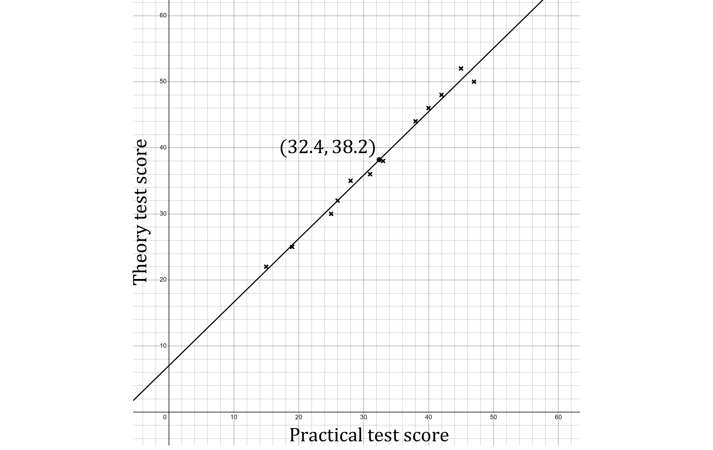

**[B1 B1]**

> **[mark-scheme]**
> **B1**: (32.4, 38.2) plotted and line passes through this point.
> 
> **B1**: Correct line of best fit, with approximately the same number of points either side of the line.
**Final answer:** **Identify the points on the scatter graph which are below the line of best fit**

**[B1]**

### Q2
*Draw a vertical line up from the **x**-axis at \$70 000 until it meets a plotted point*
*Draw a horizontal line across from the point to the **y**-axis*

> *Read off the value on the **y**-axis*

> *Give your answer in thousands of dollars*

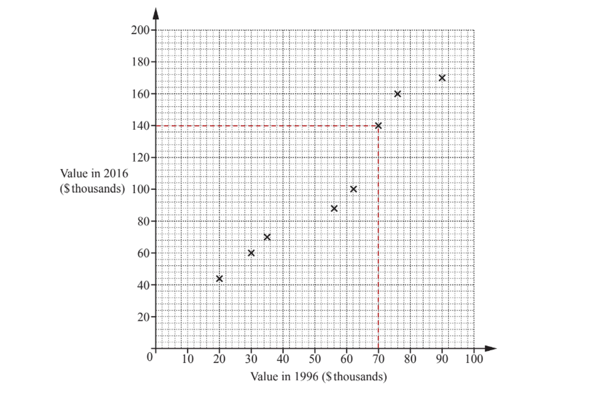

**Final answer:** **\$140 000**
> *Plot the points (40, 80) and (80, 150) on the scatter graph*

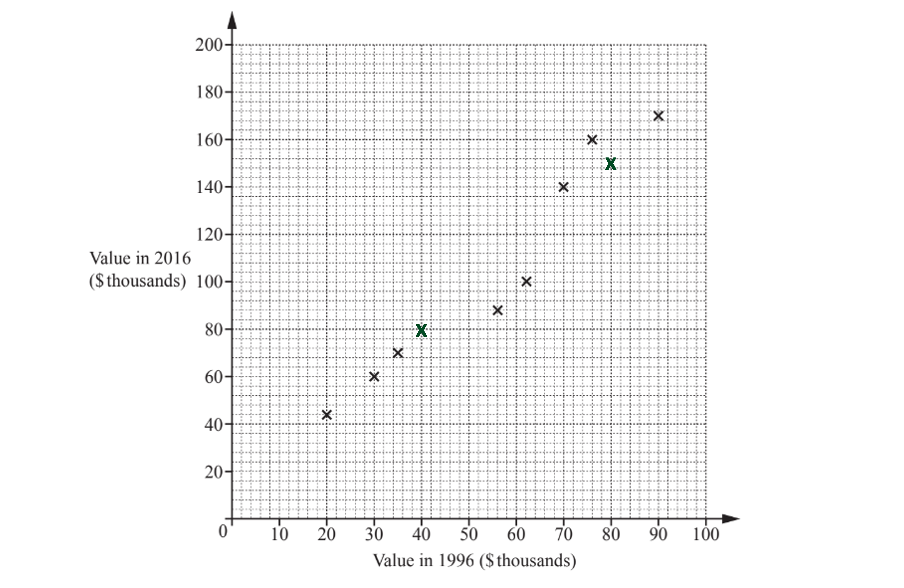

**[1]**
> *The line of best fit must go through the mean point, so use the information given and the information in the table to find the total mean value of the houses in both years*

> *For 1996, add the two new values to the total value of 437,000, change the units first as the values are given in thousands*

$437000+40000+80000=557000$

> *Divide this by 10 to find the mean value in 1996*

$557000\div10=55,700$

**[1]**

> *For 2016, multiply 104000 by eight to find the total of the first eight runs *

$104000\times8=832000$

> *Add this to the total  value of the other two houses given in the table, change the units first as the values are given in thousands*

$832000+80000+150000=1062000$

> *Find the mean value of all 10 houses by dividing this by 10*

$1062000\div10=106200$

**[1]**

> *Plot the mean point, dividing each value by 1000 before plotting it on the graph*

`open parentheses 55.7 comma space 106.2 close parentheses`

**[1]**

> *Use a ruler to draw a line of best fit onto the scatter graph, it should*

- *go through the mean point (55,7, 106.2)*
- *have roughly as many points on one side of the line as the other *

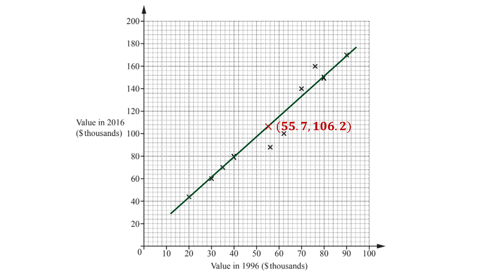

** [1]**
> *Draw a vertical line from the **x**-axis at \$50 000 until it mets the line of best fit *
*Draw a horizontal line across from the point until it meets the **y**-axis *

> *Read off the value on the **y**-axis*

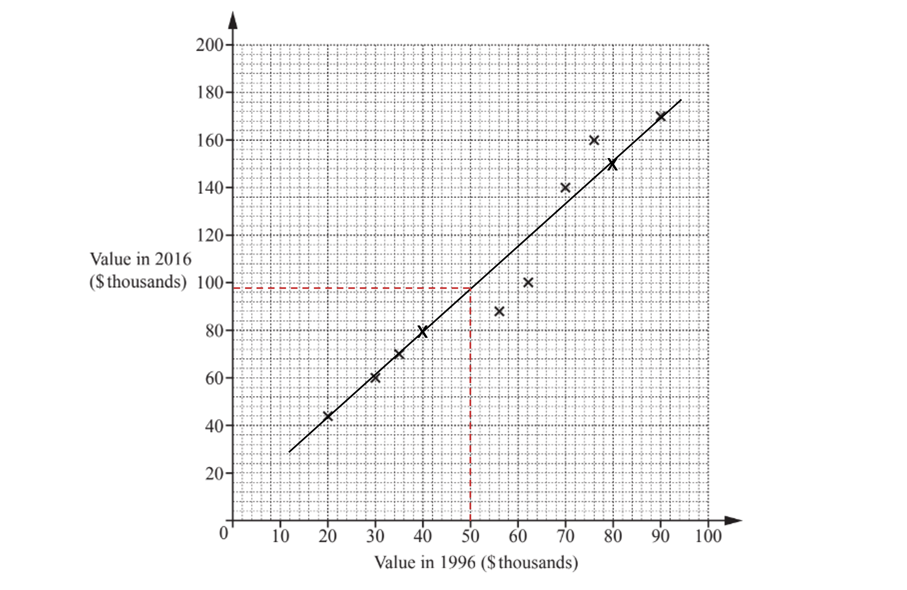

**\$98 000**** [1]**

> *Answers in the range \$80 000 to \$110 000 are accepted*

### Q3
> *Plot the points (40, 8), (65, 15), (50, 11) and (32, 9)*

*1 mark for 2 or 3 points, 2 marks for all 4 points plotted correctly** ***[2]**
> *Circle the point that is much higher on the **y**-axis compared to the **x**-axis than the other points (40, 18)*

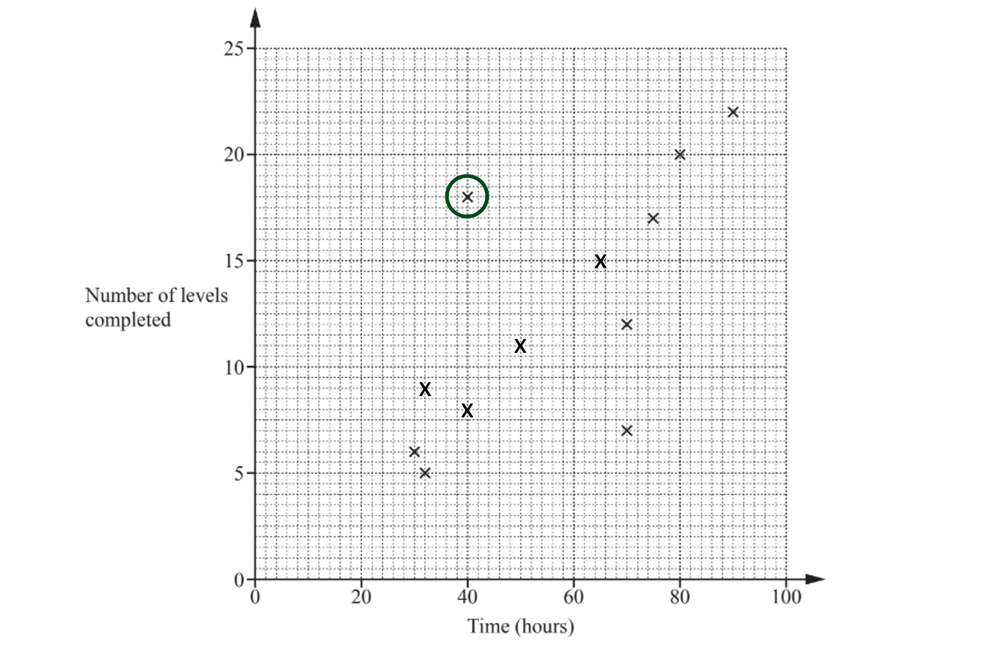

**[1]**
> *The points appear to follow in the direction of a straight line that starts from the bottom left and goes towards the top right*

**Positive correlation** **[1]**
> *The line of best fit should go through the mean point*

> *Find the mean point by entering the data into a new spreadsheet in your calculator*

> *Select 'one variable statistics' for each row and find the mean point*

*Mean for time spent playing: 56.1666...*
*Mean for number of levels completed: 12.5*

**At least one found correctly [1]**

> *Plot the mean point, rounding the value for time to one decimal place*

`open parentheses 56.2 comma space 12.5 close parentheses`

**[1]**

> *Draw a straight line through this point lying within the data set, following the trend of the data*

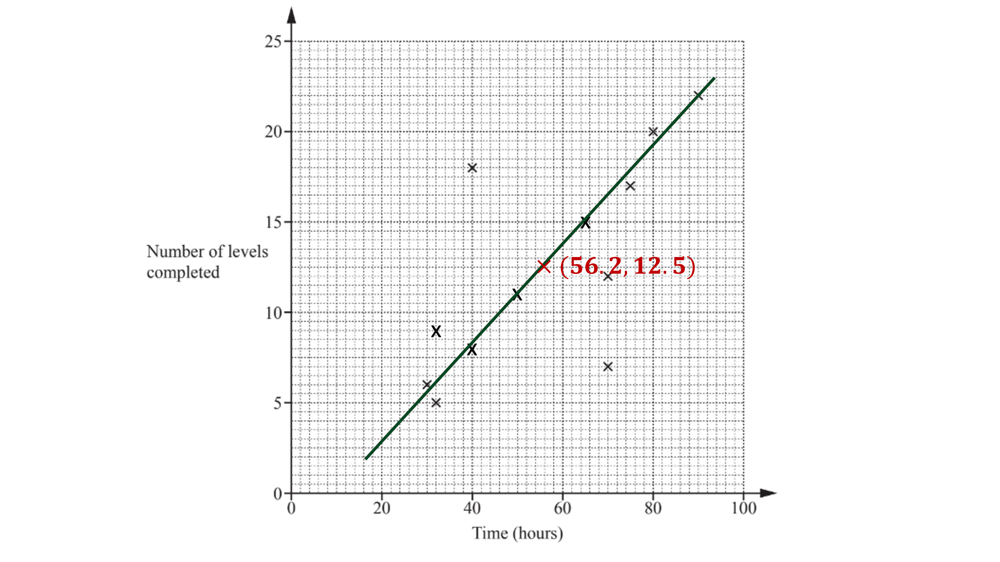

**[1]**
*Draw a horizontal line from 19 on the **y**-axis to the line of best fit* *Draw a vertical line down from the point on the line of best fit to the **x**-axis*

> *Read off the value on the **x**-axis*

**79**** ****[1]**

> *Answers in the range 76 to 80 are accepted*

### Q4
i) *The points form a pattern that starts in the top left of the graph and go down towards the bottom right*

**Negative correlation**** ****[1]**

ii) *The probability that a person picked at random had 5 attempts or more to pass can be found by dividing the number of people who took 5 or more attempts by the total number of people*

> *10 people out of the 17 people took 5 or more attempts to pass*

$\frac{10}{17}$ **[1]**

iii)* Plot the mean point on the diagram*

*(4.1, 19)*

**[1]**

> *Draw a straight line starting in the top left and going down towards the bottom right *
*The line should go through the mean point*
*There should be roughly the same number of points either side of the line*

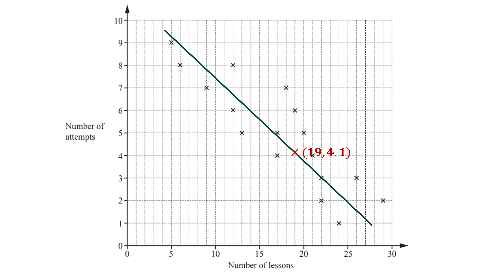

**[1]**

iv) *Draw a vertical line up from 15 on the **x**-axis until it meets the line of best fit*

> *Draw a horizontal line across from this point until it meets the **y**-axis*

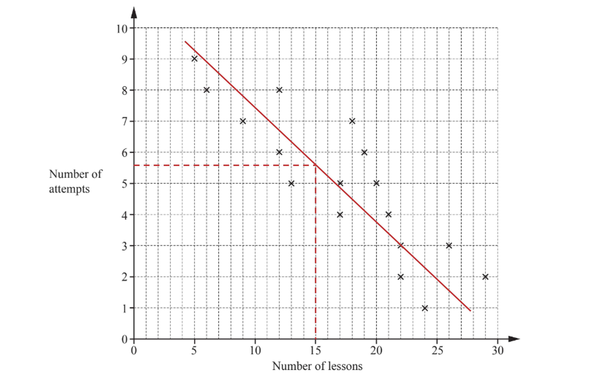

> *Read off the value from the **y**-axis, the line lies between 5 and 6*

> *It must be a whole number of lessons so choose the value it is closest to *

**6**** ****[1]**
*An answer of 5 will also be accepted*

### Q5
> *Plot the coordinates:*

`open parentheses 20 comma space 33 close parentheses comma space open parentheses 44 comma space 52 close parentheses comma space open parentheses 37 comma space 44 close parentheses comma space open parentheses 46 comma space 52 close parentheses`

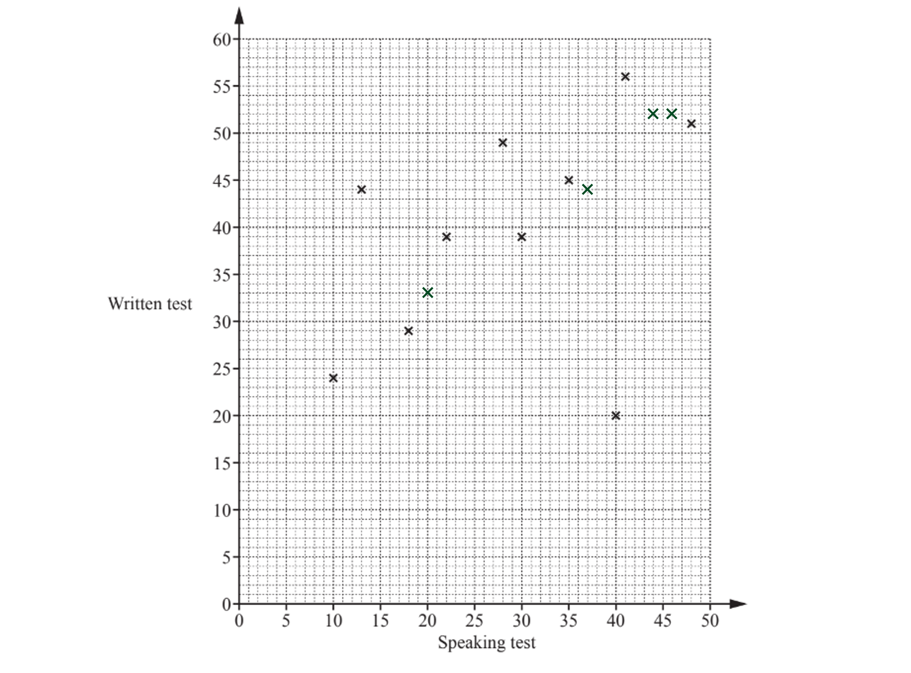

*Minimum 2 points correctly plotted** ***[1]**

*All points plotted correctly** ***[1]**
> *From the graph, as Speaking test score increases, Written test score increases*

**Positive** **[1]**
> *A high score in the Speaking test is further to the right on the grid.*

> *A low score in the Written test would be closer to the bottom of the grid*

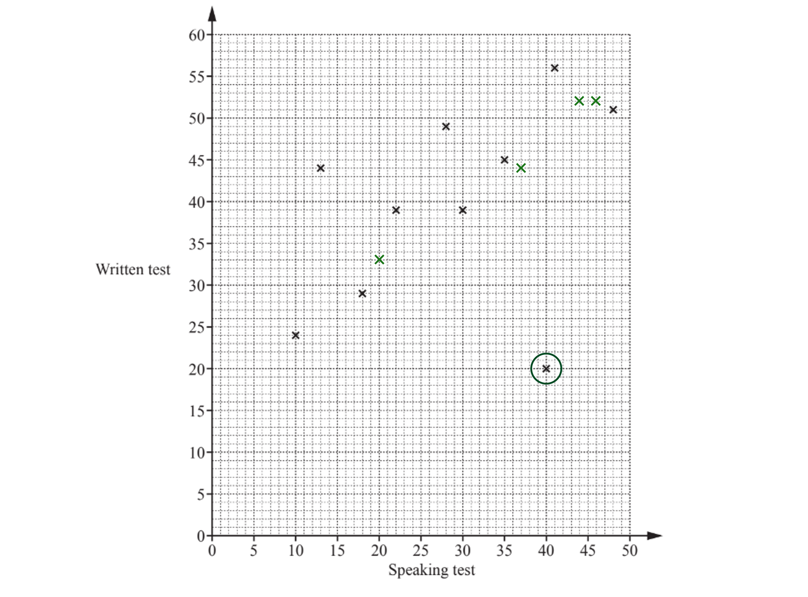

**[1]**
> *The line of best fit should go through the mean point*

> *Find the mean point by entering the data into a new spreadsheet in your calculator*

> *Select 'one variable statistics' for each row and find the mean point*

*Mean for speaking test: 30.8521...*
*Mean for written test: 41.2142...*

**At least one found correctly [1]**

> *Plot the mean point, rounding each value to the nearest whole number*

`open parentheses 31 comma space 41 close parentheses`

**[1]**

> *Draw a straight line through this point lying within the data set, following the trend of the data*

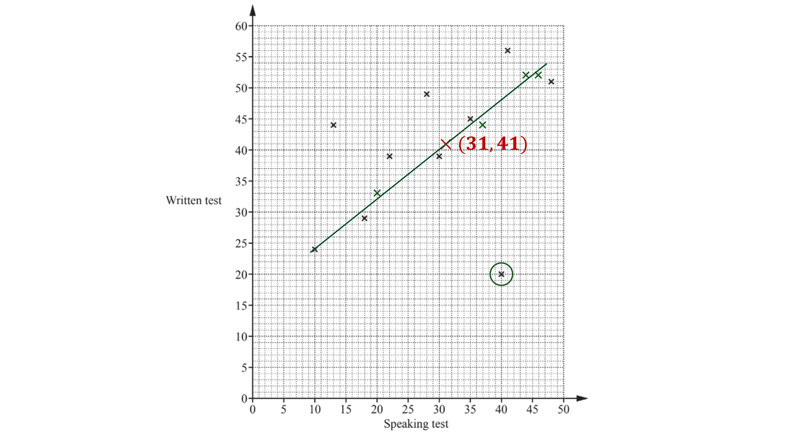

**[1]**
> *Draw a vertical line from *$25$* on the horizontal axis to the line of best fit and read across to determine the Written test score at this point*

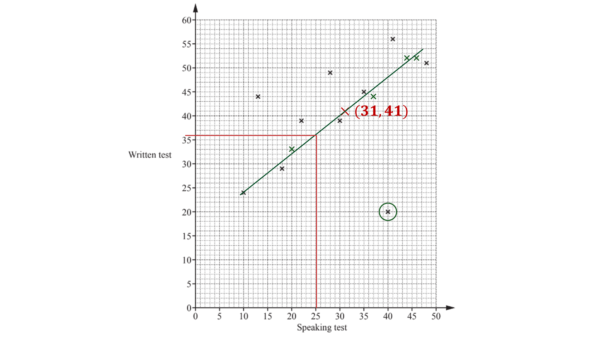

**36**** [1]**

### Q6
> *Plot each point on the scatter graph*

> *Be careful which way round you are plotting them, and read the scale on the axes carefully (each little square is worth 0.2)*

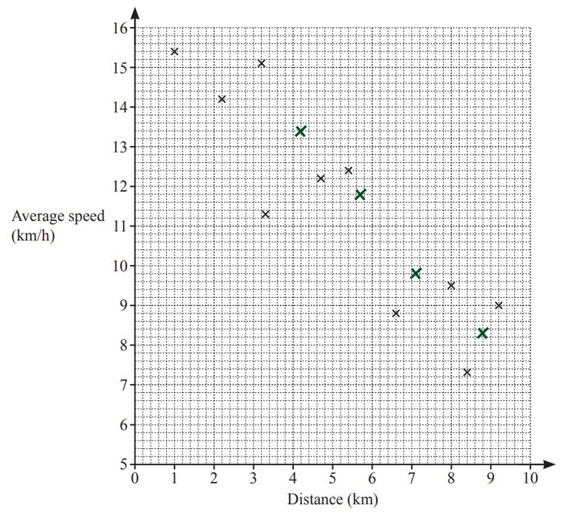

* All points plotted correctly*** ****[2]**

> *1 mark for 2 or 3 points plotted correctly*
> *The graph shows a **negative **correlation (average speed tends to decrease as distance increases).*

**Negative*** ***[1]**
> *The line of best fit must go through the mean point, so the information given and the information in the table to find the total mean distance of all 14 of Aisha's runs*

> *Multiply 5.2 by ten to find the total of the first ten runs *

$5.2\times10=52$

> *Add this to the total of the other four runs given in the table, take care to use the values for the distance*

$52+4.2+5.7+7.1+8.8=77.8$

> *Find the mean of all 14 runs by dividing this by 14*

$77.8\div14=5.55714...$

**[1]**

> *Plot the mean point, use your calculated value rounded to 1 decimal place to match the value already given*

`open parentheses 5.6 comma space 11.3 close parentheses`

**[1]**

> *Use a ruler to draw a line of best fit onto the scatter graph, it should*

- *go through the mean point (5.6, 11.3)*
- *have roughly as many points on one side of the line as the other *

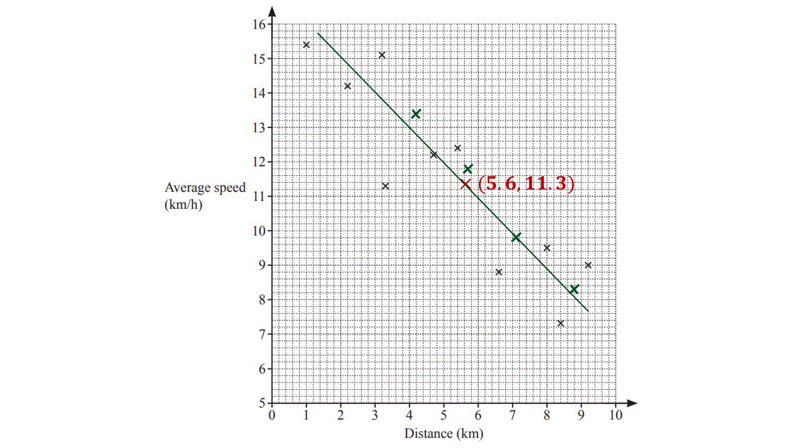

** [1]**
> *Draw a vertical line from 6 on the distance axis until it hits the line of best fit, then draw a horizontal line across to the average speed axis and take a reading*

**  ****11**** ****[1]**

> *Any answer in the range 10-12*

### Q7
> *A line of best fit should be drawn with a ruler, through the mean point and should have approximately the same number of points each side*

> *Plot the coordinate (5, 7800) for the mean point*

> *Each small square on the **y**-axis represents \$200*

**[1]**

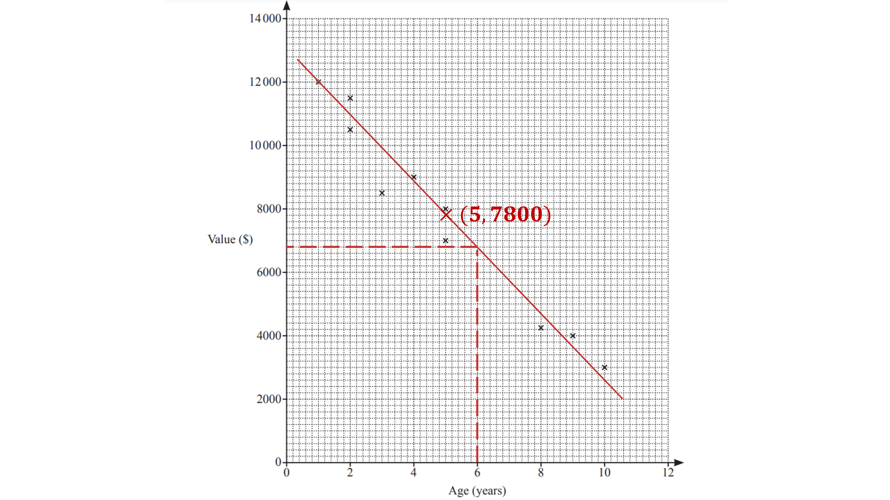

**[1]**

> *To estimate the value of a car that is 6 years old, draw a line up from 6 years on the **x**-axis until you reach your line of best fit*

> *Then draw a line across to the **y**-axis *

> *On the diagram, the line meets 4 squares above \$6000*

**\$6800** **[1]**

> *answer between 6400 and 7400, must match **your** line of best fit*

### Q8
(i) *Plot the points on the scatter graph, being careful with the scales on the axes*

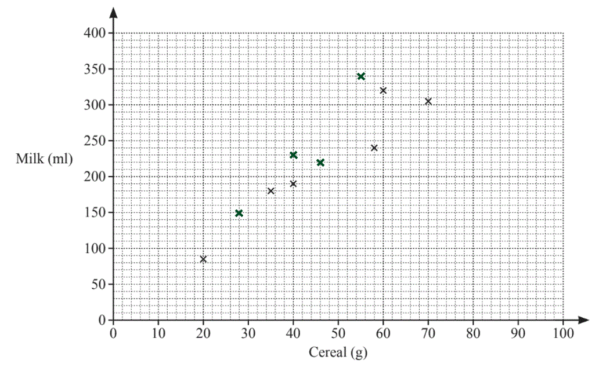

**[2]**

(ii) *Use the graph to describe how the amount of cereal changes as the amount of milk increases*

**As the amount of cereal increases, the amount of milk increases** **[1]**

(iii) *Open a new spreadsheet on your calculator and enter the data for  both the cereal and the milk *

> *Select 'one variable statistic' and find the mean for each row separately*

*Mean cereal eaten:  45.2 g*
*Mean milk used: 226 ml*

**At least one correct [1]**

> *Plot the mean point (45.2, 226) on the graph*

**[1]**

> *Use a ruler to draw a line of best fit on the scatter graph, it should*

- *go through the mean point (45.2, 226)*
- *have roughly the same number of points either side of it*

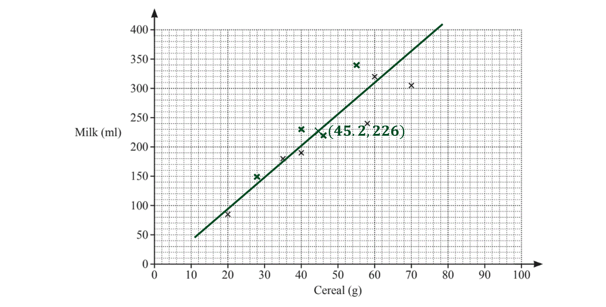

**[1]**

(iv) *Draw a horizontal line from 280 on the milk axis, across to the line of best fit, and then a vertical line down to the cereal axis*

> *Read off the value on the cereal axis*

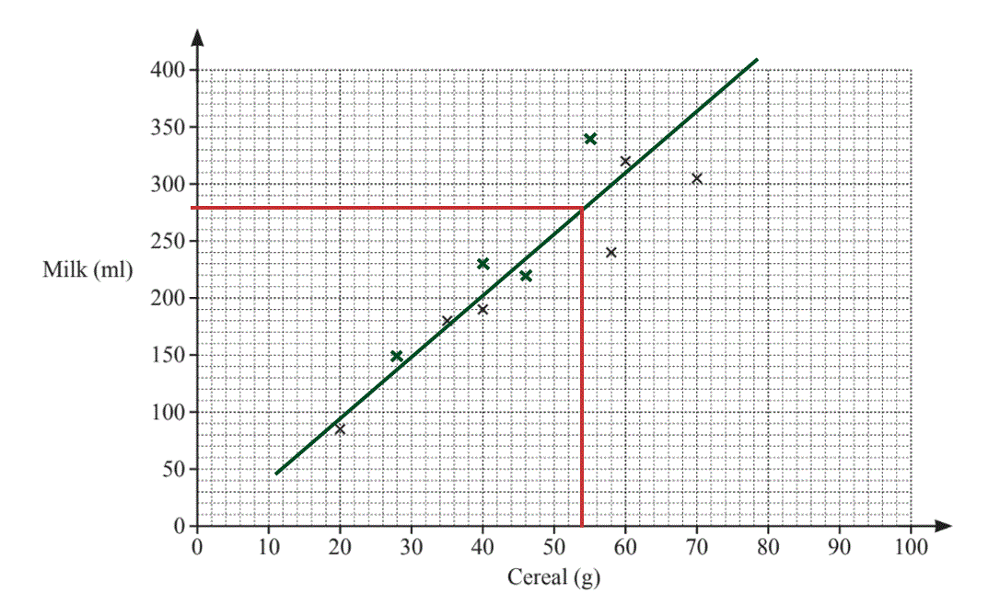

**54 g**** ****[1]**

**52 - 60 accepted**

(v) *There is no data past 70g on the cereal axis*

**Outside given data** **[1]**

> *or equivalent explanation*

### Q9
> *Plot the points on the scatter graph*

> *Be careful with the scale on the height axis, 2 small squares are worth 1cm*

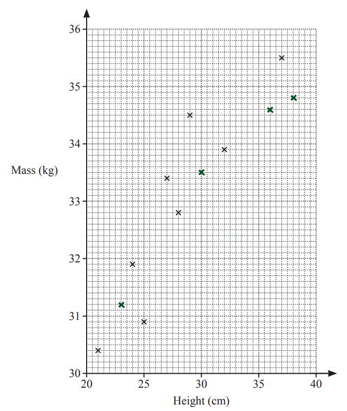

*all plotted correctly ***[2]**

> *or 1 mark for two or three points correctly plotted*
> *The correlation is **positive **(mass tends to increase as height increases).*

**Positive** **[1]**
(i) *Plot the point (29.5, 33.2) on the scatter diagram*

**[1]**

> *Draw a line of best fit on the scatter graph, it should *

- *go through the point (29.5, 33.2)*
- *have roughly as many points on one side of the line as the other*

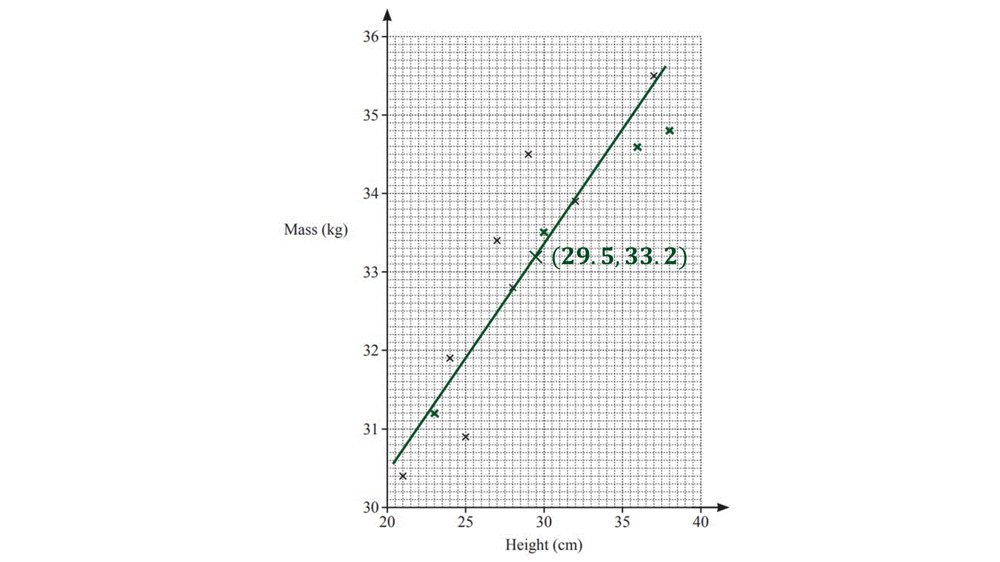

**[1]**

(ii) *Draw a horizontal line from 32.5 kg on the mass axis to the line of best fit, then a vertical line down to the height axis *

*Read off the value on the height axis (be careful with the scale)*

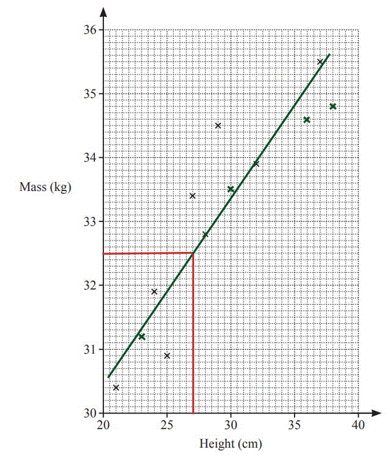

**27 cm** **[1]**

> *25 - 27 accepted*
> *Count how many points are plotted between 26 cm and 35 cm on the height axis*

> *This is how many goats are between 26 and 35 cm*

*5 goats*

**[1] **

> *Write 5 as a fraction of the total number of goats, 12, and multiply by 100 to express as a percentage*

$\frac{5}{12}\times100=41.666...$

**[1]**

> *Round to 3 significant figures*

**41.7 %** **[1]**

> *41.66 to 41.67 also accepted*

### Q10
> *Look across the Test 1 axis to find the furthest cross to the right*

> *Read off the value from the test 1 axis*
*(Note that each small square is equal to 2 marks)*

**66** **[1]**
> *The scatter graph shows **positive **correlation (Test 2 marks tend to increase as Test 1 marks increase)*

**Positive** **[1]**
> *Plot the point (48, 54) onto the scatter diagram*

**[1]**

> *Draw a line of best fit **with a ruler**, it should*

- *go through the point (48, 54)*
- *have roughly as many points on one side of the line as the other*

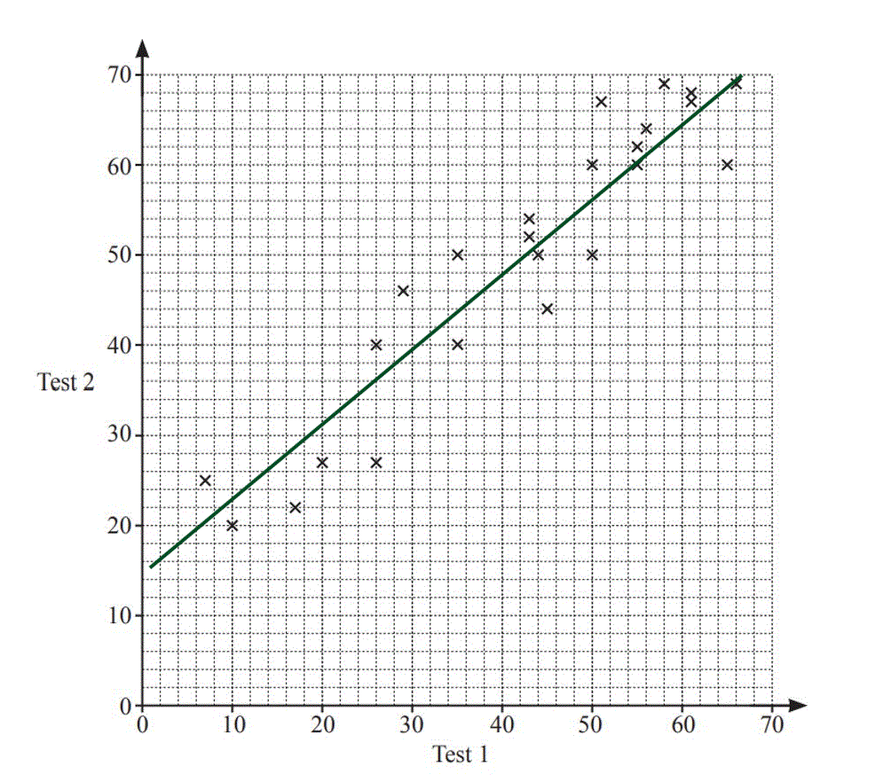

**[1]**
> *Draw a vertical line from 40 on the Test 1 axis up to the line of best fit, then a horizontal line to the Test 2 axis*

> *Read off the value*

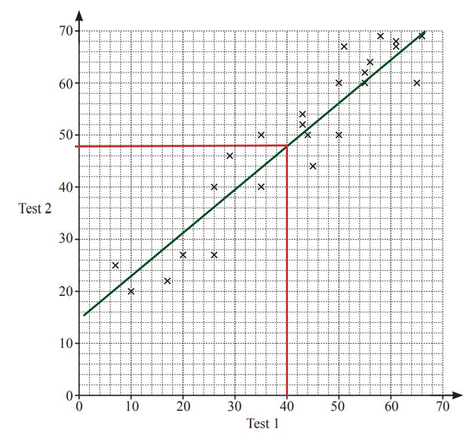

**48**** ****[1]**
*46 -50 accepted*

### Q11
(i) *Range = highest time (14.9 seconds) - lowest time (7.1 seconds) *

$14.9-7.1=7.8$

**7.8 seconds** **[1]**

(ii)* *

> *Method 1: *
*Type the data for the maximum power values into a new spreadsheet in your calculator and find the median*

> *Method 2:*
*Order the maximum power values*

$44,51,52,55,77,85,90,103,110,135$

> *Median = middle value*

`up diagonal strike 44 comma space up diagonal strike 51 comma space up diagonal strike 52 comma space up diagonal strike 55 comma space 77 comma space 85 comma space up diagonal strike 90 comma space up diagonal strike 103 comma space up diagonal strike 110 comma space up diagonal strike 135`

> *The middle value is halfway between 77 and 85. Add together the two numbers and divide by 2*

`open parentheses 77 plus 85 close parentheses divided by 2 equals 81`

**81 kW ****[1]**
(i) *Plot the two points on the scatter graph*

> *Make sure to plot them the correct way round                                         *

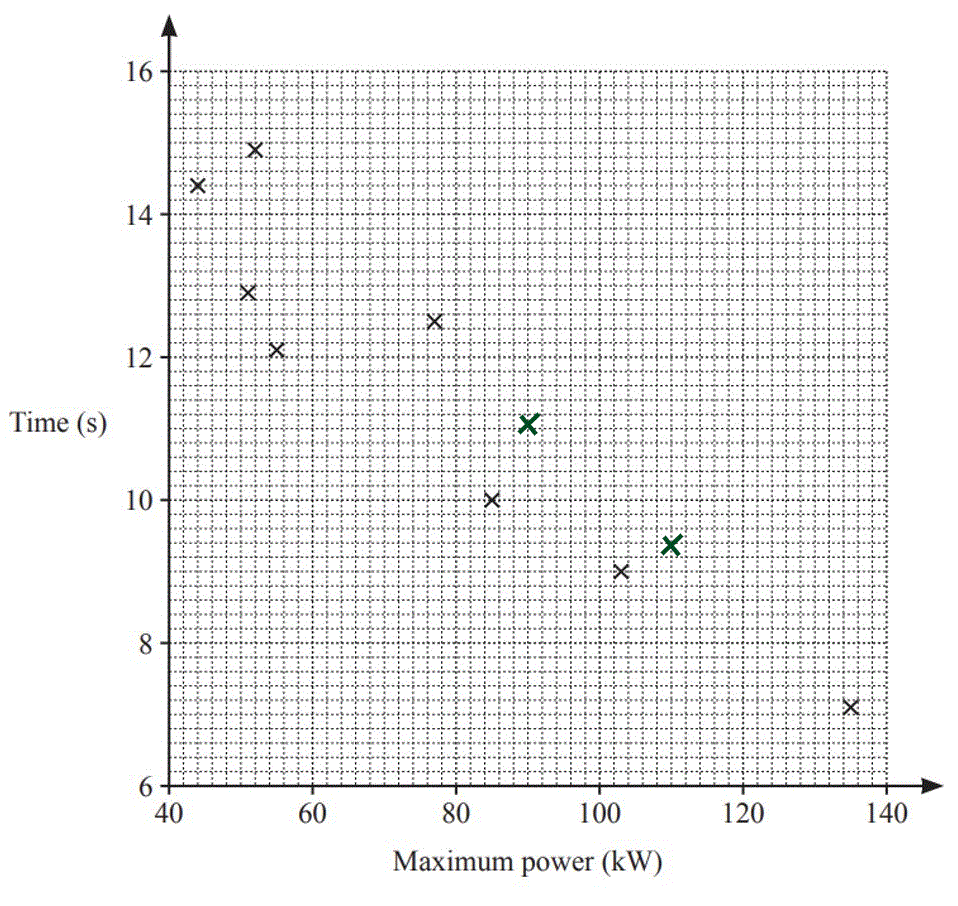

**[1]**

(ii) *The correlation is negative (time decreases as maximum power increases)*

**Negative** **[1]**

(iii) *Describe the link between maximum power and time*

**The greater the maximum power, the less time is needed**** ****[1]**

(iv) *Type the data for each row of the table into a new spread sheet in your calculator and find the mean, choose 'one variable statistic' for each*

*Mean for Maximum Power: 80.2*
*Mean for TIme: 11.3*

**[1]**

> *Plot this point on your graph*

*(80.2, 11.3)*

**[1]**

> *Draw a line of best fit on the graph, it should:*

- *go through the point (80.2, 11.3)*
- *be in the negative direction*
- *have roughly as many points on one side of the line as the other *

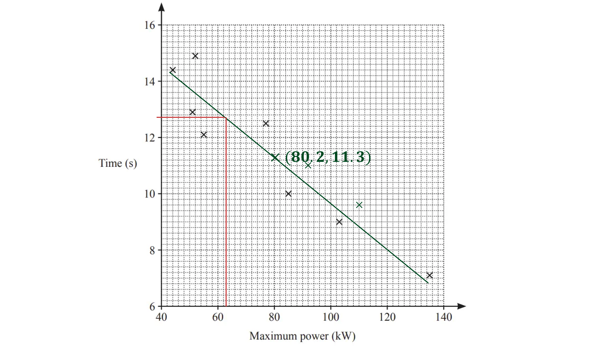

**[1]**

(v)*Draw a vertical line from 63 on the maximum power axis up to the line of best fit, and then a horizontal line across to the time axis*

> *Read off the value*

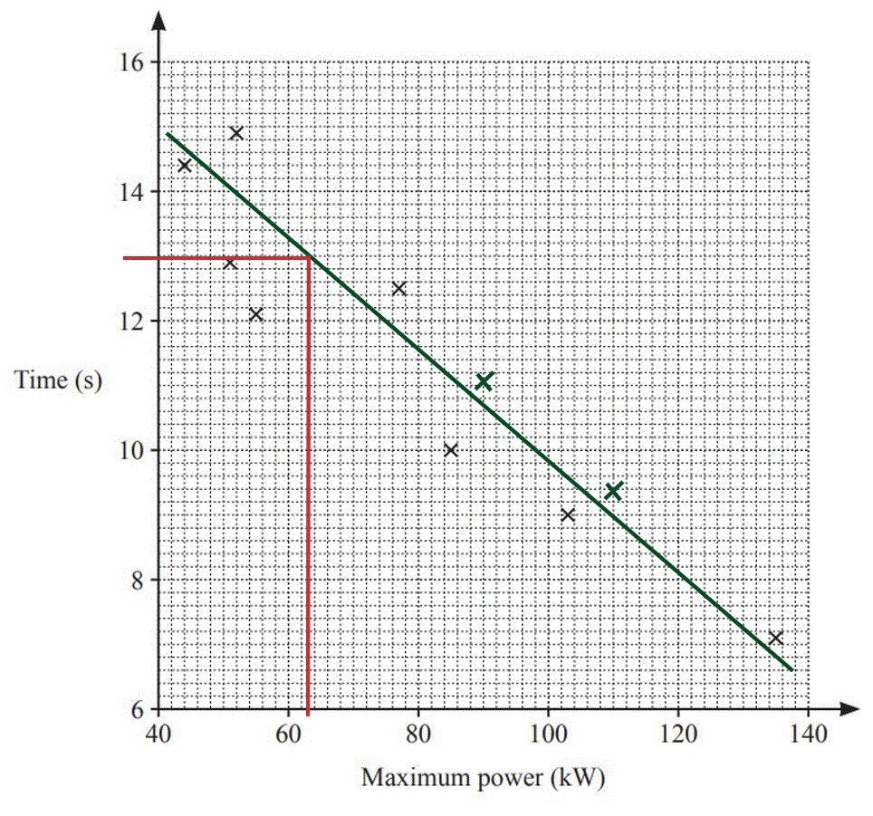

**12.8 seconds** **[1]**
**12.5 - 13.5 accepted**

### Q12
> *Find the point which is at 42 on the "number of people" (**x-**) axis Read off from the "number of phones" (**y**-) axis *

> *Be careful with the scale; on this graph one square horizontally is equal to two people and one square vertically is 2 phones*

**32** **[1]**
> *As one variable ("number of people") increases, the other variable ("number of phones") also increases*

**Positive correlation** **[1]**

### Q13
> *Plot the point (28, 30)*

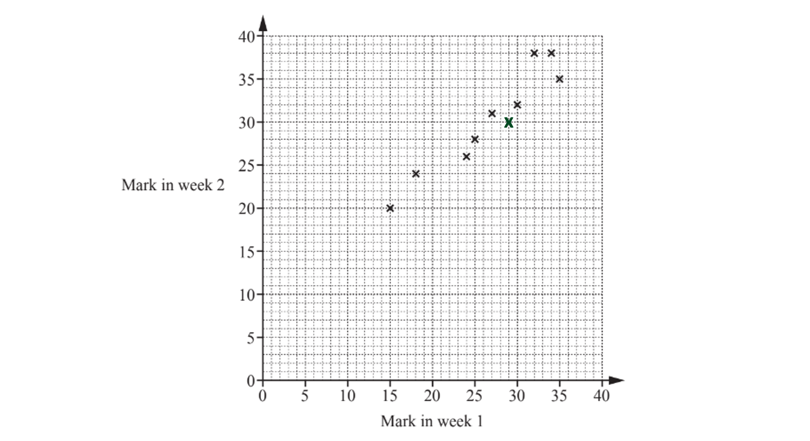

**[1]**
> *Plot the point (27, 30) on the scatter diagram*

**[1]**

*Draw a straight line with a ruler*

> *The line should *

- *start in the bottom left part of the graph and go towards the top right*
- *go through the mean point (27, 30)*
- *have roughly the same number of points either side of the line *

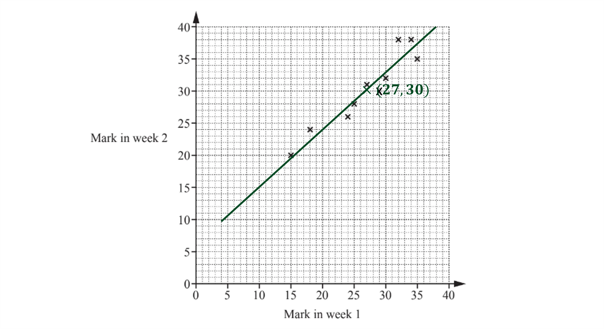

**[1]**

### Q14
> *As one variable increases, the other variable increases*

**Positive**** ****[1]**

### Q15
> *As speed increases, time decreases*

**Negative**** ****[1]**
> *As distance increases, fuel consumption increases*

**Positive** **[1]**

### Q16
> *Find 15.12 on the **x** axis and find the corresponding point*

> *Each small square represents 0.02 m*

**12.88 m**** ****[1]**
> *Each small square is 0.02 m*

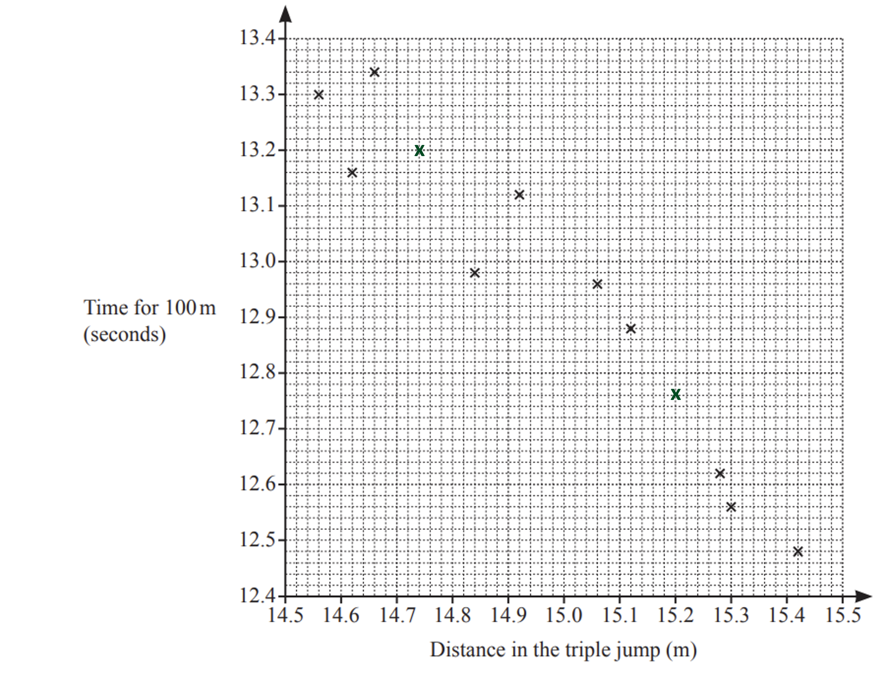

**[1]**
> *Plot the point (15.0, 12.9) on the scatter diagram*

**[1]**

> *Draw the line of best fit using a ruler, it should*

- *Pass through the mean point (15.0, 12.9) *
- *pass as close to as many points as possible*

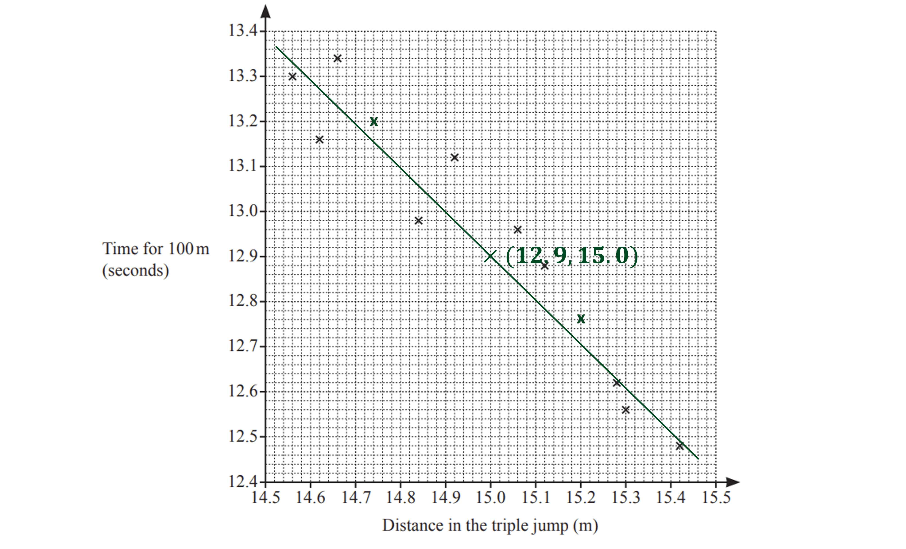

**[1]**
> *The points slope downwards from left to right.*

**negative correlation**** ****[1]**
