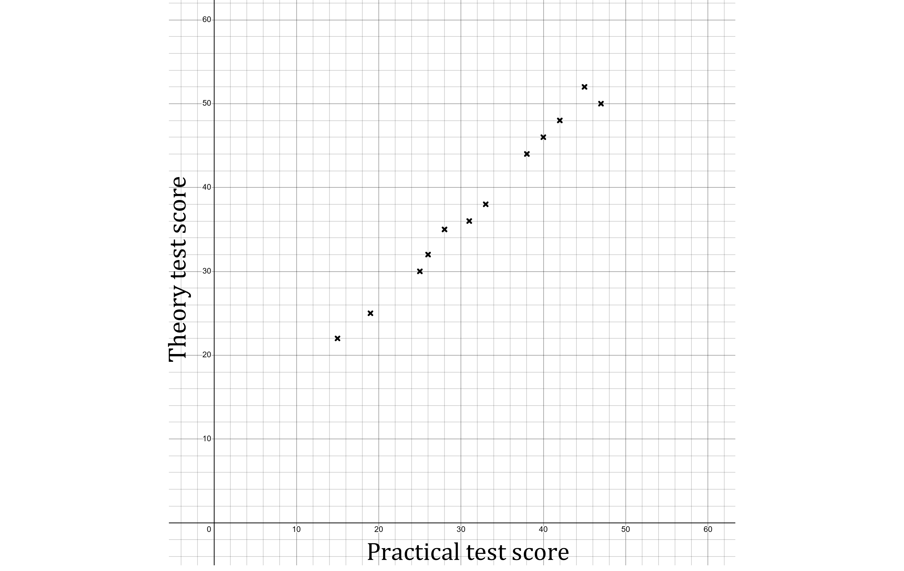
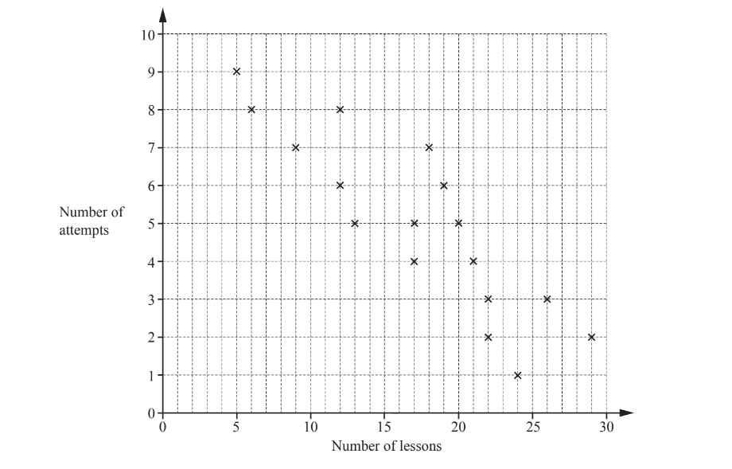
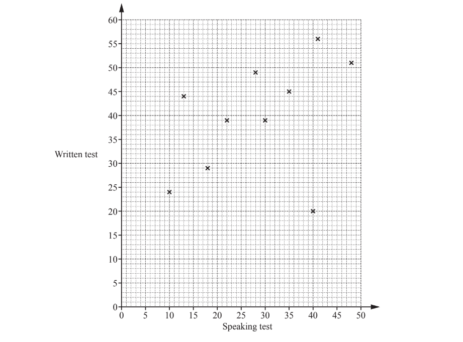
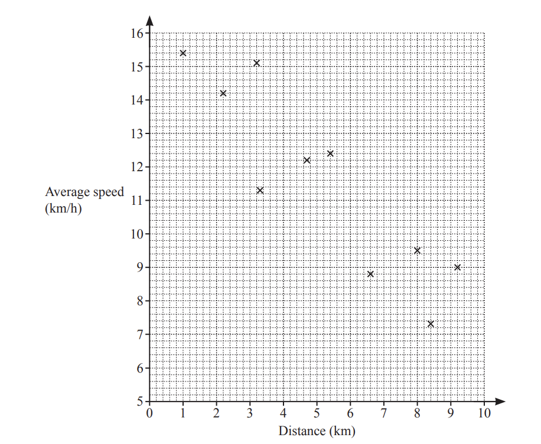
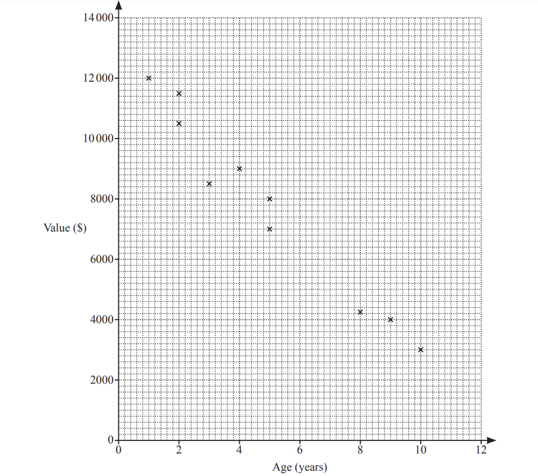
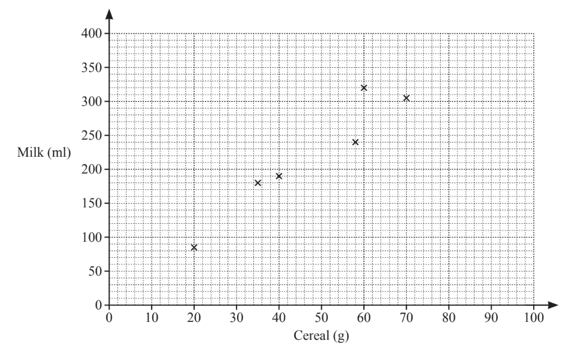
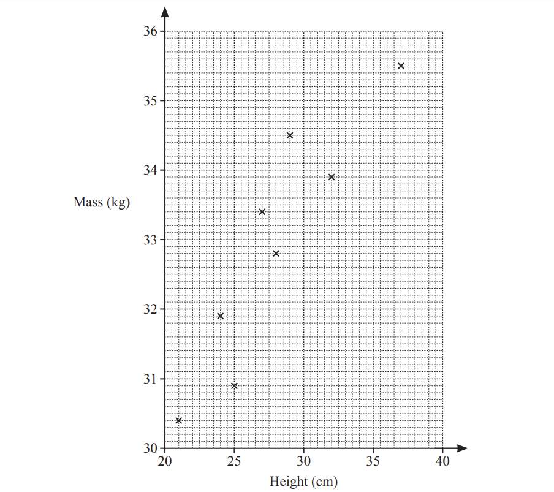
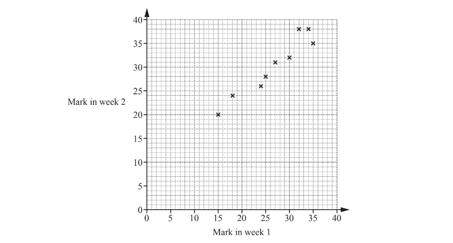

# Exam Questions — Scatter Graphs & Correlation
**Statistics** · Cambridge (CIE) IGCSE maths (0607)
> Source: [https://www.savemyexams.com/igcse/maths/cie/international-maths/23/core/topic-questions/](https://www.savemyexams.com/igcse/maths/cie/international-maths/23/core/topic-questions/) · 16 questions across 1 sets

## Exam Questions (16 questions)

### Q1 — medium — 4 marks

**Q1** [1 mark]

Twelve students each take two tests in Science, a practical test and a theory test. The table shows the scores.

Write down the type of correlation shown in the scatter diagram.

**Q1** [2 marks]

The mean score in the practical test was 32.4.

The mean score in the theory test was 38.2.

On the scatter diagram, draw a line of best fit.

**Q1** [1 mark]

The teacher of the class wants to identify which students scored lower in the theory test than predicted from their practical test score.

Suggest how your answer to (b) could be used to identify these students.

### Q2 — hard — 7 marks

**Q2** [1 mark]

The scatter diagram shows the value, in thousands of dollars, of eight houses in 1996 and the value of the same houses in 2016.

One of these eight houses had a value of \$70000 in 1996. 
Write down the value of this house in 2016.

\$ .................................

*Source: May/June 2018 0580/12 Q23A*

**Q2** [1 mark]

The values of two more houses are shown in the table.

| Value in 1996 (\$ thousands) | 40 | 80 |
|---|---|---|
| Value in 2016 (\$ thousands) | 80 | 150 |

On the scatter diagram, plot these values.

*Source: May/June 2018 0580/12 Q23B*

**Q2** [4 marks]

The first eight houses, already plotted on the scatter diagram, had a **total **value of \$437,000 in 1996 and a **mean **value of \$104,000 in 2016.

On the scatter diagram, draw a line of best fit.

*Source: May/June 2018 0580/12 Q23C*

**Q2** [1 mark]

**Extract:**

The scatter diagram shows the value, in thousands of dollars, of eight houses in 1996 and the value of the same houses in 2016.

On the scatter diagram, draw a line of best fit.

Another house had a value of \$50000 in 1996.

Find an estimate of the value of this house in 2016.

\$ ...............................

*Source: May/June 2018 0580/12 Q23D*

### Q3 — hard — 8 marks

**Q3** [2 marks]

Lucy asked 12 people how many hours they each spent playing a computer game and the number of levels they each completed in one month.

The results are shown in the table.

| Time spent playing (hours) | 90 | 32 | 70 | 75 | 30 | 70 | 40 | 80 | 40 | 65 | 50 | 32 |
|---|---|---|---|---|---|---|---|---|---|---|---|---|
| Number of levels completed | 22 | 5 | 12 | 17 | 6 | 7 | 18 | 20 | 8 | 15 | 11 | 9 |

Complete the scatter diagram. 
The first eight points have been plotted for you.

*Source: May/June 2018 0580/31 Q5A*

**Q3** [1 mark]

**Extract:**

| Time spent playing (hours) | 90 | 32 | 70 | 75 | 30 | 70 | 40 | 80 | 40 | 65 | 50 | 32 |
| Number of levels completed | 22 | 5 | 12 | 17 | 6 | 7 | 18 | 20 | 8 | 15 | 11 | 9 |

One person completes more levels per hour than any of the others.

On the scatter diagram, put a ring around the point for this person.

*Source: May/June 2018 0580/31 Q5B*

**Q3** [1 mark]

**Extract:**

Lucy asked 12 people how many hours they each spent playing a computer game and the number of levels they each completed in one month.

The results are shown in the table.

| Time spent playing (hours) | 90 | 32 | 70 | 75 | 30 | 70 | 40 | 80 | 40 | 65 | 50 | 32 |
| Number of levels completed | 22 | 5 | 12 | 17 | 6 | 7 | 18 | 20 | 8 | 15 | 11 | 9 |

Complete the scatter diagram. 

The first eight points have been plotted for you.

What type of correlation does this scatter diagram show?

*Source: May/June 2018 0580/31 Q5C*

**Q3** [3 marks]

**Extract:**

| Time spent playing (hours) | 90 | 32 | 70 | 75 | 30 | 70 | 40 | 80 | 40 | 65 | 50 | 32 |
| Number of levels completed | 22 | 5 | 12 | 17 | 6 | 7 | 18 | 20 | 8 | 15 | 11 | 9 |

On the scatter diagram, draw a line of best fit.

*Source: May/June 2018 0580/31 Q5D*

**Q3** [1 mark]

**Extract:**

| Time spent playing (hours) | 90 | 32 | 70 | 75 | 30 | 70 | 40 | 80 | 40 | 65 | 50 | 32 |
| Number of levels completed | 22 | 5 | 12 | 17 | 6 | 7 | 18 | 20 | 8 | 15 | 11 | 9 |

Another person, Monika, completed 19 levels but forgot to record the time spent playing.

Use your line of best fit to estimate the number of hours that Monika spent playing.

............................ hours

*Source: May/June 2018 0580/31 Q5E*

### Q4 — hard — 5 marks

**Q4** [5 marks]

The number of attempts at a driving test and the number of driving lessons for each of 17 people are shown in the scatter diagram.

i) What type of correlation is shown in the scatter diagram?

[1]

ii) One of these people is picked at random. 
Work out the probability that this person had 5 or more attempts.

[1]

iii) The mean number of lessons is 19 and the mean number of attempts is 4.1.
Draw a line of best fit on the scatter diagram.

[2]

iv) Another person had 15 lessons. 
Estimate their number of attempts.

[1]

*Source: Oct/Nov2018 0580/32 Q6B*

### Q5 — hard — 8 marks

**Q5** [2 marks]

Fourteen students each take two tests in French, a speaking test and a written test. The table shows the scores.

| Speaking test | 10 | 13 | 48 | 30 | 35 | 18 | 41 | 40 | 22 | 28 | 20 | 44 | 37 | 46 |
|---|---|---|---|---|---|---|---|---|---|---|---|---|---|---|
| Written test | 24 | 44 | 51 | 39 | 45 | 29 | 56 | 20 | 39 | 49 | 33 | 52 | 44 | 52 |

Complete the scatter diagram. The first ten points have been plotted for you.

*Source: June 2019 0580/31 Q6A*

**Q5** [1 mark]

What type of correlation is shown in this scatter diagram?

*Source: June 2019 0580/31 Q6B*

**Q5** [1 mark]

**Extract:**

| Speaking test | 10 | 13 | 48 | 30 | 35 | 18 | 41 | 40 | 22 | 28 | 20 | 44 | 37 | 46 |
| Written test | 24 | 44 | 51 | 39 | 45 | 29 | 56 | 20 | 39 | 49 | 33 | 52 | 44 | 52 |

One student has a high score in the speaking test and a low score in the written test.

On the scatter diagram, put a ring around this point.

*Source: June 2019 0580/31 Q6C*

**Q5** [3 marks]

**Extract:**

Fourteen students each take two tests in French, a speaking test and a written test. The table shows the scores.

| Speaking test | 10 | 13 | 48 | 30 | 35 | 18 | 41 | 40 | 22 | 28 | 20 | 44 | 37 | 46 |
| Written test | 24 | 44 | 51 | 39 | 45 | 29 | 56 | 20 | 39 | 49 | 33 | 52 | 44 | 52 |
Complete the scatter diagram. The first ten points have been plotted for you.

On the scatter diagram, draw a line of best fit.

*Source: June 2019 0580/31 Q6D*

**Q5** [1 mark]

**Extract:**

On the scatter diagram, draw a line of best fit.

Use your line of best fit to estimate a score in the written test for a student who scored 25 in the speaking test.

*Source: June 2019 0580/31 Q6E*

### Q6 — hard — 7 marks

**Q6** [2 marks]

Aisha records the distance she runs and her average speed. The results are shown in the scatter diagram.

The table shows the results of four more runs.

| Distance (km) | 4.2 | 5.7 | 7.1 | 8.8 |
|---|---|---|---|---|
| Average speed (km/h) | 13.4 | 11.8 | 9.8 | 8.3 |

On the scatter diagram, plot these points.

*Source: Nov 2020 0580/11 Q18A*

**Q6** [1 mark]

**Extract:**

Aisha records the distance she runs and her average speed. The results are shown in the scatter diagram.

What type of correlation is shown in the scatter diagram?

*Source: Nov 2020 0580/11 Q18B*

**Q6** [3 marks]

The mean distance of Aisha's first ten runs (already plotted on the scatter diagram) is 5.2 km.

The mean speed of all 14 of Aisha's runs is 11.3 km/h correct to 1 decimal place.

On the scatter diagram, draw a line of best fit.

*Source: Nov 2020 0580/11 Q18C*

**Q6** [1 mark]

**Extract:**

The table shows the results of four more runs.

| Distance (km) | 4.2 | 5.7 | 7.1 | 8.8 |
| Average speed (km/h) | 13.4 | 11.8 | 9.8 | 8.3 |
The mean distance of Aisha's first ten runs (already plotted on the scatter diagram) is 5.2 km.

The mean speed of all 14 of Aisha's runs is 11.3 km/h correct to 1 decimal place.

On the scatter diagram, draw a line of best fit.

Use your line of best fit to estimate her average speed when she runs a distance of 6km.

..........................km/h

*Source: Nov 2020 0580/11 Q18D*

### Q7 — medium — 3 marks

**Q7** [3 marks]

The scatter diagram shows the age and value of each of ten cars, all of the same model.

The mean age of the cars is 5 years and the mean value of the cars is \$7,800.

By drawing a line of best fit, estimate the value of a car that is 6 years old.

\$ ...................................................

*Source: Nov 2019 0580/12 Q12*

### Q8 — medium — 8 marks

**Q8** [8 marks]

Ten students eat cereal with milk for breakfast.

The amounts are shown in the table.

| Cereal (g) | 40 | 20 | 58 | 70 | 60 | 35 | 28 | 40 | 55 | 46 |
|---|---|---|---|---|---|---|---|---|---|---|
| Milk (ml) | 190 | 85 | 240 | 305 | 320 | 180 | 150 | 230 | 340 | 220 |

i) Complete the scatter diagram.

The first six points have been plotted for you.

[2]

ii) For these students, describe the relationship between the amount of cereal and the amount of milk.

[1]

iii) On the grid, draw a line of best fit.

[3]

iv) Another student has 280ml of milk with her cereal.

Use your line of best fit to estimate an amount of cereal this student has.

.............................................. g [1]

v) Explain why this scatter diagram should not be used to estimate the amount of milk for a student who has more than 70g of cereal.

[1]

*Source: June 2020 0580/33 Q6A*

### Q9 — medium — 9 marks

**Q9** [2 marks]

Belle records the height, in centimetres, and the mass, in kilograms, of some goats. 
Some of her results are shown in the scatter diagram.

The table shows four more results.

| Height (cm) | 23 | 30 | 36 | 38 |
|---|---|---|---|---|
| Mass (kg) | 31.2 | 33.5 | 34.6 | 34.8 |

Plot these points on the scatter diagram.

*Source: June 2020 0580/32 Q3A*

**Q9** [1 mark]

**Extract:**

Belle records the height, in centimetres, and the mass, in kilograms, of some goats. Some of her results are shown in the scatter diagram.

What type of correlation is shown in this scatter diagram?

*Source: June 2020 0580/32 Q3B*

**Q9** [3 marks]

The mean height of all the goats is 29.5 cm and the mean mass is 33.2 kg.

i) Draw a line of best fit on the scatter diagram.

[2]

ii) Use your line of best fit to estimate the height of a goat with mass 32.5kg.

[1]

*Source: June 2020 0580/32 Q3C*

**Q9** [3 marks]

**Extract:**

The table shows four more results.

| Height (cm) | 23 | 30 | 36 | 38 |
| Mass (kg) | 31.2 | 33.5 | 34.6 | 34.8 |

Work out the percentage of the 12 goats that have a height between 26cm and 35cm.

*Source: June 2020 0580/32 Q3D*

### Q10 — medium — 5 marks

**Q10** [1 mark]

Mrs Salaman gives her class two mathematics tests. The scatter diagram shows information about the marks each student scored.

Write down the highest mark scored on test 1.

*Source: June 2020 0580/11 Q18A*

**Q10** [1 mark]

**Extract:**

Mrs Salaman gives her class two mathematics tests. The scatter diagram shows information about the marks each student scored.

Write down the type of correlation shown in the scatter diagram.

*Source: June 2020 0580/11 Q18B*

**Q10** [2 marks]

The mean score for Test 1 is 48 and the mean score for  Test 2 is 54.

Draw a line of best fit on the scatter diagram.

*Source: June 2020 0580/11 Q18C*

**Q10** [1 mark]

**Extract:**

The mean score for Test 1 is 48 and the mean score for  Test 2 is 54.

Draw a line of best fit on the scatter diagram.

Hamish scored a mark of 40 on test 1. He was absent for test 2.

Use your line of best fit to find an estimate for his mark on test 2.

*Source: June 2020 0580/11 Q18D*

### Q11 — medium — 9 marks

**Q11** [2 marks]

The table shows the maximum power, kW, and the time taken, in seconds, to accelerate from 0 to 100 km/h for each of 10 cars.

| Maximum power (kW) | 77 | 52 | 103 | 55 | 44 | 51 | 85 | 135 | 90 | 110 |
|---|---|---|---|---|---|---|---|---|---|---|
| Time (seconds) | 12.5 | 14.9 | 9.0 | 12.1 | 14.4 | 12.9 | 10.0 | 7.1 | 11.0 | 9.4 |

i) Find the range of the times.

........................................... s [1]

ii) Find the median maximum power.

........................................... kW [1]

*Source: Nov 2020 0580/33 Q5A*

**Q11** [7 marks]

**Extract:**

| Maximum power (kW) | 77 | 52 | 103 | 55 | 44 | 51 | 85 | 135 | 90 | 110 |
| Time (seconds) | 12.5 | 14.9 | 9.0 | 12.1 | 14.4 | 12.9 | 10.0 | 7.1 | 11.0 | 9.4 |

i) Complete the scatter diagram. 
The first eight points have been plotted for you.

[1]

ii) What type of correlation is shown on the scatter diagram?

[1]

iii) Describe the relationship between the maximum power of a car and the time taken to accelerate from 0 to 100km/h.

[1]

iv) Draw a line of best fit on the scatter diagram.

[3]

v) Another car has a maximum power of 63kW.

Use your line of best fit to estimate the time taken for this car to accelerate from 0 to 100km/h.

............................................... s [1]

*Source: Nov 2020 0580/33 Q5B*

### Q12 — easy — 2 marks

**Q12** [1 mark]

The scatter diagram shows the number of people and the number of phones in each of 8 buildings.

One of the buildings contains 42 people.

Write down the number of phones in this building.

*Source: 2019	May/June 0580/23 Q8A*

**Q12** [1 mark]

**Extract:**

The scatter diagram shows the number of people and the number of phones in each of 8 buildings.

What type of correlation is shown in the scatter diagram?

*Source: 2019	May/June 0580/23 Q8A*

### Q13 — easy — 3 marks

**Q13** [1 mark]

A teacher gives her Spanish students a test each week. Some of the students’ marks for two weeks are shown in the scatter diagram.

Leo scored 28 marks in week 1 and 30 marks in week 2.

On the scatter diagram, plot a point to show Leo’s marks.

*Source: Oct/Nov 2018 0580/11 Q17A*

**Q13** [2 marks]

**Extract:**

A teacher gives her Spanish students a test each week. Some of the students' marks for two weeks are shown in the scatter diagram.

The mean mark for week 1 was 27 and the mean mark for week 2 was 30.

On the scatter diagram, draw a line of best fit.

*Source: Oct/Nov 2018 0580/11 Q17B*

### Q14 — easy — 1 marks

**Q14** [1 mark]

“We eat more ice cream as the temperature rises.”

What type of correlation is this?

*Source: Feb/March 2018 0580/12 Q3*

### Q15 — easy — 2 marks

**Q15** [1 mark]

Write down the type of correlation you would expect for the following.

The average speed of a train and the time taken for a journey.

*Source: May/June 2019 0580/13 Q12A*

**Q15** [1 mark]

The distance travelled by a car and the amount of fuel used.

*Source: May/June 2019 0580/13 Q12B*

### Q16 — easy — 5 marks

**Q16** [1 mark]

Ten athletes compete in both the 100 metre race and the triple jump.
Their results are shown in the scatter diagram.

One of these athletes jumps 15.12m in the triple jump.

Write down his time for the 100 metre race.

.................................................. s

*Source: Nov 2019 0580/13 Q22A*

**Q16** [1 mark]

The values for two other athletes are shown in the table.

| Distance in the triple jump (m) | 14.74 | 15.2 |
|---|---|---|
| Time for 100m (seconds) | 13.2 | 12.76 |

On the scatter diagram, plot these points.

*Source: Nov 2019 0580/13 Q22B*

**Q16** [2 marks]

**Extract:**

Ten athletes compete in both the 100 metre race and the triple jump. Their results are shown in the scatter diagram. One of these athletes jumps 15.12m in the triple jump. Write down his time for the 100 metre race. The values for two other athletes are shown in the table. | Distance in the triple jump (m) | 14.74 | 15.2 | | Time for 100m (seconds) | 13.2 | 12.76 | On the scatter diagram, plot these points.

The mean distance for the triple jump is 15.0 metres and the mean time for the 100 m is 12.9 seconds.

Draw a line of best fit on the scatter diagram.

*Source: Nov 2019 0580/13 Q22C*

**Q16** [1 mark]

**Extract:**

Ten athletes compete in both the 100 metre race and the triple jump.

Their results are shown in the scatter diagram.

What type of correlation is shown in the scatter diagram?

*Source: Nov 2019 0580/13 Q22D*

