# Exam Questions — Statistical Diagrams
**Statistics** · Cambridge (CIE) IGCSE maths (0607)
> Source: [https://www.savemyexams.com/igcse/maths/cie/international-maths/23/core/topic-questions/](https://www.savemyexams.com/igcse/maths/cie/international-maths/23/core/topic-questions/) · 27 questions across 1 sets

## Exam Questions (27 questions)

### Q1 — medium — 3 marks

**Q1** [3 marks]

A set of data is collected for the midday temperatures in a location.

This data is shown below.

| Temperature (°C) | Frequency |
|---|---|
| 16 | 6 |
| 17 | 3 |
| 18 | 8 |
| 19 | 2 |

Draw a bar chart on the grid below for this data.

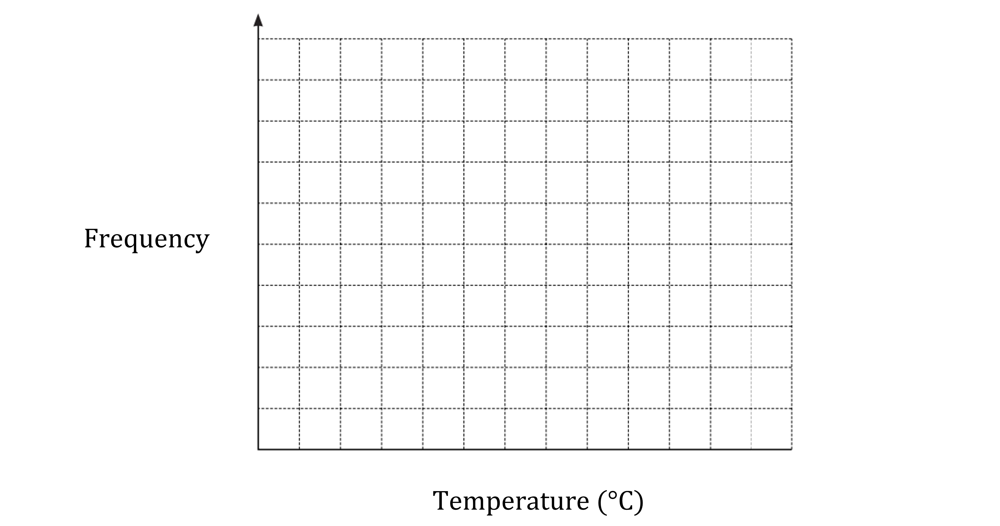

### Q2 — hard — 10 marks

**Q2** [6 marks]

60 boys are asked to name their favourite sport. 
The results are shown in the pie chart.

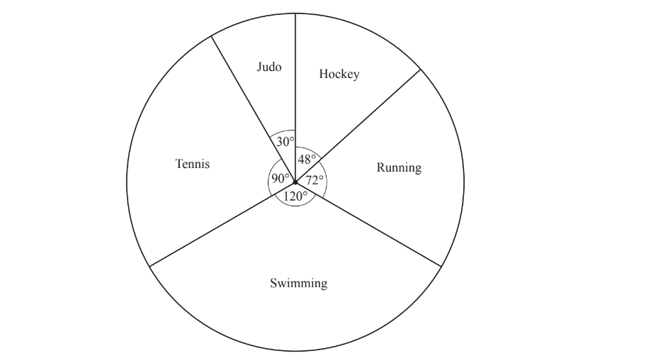

i) Write down the most popular sport.

[1]

ii) Write down the fraction of boys who choose Running.

[1]

iii) Work out how many boys choose Judo.

[2]

iv) One of the boys is chosen at random. Work out the probability that his favourite sport is **not** Judo.

[1]

v) Complete this statement. Three times as many boys choose ....................... than choose ......................

[1]

*Source: March 2019 0580/32 Q1A*

**Q2** [2 marks]

**Extract:**

60 boys are asked to name their favourite sport. The results are shown in the pie chart.

Two of the boys in **part (a)** then change their choice from Running to Swimming.

Complete the pie chart after this change. 
The Tennis, Judo and Hockey sectors have been drawn for you.

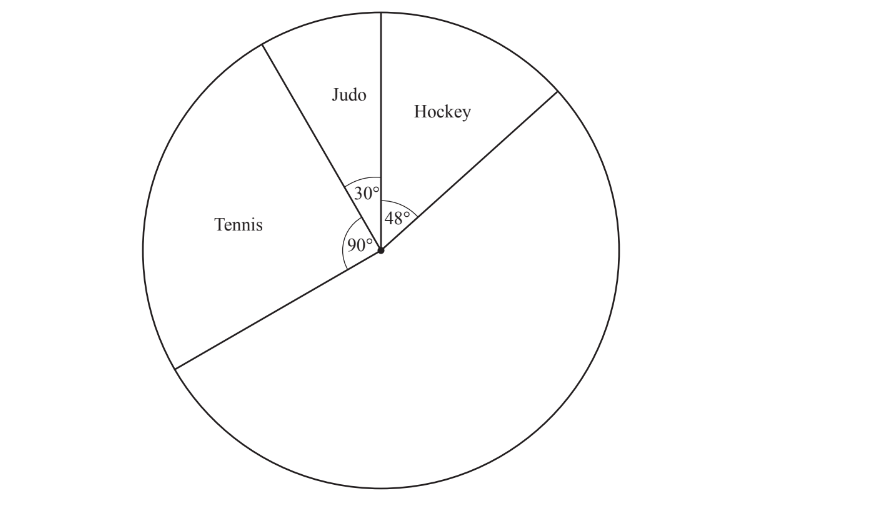

*Source: March 2019 0580/32 Q1B*

**Q2** [2 marks]

**Extract:**

Two of the boys in part (a) then change their choice from Running to Swimming. Complete the pie chart after this change. The Tennis, Judo and Hockey sectors have been drawn for you.

60 girls are asked to name their favourite sport. 
Their results are shown in the bar chart below.

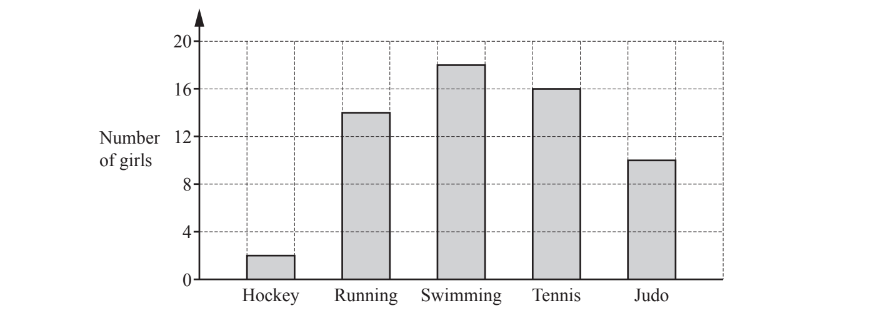

Using your pie chart in **part (b)** and the bar chart above, write down one similarity and one difference between the girls’ results and the boys’ results.

Similarity ....................................

Difference ....................................

*Source: March 2019 0580/32 Q1C*

### Q3 — hard — 5 marks

**Q3** [5 marks]

66 football players each take five penalties. 
The number of penalties that each player scores is recorded.
 The results are shown in the bar chart.

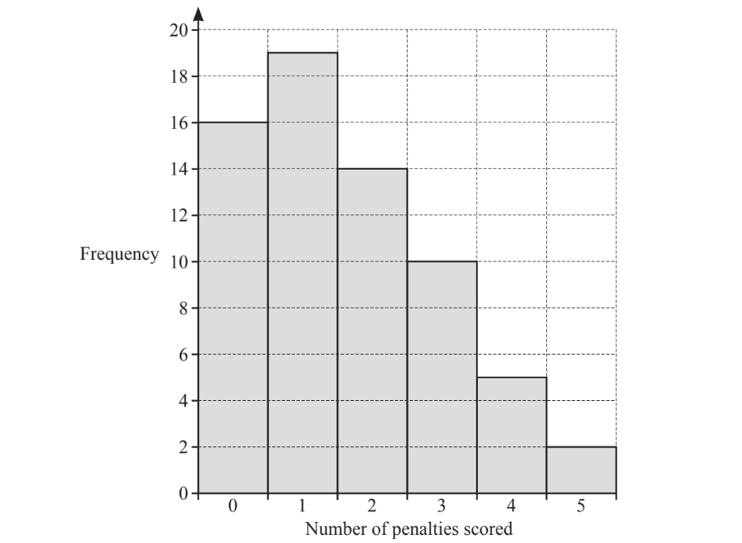

i) Write down the mode.

[1]

ii) Write down the range.

[1]

iii) Calculate the mean.

[3]

*Source: March 2020 0580/32 Q2A*

### Q4 — hard — 8 marks

**Q4** [1 mark]

80 students each record the name of their mathematics teacher. The number of these students taught by Mr House and by Miss Patel are shown in the bar chart.

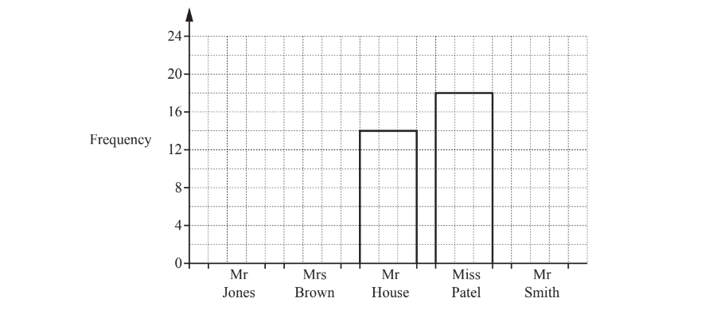

How many more students are taught by Miss Patel than by Mr House?

*Source: June 2019 0580/32 Q2A*

**Q4** [4 marks]

15 students are taught by Mr Smith. Twice as many students are taught by Mrs Brown than by Mr Jones.

Use this information to complete the bar chart.

*Source: June 2019 0580/32 Q2B*

**Q4** [1 mark]

**Extract:**

80 students each record the name of their mathematics teacher. The number of these students taught by Mr House and by Miss Patel are shown in the bar chart.
15 students are taught by Mr Smith. Twice as many students are taught by Mrs Brown than by Mr Jones.

Write down the mode.

*Source: June 2019 0580/32 Q2C*

**Q4** [2 marks]

**Extract:**

80 students each record the name of their mathematics teacher. The number of these students taught by Mr House and by Miss Patel are shown in the bar chart.

This information is also to be shown in a pie chart. Work out the sector angle for Miss Patel.

*Source: June 2019 0580/32 Q2E*

### Q5 — hard — 4 marks

**Q5** [4 marks]

Some people go fishing and catch four types of fish.

Some information is shown in the table.

| Type of fish | Number of fish | Pie chart sector angle |
|---|---|---|
| Cod | 15 | 120° |
| Mackerel | 9 | 72° |
| Herring |   | 32° |
| Tuna |   |   |

i) Complete the table.

[3]

ii) Complete the pie chart.

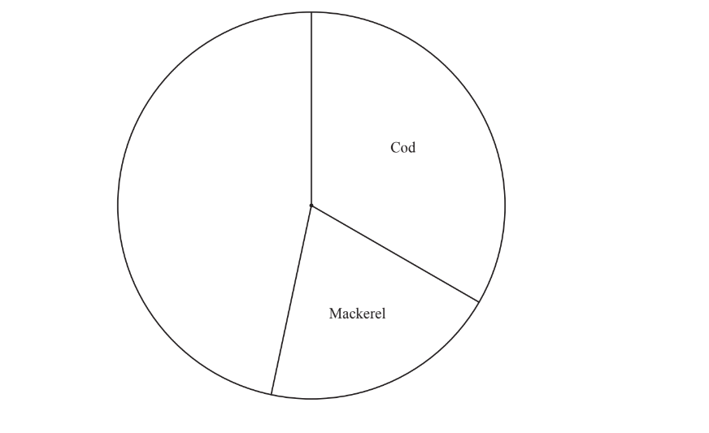

[1]

*Source: March 2018 0580/32 Q4A*

### Q6 — hard — 7 marks

**Q6** [7 marks]

Joel spins a fair five-sided spinner numbered 2, 3, 4, 5, and 6.

Joel asks 30 students to guess the number that the spinner will land on next. This pie chart shows the results.

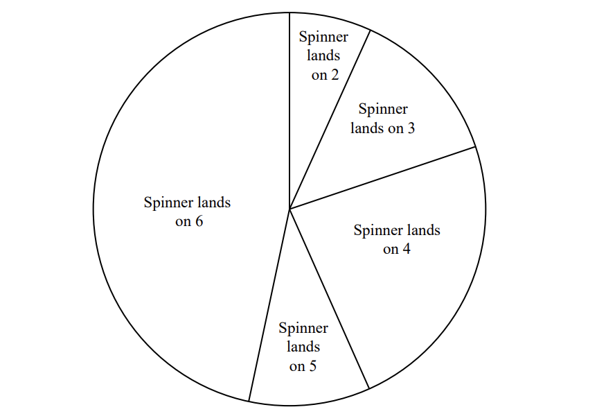

i) The sector angle for the number 6 is 168°.

How many students guessed the number 6?

[2]

ii) Find the percentage of the students who guessed a number **less than** 5.

[3]

iii) Joel spins the spinner. 10% of the students guessed correctly.

Which number did the spinner land on?

[2]

*Source: Specimen 2020 0580/03 Q3C*

### Q7 — medium — 6 marks

**Q7** [6 marks]

On Monday, Main Street station sells 40 tickets. 
There are four types of ticket; infant, child, adult and senior. 
The bar chart shows the number of infant, child and adult tickets sold.

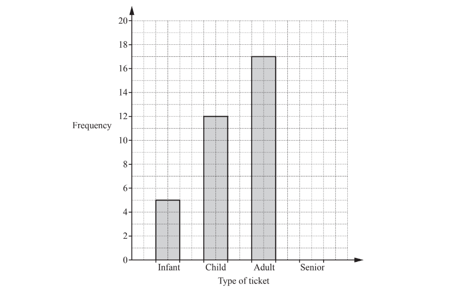

i) Complete the bar chart.

[3]

ii) Find how many more adult tickets were sold than child tickets.

[1]

iii) Write down the modal type of ticket.

[1]

iv) One of these 40 people is chosen at random.

Find the probability that this person is a child.

[1]

*Source: June 2019 0580/31 Q3A*

### Q8 — medium — 4 marks

**Q8** [4 marks]

There are 480 cabins on a ship. 
There are four types of cabin: Ocean-view, Balcony, Interior and Suite. 
Hannah starts to draw a pie chart to show the numbers of each type of cabin.

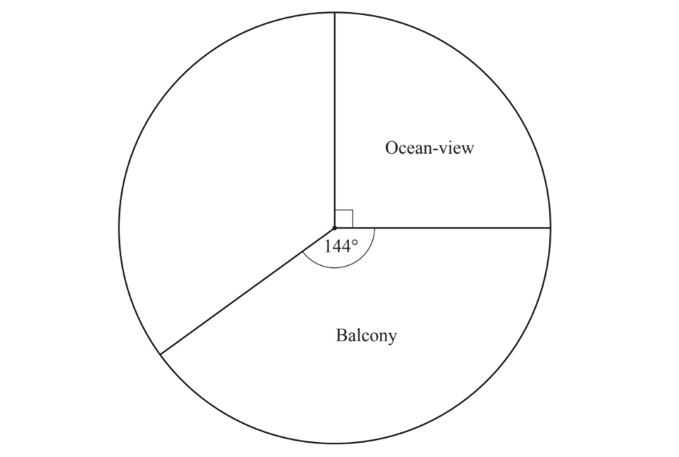

i) Show that there are 120 Ocean-view cabins on the ship.

iia) The table shows information about each type of cabin.

| Type of cabin | Number of cabins | Sector angle in a pie chart |
|---|---|---|
| Ocean-view | 120 | 90° |
| Balcony | 192 | 144° |
| Interior | 68 |   |
| Suite | 100 |   |

Complete the table.

[2]

iib) Complete the pie chart.

[1]

*Source: Nov 2020 0580/33 Q1F*

### Q9 — medium — 4 marks

**Q9** [4 marks]

The table shows information about the first 90 words in a book.

i) Complete the table.

| Length of word | Frequency | Pie chart angle |
|---|---|---|
| Very short | 6 | 24° |
| Short | 34 |   |
| Medium | 41 |   |
| Long | 9 |   |

ii) Complete the pie chart to show this information.

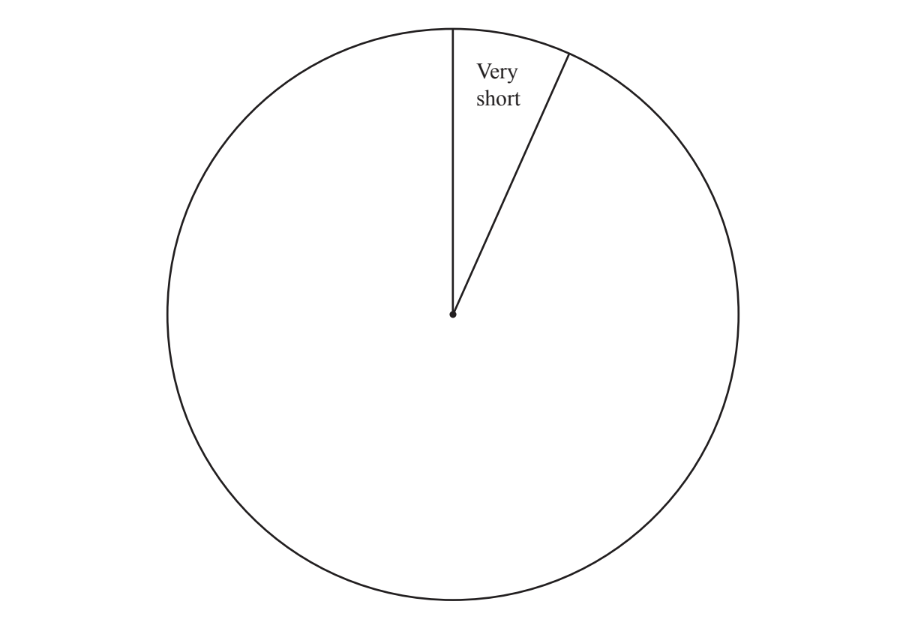

[2]

*Source: Nov 2019 0580/33 Q2C*

### Q10 — medium — 1 marks

**Q10** [1 mark]

The 840 students in a school are asked if they want a change of school uniform. The results are shown in the pie chart.

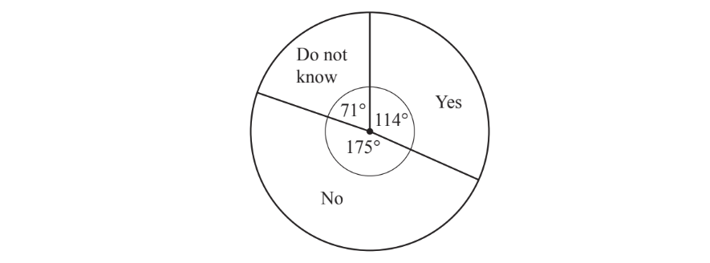

Show that the number of students who said Yes is 266.

*Source: June 2020 0580/12 Q6*

### Q11 — medium — 4 marks

**Q11** [4 marks]

25 students go on a water sports trip. The students each choose their favourite water sport. These are the results.

Rafting                Fishing              Surfing            Snorkelling         Surfing

Snorkelling         Rafting               Kayaking         Rafting               Snorkelling

Fishing               Surfing               Surfing             Kayaking           Surfing

Fishing               Snorkelling         Surfing            Surfing               Rafting

Rafting               Fishing               Snorkelling      Snorkelling         Surfing

i) Complete the frequency table for the results. You may use the tally column to help you.

| Favourite water sport | Tally | Frequency |
|---|---|---|
| Rafting |   |   |
| Surfing |   |   |
| Fishing |   |   |
| Kayaking |   |   |
| Snorkelling |   |   |

[2]

ii) Write down the mode.

[1]

iii) Work out the percentage of students whose favourite water sport is snorkelling.

................................ % [1]

*Source: March 2018 0580/32 Q3A*

### Q12 — medium — 4 marks

**Q12** [2 marks]

Fernando records the favourite sport of each of 20 people.

| football | cricket | rugby | cricket | rugby | rugby | football | football | rugby | football |
|---|---|---|---|---|---|---|---|---|---|
| cricket | rugby | tennis | football | tennis | football | rugby | cricket | football | cricket |

Complete the frequency table to show this information. You may use the tally column to help you.

| Favourite sport | Tally | Frequency |
|---|---|---|
| Cricket |   |   |
| Football |   |   |
| Rugby |   |   |
| Tennis |   |   |

*Source: Nov 2020 0580/12 Q12A*

**Q12** [2 marks]

**Extract:**

Fernando records the favourite sport of each of 20 people.

| football | cricket | rugby | cricket | rugby | rugby | football | football | rugby | football |
| cricket | rugby | tennis | football | tennis | football | rugby | cricket | football | cricket |

Fernando wants to draw a pie chart to show this information.

Work out the sector angle for football.

*Source: Nov 2020 0580/12 Q12B*

### Q13 — medium — 4 marks

**Q13** [4 marks]

The treasure is a bag of coins. 
The coins are made from three different metals.

| Metal | Percentage | Pie chart sector angle |
|---|---|---|
| Copper | 70% |   |
| Zinc | 20% |   |
| Tin | 10% |   |

i) Complete the table.

[2]

ii) Complete the pie chart.

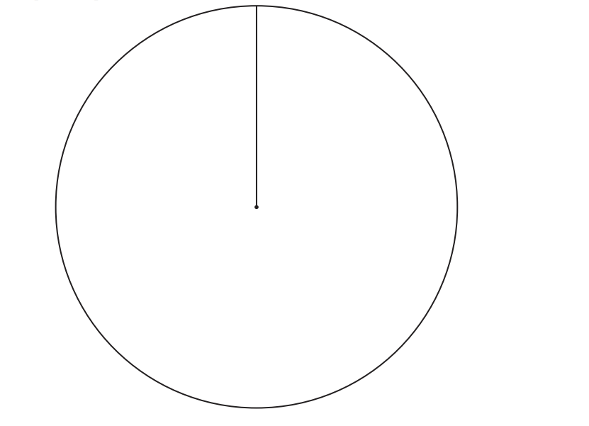

[2]

*Source: March 2020 0580/32 Q7B*

### Q14 — medium — 8 marks

**Q14** [8 marks]

50 students each record the number of glasses of water they drink in one day. The results for 10 of the students are shown below.

| 2 | 5 | 1 | 3 | 2 | 1 | 0 | 0 | 1 | 1 |
|---|---|---|---|---|---|---|---|---|---|

i) The results for the remaining 40 students are recorded in the table.

Complete the table to show the results for all 50 students.

| Number of glasses of water | Tally | Frequency |
|---|---|---|
| 0 | $\cancel{\vert \vert \vert \vert}$  $\vert$ |   |
| 1 | $\vert \vert$ |   |
| 2 | $\cancel{\vert \vert \vert \vert} \vert \vert \vert$ |   |
| 3 | $\cancel{\vert \vert \vert \vert} \cancel{\vert \vert \vert \vert} \vert$ |   |
| 4 | $\cancel{\vert \vert \vert \vert} \vert \vert \vert$ |   |
| 5 | $\cancel{\vert \vert \vert \vert}$ |   |
|   | Total | 50 |

[2]

ii) Write down the range.

[1]

iii) Find the median.

[2]

iv) Find the percentage of the 50 students who drink 4 glasses of water.

[1]

v) One of the 50 students is chosen at random.

Find the probability that this student drinks fewer than 2 glasses of water in one day. 
Give your answer as a fraction in its lowest terms.

[2]

*Source: Nov 2019 0580/32 Q4A*

### Q15 — medium — 2 marks

**Q15** [2 marks]

The table shows how children in Ivan’s class travel to school.

| Travel to school | Number of children |
|---|---|
| Walk | 12 |
| Car | 7 |
| Bicycle | 9 |
| Bus | 4 |

Ivan wants to draw a pie chart to show this information.

Find the sector angle for children who walk to school.

*Source: Nov 2019 0580/12 Q8*

### Q16 — medium — 5 marks

**Q16** [1 mark]

Jason spends 480 minutes at school each day.
The pie chart shows the time he spends in three of his lessons.

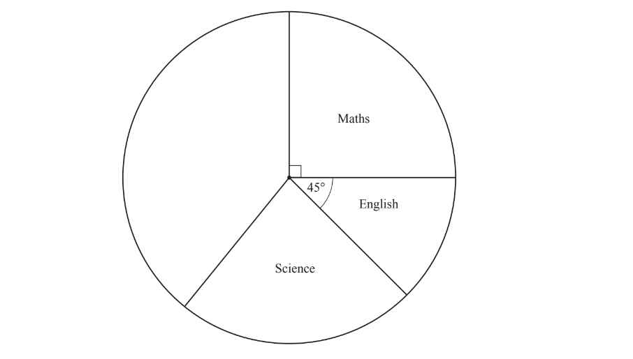

Measure the sector angle for science.

*Source: May/June 2019 0580/13 Q25A*

**Q16** [2 marks]

**Extract:**

Jason spends 480 minutes at school each day.

The pie chart shows the time he spends in three of his lessons.

Work out the time, in minutes, Jason spends in English.

...........................min

*Source: May/June 2019 0580/13 Q25B*

**Q16** [2 marks]

**Extract:**

Jason spends 480 minutes at school each day.

Jason spends 100 minutes in geography and the rest of the day is free time.

Complete the pie chart.

*Source: May/June 2019 0580/13 Q25C*

### Q17 — medium — 3 marks

**Q17** [2 marks]

The number of people swimming in a pool is recorded each day for 12 days.

| 24 | 28 | 13 | 38 | 15 | 26 |
|---|---|---|---|---|---|
| 45 | 21 | 48 | 36 | 18 | 38 |

Complete the stem-and-leaf diagram.

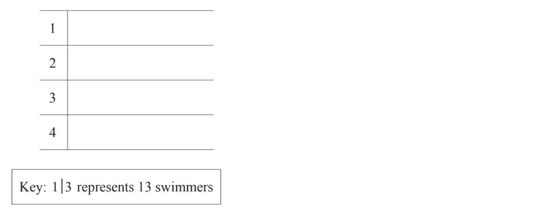

*Source: March 2020 0580/12 Q11A*

**Q17** [1 mark]

**Extract:**

The number of people swimming in a pool is recorded each day for 12 days.

| 24 | 28 | 13 | 38 | 15 | 26 |
| 45 | 21 | 48 | 36 | 18 | 38 |

Find the median number of swimmers.

*Source: March 2020 0580/12 Q11B*

### Q18 — easy — 4 marks

**Q18** [4 marks]

José manages a football team.
 He records the number of goals scored by the team for each of five months. 
Some of the results are shown on the bar chart.

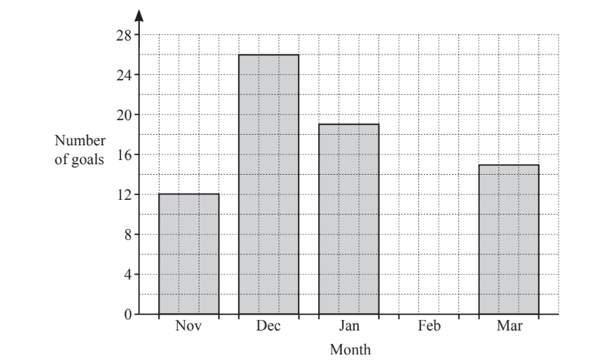

i) In February, 10 goals were scored.

Complete the bar chart.

[1]

ii) Write down the month in which most goals were scored.

[1]

iii) Find the total number of goals scored.

[1]

iv) Calculate the mean number of goals scored each month.

[1]

*Source: Nov 2019 0580/31 Q1A*

### Q19 — easy — 2 marks

**Q19** [2 marks]

The stem-and-leaf diagram shows the ages of the workers in a factory.

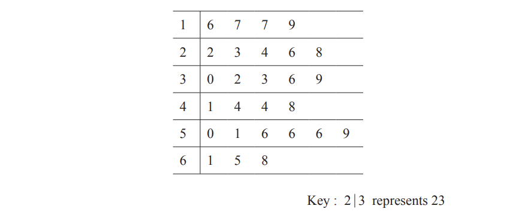

i) Write down the mode.

[1]

ii) Work out the range.

[1]

*Source: Nov 2020 0580/32 Q5B*

### Q20 — easy — 2 marks

**Q20** [2 marks]

The number of cars parked in a car park at 9am is recorded for 10 days.

| 124 | 130 | 129 | 116 | 132 | 120 | 127 | 107 | 118 | 114 |
|---|---|---|---|---|---|---|---|---|---|

Complete the stem-and-leaf diagram.

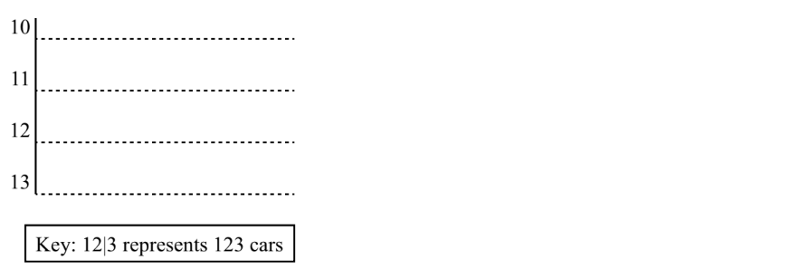

*Source: Specimen 2020 0580/01 Q3*

### Q21 — easy — 12 marks

**Q21** [9 marks]

Kyung records the number of people in each of 24 cars on Wednesday. His results are shown below.

$13612245\,34153241\,11244121$

i) Complete the frequency table. You may use the tally column to help you.

| Number in a car | Tally | Frequency |
|---|---|---|
| 1 |   |   |
| 2 |   |   |
| 3 |   |   |
| 4 |   |   |
| 5 |   |   |
| 6 |   |   |

[2]

ii) Write down the mode.

[1]

iii)Work out the range.

[1]

iv) Work out the median.

[1]

v)Calculate the mean.

[3]

vi) One of these cars is chosen at random.

Find the probability that the number of people in this car is 4.

[1]

*Source: May/June 2019 0580/33 Q8A*

**Q21** [2 marks]

Kyung also records the number of people in each of 24 cars on Saturday. The table shows the results.

| Number in a car | 1 | 2 | 3 | 4 | 5 | 6 |
|---|---|---|---|---|---|---|
| Frequency | 1 | 2 | 5 | 13 | 2 | 1 |

On the grid, complete the bar chart to show these results.

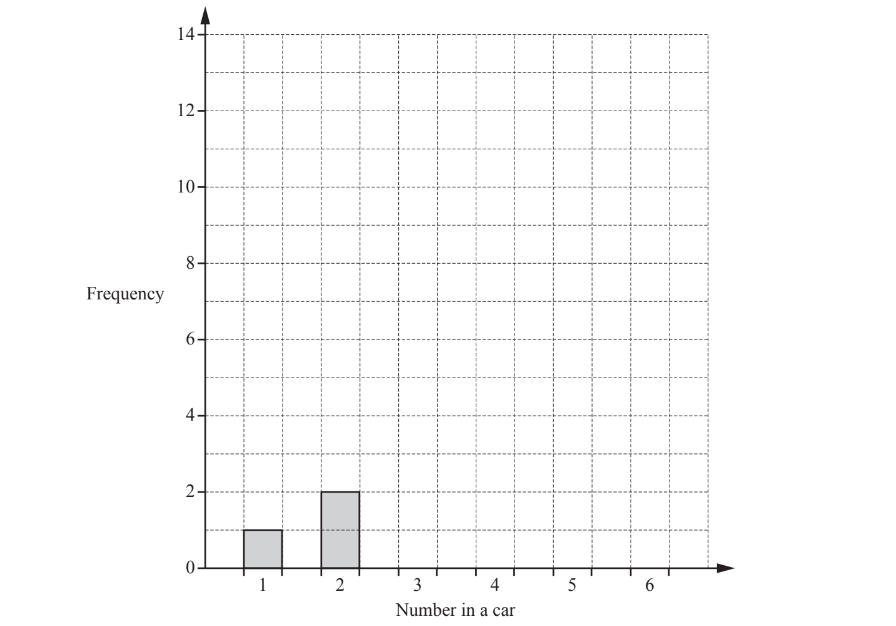

*Source: May/June 2019 0580/33 Q8B*

**Q21** [1 mark]

**Extract:**

| Number in a car | Tally | Frequency |
| 1 |   |   |
| 2 |   |   |
| 3 |   |   |
| 4 |   |   |
| 5 |   |   |
| 6 |   |   |

| Number in a car | 1 | 2 | 3 | 4 | 5 | 6 |
| Frequency | 1 | 2 | 5 | 13 | 2 | 1 |

Write down one comparison between the frequency tables in **part (a)(i)** and **part (b)**.

*Source: May/June 2019 0580/33 Q8C*

### Q22 — easy — 3 marks

**Q22** [2 marks]

Davina records the colour of each car passing her house one morning.

| red | grey | black | red | grey |
|---|---|---|---|---|
| white | white | black | black | white |
| grey | red | grey | white | grey |
| black | grey | black | white | grey |

Complete the frequency table. 
You may use the tally column to help you.

| Colour of car | Tally | Frequency |
|---|---|---|
| Black |   |   |
| Grey |   |   |
| Red |   |   |
| White |   |   |

*Source: Nov 2019 0580/13 Q15A*

**Q22** [1 mark]

**Extract:**

| red | grey | black | red | grey |
| white | white | black | black | white |
| grey | red | grey | white | grey |
| black | grey | black | white | grey |

Write down the mode.

*Source: June 2019 0580/13 Q15B*

### Q23 — easy — 12 marks

**Q23** [6 marks]

20 students from College A each run 5km. The times, correct to the nearest minute, are recorded.

| 32 | 51 | 25 | 40 | 47 | 21 | 37 | 32 | 48 | 36 |
|---|---|---|---|---|---|---|---|---|---|
| 46 | 39 | 30 | 29 | 44 | 39 | 53 | 35 | 40 | 31 |

i) Complete the stem-and-leaf diagram.

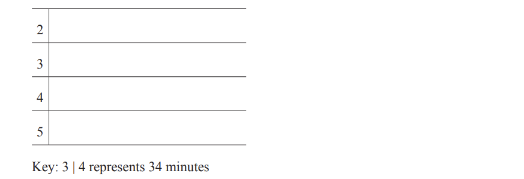

[2]

ii) Find the range of the times.

.......................................... min [1]

iii) Find the median of the times.

.......................................... min [1]

iv) Complete the bar chart for the times of the students.

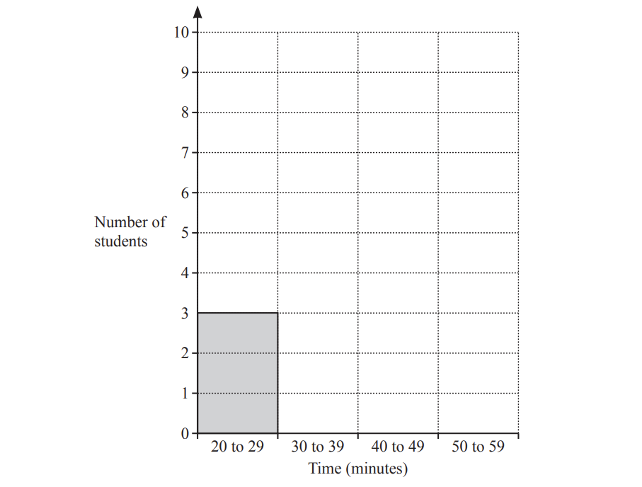

[2]

*Source: June 2020 0580/31 Q7A*

**Q23** [4 marks]

20 students from College B each run 5km. Their times, correct to the nearest minute, are recorded and the results are shown in the table.

| Time (minutes) | Number of students | Pie chart sector angle |
|---|---|---|
| 30 to 39 | 5 | 90° |
| 40 to 49 | 8 |   |
| 50 to 59 | 7 |   |

i) Complete the table.

[2]

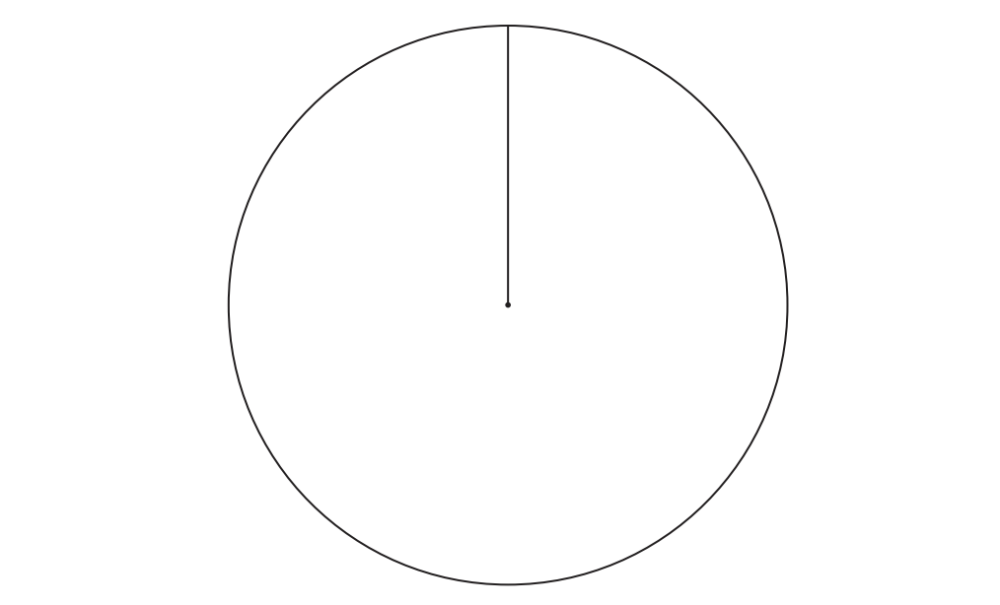

ii) Complete the pie chart.

[2]

*Source: June 2020 0580/31 Q7B*

**Q23** [2 marks]

**Extract:**

20 students from College A each run 5km. The times, correct to the nearest minute, are recorded.

| 32 | 51 | 25 | 40 | 47 | 21 | 37 | 32 | 48 | 36 |
| 46 | 39 | 30 | 29 | 44 | 39 | 53 | 35 | 40 | 31 |

20 students from College B each run 5km. Their times, correct to the nearest minute, are recorded and the results are shown in the table.

| Time (minutes) | Number of students |
| 30 to 39 | 5 |
| 40 to 49 | 8 |
| 50 to 59 | 7 |

Write down two comments comparing the times of students from College A with the times of students from College B.

*Source: June 2020 0580/31 Q7C*

### Q24 — easy — 3 marks

**Q24** [3 marks]

Nadira owns a clothes shop.

The pictogram shows the number of skirts that were sold each day in one week.

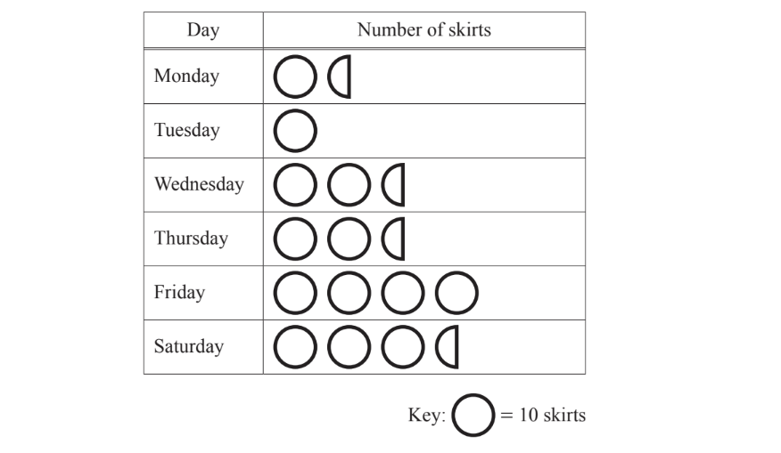

i) On which day were most skirts sold?

[1]

ii) How many skirts were sold on Wednesday?

[1]

iii) Work out how many more skirts were sold on Friday than on Thursday.

[1]

*Source: Nov 2019 0580/32 Q1A*

### Q25 — easy — 2 marks

**Q25** [2 marks]

50 students each choose their favourite colour from a list of six colours. 
The results for the colours Red, Orange, Yellow, Green and Blue are shown in the tally chart.

Complete the tally chart.

| Favourite colour | Tally |
|---|---|
| Red | $\cancel{\vert \vert \vert \vert} \cancel{\vert \vert \vert \vert} \vert$ |
| Orange | $\cancel{\vert \vert \vert \vert} \cancel{\vert \vert \vert \vert} \vert \vert \vert \vert$ |
| Yellow | $\cancel{\vert \vert \vert \vert} \vert \vert \vert \vert$ |
| Green | $\cancel{\vert \vert \vert \vert}$ |
| Blue | $\vert \vert \vert$ |
| Purple |   |

*Source: June 2019 0580/12 Q9*

### Q26 — easy — 2 marks

**Q26** [1 mark]

This bar chart shows the amount of rainfall, in mm, for each month of one year in a city.

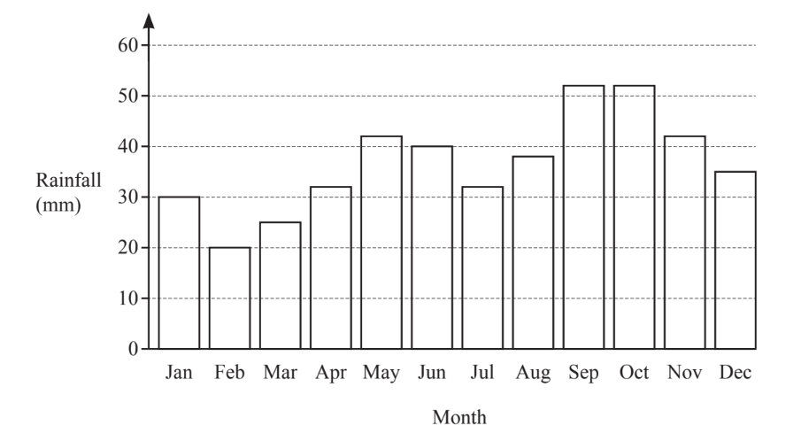

Write down the month with the least amount of rainfall.

*Source: Nov 2020 0580/13 Q1*

**Q26** [1 mark]

**Extract:**

This bar chart shows the amount of rainfall, in mm, for each month of one year in a city.

This bar chart shows the number of days it rained each month for the same year in this city.

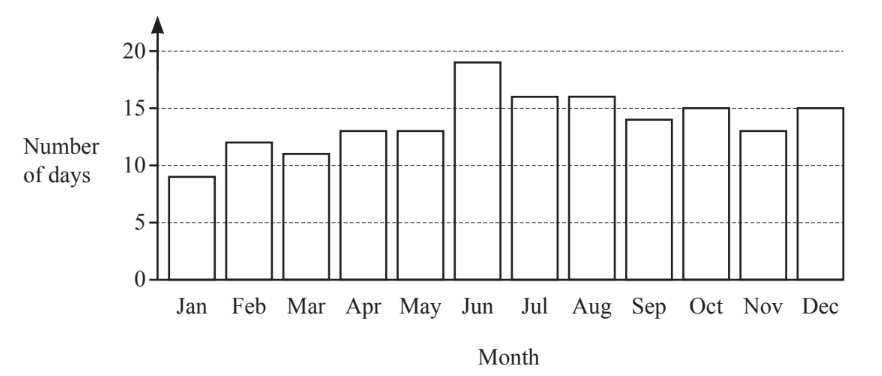

Mia says that the months with the most rainfall also have the greatest number of days it rained.

Explain why she is wrong.

*Source: Nov 2020 0580/13 Q1B*

### Q27 — easy — 3 marks

**Q27** [3 marks]

George, Louis and Beatriz have a café.

George records the number of each type of meal sold. 
He draws a pictogram to show his results. 
All rows are complete except for Salad.

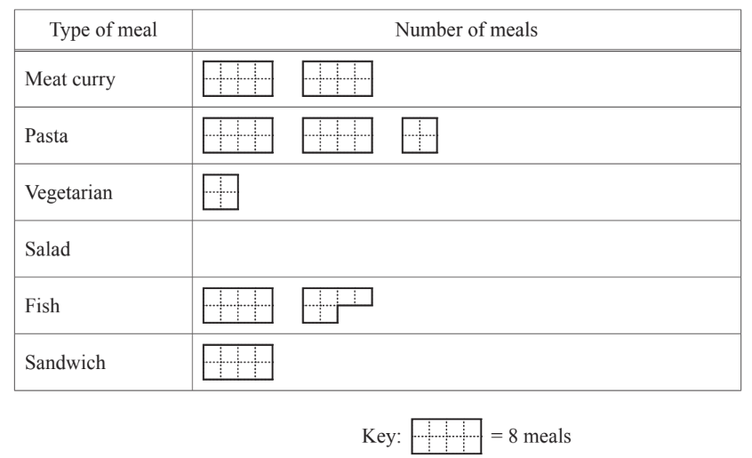

i) Six salads were sold.

Complete the pictogram.

[1]

ii) Write down which type of meal was sold most.

[1]

iii) Find the number of meals sold altogether.

[1]

*Source: Nov 2020 0580/32 Q1A*

