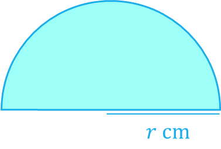
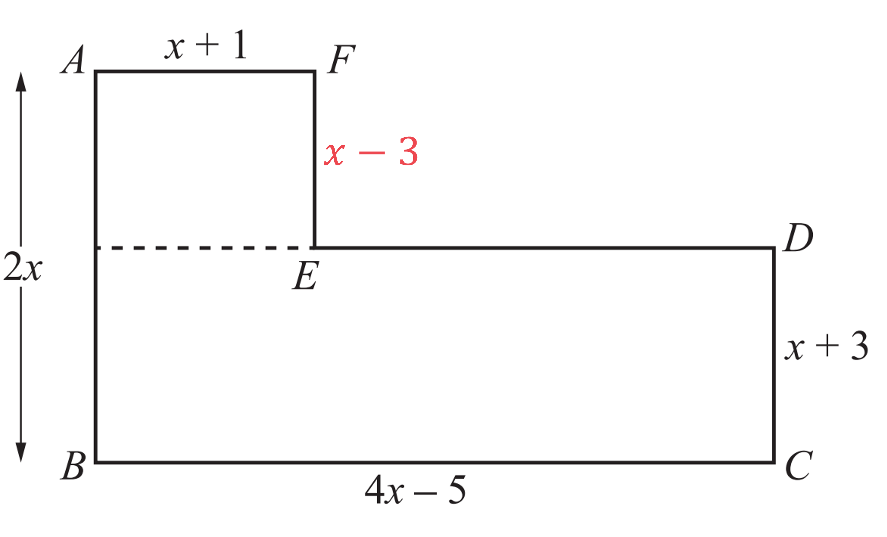
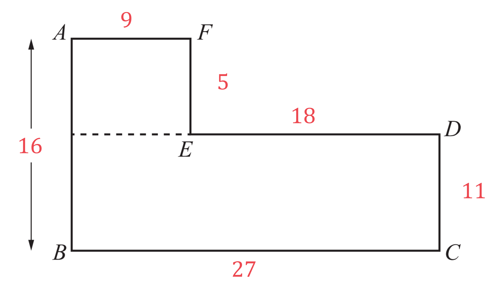
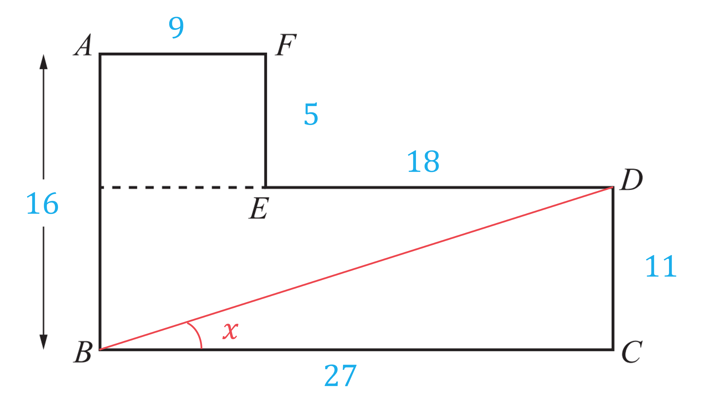
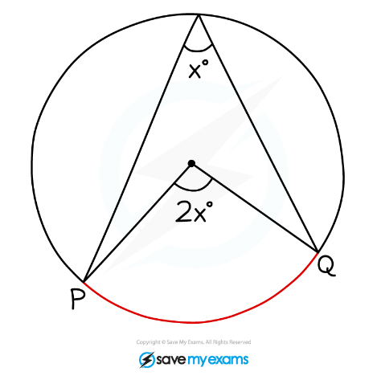

# Mark Schemes — Forming & Solving Equations
**Algebra & Sequences** · Cambridge (CIE) IGCSE maths (0607)

## Calculator Questions (33 questions)

### Q1
> *Both triangles are right-angled triangles so use SOHCAHTOA. You know the length of the opposite (**O**) and the length of the side adjacent (**A**) to the angle. *
*Therefore the tangent ratio can be used to write expressions for the tangent ratio for both triangles, *$\mathrm{tan}θ=\frac{O}{A}$*.*

$\mathrm{tan}e=\frac{x}{4x-1}$

$\mathrm{tan}f=\frac{6x+5}{12x+31}$

> *Use the given information, *$\mathrm{tan}e=\mathrm{tan}f$*, to write an equation in terms of *$x$*.*

$\begin{gathered} \tan e & = \tan f \\ \frac{x}{4 x - 1} & = \frac{6 x + 5}{12 x + 31} \end{gathered}$

**[1]**

> *Remove the fraction on the LHS by multiplying both sides by *$( 4 x - 1 )$*.*

$\begin{gathered} ( 4 x - 1 ) \frac{x}{4 x - 1} & = \frac{6 x + 5}{12 x + 31} ( 4 x - 1 ) \\ x & = \frac{( 6 x + 5 ) ( 4 x - 1 )}{12 x + 31} \end{gathered}$

> *Remove the fraction on the RHS by multiplying both sides by *$( 12 x + 31 )$*.*

$\begin{gathered} x ( 12 x + 31 ) & = \frac{( 6 x + 5 ) ( 4 x - 1 )}{12 x + 31} ( 12 x + 31 ) \\ x ( 12 x + 31 ) & = ( 6 x + 5 ) ( 4 x - 1 ) \end{gathered}$

**[1]**

> *Expand the brackets on both sides of the equation.*

$\begin{gathered} x ( 12 x + 31 ) & = ( 6 x + 5 ) ( 4 x - 1 ) \\ 12 x^{2} + 31 x & = 24 x^{2} - 6 x + 20 x - 5 \\ 12 x^{2} + 31 x & = 24 x^{2} + 14 x - 5 \end{gathered}$

> *Rearrange the expression to make a quadratic equation equal to 0.*

$\begin{gathered} 0 = 24 x^{2} + 14 x - 5 - ( 12 x^{2} + 31 x ) \end{gathered}$

> *Simplify.*

$\begin{gathered} 24 x^{2} + 14 x - 5 - 12 x^{2} - 31 x & = 0 \\ 12 x^{2} - 17 x - 5 & = 0 \end{gathered}$

**[1]**

> *This can be solved using your equation solver on your calculator, however the question says to show all working so it is a good idea to show a method of either factorising or the formula. *

> *The formula may be easier.*

> *Substitute the given values into the quadratic formula*

> *Given an equation of the form *$ax^{2}+bx+c=0$*, the quadratic formula is *$x=\frac{-b\pm\sqrt{b^{2}-4ac}}{2a}$*.*

> *Identify the values of **a, b **and **c.*

$a=12,b=-17,c=-5$

> *Substitute into the quadratic formula.*

$x = \frac{- ( - 17 ) \pm \sqrt{( - 17 )^{2} - 4 \times 12 \times ( - 5 )} }{2 \times 12}$

** [1]**

> *Simplify.*

$x=\frac{17\pm\sqrt{529}}{24}$

> *Work out the two results by doing the calculation twice, once using the positive sign and once using the negative sign in front of the square root.*

$x=\frac{5}{3}$ * or  *$x=-\frac{1}{4}$

> *Considering the diagram in part (a), the height of the first triangle is *$x$*, so *$x$* must be positive.*

** **$x=\frac{5}{3}$** ****[1]**

### Q2
> *The formula for the area of a triangle is *$A=\frac{1}{2}bh$*, where *$b$* is the base and *$h$* is the height perpendicular to the base*

$\text{Area} = 1 \frac{1}{2} ( x - 2 ) ( x )$

> *Use the given information that the area of the triangle is 2.5 cm**2** to write an equation in terms of *$x$

$\begin{gathered} 1 \frac{1}{2} x ( x - 2 ) & = 2.5 \end{gathered}$

**[1]**

> *Remove the fraction by multiplying both sides by 2*

$\begin{gathered} x ( x - 2 ) & = 5 \end{gathered}$

> *Expand the brackets on the LHS of the equation*

$x^{2}-2x=5$

> *Rearrange the expression to make a quadratic equation equal to 0*

$\begin{gathered} x^{2} - 2 x - 5 & = 0 \end{gathered}$

**[1]**

> *This can be solved using your equation solver on your calculator, however the question says to show all working so it is a good idea to show a method too. *

> *Given an equation of the form *$ax^{2}+bx+c=0$*, the quadratic formula is *$x=\frac{-b\pm\sqrt{b^{2}-4ac}}{2a}$*.*

> *Identify the values of **a, b **and **c.*

$a=1,b=-2,c=-5$

> *Substitute into the quadratic formula.*

$x = \frac{- ( - 2 ) \pm \sqrt{( - 2 )^{2} - 4 \times 1 \times ( - 5 )} }{2 \times 1}$

> *Simplify.*

$\begin{gathered} x = \frac{2 \pm \sqrt{24} }{2} \end{gathered}$

> *Find the two possible values of *$x$*.*

$x=1+\sqrt{6}=3.44948...$ *  or  *$x = \begin{gathered} \end{gathered} \begin{gathered} 1 \end{gathered} \begin{gathered} - \end{gathered} \begin{gathered} \end{gathered} \begin{gathered} \sqrt{6} \end{gathered} = - 1.44948...$

**[1]**

> *Considering the diagram in part (a), the length of the triangle is *$x$*, so *$x$* must be positive. *
*The value *$1-\sqrt{6}$* is negative so this cannot be the length of a triangle. *

> *Substitute *$x=1+\sqrt{6}$* into the expression given for the length and the width of the triangle.*

$\text{length} = x = \begin{gathered} \end{gathered} \begin{gathered} 1 \end{gathered} + \begin{gathered} \end{gathered} \begin{gathered} \sqrt{6} \end{gathered}$

$\text{width} = x - 2 = \begin{gathered} \end{gathered} \begin{gathered} ( 1 + \sqrt{6} ) \end{gathered} - 2 = - 1 + \sqrt{6}$

> *Use Pythagoras' theorem to find the length of the hypotenuse.*

$\begin{gathered} a^{2 } & = b^{2} + c^{2} \\ = ( 1 + \sqrt{6} )^{2} + ( 11 + \sqrt{6} )^{2} \\ = 14 \end{gathered}$

**[1]**

> *Square root to find the length of the hypotenuse.*

$\begin{gathered} a & = \sqrt{14} \\ = 3.741657... \end{gathered}$

> *Add the three sides of the triangle together, use either the exact values or values rounded to more than four significant figures in your working.*

$\text{Perimeter} = ( 1 + \sqrt{6} ) + \begin{gathered} \end{gathered} \begin{gathered} ( - 1 + \sqrt{6} ) \end{gathered} + \sqrt{14} = 8.640636...$

**[1]**

> *Round the answer to 3 significant figures.*

** **$P=8.64\mathrm{cm}(3s.f.)$** ****[1]**
** Answers in the range 8.63 to 8.65 accepted.**

### Q3
i) *This can be a tricky question to start. Let's say that we knew the cost of one monthly magazine was \$2. In that case, it would be relatively straightforward to see that the number of monthly magazines sold that day was \$168 ÷ \$2, so 81 monthly magazines.*

> *Let's apply the same logic to the cost of one monthly magazine being *$m$*. Therefore the number of monthly magazines sold on that day was*

$\frac{168}{m}$

> *And by the same logic, the number of weekly magazines sold on that day was *

$\frac{207}{m-0.75}$

**one of the two expressions for number of magazines ****[1]**

> *Now add the number of monthly magazines sold on that day to the number of weekly magazines sold on that day, and equate it to 100, the total number of magazines sold on that day.*

$\frac{168}{m}+\frac{207}{m-0.75}=100$

> *Get rid of the fractions by multiplying by the denominators. The two steps below can be combined into one step if you are confident.*

$\frac{168 ( m - 0.75 )}{m} + 207 = 100 ( m - 0.75 )
168 ( m - 0.75 ) + 207 m = 100 m ( m - 0.75 )$

**[1]**

> *Expand the brackets and collect all terms on one side (with the term in  positive)*

$\begin{gathered} 168 m - 126 + 207 m & = 100 m^{2} - 75 m \\ 0 = 100 m^{2} - 450 m + 126 \end{gathered}$

**[1]**

> *Divide both sides of the equation by 2*

$0=50m^{2}-225m+63$

**Note that there are no marks for the final line- the marks are for showing how to get there**

ii) *Method 1* 
*The question does not specify a method so using your calculator is appropriate here*

> *Solve using your calculator's polynomial solver function, type in the values *$a=50,b=-225$* and *$c=63$

$m=0.3\mathrm{or}m=4.2$

**[1]**

> *The price of  a weekly magazine is given as *$( m - 0.75 )$*. Therefore *$m$* cannot be 0.3 as *$0.3-4.2=-3.9$* and the price cannot be negative! Therefore *$m=4.2$*, or \$4.20.*

**\$4.20 ****[1]**

### Q4
> *Let one small coffee cake be *$x$* and one large coffee cake be *$2x+1$

> *Let the number of small coffee cakes Petra bought be *$a$* and the number of large coffee cakes be *$b$

> *Form an equation in terms of *$a$* and *$b$* for the total number of coffee cakes that Petra bought*

$\begin{gathered} a + b & = 45 \end{gathered}$

> *Form an equation in terms of *$x$* for the number, *$a$*, of small coffee cakes that can be bought for \$20*

$\begin{gathered} a x & = 20 \\ a & = \frac{20}{x} \end{gathered}$

> *Form an equation in terms of *$x$* for the number, *$b$*, of large coffee cakes that can be bought for \$10*

$\begin{gathered} b ( 2 x + 1 ) & = 10 \\ b & = \frac{10}{2 x + 1} \end{gathered}$

**Correct expression for a or b ****[1]**

> *Substitute the expressions for *$a$* and *$b$* into the equation for the total number of cakes*

$\begin{array}{rcl} a + b & = 45 \\ ( \frac{20}{x} ) + ( \frac{10}{2 x + 1} ) & = 45 \end{array}$

**[1]**

> *Remove the fractions by multiplying both sides by *$x ( 2 x + 1 )$

$\begin{gathered} \frac{20 x ( 2 x + 1 )}{x} + \frac{10 x ( 2 x + 1 )}{2 x + 1} & = 45 x ( 2 x + 1 ) \\ 20 ( 2 x + 1 ) + 10 x & = 45 x ( 2 x + 1 ) \end{gathered}$

**[1]**

> *Expand the brackets and simplify*

$\begin{gathered} 40 x + 20 + 10 x & = 90 x^{2} + 45 x \\ 50 x + 20 & = 90 x^{2} + 45 x \end{gathered}$

> *Rearrange to make a quadratic equation equal to zero*

$\begin{gathered} 90 x^{2} + 45 x - 50 x - 20 & = 0 \\ 90 x^{2} - 5 x - 20 & = 0 \end{gathered}$

> *Simplify the equation by dividing every term by 5*

$\begin{gathered} 18 x^{2} - x - 4 & = 0 \end{gathered}$** ****[1]**
**Equivalent correct equation accepted**

> *Solve using your calculator's polynomial solver function, type in the values *$a=18,b=-1$* and *$c=-4$

$x=\frac{1}{2}$* or *$x=-\frac{4}{9}$

**[1]**

> *Disregard the negative because price must be positive so one small coffee cake = \$0.50 or 50 cents.*

`bold $ bold 0 bold. bold 50` **[1]**

### Q5
> *Substitute the values in the diagram into the formula for the area of a trapezium*
* The formula is *$A = 1 \frac{1}{2} ( a + b ) h$*, where *$a$* and *$b$* are the two parallel sides and *$h$* is the perpendicular height*

$A = 1 \frac{1}{2} \times ( ( x - 4 ) + ( x + 5 ) ) \times 2 x$

**[1]**

> *The area is given as 351 cm**2**, so set this expression equal to 351*

$1 \frac{1}{2} \times ( ( x - 4 ) + ( x + 5 ) ) \times 2 x = 351$

> *Simplify the expression in the brackets*

$\begin{gathered} 1 \frac{1}{2} \times ( 2 x + 1 ) \times 2 x & = 351 \end{gathered}$

> *Cancel out the 2*

$\begin{gathered} \frac{1}{ \cancel{2} } \times ( 2 x + 1 ) \times \cancel{2} x & = 351 \\ x ( 2 x + 1 ) & = 351 \end{gathered}$

> *Expand the brackets on the right hand side*

$\begin{gathered} 2 x^{2} + x & = 351 \end{gathered}$

> *Subtract 351 from both sides*

$\begin{gathered} 2 x^{2} + x - 351 & = 0 \end{gathered}$

$2x^{2}+x-351=0$ **[1]**
> *This question does not ask for working to be shown, so you can use your calculator's polynomial solver function to find the solution*

*Open your calculator's quadratic equation solving software and type in the coefficients:  *$a=2$*, *$b=1$* **and** *$c=-351$

> *It is still a good idea to show some working so you could write down the quadratic formula with these values substituted in*

$x=\frac{-1\pm\sqrt{1^{2}-4\times2\times-351}}{2\times2}$

$x=13$* or *$x=-13.5$

**[1]**

> *Considering the diagram in part (a), the height of the trapezium is *$2x$*, so *$x$* must be positive.*

** **$x=13$** ****[1]**

### Q6
> *We have a right-angle triangle so can use Pythagoras' theorem, *$a^{2}+b^{2}=c^{2}$* where *$a$* and *$b$* are the shorter sides and *$c$* is the hypotenuse*

> *Substitute the expressions given in terms of *$x$* into Pythagoras' theorem*

$x^{2} + ( 2 x - 3 )^{2} = 6^{2}$

**[1]**

> *Now expand the brackets and the 6**2**, taking care to note that *$( 2 x - 3 )^{2} = ( 2 x - 3 ) ( 2 x - 3 )$* not "*$4x^{2}+9$*"*

$\begin{array}{rcl} x^{2} + ( 2 x - 3 ) ( 2 x - 3 ) & = 36 \\ x^{2} + 4 x^{2} - 12 x + 9 & = 36 \end{array}$

**correctly expanding **$( 2 x - 3 )^{2}$** ****[1]**

> *Now collect like terms and equate to zero by subtracting 36 from both sides*

$\begin{array}{cc} 5 x^{ } 2 - 12 x - 27 & = 0\end{array}$ **[1] **
**Note that you can only be awarded the final mark if you have shown the previous two main steps**
> *This question does not ask for working to be shown, so you can use your calculator's polynomial solver function to find the solution*

*Open your calculator's quadratic equation solving software and type is the coefficients: *$a=5$*, *$b=-12$* **and** *$c=-27$

> *It is still a good idea to show some working so you could write down the quadratic formula with these values substituted in*

$x = \frac{+ 12 \pm \sqrt{( - 12 )^{2} - 4 \times 5 \times ( - 27 )} }{2 \times 5}$

> *Give your final answers to exactly 2 decimal places, as the question requests.*

$x=3.82$ **[1]**

$x=-1.42$** [1]**
> *The perimeter is *

$x+2x-3+6$

> *Substitute your value of *$x$* into the above expression*
*Note that *$x$* is a length of the triangle, so we can ignore the negative value of *$x$*we obtained in part (b) *

> *Use *$x=3.82$

$3.82+2\times3.82-3+6$

**[1]**

> *Work out the result*

**Perimeter = 14.46 m ****[1]**
> *Method 1 *

> *The smallest angle is the angle between "*$2x-3$*" and *$6$* *

> *Use your positive answer from part (b) for *$x$*, so *$x=3.82$

> *We have a right-angle triangle, *$x$* (or 3.82) is opposite the required angle and *$6$* is the hypotenuse *

> *So we can use the sine ratio, *$\mathrm{sin}θ=\frac{\mathrm{opposite}}{\mathrm{hypotenuse}}$

$\mathrm{sin}θ=\frac{3.82}{6}$

**[1]**

> *Inverse sine to find the angle*

$\begin{gathered} \\theta = \sin ^{- 1} ( \frac{4.64}{6} ) \\ = 39.54370792...^{\circ} \end{gathered}$

> *Give angles in degrees to 1 decimal place*

**Final answer:** **Angle = 39.5° **

**final answer between 39.3° and 39.5° depending on rounding of x value  ****[1]**

> *Method 2 *

> *The smallest angle is the angle between "*$2x-3$*" and *$6$* *

> *Evaluate "*$2x-3$*" by substituting your positive answer from part (b)*

$2\times3.82-3=4.64$

> *We have a right-angle triangle, *$2x-3$* (or 4.64) is adjacent to the angle and *$6$* is the hypotenuse*
*So we can use the cosine ratio, *$\mathrm{cos}θ=\frac{\mathrm{adjacent}}{\mathrm{hypotenuse}}$

$\mathrm{cos}θ=\frac{4.64}{6}$

**[1]**

> *Inverse cosine to find the angle*

$\begin{gathered} \\theta = \cos ^{- 1} ( \frac{4.64}{6} ) \\ = 39.34582977...^{\circ} \end{gathered}$

> *Give angles in degrees to 1 decimal place*

**Angle = 39.3°  ****[1]**

**Final answer between 39.3° and 39.5° depending on rounding of x value  ****[1]**

### Q7
i) *Each sack costs \$*$m$* and Paulo pays \$*$72$ 
*Write down the number of sacks Paulo buys (by dividing 72 by *$m$*)*

$\frac{72}{m}$** ****[1]**

ii) *Each sack costs \$*$( m + 0.9 )$* and Jim pays \$*$72$
 *Write down the number of sacks Jim buys by dividing 72 by *$( m + 0.9 )$

$\frac{72}{m+0.9}$** ****[1]**
*Paulo buys *$\frac{72}{m}$* sacks and Jim buys *$\frac{72}{m+0.9}$* sacks* 
*Paulo's number of sacks is 4 more than Jim's* 
*Form an equation (by setting Paulo's number to equal Jim's number plus 4)*

$\frac{72}{m}=\frac{72}{m+0.9}+4$

**[1]**

*Multiply both sides by *$( m + 0.9 )$

$\frac{72 ( m + 0.9 )}{m} = 72 + 4 ( m + 0.9 )$

*Multiply both sides by *$m$

$72 ( m + 0.9 ) = 72 m + 4 m ( m + 0.9 )$

**[1]**

*Expand the brackets*

$\begin{gathered} 72 m + 72 \times 0.9 & = 72 m + 4 m^{2} + 4 m \times 0.9 \\ 72 m + 64.8 & = 72 m + 4 m^{2} + 3.6 m \end{gathered}$

*Subtract *$72m$* from both sides*

$64.8=4m^{2}+3.6m$

**[1]**

*Change the decimals into whole numbers by multiplying both sides by 10*

$648=40m^{2}+36m$

*Divide both sides by 4*

$162=10m^{2}+9m$

> *Subtract 162 from both sides*

$10m^{2}+9m-162=0$ **[1]**
i) *This question does not ask for working to be shown, so you can use your calculator's polynomial solver function to find the solution*

> *Open your calculator's quadratic equation solving software and type is the coefficients: *$a=10$*, *$b=9$* **and** *$c=-162$* *

> *It is still a good idea to show some working so you could write down the quadratic formula with these values substituted in*

$m = \frac{- 9 \pm \sqrt{9^{2} - 4 \times 10 \times ( - 162 )} }{2 \times 10}$

> *Use a calculator to find these two solutions*

$m=3.6$**and **$m=-4.5$
**1 mark for each correct answer [2]**
**This question can also be done by factorisation using (2****m ****+ 9)(5****m ****- 18) = 0**

ii) *Choose the correct value for *$m$* (it is a price so cannot be negative)*

$m=3.6$

*Substitute *$m=3.6$* into *$\frac{72}{m}$* from part (a)(i)*

$\frac{72}{3.6}$

**20 sacks** **[1]**

### Q8
> *Find the cost of 2.8 kg of leeks at \$2.65 per kg.*

$2.8\times2.65=7.42$* *

**[1]**

> *Let 1kg of potatoes be **p.*

> *Form an equation in terms of **p.*

$3.6p+7.42=13.72$

> *Subtract the cost of the leeks from the total cost of Rangan's shopping.*

$3.6p=13.72-7.42\,3.6p=6.3$* *

> *So the total cost of the potatoes was \$6.30.*

> *Find the cost of 1 kg of potatoes by dividing the total cost of the potatoes by the amount of potatoes that Rangan bought (3.6 kg).*

$p=6.3\div3.6\,p=1.75$

**[1]**

> *Remember to write the final answer in \$ correct to 2 decimal places.*

**\$1.75 ****[1]**

### Q9
> *The perimeter of a semicircle consists of two parts: a straight line and an arc.*

> *Let **r** be the radius of the semicircle.*

> *The straight line is the diameter of the semicircle so is equal to 2**r**.*

> *The arc of a semicircle is half the circumference so halve the expression for the circumference *$C=2πr.$

*Length of the arc =* $\frac{1}{2}\times2πr=πr$

> *Form an expression for the perimeter by adding together the arc length and the length of the diameter.*

*Perimeter = *$πr+2r$

**[1]**

> *Factorise out the **r.*

*Perimeter =* $( \mathrm{\pi } + 2 ) r$

> *Make the expression for the perimeter equal to 19.02.*

$( \mathrm{\pi } + 2 ) r = 19.02$

> *Divide both sides by π+2.*

$r=\frac{19.02}{π+2}=3.6992...$

**[1]**

> *Round to 3 significant figures.*

**3.70 cm** **[1]**

### Q10
i) *Use the information given to form an equation for the perimeter and an equation for the area of the rectangle. *
*Let the length of the rectangle be *$l$* cm.  *

> *The perimeter of a rectangle is 2(length + width).  *

$\begin{gathered} 2 ( x + l ) & = 80 \\ x + l & = 40 ( 1 ) \end{gathered}$

**[1]**

**    ***The area of a rectangle is 2(length × width).  *

> $x l = A ( 2 )$*   *

> *Rearrange equation (1) and substitute into equation (2) to eliminate *$l$*.    *

$( 1 ) l = 40 - x
( 2 ) A = x ( 40 - x )$

**[1]**

> *Expand the brackets and rearrange to set equal to zero.  *

$A=40x-x^{2}$

$x^{2}-40x+A=0$* ***[1]*** *

ii) *Substitute *$A=300$* into the equation from part (i).   *

> $\begin{gathered} x^{2 } - 40 x + 300 & = 0 \end{gathered}$*   *

> *Factorise by finding the factors of 300 and considering which ones have a sum of -40.  *

> $- 30 \times - 10 = 300
- 30 + ( - 10 ) = - 40$*  *

> *So the factors needed are -30 and -10. *

> *Put these into the brackets. *

> $( x - 30 ) ( x - 10 ) = 0$* *

**1 mark for factors which either add to - 40 or multiply to 300****  [2]**

** ***Solve by setting each bracket to zero and making **x **the subject.*

$\begin{gathered} x - 30 & = 0 \\ x & = 30 \end{gathered}$

> *Or,*

$\begin{gathered} x - 10 & = 0 \\ x & = 10 \end{gathered}$

> * *

$x=30\mathrm{cm} \mathrm{or}x=10\mathrm{cm}$* ***[1]*** *

iii) *Substitute *$A=200$* into the equation from part (i). *

> $\begin{gathered} x^{2 } - 40 x + 200 & = 0 \end{gathered}$*     *

> *The quadratic formula for an equation in the form *$ax^{2}+bx+c=0$*  is  *$x=\frac{-b\pm\sqrt{b^{2}-4ac}}{2a}.$

> *Identify the values of *$a,b\mathrm{and}c$*.*

$a=1\,b=-40\,c=200$

> *  Substitute the values of *$a,b\mathrm{and}c$* into the quadratic formula.*

$x = \frac{- ( - 40 ) \pm \sqrt{( - 40 )^{2 } - 4 ( 1 ) ( 200 )} }{2 ( 1 )}$

*   ***Correct discriminant**** [1]**
**Correct use of the formula****  [1]**

**   ***Simplify.*

$\begin{gathered} x & = \frac{40 \pm \sqrt{800} }{2} \\ = \frac{40 \pm 20 \sqrt{2} }{2} \\ = 20 \pm 10 \sqrt{2} \end{gathered}$

*Find both answers. *

> *   *$\begin{gathered} x & = 20 + 10 \sqrt{2} \\ = 34.142135... \end{gathered}$*   *

> *or,*

$\begin{gathered} x & = 20 - 10 \sqrt{2} \\ = 5.857864... \end{gathered}$

> *     *

$x=34.14\mathrm{cm} \mathrm{or}x=5.86\mathrm{cm}(2d.p.)$
**Answers correct to any number of decimal places**** [1]*** *
**Answers correct to two decimal places**** [1]*** *

### Q11
> *Method 1*

*Angles in a quadrilateral add up to 360**o**.* 
*Write down an equation adding together all four angles.*

$2x+2x+(3x-15)+(2x+24)=360$

> *You can rewrite the equation without brackets.*

$2x+2x+3x-15+2x+24=360$

**[1]**

> *Rearrange the equation so that like terms are next to each other, remember to keep the sign in front of each term the same as it was when you re-arrange. *

$2x+2x+3x+2x-15+24=360$

> *Add/subtract the like terms, being careful with negatives!*

$9x+9=360$

**[1]**

> *Solve the equation. It may be easiest to factorise the 9 out first.*

$\begin{gathered} 9 x + 9 & = 360 \\ 9 ( x + 1 ) & = 360 \\ x + 1 & = \frac{ 360}{9} \\ x + 1 & = 40 \\ x & = 39 \end{gathered}$

$x=39^{\circ}$ **[1]**

> *Method 2*

> *Opposite angles in a parallelogram are equal.*

> *Write down an equation for the two opposite angles that have **different **expressions.*

$3x-15=2x+24$

**[1]**

> *Solve the equation by first bringing the **x** terms to one side.  *
*The easiest method is to subtract the **x** term with the smallest coefficient.*

$\begin{gathered} 3 x - 15 & = 2 x + 24 \\ - 2 x & = - 2 x \\ x - 15 & = 24 \end{gathered}$

> *Add 15 to both sides.*

$\begin{gathered} x - 15 & = 24 \\ + 15 & = + 15 \\ x & = 39 \end{gathered}$

**[1]**

$x=39^{\circ}$ **[1]**

### Q12
> *Multiply the number of magazines by their cost and the number of cards by their cost and add them together. *

> *Make sure that you are working in dollars and not cents.*

$\$ 2 . 45 x + 3 . 15 y$

** **$2.45x$** correct [1] **
 $3.15y$ **correct [1]**
> *Substitute *$x=8$* into the expression from part a) and equate it to the given total.*

$2.45\times8+3.15y=60.55$

> *Simplify the left hand side.*

$19.6+3.15y=60.55$

> *Subtract 19.6 from both sides.*

$3.15y=40.95$

**[1]**

> *Divide both sides by 3.15.*

$13$* ***[1]**

### Q13
> *Let the cost of a tea be **t** and the cost of a coffee be **c. *

> *Use the information in the question to write two equations.*

> *3 teas = 3**t, **2 coffees = 2**c,** add these and set equal to 7.8 (£7.80). *

$3t+2c=7.8$

> *5 teas = 5**t, **4 coffees = 4**c,** add these and set equal to 14.2 (£14.20). *

$5t+4c=14.2$

**[1]**

> *Number the equations.*

> $\begin{gathered} 3 t + 2 c & = 7.8 ( 1 ) \\ 5 t + 4 c & = 14.2 ( 2 ) \end{gathered}$* *

> *Make the **c** terms equal by multiplying all parts of equation (1) by 2.*

$2 ( 1 ) 2 ( 3 t + 2 c = 7.8 ) 
 ( 2 ) \begin{array}{rcl} \end{array} \begin{array}{rcl} 5 \end{array} \begin{array}{rcl} t \end{array} \begin{array}{rcl} \end{array} \begin{array}{rcl} + \end{array} \begin{array}{rcl} \end{array} \begin{array}{rcl} 4 \end{array} \begin{array}{rcl} c \end{array} \begin{array}{rcl} \end{array} \begin{array}{rcl} = \end{array} \begin{array}{rcl} \end{array} \begin{array}{rcl} 14 \end{array} \begin{array}{rcl} . \end{array} \begin{array}{rcl} 2 \end{array}$*  *

> *This gives two equations with the same coefficient of **c.*

$\begin{gathered} 6 t + 4 c & = 15.6 ( 3 ) \\ 5 t + 4 c & = 14.2 ( 2 ) \end{gathered}$

> *Eliminate the **c** terms by subtracting equation (2) from equation (3).*

`| _ _ | | _ _ | | _ _ 6 | | _ _ t | | _ _ | | _ _ + | | _ _ | | _ _ 4 | | _ _ c | | _ _ | | _ = _ | | _ _ | | _ _ 15 | | _ _. | | _ _ 6 | bottom - ( | 5 t + 4 c | = 14.2 | | ) t = 1.4`

**[1]**

> *Substitute *$t=1.4$* into either of the two original equations**.*

$\begin{gathered} ( 1 ) 3 t + 2 c & = 7.8 \\ 3 ( 1.4 ) + 2 c & = 7.8 \\ 4.2 + 2 c & = 7.8 \end{gathered}$

**[1]**

> *Solve this equation to find** c.*

$\begin{gathered} 2 c & = 7.8 - 4.2 \\ 2 c & = 3.6 \\ c & = \frac{3.6}{2} = 1.8 \end{gathered}$

> *This means that 1 tea costs £1.40 and 1 coffee costs £1.80. *

**One tea = £1.40       **
**One coffee = £1.80 ****[1]**

### Q14
> *i) Substitute the values in the diagram into the area of a triangle formula, *$A=\frac{1}{2}ab\mathrm{sin}C$*, where *$a$* and *$b$* are the two known sides and *$C$* is the included angle.*

$70 = 1 \frac{1}{2} \times ( x + 4 ) \times ( 4 x - 5 ) \times \sin ( 30 )$**[1]**

> *Simplify the right hand side.*

$70 = 1 \frac{1}{4} ( x + 4 ) ( 4 x - 5 )$

> *Multiply both sides by 4.*

$280 = ( x + 4 ) ( 4 x - 5 )$**[1]**

> *Expand the brackets on the right hand side.*

$280=4x^{2}+16x-5x-20$

**[1]**

> *Simplify by collecting like terms.*

$280=4x^{2}+11x-20$

> *Subtract 280 from both sides.*

$0=4x^{2}+11x-300$

$4x^{2}+11x-300=0$ **[1]**

> *ii) Substitute the given values into the quadratic formula, *$x=\frac{-b\pm\sqrt{b^{2}-4ac}}{2a}$*, given an equation of the form *$ax^{2}+bx+c=0$*.*

$x=\frac{-11\pm\sqrt{11^{2}-4\times4\times-300}}{2\times4}$

**Correct substitution of values into the discriminant (the part inside the square root sign) [1] **
**Correct substitution of values in to the rest of the formula [1]**

> *Simplify the right hand side.*

$x=\frac{-11\pm\sqrt{4921}}{8}$

> *Work out the two results by doing the calculation twice, once using the positive sign and once using the negative sign in front of the square root.*

$x=7.39372...$* or *$x=-10.14372...$

**Final answer:** $x=7.39$** or **$x=-10.14$

**7.39 [1] **
**-10.14 [1]**
**Remember to give your answers to 2 d.p. as the question asks for, otherwise you will drop a mark!**

> *iii) Substitute the (positive) value for *$x$* from part ii) into the expression for the side **DE**.*

$7.39372...+4=11.39372...$

**DE**** = 11.4 m**** [1]**

**Answers of 11.39... will be accepted.**

### Q15
> *Angles in a triangle add up to 180°. *
*The right angle equals 90°, so the two algebraic expression add up to 180° - 90°.*

> *Use this to form an equation.*

$7x+5x+18=180-90$

**[1]**

> *Simplify.*

$12x+18=90$

> *Solve the equation to find *$x$*.*

$\begin{gathered} 12 x + 18 & = 90 \\ 12 x & = 90 - 18 \\ 12 x & = 72 \\ x & = \frac{72}{12} = 6 \end{gathered}$

** [1]**

> *Now substitute *$x=6$* into the expressions for each of the angles.*

$7 x = 7 ( 6 ) = 42^{\circ}
5 x + 18 = 5 ( 6 ) + 18 = 48^{\circ}$

**The smallest angle = 42°**** [1]**

### Q16
> *Split the shape into two rectangles by extending the line **ED**..*

> *Find the length **EF** by subtracting the length of **CD **from the length **AB.*

$2 x - ( x + 3 ) = 2 x - x - 3 = x - 3$

**[1]**

> *Find the area of the top rectangle by multiplying the lengths **AF** and **EF**.*

$( x + 1 ) ( x - 3 ) = x^{2} - 3 x + x - 3 = x^{2} - 2 x - 3$

**[1]**

> *Find the area of the bottom rectangle by multiplying the lengths **BC** and **CD**.*

$( 4 x - 5 ) ( x + 3 ) = 4 x^{2} + 12 x - 5 x - 15 = 4 x^{2} + 7 x - 15$

**[1]**

> *Form an equation by adding the two areas together and making the expression equal to 342.*

$( x^{2} - 2 x - 3 ) + ( 4 x^{2} + 7 x - 15 ) = 342$

**[1]**

> *Simplify the expression by collecting like terms.*

$5x^{2}+5x-18=342$

> *Subtract 342 from both sides.*

$5x^{2}+5x-360=0$

> *Factorise out a 5 from the quadratic.*

$5 ( x^{2} + x - 72 ) = 0$

> *Divide both sides by 5.*

$x^{2}+x-72=0$ **[1]**
> *The coefficient of **x**2** is 1, this means the quadratic will factorise into the form *$( x + p ) ( x + q )$* where **p** and **q **are two numbers which add together to give the coefficient of **x **(1) and multiply together to give the constant term (-72).*

> *The product of the two numbers is negative and the sum is positive, therefore the two numbers have different signs. Look for pairs of numbers that multiply to give -72 and add to make 1.*

$\begin{gathered} 9 \times ( - 8 ) & = 72 \\ 9 + ( - 8 ) & = 1 \end{gathered}$

**[1]**

> *Therefore **p **and **q **are 9 and -8 so you can write in factorised form.*

$( x + 9 ) ( x - 8 ) = 0$

**[1]**

> *Find the two solutions by making each factor equal to zero and solving for **x**.*

$\begin{gathered} x + 9 & = 0 \Leftrightarrow x = - 9 \\ x - 8 & = 0 \Leftrightarrow x = 8 \end{gathered}$

$x=-9\mathrm{or}x=8$ **[1]**
> $x=-9$* or *$x=8$*, however substituting *$x=-9$* into the expressions for the lengths will give negative lengths (*$2x=-18$* for example).*

$x=8$

> *Perimeter is the total length around the outside of the shape. Substitute *$x=8$* into the expressions for all the lengths.*

$AB=2\times8=16\,BC=4\times8-5=27\,CD=8+3=11\,EF=8-3=5\,FA=8+1=9\,$

**One correct length**** [1]**

> *Find the length **ED **by subtracting **FA **from **BC.*

$ED=27-9=18$

> *Find the perimeter by adding the lengths together.*

$16+27+11+5+9+18$

**86 cm** **[1]**
> *Label angle **DBC** as **x**. This angle will be the interior angle of the triangle **BCD** at the corner labelled **B**.*

> *This is a right angled triangle. You know the lengths of the sides that are adjacent (**BC**) and opposite (**CD**) to the angle. Therefore use the trig ratio *$\mathrm{tan}x=\frac{\mathrm{Opposite}}{\mathrm{Adjacent}}.$

$\mathrm{tan}x=\frac{11}{27}$

**[1]**

> *Find the angle by using inverse tan on  your calculator.*

$x = \tan ^{- 1} ( \frac{11}{27} ) = 22.1663...$

> *Round angles to 1 decimal place.*

**Angle ****DBC**** = 22.2°** **[1]**

### Q17
*Angles in a quadrilateral add up to 360**o**.* 
*Write down an equation adding together all four angles.*

$x+(x+5)+(2x-25)+(x+10)=360$

> *You can re-write the equation without brackets.*

$x+x+5+2x-25+x+10=360$

**[1]**

> *Re-arrange the equation so that like terms are next to each other, remember to keep the sign in front of each term the same as it was when you re-arrange. *

$x+x+2x+x+5-25+10=360$

> *Add/subtract the like terms, being careful with negatives!*

$5x-10=360$

**[1]**

> *Add 10 to both sides.*

$5x=370$

> *Divide both sides by 5.*

$x=\frac{370}{5}$

$x=74^{\circ}$ **[1]**

### Q18
> *Identify the values of each variable.*

$V=275,h=14.8,r=?$

> *Substitute the values into the formula to form an equation.*

$275=\frac{1}{3}\timesπ\timesr^{2}\times14.8$

**[1]**

*Rearrange to make **r** the subject. Rearrange fully before typing in your calculator. If you decide to type it in your calculator as you go then use the 'answer' button or lots of decimal places to avoid rounding errors.* 
*Multiply both sides by 3.*

$π\timesr^{2}\times14.8=275\times3=825$

> *Divide by sides by 14.8 × π.*

$r^{2}=\frac{275\times3}{14.8\timesπ}=17.7436...$

> *Square root both sides.*

$r=\pm\sqrt{\frac{275\times3}{14.8\timesπ}}=\pm4.2123...$

**[1]**

> *The radius is a length so can not be negative. Round the positive answer to 3 significant figures.*

**4.21 cm** **[1]**

### Q19
> *Simple interest is where each year the interest is calculated by finding the percentage of the initial amount invested.*

> *Find 1.25% of \$2000 by dividing 1.25 by 100 to convert to a decimal and then multiplying by the amount.*

$\frac{1.25}{100}\times2000=25$

*For simple interest, \$25 will be the interest for each year.* *Find Paddy's amount after 5 years by adding 5 lots of \$25 to the initial amount.*

$5\times25+2000=2125$

**[1]**

*Compound interest is where each year the interest is calculated by finding the percentage of the current amount.*

*Recall the formula for compound interest *$A = P ( 1 + \frac{r}{100} )^{n}$*.*

*A** is the total final amount.* 
*P **is the initial amount.*
*r** is the interest rate.* 
*n** is the number of years.*

> *Anna's final amount is the same as Paddy's so is also \$2125. Substitute **A** = 2125, **P **= 2000, **n** = 5 to form an equation.*

$2125 = 2000 ( 1 + \frac{r}{100} )^{5}$

** Correct right hand side expression**** [1] **
**Correct equation**** [1]**

> *Divide both sides by 2000.*

$( 1 + \frac{r}{100} )^{5} = \frac{2125}{2000} = 1.0625$

> *Take the 5th root of both sides.*

`1 + r / 100 = fifth sqrt of 1.0625 ) = 1.012198...`

**[1]**

> *Solve the equation by subtracting 1 from both sides and then multiplying both sides by 100. Use the answer button to avoid losing accuracy.*

$\begin{gathered} \frac{r}{100} & = 0.012198... \\ r = 1.2198... \end{gathered}$

> *Round to 3 significant figures.*

$r=1.22$* ***[1]**

### Q20
> *Form an expression for the perimeter of the rectangle, remember that opposite sides are equal and label each of the other two sides. *

> *Use this to form an expression for the perimeter of the rectangle.*

$\begin{gathered} P_{r e c t} & = 4 x + ( 3 x + 4 ) + 4 x + ( 3 x + 4 ) \end{gathered}$

> *Form an expression for the perimeter of the trapezium by adding the expressions given for each of the sides. *

$\begin{gathered} P_{t r a p} & = 5 x + ( x - 3 ) + 5 x + ( 7 x - 3 ) \end{gathered}$

**Either expression formed **** [1]**

> *Form an equation by setting the expressions for the perimeter of the rectangle and the perimeter of the trapezium equal to each other.*

$\begin{gathered} 4 x + ( 3 x + 4 ) + 4 x + ( 3 x + 4 ) & = 5 x + ( x - 3 ) + 5 x + ( 7 x - 3 ) \end{gathered}$

** **** [1]**

> *Simplify both sides by collecting the like terms together.*

$\begin{gathered} 4 x + 3 x + 4 + 4 x + 3 x + 4 & = 5 x + x - 3 + 5 x + 7 x - 3 \\ 4 x + 3 x + 4 x + 3 x + 4 + 4 & = 5 x + x + 5 x + 7 x - 3 - 3 \\ 14 x + 8 & = 18 x - 6 \end{gathered}$

> *Solve the equation to find *$x$*, begin by subtracting the term with the smallest coefficient of *$x$*.*

$\begin{gathered} 14 x + 8 & = 18 x - 6 \\ - 14 x & = - 14 x \\ 8 & = 4 x - 6 \\ + 6 & = + 6 \\ 14 & = 4 x \\ \div 4 & = \div 4 \\ \frac{14}{4} & = x \end{gathered}$

**[1]**

> *Substitute *$x=3.5$* into the expression for the length and width of the rectangle.*

$w = 4 x = 4 ( 3.5 ) = 14
l = 3 x + 4 = 3 ( 3.5 ) + 4 = 14.5$

> *So  **w**  =  14 cm  and **l**  = 14.5 cm. *
*Use this to find the area of the rectangle.*

$\begin{gathered} Area_{( r e c t a n g l e )} & = 14 \times 14.5 = 203 cm^{2} \end{gathered}$

**[1]**

$203\mathrm{cm}^{2}$* ***[1]**

### Q21
> *The perimeter of a shape is the sum of the lengths of its sides.*

> *Write down an expression, in terms of *$x$* for each of the lengths of the trapezium.*

$\begin{gathered} A D & = x \\ B C & = A D = x \\ A B & = 2 A D = 2 x \\ D C & = A B + 4 = 2 x + 4 \end{gathered}$

**At least AB or DC correct**** [1]**

> *Label the diagram with these expressions.*

> *Use this to form an expression for the perimeter of the trapezium.*

$\begin{gathered} P & = x + 2 x + x + ( 2 x + 4 ) \end{gathered}$

** **** [1]**

> *Form an equation for the perimeter of the trapezium, setting it equal to 38 cm.*

$\begin{gathered} \text{Perimeter} & = 38 \\ x + 2 x + 2 x + 4 & = 38 \\ 6 x + 4 & = 38 \end{gathered}$

** **** [1]**

> *Solve the equation to find *$x$*.*

$\begin{array}{rcl} 6 x + 4 & = 38 \\ - 4 & = - 4 \\ 6 x & = 34 \\ \div 6 & = \div 6 \\ x & = \frac{34}{6} = \frac{17}{3} \end{array}$

$x=5\frac{2}{3}$**  ****[1]**
** Equivalent fraction or decimal also accepted**

### Q22
> *Let one small lemon cake be *$x$* and one large lemon cake be *$2x+1$*. *
*Form an equation in terms of *$x.$

$3 x + 2 ( 2 x + 1 ) = 12.36$

**[1]**

> *Expand the brackets.*

$3x+4x+2=12.36$

> *Simplify.*

$7x+2=12.36$

**[1]**

> *Solve the equation by subtracting 2 from both sides and then dividing both sides by 7.*

$\begin{gathered} 7 x + 2 - 2 & = 12.36 - 2 \\ 7 x & = 10.36 \\ x & = \frac{ 10.36}{7} \end{gathered}$

> $x=1.48$* so one small lemon cake = \$1.48.*

`bold $ bold 1 bold. bold 48` **[1] **
**Round answers in dollars to 2 d.p.**
> *Let one small chocolate cake be *$x$* and one large chocolate cake be *$2x+1$*. *
*Form an equation in terms of *$x.$

$18 x = 7 ( 2 x + 1 )$

**[1]**

> *Expand the brackets.*

$18x=14x+7$

> *Bring the *$x$* terms to the same side by subtracting the term with the lower coefficient of *$x.$

$\begin{gathered} 18 x - 14 x & = 7 \\ 4 x & = 7 \end{gathered}$

**[1]**

> *Solve the equation by dividing both sides by 4.*

$\begin{gathered} x & = \frac{7}{4} = 1.75 \end{gathered}$

> $x=1.75$* so one small chocolate cake = \$1.75.*

`bold $ bold 1 bold. bold 75` **[1] **
**Round answers in dollars to 2 d.p.**

### Q23
> *Choose a variable for the width of the rectangle, for example, **w. **Form an expression in terms of **w**, for the length of the rectangle.*

$\begin{gathered} l & = w + 7 \end{gathered}$

**[1]**

> *Label each part of the diagram that would need to be added to form the perimeter.*

** At least 6 sides shown**** [1]**

> *Use the diagram to find an expression for the perimeter of the 8-sided shape. Make sure you add every part and do not miss any.  Starting at the top and working clockwise gives: *

$\begin{gathered} P & = w + ( w + 7 ) + w + 7 + ( w + 7 ) + w + ( w + 7 ) + w + 7 + ( w + 7 ) \end{gathered}$

**[1]**

> *Simplify by collecting the like terms.*

$\begin{gathered} P & = w + w + w + w + w + w + w + w + 7 + 7 + 7 + 7 + 7 + 7 \\ = 8 w + 42 \end{gathered}$

> *The perimeter is 70 cm, use this to form an equation.*

$\begin{gathered} 8 w + 42 & = 70 \end{gathered}$

> *Solve the equation to find **w**.*

> $\begin{gathered} 8 w + 42 & = 70 \\ - 42 & = - 42 \\ 8 w & = 28 \\ \div 8 & = \div 8 \\ w & = \frac{28}{8} = \frac{7}{2} \end{gathered}$* *

> *Substitute **w** = 3.5 into the expression for the length of one of the rectangles.*

$l=w+7=3.5+7=10.5$

**[1]**

> *So  **w**  =  3.5  and **l**  = 10.5.*
*Use this to find the area of one rectangle*

$\begin{gathered} Area_{( o n e r e c t a n g l e )} & = 3.5 \times 10.5 = 36.75 cm^{2} \end{gathered}$

> *The total area of the 8-sided shape will be the area of 4 rectangles.*

$\begin{gathered} Area_{( s h a p e )} & = 4 \times 36.75 = 147 cm^{2} \end{gathered}$

$147\mathrm{cm}^{2}$* ***[1]**

### Q24
> *The amount paid for the adult tickets is the cost of each ticket, *$x$*, multiplied by the number of adults, 18 500.*

*amount paid for adult tickets*$=18500x$

> *The amount paid for the child tickets is the cost of each ticket, *$( x - 2.50 )$*, multiplied by the number of children, 2400.*

*amount paid for child tickets*$= 2400 ( x - 2.5 )$

$18500x$** or****  **$2400 ( x - 2.5 )$** ****[1]**

> *The total amount paid for tickets is found by adding the amount paid for adult tickets to the amount paid for child tickets. And it is equal to \$320 040.*

$18 500 x + 2400 ( x - 2.5 ) = 320 040$

**[1]**

> *Expand the brackets and collect like terms.*

$\begin{gathered} 18 500 x + 2400 x - 6000 & = 320 040 \\ 20 900 x & = 326 040 \end{gathered}$

**[1]**

> *Divide both sides by 20 900 to find *$x$*, the cost of an adult ticket. *

**\$15.60**** ****[1]** 
**You will not be penalised for writing "\$15.6" but answers in \$/€/£ are best expressed to 2 decimal places**

### Q25
*The area of a triangle is *$\frac{1}{2}\times$*base*$\times$*height* *Substitute the base as *$( 2 x + 5 )$* and the height as *$4 ( x - 1 )$* into the formula* * *

$1 \frac{1}{2} \times ( 2 x + 5 ) \times 4 ( x - 1 )$

**[1]**

*Simplify the expression (using *$\frac{1}{2}\times4=2$* )* * *

$2 ( 2 x + 5 ) ( x - 1 )$ * *

*Form an equation in *$x$*(by setting the expression to equal 30)* * *

$2 ( 2 x + 5 ) ( x - 1 ) = 30$ * *

*Divide both sides by 2* * *

$( 2 x + 5 ) ( x - 1 ) = 15$ * *

*Expand the brackets * * *

$\begin{gathered} 2 x^{2} - 2 x + 5 x - 5 & = 15 \\ 2 x^{2} + 3 x - 5 & = 15 \end{gathered}$

**[1] **

*Form a quadratic equation (by subtracting 15 from both sides to get = 0)* * *

$\begin{gathered} 2 x^{2} + 3 x - 5 - 15 & = 0 \\ 2 x^{2} + 3 x - 20 & = 0 \end{gathered}$

$2x^{2}+3x-20=0$* ***[1]** 
**Answer correctly obtained with no errors or omissions**
*"Use factorisation" means write the quadratic as two brackets multiplied together* 
*Multiply the first and last numbers together* * *

$2\times-20=-40$ * *

*Find two numbers that multiply to give -40 and add to give the middle number, 3* * *

*8 and -5* * *

*Split the middle term of the quadratic into two parts with these numbers* * *

$2x^{2}+8x-5x-20$ * *

*Factorise fully the first pair of terms and factorise fully the second pair of terms* * *

$2 x ( x + 4 ) - 5 ( x + 4 )$

**[1]**

*Factorise out the common bracket of *$( x + 4 )$ * *

$( x + 4 ) ( 2 x - 5 )$

**[1]**

*Write out the full equation* * *

$( x + 4 ) ( 2 x - 5 ) = 0$ * *

*Solve the first bracket equal to zero and the second bracket equal to zero*

$\begin{gathered} x + 4 & = 0 \\ x = - 4 \end{gathered}$      * or*        $\begin{gathered} 2 x - 5 & = 0 \\ 2 x & = 5 \\ x = \frac{5}{2} \end{gathered}$

$x=-4$** ****or**** **$x=\frac{5}{2}$ **[1]**
*Find the length of side *$AB$* by substituting in *$x$*from part (b)* * *

$A B = 4 ( x - 1 )$ *cannot have *$x=-4$* otherwise ***AB*** is negative* *must use *$x=\frac{5}{2}$* *$A B = 4 ( \frac{5}{2} - 1 ) = 6$

**[1]**

> *Find the length of side *$AC$* (by substituting in *$x=\frac{5}{2}$*)  *

> $A C = ( 2 \times \frac{5}{2} + 5 ) = 10$*  *

*Find *$BC$* by Pythagoras' Theorem*

$BC=\sqrt{6^{2}+10^{2}}$

**[1]**

**11.7 cm** **[1]**

### Q26
> *Careful - this "looks" like a cyclic quadrilateral but it isn't as one of the points is not on the circumference.*

> *Use the circle theorem: "Angle subtended by an arc at the centre is twice the angle at the circumference".*

> *Look very carefully at the diagram to find the correct angle at the centre.*

*angle at the circumference = *$5x$

*angle at the centre =* $360-(3x+22)$

**[1]**

> *Apply the theorem. Angle **AOC** is twice the size of angle **ABC**.*

$360-(3x+22)=2\times5x$

**[1]**

> *Simplify both sides of the equation.*

$338-3x=10x$

**[1]**

> *Add *$3x$* to both sides.*

$338=13x$

> *Divide both sides by 13*

$\frac{338}{13}=x$

$x=26^{\circ}$ **[1]**

### Q27
i) *We can start by writing*

`y ^2 + 5 y - 84 = ( y box ) ( y box )`

> *To work out the missing numbers in the brackets, we are looking for two numbers that multiply to −84 and add to 5. (The acronym TEAM may help you to remember what to do: **T**imes for the **E**nd, **A**dd for the **M**iddle)*

> *If the two numbers are not obvious, use your calculator to help you write down factor pairs of −84:*

*1 and 84*

*2 and 41*

*3 and 28*

*4 and 21*

*6 and 14*

*7 and 12*

> *7 and 12 is the first pair that can be added or subtracted to make 5. *

*12 − 7 = 5    and    12 × (−7) = −84*

> *So the missing numbers in the brackets are +12 and −7.*

$y^{2} + 5 y - 84 = ( y + 12 ) ( y - 7 )$

$(y+12)(y-7)$** **
**two numbers in the brackets that multiply to −84 ****[1] **
**two numbers in the brackets that add to 5 ****[1]**

ii) *Area of rectangle = length × width. Substitute into this formula, length = *$y+5$*, width = *$y$*, and area = 84. *

$( y + 5 ) \times y = 84$

**[1]**

> *Expand*

$y ( y + 5 ) = 84
y^{2} + 5 y = 84$

> *Rearrange to a quadratic equation in the form from part (b)(i) and factorise using the answer of part (b)(i)*

$y^{2} + 5 y - 84 = 0
( y + 12 ) ( y - 7 ) = 0$

> *We can solve using the rule that if **A**×**B** = 0, then either **A **= 0 or **B** = 0.*

$y+12=0\mathrm{or}y-7=0\,y=-12\mathrm{or}y=7$

**[1]**

> *Clearly the length of a rectangle cannot be a negative number so we should ignore *$y=-12$* and only use *$y=7$*. *
*Be careful to answer the question- which asks for the perimeter of the rectangle, not simply *$y$*! *
*Perimeter = *$2 ( y + 5 ) + 2 y$*. Substitute in *$y=7$*.*

*Perimeter *$= 2 ( 7 + 5 ) + 2 ( 7 ) = 38$

**38  cm*** ***[1]**

### Q28
i) *Substitute the values into the formula for compound interest.*

*Formula for compound interest *$A = P ( 1 + \frac{r}{100} )^{n}$*.*

*A** = final amount = 206.46*

*P  =** initial amount = 200*

*r**  =  interest rate = **r*

> *n** = number of years = 2.*

> *Substitute the values into the formula to form an equation.   *

$200 ( 1 + \frac{r}{100} )^{2} = 206.46$

**[1]**

> *   Divide both sides by 200.  *

$( 1 + \frac{r}{100} )^{2} = \frac{206.46}{200} 
( 1 + \frac{r}{100} )^{2} = 1.0323$

> *     Expand the brackets by multiplying every term in the first bracket by every term in the second bracket.   *

$\begin{gathered} ( 1 + \frac{r}{100} ) ( 1 + \frac{r}{100} ) & = 1.0323 \\ 1 ( 1 + \frac{r}{100} ) + \frac{r}{100} ( 1 + \frac{r}{100} ) & = 1.0323 \\ 1 + \frac{r}{100} + \frac{r}{100} + ( \frac{r}{100} )^{2} & = 1.0323 \\ 1 + \frac{2 r}{100} + ( \frac{r}{100} )^{2} & = 1.0323 \end{gathered}$

**[1]**

> *    Set equal to zero and rearrange. *

> *      *

$\begin{gathered} 1 + \frac{2 r}{100} + ( \frac{r}{100} )^{2} - 1.0323 & = 0 \\ ( \frac{r}{100} )^{2} + \frac{2 r}{100} - 0.0323 & = 0 \end{gathered}$

> *    *

> *     Remove the fractions by multiplying every term by 100**2** .*

> *  *

$\begin{gathered} ( \frac{r}{100} )^{2} ( 100 )^{2} + \frac{2 r}{100} ( 100 )^{2} - 0.0323 ( 100 )^{2} & = 0 \\ \frac{10000 r^{2}}{10000} + \frac{200000 r}{100} - 323 & = 0 \end{gathered}$

$r^{2}+200r-323=0$ **[1]**

> *   *

ii) *The question asks for the answers to be given to 2 decimal places. This is a hint that you should use the quadratic formula.*

> *The quadratic formula: If  *$ax^{2}+bx+c=0$*  then  *$x=\frac{-b\pm\sqrt{b^{2}-4ac}}{2a}$*.*

> *Substitute the values *$a=1,b=200,c=-323\mathrm{and}x=r$* into the quadratic formula.      *

$r = \frac{- ( 200 ) \pm \sqrt{( 200 )^{2} - ( 4 \times 1 \times - 323 )} }{2 \times 1}$

** [1]**

> *Simplify.*

$\begin{gathered} r & = \frac{- 200 \pm \sqrt{40000 - ( - 1292 )} }{2} \\ = \frac{- 200 \pm \sqrt{41292} }{2} \end{gathered}$

> *Consider both solutions.*

$r=\frac{-200+\sqrt{41292}}{2}\mathrm{or}r=\frac{-200-\sqrt{41292}}{2}$

> $r$* **must be positive, so only work out the solution that will lead to a positive value of *$r$*.*

$r=\frac{-200+\sqrt{41292}}{2}=1.6021653....$

**[1]**

> *Round to 2 decimal places as specified in question.*

$r=1.60$ **[1]**

### Q29
> *Find the cost of an orange in dollars by dividing by 100.*

$\frac{21}{100}=0.21$

> *Find an expression for the cost of Alex's oranges.*

$0.21x$

> *Find an expression for the cost of Bobbie's oranges.*

$0.21 ( x + 2 )$

> *Form an equation in terms of *$x$* for the cost of all the oranges that are bought.*

$0.21 x + 0.21 ( x + 2 ) = 4.20$

**[1]**

> *Simplify the left hand side by expanding the brackets and collecting like terms.*

$0.21x+0.21x+0.42=4.2$

> *Collect like terms.*

$0.42x+0.42=4.2$

**[1]**

> *Subtract 0.42 from both sides.*

$0.42x=3.78$

> *Divide both sides by 0.42.*

$x=9$** [1]**

**You could also solve this by keep the cost of one orange in cents and changing the total cost into cents.**

### Q30
> *Cross-multiply to clear the fractions*

$4 ( 3 y ) = 3 ( 2 y - 1 )$

**[1]**

> *Expand the brackets*

$12y=6y-3$

**[1]**

> *Subtract *$6y$* from both sides*

$6y=-3$

> *And divide both sides by 6*

$y=\frac{-3}{6}$

> *Simplify*

$y=-\frac{1}{2}$ **[1]**

### Q31
> *Let Redlands, **R**, be **x **years old and use this to write expressions for the ages of St Samuels, **S**, and Francis Long School, **F. *

$R=x\,S=2x\,F=x-7$

** Either expression for S or F correct**** [1]**

> *Find the number of students by dividing the total amount paid by the amount paid by each student. *

`table columnalign right center left columnspacing 0px end | Number of students | = 1155 / 15 = 77 | |`

**[1]**

> *The word total means 'the sum of', so add the expressions together and form an equation for the total number of students by setting this equal to 77.*

$\begin{gathered} R + S + F & = 77 \\ x + 2 x + ( x - 7 ) & = 77 \\ 4 x - 7 & = 77 \end{gathered}$

**[1]**

> *Now solve the equation to find *$x$*.*

$\begin{gathered} 4 x - 7 & = 77 \\ + 7 & = + 7 \\ 4 x & = 84 \\ \div 4 & = \div 4 \\ x & = \frac{84}{4} \\ = 21 \end{gathered}$

> $x=21$* means that there were 21 students from Redlands School.  *
*Now substitute *$x=21$* into the expressions for **S **and **F.*

$\begin{gathered} R & = x = 21 \\ S & = 2 x = 2 ( 21 ) \\ F & = x - 7 = 21 - 7 \end{gathered}$

**Redlands: 21 students      **** **
**St Samuels: 42 students      **** **
**Francis Long: 14 students****  ****[2]**

### Q32
> *Let adult tickets be **a** and child tickets be **c. *

> *Use the information in the question to write two equations.*

> *3 adult tickets = 3**a, **1 child ticket = **c,** add these and set equal to 30. *

$3a+c=30$

> *1 adult ticket = **a, **3 child tickets = 3**c,** add these and set equal to 22. *

$a+3c=22$

**[1]**

> *Number the equations.*

> $\begin{gathered} 3 a + c & = 30 ( 1 ) \\ a + 3 c & = 22 ( 2 ) \end{gathered}$* *

> *Make the **c** terms equal by multiplying all parts of equation (1) by 3.*

$3 ( 1 ) 3 ( 3 a + c = 30 ) 
 ( 2 ) a + 3 c = 22$*  *

> *This gives the two equation with the same coefficient of **c.*

$\begin{gathered} 9 a + 3 c & = 90 ( 3 ) \\ a + 3 c & = 22 ( 2 ) \end{gathered}$

> *Eliminate the **c** terms by subtracting equation (2) from equation (3).*

`| _ _ 9 | | _ _ a | | _ _ | | _ _ + | | _ _ 3 | | _ _ c | | _ _ | | _ = _ | | _ _ | | _ _ 90 | bottom - ( | a + 3 c | = 22 | | ) 8 a = 68`

**[1]**

> *Solve the equation to find** a  **by dividing both sides by 8.*

$\begin{gathered} a & = \frac{68}{8} = 8.5 \end{gathered}$

> *Substitute *$a=8.5$* into either of the two original equations**.*

$\begin{gathered} ( 1 ) 3 a + c & = 30 \\ 3 ( 8.5 ) + c & = 30 \\ 25.5 + c & = 30 \end{gathered}$

**[1]**

> *Solve this equation to find** c.*

$\begin{gathered} c + 25.5 & = 30 \\ c & = 30 - 25.5 \\ c & = 4.5 \end{gathered}$

> *This means that 1 adult ticket costs £8.50 and 1 child ticket costs £4.50. *

**Adult ticket = £8.50       **
**Child ticket =  £4.50 ****[1]**

### Q33
> *Identify the number of each counters*

| > *Red* | > *Green* | > *Total* |
|---|---|---|
| $r$ | $g$ | $r+g$ |

> *Use the probability  *$\frac{3}{7}$* to form an equation*

$\frac{g}{r+g}=\frac{3}{7}$

**[1]**

> *Identify the number of each counters*

| > *Red* | > *Green* | > *Total* |
|---|---|---|
| $r+2$ | $g+3$ | $r+g+5$ |

> *Use the probability  *$\frac{6}{13}$* to form an equation*

$\frac{g+3}{r+g+5}=\frac{6}{13}$

**[1]**

> *Rewrite both equations without the fractions*

$\begin{gathered} \frac{g}{r + g} & = \frac{3}{7} \\ 7 g & = 3 ( r + g ) \\ 7 g & = 3 r + 3 g \\ 4 g & = 3 r \end{gathered}$

$\begin{gathered} \frac{g + 3}{r + g + 5} & = \frac{6}{13} \\ 13 ( g + 3 ) & = 6 ( r + g + 5 ) \\ 13 g + 39 & = 6 r + 6 g + 30 \\ 7 g + 9 & = 6 r \end{gathered}$

**writing both without fractions [1]**

> *Double the first equation*

$\begin{gathered} 6 r & = 8 g \end{gathered}$

> *Substitute into the second equation*

$\begin{gathered} 8 g & = 7 g + 9 \\ g = 9 \end{gathered}$

**[1]**

> *Substitute *$g=9$* into the first equation to find *$r$

$\begin{gathered} 3 r & = 4 \times 9 \\ 3 r & = 36 \\ r = 12 \end{gathered}$

**9 green and 12 red ****[1]**
