# Exam Questions — Forming & Solving Equations
**Algebra & Sequences** · Cambridge (CIE) IGCSE maths (0607)
> Source: [https://www.savemyexams.com/igcse/maths/cie/international-maths/23/extended/topic-questions/](https://www.savemyexams.com/igcse/maths/cie/international-maths/23/extended/topic-questions/) · 33 questions across 1 sets

## Calculator Questions (33 questions)

### Q1 — very_hard — 5 marks

**Q1** [5 marks]

Here are two right-angled triangles.

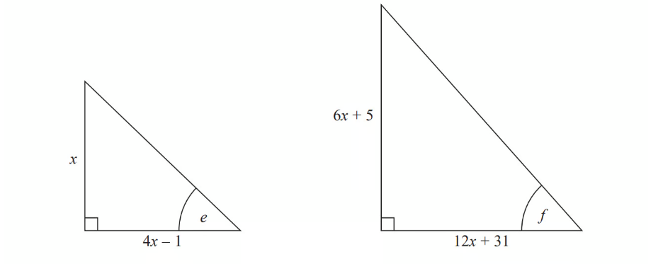

Given that

$\mathrm{tan}e=\mathrm{tan}f$

find the value of $x$.

You must show all your working.

*Source: June 2018 1MA1/3H Q19*

### Q2 — very_hard — 6 marks

**Q2** [6 marks]

Here is a right-angled triangle.

All measurements are in centimetres. 
The area of the triangle is 2.5 cm2 .

Find the perimeter of the triangle. 
Give your answer correct to 3 significant figures. 
You must show all of your working.

*Source: Spec 1 2015 1MA1/2H Q19*

### Q3 — very_hard — 1 marks

**Q3** [1 mark]

In a shop, the price of a monthly magazine is \$$m$ and the price of a weekly magazine is \$$(m-0.75)$.

One day, the shop receives 
•  \$168 from selling monthly magazines 
•  \$207 from selling weekly magazines.

The total number of these magazines sold during this day is 100.

i) Show that  $50m^{2}-225m+63=0$.

[3]

ii) Find the price of a monthly magazine.

\$ ............................................... [2]

### Q4 — very_hard — 6 marks

**Q4** [6 marks]

Ahmed sells different types of cake in his shop.
The cost of each cake depends on its type and its size.

Every small cake costs `$ x` and every large cake costs $\$ ( 2 x + 1 )$.

Petra spends \$20 on small coffee cakes and \$10 on large coffee cakes. 
The total number of cakes is 45.

Write an equation in terms of $x$. 
Solve this equation to find the cost of a small coffee cake. 
Show all your working.

\$ ................................................

*Source: 2020 Oct/Nov 0580/42 Q5D*

### Q5 — hard — 4 marks

**Q5** [2 marks]

The diagram shows a trapezium.

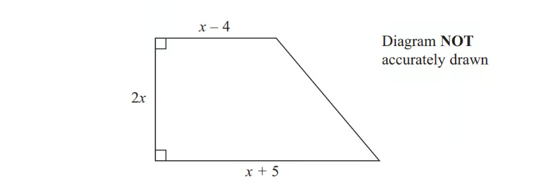

All the measurements are in centimetres.

The area of the trapezium is 351 cm2.

Show that  $2x^{2}+x---351=0$

*Source: November 2013 1MA0/2H Q*

**Q5** [2 marks]

**Extract:**

2x^2 + x - 351 = 0

Work out the value of $x$.

*Source: November 2013 1MA0/2H Q22B*

### Q6 — hard — 9 marks

**Q6** [3 marks]

In this question, all measurements are in metres.

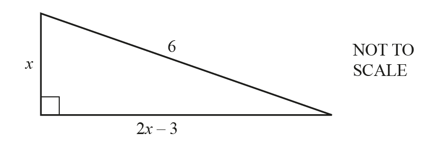

The diagram shows a right-angled triangle.

Show that $5x^{2}-12x-27=0.$

*Source: 2018	May/June 0580/42 Q7A*

**Q6** [2 marks]

Solve $5x^{2}-12x-27=0.$ 
Give your answers correct to 2 decimal places.

$x=$......................... or $x=$.........................

*Source: 2018	May/June 0580/42 Q7B*

**Q6** [2 marks]

**Extract:**

The diagram shows a right-angled triangle.
Show that 5 x squared minus 12 x minus 27 equals 0.
Solve 5 x squared minus 12 x minus 27 equals 0. 
Give your answers correct to 2 decimal places.
x equals......................... or x equals.........................

Calculate the perimeter of the triangle.

............................................ m

*Source: 2018	May/June 0580/42 Q7C*

**Q6** [2 marks]

**Extract:**

The diagram shows a right-angled triangle.
Show that 5x^2 - 12x - 27 = 0.
Solve 5x^2 - 12x - 27 = 0. Give your answers correct to 2 decimal places. x = ......................... or x = ..........................
Calculate the perimeter of the triangle.

Calculate the smallest angle of the triangle.

*Source: 2018	May/June 0580/42 Q7D*

### Q7 — hard — 9 marks

**Q7** [2 marks]

Paulo and Jim each buy sacks of rice but from different shops. Paulo pays \$72 for sacks costing \$$m$ each. 
Jim pays \$72 for sacks costing \$$(m+0.9)$ each.

i) Find an expression, in terms of $m$, for the number of sacks Paulo buys.

[1]

ii) Find an expression, in terms of $m$, for the number of sacks Jim buys.

[1]

*Source: 2018	Oct/Nov 0580/41 Q9A*

**Q7** [4 marks]

**Extract:**

Paulo pays \$72 for sacks costing \$m each.
Jim pays \$72 for sacks costing \$(m + 0.9) each.
i) Find an expression, in terms of m, for the number of sacks Paulo buys.
ii) Find an expression, in terms of m, for the number of sacks Jim buys.

Paulo buys 4 more sacks than Jim.   
Write down an equation, in terms of $m$, and show that it simplifies to  $10m^{2}+9m-162=0$.

*Source: 2018	Oct/Nov 0580/41 Q9B*

**Q7** [3 marks]

**Extract:**

Paulo pays \$72 for sacks costing \$m each.
i) Find an expression, in terms of m, for the number of sacks Paulo buys.

Paulo buys 4 more sacks than Jim.   

Write down an equation, in terms of m, and show that it simplifies to  10 m^2 + 9 m - 162 = 0.

i) Solve  $10m^{2}+9m-162=0$.

$m$ = .................... or $m$ = .................... [2]

ii) Find the number of sacks of rice that Paulo buys.

[1]

*Source: 2018	Oct/Nov 0580/41 Q9C*

### Q8 — medium — 3 marks

**Q8** [3 marks]

Rangan buys 3.6kg of potatoes and 2.8kg of leeks.

The total cost is \$13.72.

Leeks cost \$2.65 per kilogram.

Find the cost of 1 kg of potatoes.

\$ ................................................

*Source: 2020 Oct/Nov 0580/02 Q3*

### Q9 — very_hard — 3 marks

**Q9** [3 marks]

The total perimeter of a semicircle is 19.02 cm.   
Calculate the radius of the semicircle.

................................................ cm

*Source: 2020 May/June 0580/23 Q12*

### Q10 — hard — 10 marks

**Q10** [10 marks]

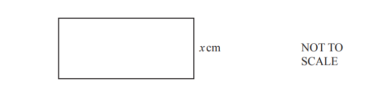

The perimeter of the rectangle is 80 cm. 
The area of the rectangle is $A$cm2.

i) Show that  $x^{2}--40x+A=0$.

[3]

ii) When $A=300$, solve the equation $x^{2}--40x+A=0$ by factorising.

$x$ = .................. or $x$ = .................  [3]

iii) When $A=200$, solve the equation $x^{2}--40x+A=0$ using the quadratic formula. 
Show all your working and give your answers correct to 2 decimal places.

$x$= .................. or $x$ = .................  [4]

*Source: 2020 Specimen 0580/04 Q4A*

### Q11 — medium — 3 marks

**Q11** [3 marks]

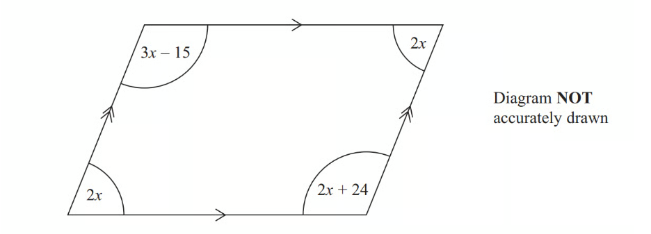

The diagram shows a parallelogram. 
The sizes of the angles, in degrees, are

$2x\,3x-15\,2x\,2x+24$

Work out the value of $x$.

*Source: 2012	June 1MA0/1H Q11*

### Q12 — medium — 4 marks

**Q12** [2 marks]

Esme buys $x$ magazines at \$2.45 each and $y$ cards at \$3.15 each.

Write down an expression, in terms of $x$ and $y$, for the total cost, in dollars, of the magazines and the cards.

\$ ...................................................

*Source: 2019	Oct/Nov 0580/22 Q15A*

**Q12** [2 marks]

**Extract:**

Esme buys ![x] magazines at \$2.45 each and ![y] cards at \$3.15 each.

Esme spends \$60.55 in total. 
She buys 8 magazines.

How many cards does she buy?

*Source: 2019	Oct/Nov 0580/22 Q15B*

### Q13 — hard — 4 marks

**Q13** [4 marks]

3 teas and 2 coffees have a total cost of £7.80 5
 teas and 4 coffees have a total cost of £14.20

Work out the cost of one tea and the cost of one coffee.

*Source: November 2017 1MA1/1H Q11*

### Q14 — hard — 9 marks

**Q14** [9 marks]

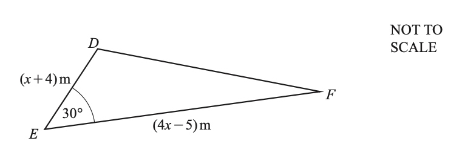

The area of triangle *DEF* is 70 m2.

i) Show that  $4x^{2}+11x-300=0$.

[4]

ii) Use the quadratic formula to solve $4x^{2}+11x-300=0$. 
Show all your working and give your answers correct to 2 decimal places.

$x$ = .......................... or $x$ = .......................... [4]

iii) Find the length of *DE*.

*DE* = ............................................... m [1]

*Source: 2019	Oct/Nov 0580/42 Q6B*

### Q15 — medium — 3 marks

**Q15** [3 marks]

The diagram shows a right-angled triangle.

All the angles are in degrees. 
Work out the size of the smallest angle of the triangle.

*Source: 2015	Spec1 1MA1/1H Q1*

### Q16 — very_hard — 12 marks

**Q16** [5 marks]

All the lengths in this question are in centimetres.

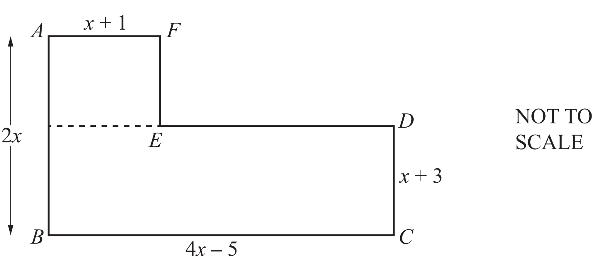

The diagram shows a shape *ABCDEF* made from two rectangles. The total area of the shape is 342 cm2.

Show that $x^{2}+x-72=0$.

*Source: 2020 May/June 0580/43 Q5A*

**Q16** [3 marks]

Solve  $x^{2}+x-72=0$ by factorisation.

$x=$ .................... or  $x=$....................

*Source: 2020 May/June 0580/43 Q5B*

**Q16** [2 marks]

**Extract:**

The diagram shows a shape ABCDEF made from two rectangles. The total area of the shape is 342 cm^2^.

Work out the perimeter of the shape *ABCDEF*.

............................................ cm

*Source: 2020 May/June 0580/43 Q5C*

**Q16** [2 marks]

Calculate angle *DBC*.

Angle *DBC* = ................................................

*Source: 2020 May/June 0580/43 Q5D*

### Q17 — medium — 3 marks

**Q17** [3 marks]

The angles of a quadrilateral are $x^{\circ}$, $(x+5)^{\circ}$, $(2x-25)^{\circ}$ and $(x+10)^{\circ}$.

Find the value of $x$.

$x$ = ...................................................

*Source: 2019	Oct/Nov 0580/41 Q1B*

### Q18 — hard — 3 marks

**Q18** [3 marks]

A cone with height 14.8 cm has volume 275 cm3.   
Calculate the radius of the cone. [
The volume, $V$, of a cone with radius $r$ and height $h$ is $V=\frac{1}{3}πr^{2}h$.]

............................................... cm

*Source: 2019 March 0580/22 Q12*

### Q19 — very_hard — 5 marks

**Q19** [5 marks]

Paddy and Anna each invest \$2000 for 5 years. 
Paddy earns simple interest at a rate of 1.25% per year. 
Anna earns compound interest at a rate of $r$% per year. 
At the end of 5 years, Paddy’s investment is worth the same as Anna’s investment.

Calculate the value of $r$.

$r=$................................................

*Source: 2020 May/June 0580/23 Q16*

### Q20 — hard — 5 marks

**Q20** [5 marks]

$ABCD$ is a rectangle. 
$EFGH$is a trapezium.

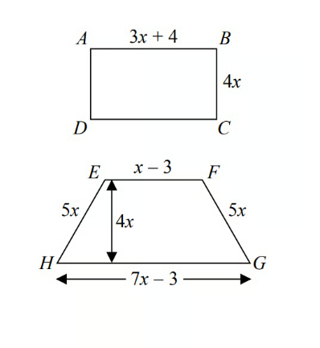

All measurements are in centimetres. 
The perimeters of these two shapes are the same.

Work out the area of the rectangle.

*Source: Sample 2015 1MA1/2H Q9*

### Q21 — medium — 4 marks

**Q21** [4 marks]

The diagram shows a trapezium.

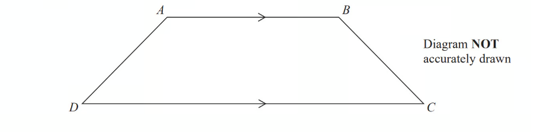

$AD$ = $x$ cm. 
$BC$is the same length as $AD$. 
$AB$ is twice the length of $AD$. 
$DC$ is 4 cm longer than $AB$.

The perimeter of the trapezium is 38 cm. 
Work out the length of $AD$.

*Source: June 2014 1MA0/2H Q9*

### Q22 — medium — 6 marks

**Q22** [3 marks]

Ahmed sells different types of cake in his shop. 
The cost of each cake depends on its type and its size.

Every small cake costs `$ x` and every large cake costs $\$ ( 2 x + 1 )$The total cost of 3 small lemon cakes and 2 large lemon cakes is \$12.36.

Find the cost of a small lemon cake.

\$ ................................................

*Source: 2020 Oct/Nov 0580/42 Q5A*

**Q22** [3 marks]

The cost of 18 small chocolate cakes is the same as the cost of 7 large chocolate cakes.

Find the cost of a small chocolate cake.

\$ ................................................ [3]

*Source: 2020 Oct/Nov 0580/42 Q5B*

### Q23 — hard — 5 marks

**Q23** [5 marks]

Here is a rectangle.

The length of the rectangle is 7 cm longer than the width of the rectangle.

4 of these rectangles are used to make this 8-sided shape.

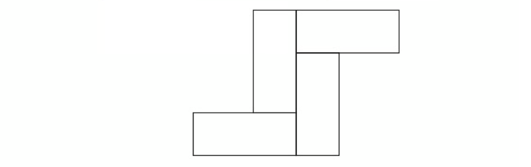

The perimeter of the 8-sided shape is 70 cm. 
Work out the area of the 8-sided shape.

*Source: November 2017 1MA1/3H Q6*

### Q24 — hard — 4 marks

**Q24** [4 marks]

At a football match, the price of an adult ticket is \$$x$ and the price of a child ticket is \$$(x-2.50)$. 
There are 18 500 adults and 2400 children attending the football match. 
The total amount paid for the tickets is \$320 040. 
Find the price of an adult ticket.

\$ ................................................

*Source: 2018	May/June 0580/43 Q5A*

### Q25 — hard — 9 marks

**Q25** [3 marks]

The diagram shows a right-angled triangle *ABC*.

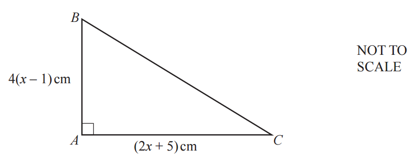

The area of this triangle is 30 cm2. 
Show that  $2x^{2}+3x-20=0$.

*Source: 2018	Oct/Nov 0580/42 Q4A*

**Q25** [3 marks]

**Extract:**

2 x squared plus 3 x minus 20 equals 0

Use factorisation to solve the equation  $2x^{2}+3x-20=0$.

$x$ = ...................... or $x$ = ......................

*Source: 2018	Oct/Nov 0580/42 Q4B*

**Q25** [3 marks]

**Extract:**

The diagram shows a right-angled triangle ABC.
The area of this triangle is 30 cm^2^.
Show that 2 x squared plus 3 x minus 20 equals 0.

Calculate *BC*.

*BC* = .......................................... cm

*Source: 2018	Oct/Nov 0580/42 Q4C*

### Q26 — very_hard — 4 marks

**Q26** [4 marks]

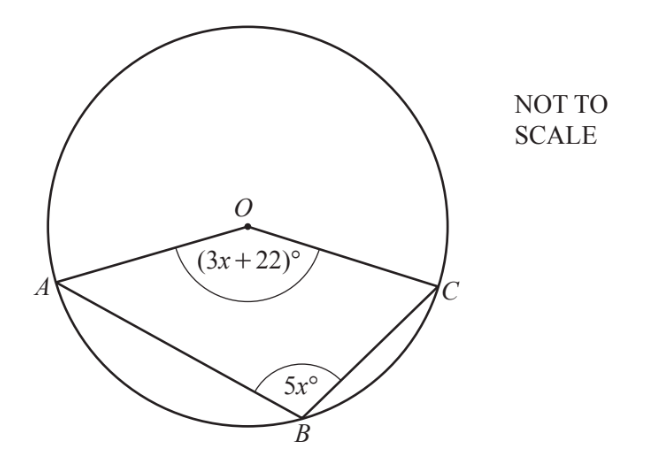

*A*, *B* and *C* lie on the circle, centre *O*. 
Angle *AOC =* $(3x+22)^{\circ}$ and angle *ABC* = $5x^{\circ}$.

Find the value of $x$.

$x$ = ...................................................

*Source: 2019	Oct/Nov 0580/41 Q1E*

### Q27 — medium — 5 marks

**Q27** [5 marks]

i) Factorise  $y^{2}+5y-84$.

[2]

ii)

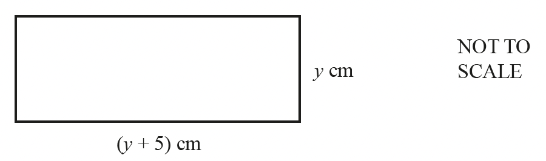

The area of the rectangle is 84 cm2.

Find the perimeter.

.......................................... cm [3]

*Source: 2018	May/June 0580/43 Q5B*

### Q28 — very_hard — 6 marks

**Q28** [6 marks]

Alan invests \$200 at a rate of `r percent sign` per year compound interest. After 2 years the value of his investment is \$206.46.

i) Show that     $r^{2}+200r-323=0$.

[3]

ii) Solve the equation   $r^{2}+200r-323=0$  to find the rate of interest. 
Show all your working and give your answer correct to 2 decimal places.

$r=$................................................ [3]

*Source: 2020 Oct/Nov 0580/41 Q8F*

### Q29 — medium — 3 marks

**Q29** [3 marks]

Oranges cost 21 cents each. 
Alex buys $x$ oranges and Bobbie buys $(x+2)$ oranges. 
The total cost of these oranges is \$4.20. 
Find the value of $x$.

$x$ = ...................................................

*Source: 2019	Oct/Nov 0580/41 Q7A*

### Q30 — hard — 3 marks

**Q30** [3 marks]

Solve.

$\frac{3y}{2y-1}=\frac{3}{4}$

$y$ = ..............................................

*Source: Specimen 2025 0580/04 Q18*

### Q31 — medium — 5 marks

**Q31** [5 marks]

Redlands School sent $x$ students to a revision day.

St Samuel's School sent twice as many students as Redlands School.    
Francis Long School sent 7 fewer students than Redlands School.

Each student paid £ 15 for the revision day.  
The students paid a total of £1155

Work out how many students were sent by each school to the revision day.    
You must show all your working.

*Source: 2015	June 1MA0/2H Q5*

### Q32 — hard — 4 marks

**Q32** [4 marks]

A cinema sells adult tickets and child tickets.

The total cost of 3 adult tickets and 1 child ticket is £30   
    The total cost of 1 adult ticket and  3 child tickets is £22

Work out the cost of an adult ticket and the cost of a child     ticket.

*Source: November 2014 1MA0/2H Q15*

### Q33 — very_hard — 5 marks

**Q33** [5 marks]

There are only $r$ red counters and $g$ green counters in a bag.

A counter is taken at random from the bag. 
The probability that the counter is green is $\frac{3}{7}$ The counter is put back in the bag.

2 more red counters and 3 more green counters are put in the bag. 
A counter is taken at random from the bag.

The probability that the counter is green is $\frac{6}{13}$ 
Find the number of red counters and the number of green counters that were in the bag originally.

*Source: June 2019 1MA1/1H Q22*

