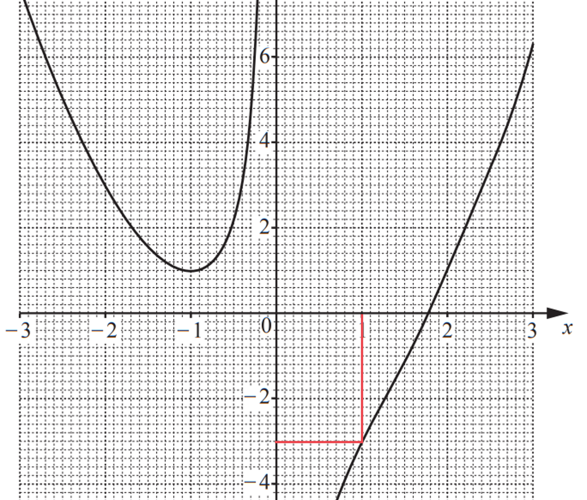
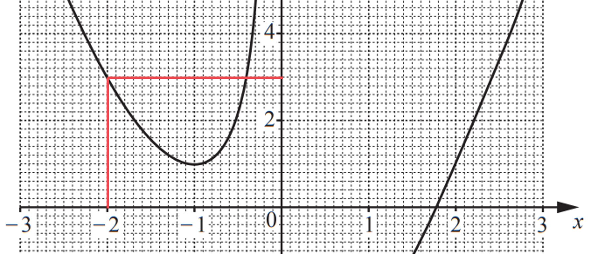
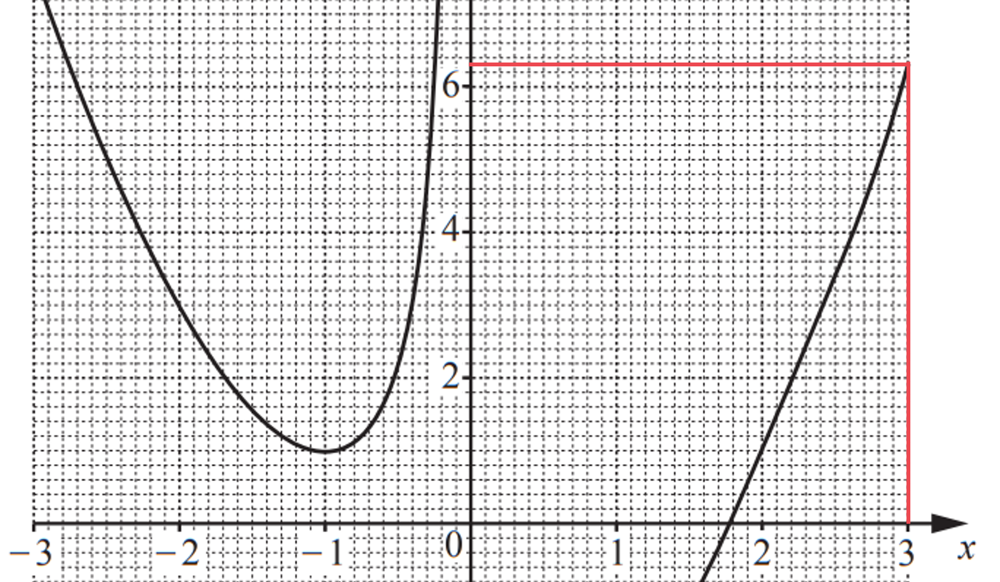

# Mark Schemes — Functions
**Algebra & Sequences** · Cambridge (CIE) IGCSE maths (0607)

## Non-Calculator Questions (43 questions)

### Q1
> *Replace *`straight f open parentheses x close parentheses`* with *$y$

$y = 2 x - 1$ * *

> *Swap *$x$* and *$y$

$x=2y-1$

**[M1]**

> *Rearrange to make *$y$* the subject again*

$\frac{x+1}{2}=y$

> *This is the inverse function*

`straight f to the power of negative 1 end exponent open parentheses x close parentheses equals fraction numerator x plus 1 over denominator 2 end fraction`

**[A1]**

> **[mark-scheme]**
> **M1**: For reaching $x=2y-1$ or $y+1=2x$ or $\frac{y}{2}=x-\frac{1}{2}$ or equivalent.
> 
> **A1**: Correct final answer or equivalent. E.g. `straight f to the power of negative 1 end exponent open parentheses x close parentheses equals x over 2 plus 1 half`.
> 
> If final answer is correct but no working shown then M1 A1 is awarded.
> *Use the expression for *`straight f open parentheses x close parentheses`* as the input to *`straight g open parentheses x close parentheses`

> $f(x)=2x-1$*           *$g(x)=\frac{3}{x+4}$

`straight g open parentheses straight f open parentheses x close parentheses close parentheses equals fraction numerator 3 over denominator open parentheses 2 x minus 1 close parentheses plus 4 end fraction`

**[M1]**

> *Simplify*

`straight g open parentheses straight f open parentheses x close parentheses close parentheses equals fraction numerator 3 over denominator 2 x plus 3 end fraction`

**[A1]**

> **[mark-scheme]**
> **M1**: Substituting `straight f open parentheses x close parentheses` into `straight g open parentheses x close parentheses`.
> 
> **A1**: Correct final answer.
> *Use the expressiona for *`straight g open parentheses x close parentheses`* as the input to *`straight f open parentheses x close parentheses`

> $f(x)=2x-1$*           *$g(x)=\frac{3}{x+4}$

`straight f open parentheses straight g open parentheses x close parentheses close parentheses equals 2 open parentheses fraction numerator 3 over denominator x plus 4 end fraction close parentheses minus 1 equals 2`

**[M1]**

> *Solve the equation to find *$x$

`table row cell 2 open parentheses fraction numerator 3 over denominator x plus 4 end fraction close parentheses end cell equals 3 row cell fraction numerator 3 over denominator x plus 4 end fraction end cell equals cell 3 over 2 end cell row cell 2 open parentheses 3 close parentheses end cell equals cell 3 open parentheses x plus 4 close parentheses end cell row 2 equals cell x plus 4 end cell row cell 2 minus 4 end cell equals x end table`

**[M1]**

$x=-2$

**[A1]**

> **[mark-scheme]**
> **M1**: Substituting `straight g open parentheses x close parentheses` into `straight f open parentheses x close parentheses`.
> 
> **M1**: Correct algebraic method to solve the equation.
> 
> **A1**: Correct final answer.

### Q2
> *Find *`gg open parentheses x close parentheses`* by substituting the function *`straight g open parentheses x close parentheses space`*into the function *`straight g open parentheses x close parentheses`*. *

`table attributes columnalign right center left columnspacing 0px end attributes row cell gg open parentheses x close parentheses space end cell equals cell 1 minus 2 open parentheses straight g open parentheses x close parentheses close parentheses end cell row blank equals cell space 1 space minus 2 open parentheses 1 space minus 2 x close parentheses end cell end table`

> *Expand the brackets and simplify.*

`table row cell gg open parentheses x close parentheses space end cell equals cell 1 space minus space open parentheses 2 space minus 4 x close parentheses end cell row blank equals cell space 1 space minus space 2 space plus space 4 x end cell row blank equals cell space minus 1 space plus space 4 x end cell end table`

**[1]**

> *Find *`straight g open parentheses x close parentheses straight g open parentheses x close parentheses`* by multiplying the function *`straight g open parentheses x close parentheses space`*by the function *`straight g open parentheses x close parentheses`*. *

`table attributes columnalign right center left columnspacing 0px end attributes row cell straight g open parentheses x close parentheses straight g open parentheses x close parentheses space end cell equals cell open parentheses 1 minus 2 x close parentheses open parentheses 1 minus 2 x close parentheses end cell end table`

> *Expand the brackets and simplify.*

`table row cell straight g open parentheses x close parentheses straight g open parentheses x close parentheses space end cell equals cell space 1 open parentheses 1 minus 2 x close parentheses minus 2 open parentheses 1 space minus 2 x close parentheses end cell row blank equals cell 1 space minus space 2 x space minus space 2 x space plus space 4 x squared end cell row blank equals cell space 1 space minus space 4 x space plus space 4 x squared end cell end table`

**[1]**

> *Substitute into *$g(x)g(x)-\mathrm{gg}(x)$*.*

`table attributes columnalign right center left columnspacing 0px end attributes row cell straight g left parenthesis x right parenthesis straight g left parenthesis x right parenthesis space minus space gg left parenthesis x right parenthesis space end cell equals cell space open parentheses 1 space minus space 4 x space plus space 4 x squared close parentheses space minus space open parentheses negative 1 space plus space 4 x close parentheses end cell end table`

**[1]**

> *Expand and simplify.*

`table attributes columnalign right center left columnspacing 0px end attributes row cell straight g left parenthesis x right parenthesis straight g left parenthesis x right parenthesis space minus space gg left parenthesis x right parenthesis space end cell equals cell space 1 space minus space 4 x space plus space 4 x squared space plus space 1 space minus space 4 x end cell row blank equals cell space 2 space minus space 8 x space plus space 4 x squared end cell end table`

`table row blank blank cell bold space bold 4 bold italic x to the power of bold 2 bold space end exponent bold minus bold space bold 8 bold italic x bold space bold plus bold space bold 2 end cell end table`* ***[1]**

### Q3
*Find g(2) by substituting **x** = 2 into g(**x**)* * *

`table row cell straight g open parentheses 2 close parentheses end cell equals cell 2 cross times 2 minus 1 end cell row blank equals 3 end table` * *

*You could try to solve *`straight h to the power of negative 1 end exponent open parentheses x close parentheses equals 3`* by finding *`straight h to the power of negative 1 end exponent open parentheses x close parentheses`*, but it is not possible to find the inverse function using algebra from this course* *Instead, apply the function h to both sides of the equation* * *

`hh to the power of negative 1 end exponent open parentheses x close parentheses equals straight h open parentheses 3 close parentheses` * *

*The input **x **on the left first goes through the function h**-1**, but then has this immediately "undone" by going through the function h The h and the h**-1** cancel each other out (they are inverses of each other)* * *

`x equals straight h open parentheses 3 close parentheses`

**[1]*** *

*Find h(3) by substituting **x** = 3 into h(**x**)*

`x equals straight h open parentheses 3 close parentheses equals 3 cubed`

$x=27$ **[1]**

### Q4
*If *`straight h open parentheses x close parentheses equals 3 to the power of x space end exponent`*, find *`straight h open parentheses 3 x close parentheses`* (by replacing *$x$* with *$3x$*)*

`straight h open parentheses 3 x close parentheses equals 3 to the power of 3 x end exponent`

** [1]**

*The question wants the form *$k^{x}$*, not *$k^{3x}$* Use *`a to the power of m n end exponent equals open parentheses a to the power of m close parentheses to the power of n`* to separate out the power of *$x$

`table row cell 3 to the power of 3 x end exponent end cell equals cell open parentheses 3 cubed close parentheses to the power of x end cell end table`

*Change *$3^{3}$* into 27 and remove brackets*

`open parentheses 3 cubed close parentheses to the power of x equals open parentheses 27 close parentheses to the power of x equals 27 to the power of x`

> *Compare *$27^{x}$* with *$k^{x}$* to see that *$k$* is 27*

$k=27$ **[1]**

### Q5
> *Substitute *$x=2x+1$* into *`straight g open parentheses x close parentheses`* to find *`straight g open parentheses 2 x plus 1 close parentheses`*.*

`straight g open parentheses 2 x plus 1 close parentheses equals fraction numerator 10 over denominator 2 x plus 1 end fraction`

> *Make *`straight g open parentheses 2 x plus 1 close parentheses`* equal to 4.*

$\frac{10}{2x+1}=4$

**[1]**

> *Multiply both sides by *$2x+1$*.*

`10 equals 4 open parentheses 2 x plus 1 close parentheses`

> *Expand the brackets on the right hand side.*

$10=8x+4$

**[1]**

> *Subtract 4 from both sides.*

$6=8x$

> *Divide both sides by 8.*

$\frac{6}{8}=x$

$x=0.75$* ***[1]**

**An equivalent fractional answer will also be accepted.**

### Q6
> *Write the original function *$f(x)$* in terms of *$x$* and *$y$*.*

$y=3x-5$

> *Rearrange to make *$x$* the subject.*

> `table row cell y plus 5 end cell equals cell 3 x end cell end table`*             *

**[1]**

> `table attributes columnalign right center left columnspacing 0px end attributes row cell fraction numerator y plus 5 over denominator 3 end fraction end cell equals x end table`*                 *

> *Swap the variables and re-write in function notation.*

$f^{-1}(x)=\frac{x+5}{3}$* ***[1]**

### Q7
> *Substitute *$x+2$* into *`straight f open parentheses x close parentheses`*.*

`straight f open parentheses x plus 2 close parentheses equals 7 open parentheses x plus 2 close parentheses minus 4`

> *Expand and simplify.*

`table row cell straight f open parentheses x plus 2 close parentheses end cell equals cell 7 x plus 14 minus 4 end cell row blank equals cell 7 x plus 10 end cell end table`

> *Make the expression equal to -11.*

`table row cell 7 x plus 10 end cell equals cell negative 11 end cell end table`

**[1]**

> *Solve by subtracting 10 from both sides and then dividing both sides by 7.*

`table row cell 7 x end cell equals cell negative 11 minus 10 end cell row cell 7 x end cell equals cell negative 21 end cell row x equals cell fraction numerator negative 21 over denominator 7 end fraction end cell end table`

$x=-3$ **[1]**

### Q8
> *If *$h^{-1}=-2$*, the input will be the same as the output from *`straight h open parentheses negative 2 close parentheses`*.*

`table row cell straight h open parentheses negative 2 close parentheses end cell equals cell 3 to the power of negative 2 end exponent end cell row cell straight h open parentheses negative 2 close parentheses end cell equals cell fraction numerator space 1 over denominator 3 squared end fraction end cell end table`

$x=\frac{1}{9}$ **[1]**

### Q9
*This question involves setting up and solving simultaneous equations in **a** and **b* 
*If g(3) = 20 then substitute x = 3 into g(x) and set this equal to 20* * *

`table row cell a cross times 3 plus b end cell equals 20 row cell 3 a plus b end cell equals 20 end table`

**[1]**

*f**-1**(33) = g(1) *
*Find the inverse function, f**-1**(**x) **by first replacing f(**x**) with **y* * *

$y=5x+3$ * *

*Without rearranging the equation, swap the **x**'s and **y**'s* * *

$x=5y+3$

*Now make **y** the subject of this new equation (by subtracting 3 from both sides then dividing both sides by 5)* * *

`table row cell x minus 3 end cell equals cell 5 y end cell row cell fraction numerator x minus 3 over denominator 5 end fraction end cell equals y end table` * *

*The function on the left-hand side is the inverse function, f**-1**(**x**)* *Replace **y** with f**-1**(**x**)*

$f^{-1}(x)=\frac{x-3}{5}$

**[1]**

> *Find f**-1**(33) by substituting **x** = 33 into f**-1**(**x**)  *

`table row cell straight f to the power of negative 1 end exponent open parentheses 33 close parentheses end cell equals cell fraction numerator 33 minus 3 over denominator 5 end fraction end cell row blank equals cell 30 over 5 end cell row blank equals 6 end table`

> *Find g(1) by substituting 1 into g(**x**)  *

`straight g open parentheses 1 close parentheses equals a plus b`

**[1]**

> *f**-1**(33) = g(1) where f**-1**(33) = 6 and g(1) = **a** + **b** *
*Set 6 equal to **a** + **b**  *

$6=a+b$

**[1]**

> *Write down the two simultaneous equations for **a** and **b**  *

> `table row cell 3 a plus b end cell equals 20 row cell a plus b end cell equals 6 end table`*  *

> *Solve to find **a** (for example, by subtracting the second equations from the first)  *

> `table attributes columnalign right center left columnspacing 0px end attributes row cell 2 a end cell equals 14 row a equals cell 14 over 2 end cell row a equals 7 end table`*  *

> *Find **b** (for example, by substituting **a** = 7 into the second equation then solving for** b**)  *

> `table row cell 7 plus b end cell equals 6 row b equals cell negative 1 end cell end table`*  *

> *Write out the two solutions together*

**a ****= 7 and ****b**** = -1*** ***[1]**

### Q10
*Multiply the function *`straight f open parentheses x close parentheses`* by 5 and make it equal to 3 and solve for *$x$.

`5 open parentheses 2 x minus 3 close parentheses equals 3`

> *Expand the brackets on the left hand side.*

$10x-15=3$

**[1]**

> *Add 15 to both sides.*

$10x=18$

> *Divide both sides by 10.*

$x=1.8$** [1]**

**Equivalent fractional answers will be accepted.**
> *Find an expression for the composite function *`gf open parentheses x close parentheses`* by using the output from *`straight f open parentheses x close parentheses`* as the. input for *`straight g open parentheses x close parentheses`*.*

`gf open parentheses x close parentheses equals 9 minus open parentheses 2 x minus 3 close parentheses squared`

> *Set the expression equal to -16 and solve for *$x$*.*

`negative 16 equals 9 minus open parentheses 2 x minus 3 close parentheses squared`

**[1]**

> *Expand the brackets on the right hand side.*

`negative 16 equals 9 minus open parentheses 4 x squared minus 6 x minus 6 x plus 9 close parentheses`

> *Remove the brackets on the right hand side being careful with negatives.*

$-16=9-4x^{2}+6x+6x-9$

> *Simplify the expression by collecting like terms.*

$-16=-4x^{2}+12x$

> *Add *$4x^{2}$* to both sides.*

$4x^{2}-16=12x$

> *Subtract *$12x$* from both sides.*

$4x^{2}-12x-16=0$

**[1]**

> *Divide both sides by 4.*

$x^{2}-3x-4=0$

> *Factorise.*

`open parentheses x minus 4 close parentheses open parentheses x plus 1 close parentheses equals 0`

**[1]**

> *Find the value for *$x$* that will make each set of brackets equal to 0.*

$x=4$**   or   **$x=-1$** ****[1]**

### Q11
> *Find *`straight f to the power of negative 1 end exponent open parentheses x close parentheses`* by setting *`straight f open parentheses x close parentheses`* equal to *$y$*, swapping the variables and rearranging to make *$y$* the subject.*

`table row cell y space end cell equals cell space 1 half x end cell row cell x space end cell equals cell space 1 half y end cell row cell y space end cell equals cell space 2 x end cell row cell straight f to the power of negative 1 space end exponent open parentheses x close parentheses space end cell equals cell space 2 x end cell end table`

**[1]**

> `gf open parentheses x close parentheses`* means *`straight g open parentheses straight f open parentheses x close parentheses close parentheses`*. Find *`gf open parentheses x close parentheses`* by substituting *`straight f open parentheses x close parentheses`* into *`g open parentheses x close parentheses.`*  *

`gf open parentheses x close parentheses equals straight g open parentheses 1 half x close parentheses space equals space open parentheses 1 half x close parentheses space minus space open parentheses 1 half x close parentheses squared space`

**[1]**

> *Set *`gf open parentheses x close parentheses`* equal to*`straight f to the power of negative 1 end exponent open parentheses x close parentheses`*.  *

`space open parentheses 1 half x close parentheses space minus space open parentheses 1 half x close parentheses squared space equals space 2 x`

> *Simplify.  *

$\frac{1}{2}x-\frac{1}{4}x^{2}=2x$

> *Remove the fractions by multiplying every term through by 4.  *

$2x-x^{2}=8x$

> *Form a quadratic equation by bringing all terms to one side.  Adding *$x^{2}$* and subtracting *$2x$* from both sides gives the quadratic in is simplest form.*

$x^{2}+6x=0$

> *Factorise.*

`x open parentheses x space plus space 6 close parentheses equals space 0`

**[1]**

> *Solve.*

> *Remember that *$x=0$* is one solution. *

$x=0\mathrm{and}x=-6$* ***[1]**

### Q12
> *Substitute *$x=-3$* into *$f$

$f(-3)=5-2(-3)=11$

**[1]**

> *Substitute *$x=11$* into *$f$

$f(11)=5-2(11)=5-22$

$-17$** [1]**
i) *Substitute *$2x$* into *$g$*.*

`straight g left parenthesis 2 x right parenthesis equals open parentheses 2 x close parentheses squared plus 8`

> *Expand the brackets to get the final answer.*

$=4x^{2}+8$* ***[1]**

ii) *The question is asking for the inverse function of *$f$*. Replace "*$f(x)$*" with "*$y$*", and swap *$x$* and *$y$* around.*

$y=5-2x\mathrm{becomes}x=5-2y$

**[1]**

> *Rearrange to get *$y$* in terms of *$x$*.*

`table attributes columnalign right center left columnspacing 0px end attributes row cell x plus 2 y end cell equals 5 row cell 2 y end cell equals cell 5 minus x end cell row y equals cell fraction numerator 5 minus x over denominator 2 end fraction end cell end table`

> *Replace "*$y$*" with "*$f^{-1}(x)$*".*

$f^{-1}(x)=\frac{5-x}{2}$* ***[1]**

### Q13
> *Replace the functions with the algebraic expressions.*

$\frac{1}{7-2x}+\frac{10}{x}$

> *Multiply the numerator and the denominator of the first fraction by *$x$*, and the numerator and denominator of the second fraction by *$7-2x$* to find equivalent fractions with a common denominator.*

$\frac{1}{7-2x}\times\frac{x}{x}+\frac{10}{x}\times\frac{7-2x}{7-2x}$

`fraction numerator x over denominator x open parentheses 7 minus 2 x close parentheses end fraction plus fraction numerator 10 open parentheses 7 minus 2 x close parentheses over denominator x open parentheses 7 minus 2 x close parentheses end fraction`

> *Add the fractions together.*

> * *`fraction numerator x plus 10 open parentheses 7 minus 2 x close parentheses over denominator x open parentheses 7 minus 2 x close parentheses end fraction`

**Correct numerator [1] **
**Correct common denominator [1]**

> *Expand the brackets on the numerator and the denominator.*

$\frac{x+70-20x}{7x-2x^{2}}$

> *Simplify the numerator by collecting like terms.*

$\frac{70-19x}{7x-2x^{2}}$** [1]**

**You will still get the mark if you leave the denominator in its factorised form **`x open parentheses 7 minus 2 x close parentheses`**.**
> *If *`straight h to the power of negative 1 end exponent open parentheses 19 space 683 close parentheses`*, the output will be the same as the input required for *`straight h open parentheses x close parentheses equals 19 space 683`*.*

`table row cell straight h open parentheses x close parentheses end cell equals cell 27 to the power of x end cell row cell 19 space 683 space end cell equals cell space 27 to the power of x end cell end table`

> *Try different values for *$x$*.*

$x=3$ **[1]**

### Q14
> `ff open parentheses x close parentheses`* is the compound function "*$f$* of *`straight f open parentheses x close parentheses`*".*

`ff open parentheses x close parentheses equals 7 minus open parentheses 7 minus x close parentheses equals x`

**[1]**

> *A simple result so we can write the value of *`ff open parentheses 2 close parentheses`* straight down!*

$\mathrm{ff}(2)=2$ **[1]**
> `gf open parentheses x close parentheses`* is the compound function "*$g$* of *`straight f open parentheses x close parentheses`*".*

`gf open parentheses x close parentheses equals 4 open parentheses 7 minus x close parentheses plus 2`

**[1]**

`table attributes columnalign right center left columnspacing 0px end attributes row cell gf open parentheses x close parentheses end cell equals cell 28 minus 4 x plus 2 equals 30 minus 4 x end cell end table`

$\mathrm{gf}(x)=30-4x$ **[1]**
> *Replace "*$x$*" by "*$2x$*" in *`straight h open parentheses x close parentheses`*.*

`straight h open parentheses 2 x close parentheses equals 15 minus open parentheses 2 x close parentheses squared`

**[1]**

> *Simplify for the final answer.*

$h(2x)=15-4x^{2}$* ***[1]**

### Q15
> *Substitute in the expression for the two functions.*

$\frac{x^{2}+1}{3x+2}+x$

> *Write **x** as a fraction with 1 as the denominator.*

$\frac{x^{2}+1}{3x+2}+\frac{x}{1}$

> *A common denominator for both fractions is *$3x+2$*. *
*Convert the denominator of the second fraction into *$3x+2$* by multiplying the numerator and denominator by *$3x+2.$

`fraction numerator x squared plus 1 over denominator 3 x plus 2 end fraction plus fraction numerator x open parentheses 3 x plus 2 close parentheses over denominator 3 x plus 2 end fraction`

**[1]**

> *As the denominators are the same you can write as one fraction.*

`fraction numerator x squared plus 1 plus x open parentheses 3 x plus 2 close parentheses over denominator 3 x plus 2 end fraction`

**[1]**

> *Expand the bracket in the numerator.*

$\frac{x^{2}+1+3x^{2}+2x}{3x+2}$

> *Simplify the numerator.*

$\frac{4x^{2}+2x+1}{3x+2}$ **[1]**

### Q16
i) `gf open parentheses x close parentheses`* means *`straight g open parentheses straight f open parentheses x close parentheses close parentheses`

*Replace *`straight f open parentheses x close parentheses`* with *$x^{3}$ * *

`straight g open parentheses straight f open parentheses x close parentheses close parentheses equals straight g open parentheses x cubed close parentheses` * *

*Find *`straight g open parentheses x cubed close parentheses`* by replacing all *$x$*'s in *`straight g open parentheses x close parentheses`* with *$x^{3}$* *

`straight g open parentheses x cubed close parentheses equals 5 x cubed plus 2`

$\mathrm{gf}(x)=5x^{3}+2$ **[1]**

ii) *Replace *`straight g open parentheses x close parentheses`* with *$y$* *

$y=5x+2$

*Without rearranging the equation, swap the *$x$* **and the *$y$* around*

$x=5y+2$

**[1]**

*Rearrange this new equation to make *$y$* the subject (by subtracting *$2$* then dividing by *$5$*)*

`table attributes columnalign right center left columnspacing 0px end attributes row cell x minus 2 end cell equals cell 5 y end cell row cell fraction numerator x minus 2 over denominator 5 end fraction end cell equals y end table`

> *The newly formed function of *$x$* on the left-hand side is the inverse function *`straight g to the power of negative 1 end exponent open parentheses x close parentheses`* Replace *$y$* with *`straight g to the power of negative 1 end exponent open parentheses x close parentheses`*  *

$g^{-1}(x)=\frac{x-2}{5}$ **[1]**

### Q17
*To go from *$\text{f}(x)$* to *$\text{f}(1-x)$*, the *$x$* has been replaced by *$1-x$ *So substitute *$1-x$* in place of *$x$* into the expression for *$\text{f}(x)$

$\text{f}(1-x)=2(1-x)+3$

**[1]**

> *Then expand and simplify*

`table row cell straight f left parenthesis 1 minus x right parenthesis end cell equals cell 2 minus 2 x plus 3 end cell row cell text f end text left parenthesis 1 minus x right parenthesis end cell equals cell negative 2 x plus 5 end cell end table`

$-2x+5$ **[1]** 
**Could be written alternatively as **$5-2x$

### Q18
> *Substitute *$x=p$* into *`straight h open parentheses p close parentheses`*.*

> `table row cell straight h open parentheses p close parentheses end cell equals cell p squared end cell row cell straight h open parentheses p close parentheses end cell equals cell p rightwards double arrow p squared equals p end cell end table`* *

> *Subtract **p** from both sides to make one side equal to zero.*

$p^{2}-p=0$

> *Factorise out a **p** from the left hand side.*

`p open parentheses p minus 1 close parentheses equals 0`

> *Find the two solutions by setting each factor equal to zero and solving.*

`table row p equals 0 row cell p minus 1 end cell equals cell 0 rightwards double arrow p equals 1 end cell end table`

$p=0\mathrm{or}p=1$

**1 mark for each answer**** [2]**

### Q19
*Find *`straight h open parentheses negative 2 close parentheses`* by substituting *$x=-2$* into *`straight h open parentheses x close parentheses`* and simplifying* * *

`table row cell straight h open parentheses negative 2 close parentheses end cell equals cell a open parentheses negative 2 close parentheses squared plus 1 end cell row blank equals cell a cross times 4 plus 1 end cell row blank equals cell 4 a plus 1 end cell end table` *  *

*Form an equation in *$a$* by replacing *`straight h open parentheses negative 2 close parentheses`* in *`straight h open parentheses negative 2 close parentheses equals 21`*with *$4a+1$ * *

$4a+1=21$

**[1]**

*Solve the equation (by subtracting *$1$* then dividing by *$4$*)*

`table row cell 4 a end cell equals cell 21 minus 1 end cell row cell 4 a end cell equals 20 row a equals cell 20 over 4 end cell end table`

$a=5$ **[1]**

### Q20
`open parentheses straight f open parentheses x close parentheses close parentheses squared equals straight f open parentheses x close parentheses cross times straight f open parentheses x close parentheses`*, not the composite function *`ff open parentheses x close parentheses` 
*Write down *`open parentheses straight f open parentheses x close parentheses close parentheses squared` * *

`open parentheses straight f open parentheses x close parentheses close parentheses squared equals open parentheses 3 x plus 4 close parentheses open parentheses 3 x plus 4 close parentheses` * *

*Expand the brackets (by multiplying everything in the first bracket by everything in the second bracket)* * *

`table attributes columnalign right center left columnspacing 0px end attributes row cell open parentheses straight f open parentheses x close parentheses close parentheses squared end cell equals cell 9 x squared plus 12 x plus 12 x plus 16 end cell row blank equals cell 9 x squared plus 24 x plus 16 end cell end table` * *

**at least three correct terms in the first expanded line**** [1]**

> *This is in the form *$ax^{2}+bx+c$* where** a** = 9, **b** = 24 and **c** = 16*

`Error converting from MathML to accessible text.` **[1]**

### Q21
> *Find *`straight f to the power of negative 1 end exponent open parentheses 3 close parentheses`* by setting *`straight f open parentheses x close parentheses`* equal to 3. (This is the easiest way to find the inverse of an input without finding the inverse function first).*

`table row cell fraction numerator 2 x over denominator 5 end fraction space minus space 1 space end cell equals cell space 3 end cell end table`

**[1]**

> *Solve to find the value of *$x$*, this will be the input of *`straight f open parentheses x close parentheses`* that gives the output of 3, which is the same as the output of *`straight f to the power of negative 1 end exponent open parentheses x close parentheses`* when the input is 3. *

`table row cell fraction numerator 2 x over denominator 5 end fraction space end cell equals cell space 4 end cell row cell 2 x space end cell equals cell space 20 end cell row cell x space end cell equals cell space 10 end cell end table`

** Method to solve correct**** [1]**** **
**Answer correct**** [1]**

> *Find *`straight f open parentheses negative 0.5 close parentheses`* by replacing the *$x$* **values in *`straight f open parentheses x close parentheses`* with -0.5 and simplifying.  *

`straight f open parentheses negative 0.5 close parentheses space equals fraction numerator space 2 open parentheses negative 0.5 close parentheses over denominator 5 end fraction space minus space 1 space equals space fraction numerator negative 1 over denominator 5 end fraction space minus space 1 space equals space minus space 0.2 space minus space 1 space equals space minus 1.2`

**[1]**

> *Add *`straight f open parentheses negative 0.5 close parentheses`* to *`straight f to the power of negative 1 end exponent open parentheses 3 close parentheses`*.  *

`straight f to the power of negative 1 end exponent open parentheses 3 close parentheses space plus space straight f open parentheses negative 0.5 close parentheses space equals space 10 space plus space open parentheses negative 1.2 close parentheses`

$f^{-1}(3)+f(-0.5)=8.8$* ***[1]**

### Q22
i) `text f end text open parentheses 1 close parentheses`* is asking to find the output (**y**-value) of the function *`text f end text open parentheses x close parentheses`* when *$x=1$

**-3 ****[1]**

ii) `text ff end text open parentheses negative 2 close parentheses`* or *`text f end text open parentheses text f end text open parentheses negative 2 close parentheses close parentheses`* is asking to find the output of the function *`text f end text open parentheses x close parentheses`* when *$x=-2$*, and then use this value as the input to *`text f end text open parentheses x close parentheses`* again*

> *Finding *`text f end text open parentheses negative 2 close parentheses`

`text f end text open parentheses negative 2 close parentheses text  = 3 end text`

**[1]**

> *Now use 3 as the input, to find *`text f end text open parentheses text f end text open parentheses negative 2 close parentheses close parentheses`

`text ff end text open parentheses negative 2 close parentheses text  = f(3) = 6.3 end text`

**6.3 ****[1]**
** ****6.2 to 6.4 allowed**

### Q23
*Replace *`straight f open parentheses x close parentheses`* with *$y$

$y=7+3x$

*Without rearranging the equation, swap the *$x$* **and the *$y$* around*

$x=7+3y$

**[1]**

*Rearrange this new equation to make *$y$* the subject*

`table attributes columnalign right center left columnspacing 0px end attributes row cell x minus 7 end cell equals cell 3 y end cell row cell fraction numerator x minus 7 over denominator 3 end fraction end cell equals y end table`

> *The newly formed function of *$x$* on the left-hand side is the inverse function Replace *$y$* with *`straight f to the power of negative 1 end exponent open parentheses x close parentheses`*  *

`table row cell fraction numerator x minus 7 over denominator 3 end fraction end cell equals cell straight f to the power of negative 1 end exponent open parentheses x close parentheses end cell end table`

$f^{-1}(x)=\frac{x-7}{3}$ **[1]**

**Other acceptable methods do the **$x$** and **$y$** "swap" at the end **
**The inverse function **`table row blank blank cell straight f to the power of negative 1 end exponent open parentheses x close parentheses end cell end table`** does not mean **`fraction numerator 1 over denominator straight f open parentheses x close parentheses end fraction`

### Q24
> *First work out what *`gg open parentheses x close parentheses`* is, algebraically*

`gg open parentheses x close parentheses equals 2 open parentheses 2 x plus 3 close parentheses plus 3`

**[1]**

> *Simplify*

$=4x+6+3\,=4x+9$

> *Now equate this to '7' *

$4x+9=7$

**[1]**

> *And solve*

`table row cell 4 x end cell equals cell negative 2 end cell row x equals cell negative 2 over 4 end cell end table`

$x=-\frac{1}{2}$** [1] **
**any equivalent fraction or '0.5' is accepted**
> *The inverse of a function maps the output of the function back to the input. *
*Therefore if *`straight h to the power of negative 1 end exponent open parentheses x close parentheses equals 5`*, then *`space straight h open parentheses 5 close parentheses equals x`

`bold space straight h open parentheses 5 close parentheses equals 2 to the power of 5`

**recognising that**** **`x equals straight h open parentheses 5 close parentheses`** [1]**

*                                  *$=2\times2\times2\times2\times2$

**Answer = 32**** [1]**

### Q25
> `gh open parentheses 2 close parentheses`* or "g of h of 2" means we should find *`straight h open parentheses 2 close parentheses`* first, by substituting *$x=2$* into *`straight h open parentheses x close parentheses`*, and then substitute the result into *`straight g open parentheses x close parentheses`

`straight h open parentheses 2 close parentheses equals 3 squared equals 9`

> *Substitute this into *`straight g open parentheses x close parentheses`

`straight g open parentheses 9 close parentheses equals 9 squared plus 1 space equals space 82`

**Finding **$h(2)$** and substituting in to **$g(x)$**  ****[1]**

$82$ **[1]**
> `straight f to the power of negative 1 end exponent open parentheses x close parentheses`* means the inverse of *`straight f open parentheses x close parentheses`*. To find the inverse we will: Write *`straight f open parentheses x close parentheses`* as an equation for *$y$* in terms of *$x$* *
*Rearrange to make *$x$* the subject *
*Swap the variables around*

> $y$* in terms of *$x$

$y=7x-2$

> *Add 2 to both sides*

$y+2=7x$

**[1]**

> *Divide both sides by 7*

$\frac{y+2}{7}=x$

> *Swap the variables around*

$f^{-1}(x)=\frac{x+2}{7}$ **[1]**

### Q26
> *Substitute the function *`straight h open parentheses x close parentheses space`*into the given equation.*

`table row cell 1 over 3 to the power of x space end cell equals cell space 9 to the power of k x end exponent end cell end table`

> *Rewrite *$9^{kx}$* as a power of 3.*

`table row cell 1 over 3 to the power of x space end cell equals cell space open parentheses 3 squared close parentheses to the power of k x end exponent end cell end table`

**[1]**

> *Use the law of indices for brackets, *`open parentheses x to the power of a close parentheses to the power of b equals space x to the power of a b end exponent`*.*

`table row cell 1 over 3 to the power of x space end cell equals cell space 3 squared to the power of k x end exponent end cell end table`

> *Use the law of negative indices, *$\frac{1}{a^{b}}=a^{-b}$*.*

`table row cell 3 to the power of negative x end exponent space end cell equals cell space 3 squared to the power of k x end exponent end cell end table`

> *This means that *$-x=2kx$*, solve.*

`table row cell negative x space end cell equals cell space 2 k x end cell row cell negative 1 space end cell equals cell space 2 k end cell row cell k space end cell equals cell space minus 1 half end cell end table`

`table row cell bold italic k bold space end cell bold equals cell bold space bold minus bold 1 over bold 2 end cell end table`* ***[1]**

### Q27
i) *Method 1*
* **Find *`straight f open parentheses 8 over 3 close parentheses`* first.*

`table row cell straight f open parentheses 8 over 3 close parentheses end cell equals cell 8 minus 3 open parentheses 8 over 3 close parentheses end cell row blank equals cell 8 minus 8 end cell row blank equals 0 end table`

**[1]**

> *Then substitute the result into *$h$*.*

`table row cell straight h open parentheses 0 close parentheses end cell equals cell 2 to the power of 0 end cell end table`

> *Any number to the power of 0 is 1.*

**Answer = 1 ****[1]**

> *Method 2** *
*Find *`hf open parentheses x close parentheses`*, by substituting *$f$* into *$h$*.*

`table row cell straight h open parentheses straight f open parentheses x close parentheses close parentheses end cell equals cell 2 to the power of straight f open parentheses x close parentheses end exponent end cell row blank equals cell 2 to the power of 8 minus 3 x end exponent end cell end table`

> *Then evaluate *`hf open parentheses 8 over 3 close parentheses`*.*

`table row cell hf open parentheses 8 over 3 close parentheses end cell equals cell 2 to the power of 8 minus 3 cross times 8 over 3 end exponent end cell end table`

**[1]**

`table attributes columnalign right center left columnspacing 0px end attributes row blank equals cell 2 to the power of 8 minus 8 end exponent end cell row blank equals cell 2 to the power of 0 end cell end table`

> *Any number to the power of 0 is 1.*

**Answer = 1 ****[1]**

ii) *Method 1** *
*Find *`straight h open parentheses negative 2 close parentheses`* first.*

`table attributes columnalign right center left columnspacing 0px end attributes row cell straight h open parentheses negative 2 close parentheses end cell equals cell 2 to the power of negative 2 end exponent end cell row blank equals cell 1 over 2 squared end cell row blank equals cell 1 fourth end cell end table`

> *Then substitute the result into *$g$*.*

`table row cell straight g open parentheses 1 fourth close parentheses end cell equals cell fraction numerator 10 over denominator 1 fourth plus 1 end fraction end cell end table`

**[1]**

`table row blank equals cell fraction numerator 10 over denominator 5 over 4 end fraction end cell row blank equals cell 10 cross times 4 over 5 end cell row blank equals 8 end table`

**Answer = 8 ****[1]**

> *Method 2*

> *Find *`gh open parentheses x close parentheses`* first by substituting *$h$* into *$g$*.*

`table row cell straight g open parentheses straight h open parentheses x close parentheses close parentheses end cell equals cell fraction numerator 10 over denominator straight h open parentheses x close parentheses plus 1 end fraction end cell row blank equals cell fraction numerator 10 over denominator x to the power of x plus 1 end fraction end cell end table`

> *Then substitute *$x=-2$* into the resulting function.*

`table row cell gh open parentheses negative 2 close parentheses end cell equals cell fraction numerator 10 over denominator 2 to the power of negative 2 end exponent plus 1 end fraction end cell end table`

**[1]**

`table row blank equals cell fraction numerator 10 over denominator 1 fourth plus 1 end fraction end cell row blank equals cell fraction numerator 10 over denominator 5 over 4 end fraction end cell row blank equals cell 10 cross times 4 over 5 end cell row blank equals 8 end table`

**Answer = 8 ****[1]**

iii) *Replace "*$g(x)$*" with "*$y$*", and swap *$x$* and *$y$* around.*

$y=\frac{10}{x+1}\mathrm{becomes}x=\frac{10}{y+1}$

**[1]**

> *Rearrange to get *$y$* in terms of *$x$*. Start by multiplying both sides by the denominator to clear the fraction.*

`table attributes columnalign right center left columnspacing 0px end attributes row cell x open parentheses y plus 1 close parentheses end cell equals 10 end table`

> *Expand the bracket.*

`table attributes columnalign right center left columnspacing 0px end attributes row cell x y plus x end cell equals 10 end table`

> *Subtract any terms not in *$y$* from the both sides, to leave any terms in *$y$* on their own on one side.*

`table attributes columnalign right center left columnspacing 0px end attributes row cell x y end cell equals cell 10 minus x end cell end table`

**[1]**

> *Divide by *$x$* to isolate *$y$*.*

`table row y equals cell fraction numerator 10 minus x over denominator x end fraction end cell end table`

> *Replace "*$y$*" with "*$g^{-1}(x)$*".*

$g^{-1}(x)=\frac{10-x}{x}$** ****[1]**

iv) *An inverse function maps the output back onto the input. So in *`straight f to the power of negative 1 end exponent straight f open parentheses x close parentheses`*, the output of *`straight f open parentheses x close parentheses`* will be mapped back to the input.*

> *Therefore *`straight f to the power of negative 1 end exponent straight f open parentheses x close parentheses equals x`*, in every case.*

`straight f to the power of negative 1 end exponent straight f open parentheses 5 close parentheses equals 5`

** ****5 ****[1]**

**You could also solve this question by finding **`straight f to the power of negative 1 end exponent open parentheses x close parentheses`** and performing the whole operation, but this is time-consuming for one mark and not recommended!**

### Q28
> *Substitute *$x=-2$* into the expression for *$f(x).$* *
*Remember the brackets around the value.*

`straight f open parentheses negative 2 close parentheses equals 3 open parentheses negative 2 close parentheses squared space plus space a`

> *Use the given value of 19 to form an equation for *$a$*.*

`3 open parentheses negative 2 close parentheses squared space plus space a space equals space 19`

**[1]**

> *Simplify and solve the equation.*

`table row cell 3 open parentheses negative 2 close parentheses squared space plus space a space end cell equals cell space 19 end cell row cell 3 open parentheses 4 close parentheses space plus space a space end cell equals cell space 19 end cell row cell 12 space plus space a space end cell equals cell space 19 end cell row cell a space end cell equals cell space 7 end cell end table`

$a=7$ **[1]**

### Q29
i) $\mathrm{gh}(x)$* means *`straight g open parentheses straight h open parentheses straight x close parentheses close parentheses`* or 'carry out the function g on the function h.* 
*Substitute *$h(x)$* into *$g$*.*

`gh left parenthesis x right parenthesis equals 2 open parentheses straight h left parenthesis x right parenthesis close parentheses plus 7`

> *Substitute *$3x-8$* into *$h$*.*

`gh left parenthesis x right parenthesis equals 2 open parentheses 3 x space minus space 8 close parentheses plus 7`

**[1]**

> *Expand the brackets and simplify.*

`table row cell gh left parenthesis x right parenthesis end cell equals cell 6 x space minus space 16 space plus space 7 end cell row blank equals cell 6 x space minus space 9 end cell end table`

> *This can be factorised by removing the common factor outside of the brackets*

$3(2x-3)$ **[1] **
**A final answer of  **`table row blank blank cell open parentheses 6 x space minus space 9 close parentheses end cell end table`** would also gain full marks.**

ii) $g^{-1}(x)$* is the inverse of *$g(x).$* Let  *$y=2x+7$* and swap the *$x$ *and  *$y$*     *

`table row cell x space end cell equals cell space 2 y space plus space 7 end cell end table`

**[1]**

> *Rearrange to make *$y$* the subject  by first subtracting 7 from both sides.    *

`table row cell 2 y space space end cell equals cell space x space minus space 7 end cell end table`

> *   Divide both sides by 2 to solve.*

`table row cell y space end cell equals cell space fraction numerator x space minus space 7 over denominator 2 end fraction end cell end table`

> *   Change *$y$* back into *$g^{-1}(x)$*.*

$g^{-1}(x)=\frac{x-7}{2}$ **[1]**

### Q30
i) *Method 1 *
*Find *`straight g open parentheses 2 close parentheses`* first.*

`table row cell straight g open parentheses 2 close parentheses end cell equals cell 2 squared plus 1 end cell row blank equals 5 end table`

> *Then substitute the result into *$g$* again.*

`table attributes columnalign right center left columnspacing 0px end attributes row cell straight g open parentheses 5 close parentheses end cell equals cell 5 squared plus 1 end cell end table`

**[1]**

`table attributes columnalign right center left columnspacing 0px end attributes row blank equals 26 end table`

**Answer = 26 ****[1]**

> *Method 2*
*Find *`gg open parentheses x close parentheses`* first by substituting *`straight g open parentheses x close parentheses`* into *$g$*.*

`table row cell straight g open parentheses straight g open parentheses x close parentheses close parentheses end cell equals cell open parentheses x squared plus 1 close parentheses squared plus 1 end cell end table`

> *There is no need to expand the brackets, just substitute *$2$* into the resulting function.*

`table row cell gg open parentheses x close parentheses end cell equals cell open parentheses 2 squared plus 1 close parentheses squared plus 1 end cell end table`

**[1]**

`table attributes columnalign right center left columnspacing 0px end attributes row blank equals cell open parentheses 4 plus 1 close parentheses squared plus 1 end cell row blank equals cell 5 squared plus 1 end cell row blank equals 26 end table`

**Answer = 26 ****[1]**

ii) `straight g open parentheses x close parentheses equals x squared plus 1`*. Replace the "*$x$*" in *$x^{2}+1$* with "*$x+2$*".*

`table row cell straight g open parentheses x plus 2 close parentheses end cell equals cell open parentheses x plus 2 close parentheses squared plus 1 end cell end table`

**[1]**

> *Expand the bracket and simplify. Remember that *`open parentheses x plus 2 close parentheses squared equals open parentheses x plus 2 close parentheses open parentheses x plus 2 close parentheses`*, not "*$x^{2}+4$*"!*

`table row blank equals cell open parentheses x plus 2 close parentheses open parentheses x plus 2 close parentheses plus 1 end cell row blank equals cell x squared plus 4 x plus 4 plus 1 end cell row blank equals cell x squared plus 4 x plus 5 end cell end table`

`table row blank blank cell bold italic x to the power of bold 2 bold plus bold 4 bold italic x bold plus bold 5 end cell end table`** ****[1]**

iii) `straight f open parentheses x close parentheses equals 7`*, and *`straight f open parentheses x close parentheses equals 2 x minus 3`*. Therefore*

`table attributes columnalign right center left columnspacing 0px end attributes row 7 equals cell 2 x minus 3 end cell end table`

**[1]**

> *Solve the equation. Start by adding 3 to both sides. Then divide both sides by 2.*

`table row 10 equals cell 2 x end cell row 5 equals x end table`

$x=5$** ****[1]**

iv) *The question is asking for the inverse function of *$f$*. Replace "*$f(x)$*" with "*$y$*", and swap *$x$* and *$y$* around.*

$y=2x-3\mathrm{becomes}x=2y-3$

**[1]**

> *Rearrange to get *$y$* in terms of *$x$*.*

`table row cell x plus 3 end cell equals cell 2 y end cell row cell fraction numerator x plus 3 over denominator 2 end fraction end cell equals y end table`

> *Replace "*$y$*" with "*$f^{-1}(x)$*".*

$f^{-1}(x)=\frac{x+3}{2}$* ***[1]**

### Q31
i) *Replace *$x$* in *`straight f open parentheses x close parentheses`* with −3*

`straight f open parentheses negative 3 close parentheses equals 3 minus 2 open parentheses negative 3 close parentheses`

> *And evaluate*

$=3+6$

$f(-3)=9$ **[1]**

ii) *Replace *$x$* in *`straight g open parentheses x close parentheses`* with your answer from part (i). *
*In "maths language", *`gf open parentheses negative 3 close parentheses equals straight g open parentheses straight f open parentheses negative 3 close parentheses close parentheses equals straight g open parentheses 9 close parentheses`

`straight g open parentheses 9 close parentheses equals 2 cross times 9 plus 3`

> *And evaluate*

$=18+3$

$\mathrm{gf}(-3)=21$ **[1]**
> *Write "*`straight f open parentheses x close parentheses equals...`*" as "*$y=...$*", and then swap *$y$* and *$x$* (see final note below)*

$y=3-2x\overset{}{\rightarrow}x=3-2y$

> *We need to rearrange to get *$y$* in terms of *$x$*. One way to start is to subtract 3 from both sides*

$x-3=-2y$

**[1]**

> *Multiply all terms by -1 to make the coefficient of *$y$* positive*

$-x+3=2y$

> *And divide both sides by 2*

$\frac{-x+3}{2}=y$

> *Now write the final answer, replacing *$y$* with *`straight f to the power of negative 1 end exponent open parentheses x close parentheses`

$f^{-1}(x)=\frac{-x+3}{2}$**or   **$f^{-1}(x)=\frac{3-x}{2}$**[1]**

**It doesn't matter if you swap **$x$** and **$y$** at the beginning or the end of the method**

### Q32
*To find f(2**x**), replace the **x**'s in f(**x**) with 2**x* * *

`straight f open parentheses 2 x close parentheses equals 5 minus 2 x`

**[1]*** *

*To find g(**x** - 1), replace the **x**'s in g(**x**) with (**x** - 1) in brackets* * *

`straight g open parentheses x minus 1 close parentheses equals 3 open parentheses x minus 1 close parentheses plus 7`

**[1]*** *

*Add the two results above* * *

`straight f open parentheses 2 x close parentheses plus straight g open parentheses x minus 1 close parentheses equals 5 minus 2 x plus 3 open parentheses x minus 1 close parentheses plus 7` * *

*Expand and simplified the right-hand side* * *

`table row cell straight f open parentheses 2 x close parentheses plus straight g open parentheses x minus 1 close parentheses end cell equals cell 5 minus 2 x plus 3 x minus 3 plus 7 end cell row blank equals cell 9 plus x end cell end table`

**9 + ****x**** ****[1]**

### Q33
*Replace f(**x**) with **y* * *

$y=3x-2$ * *

*Without rearranging the equation, swap the **x**'s and **y**'s* * *

$x=3y-2$

**[1]**

*Now make **y** the subject of this new equation (by adding 2 to both sides then dividing both sides by 3)* * *

`table row cell x plus 2 end cell equals cell 3 y end cell row cell fraction numerator x plus 2 over denominator 3 end fraction end cell equals y end table` * *

*The function on the left-hand side is the inverse function, f**-1**(**x**)* *Replace **y** with f**-1**(**x**) to write down the final answer*

$f^{-1}(x)=\frac{x+2}{3}$**[1]**
*gf(**x**) means g(f(**x**))* *Write the expression for f(**x**) inside g(...)* * *

`straight g open parentheses straight f open parentheses x close parentheses close parentheses equals straight g open parentheses 3 x minus 2 close parentheses` * *

*Find g(3**x** - 2) by replacing the **x**'s in g(**x**) with the brackets (3**x** - 2)* * *

`g open parentheses 3 x minus 2 close parentheses equals fraction numerator 10 over denominator open parentheses 3 x minus 2 close parentheses plus 2 end fraction`

**[1]**

*Expand the brackets and collect like terms in the denominator* * *

`table attributes columnalign right center left columnspacing 0px end attributes row cell g open parentheses 3 x minus 2 close parentheses end cell equals cell fraction numerator 10 over denominator 3 x minus 2 plus 2 end fraction end cell row blank equals cell fraction numerator 10 over denominator 3 x end fraction end cell end table` * *

> *Write your final answer as gf(**x**) = ...*

$\mathrm{gf}(x)=\frac{10}{3x}$* ***[1]**

### Q34
> *i) Substitute *$x=4$* into *`straight f open parentheses x close parentheses`*.*

`straight f open parentheses 4 close parentheses equals 2 open parentheses 4 close parentheses minus 3`

`f open parentheses 4 close parentheses equals 8 minus 3`

$f(4)=5$** ****[1]**

> *ii) To work out a composite function, start with the function closest to the *$x$*. Start by substituting *$x=3$* into *`straight g open parentheses x close parentheses`*.*

> `straight g open parentheses 3 close parentheses equals 9 minus open parentheses 3 close parentheses squared`* *
`straight g open parentheses 3 close parentheses equals 0`

> *Substitute the result into *`straight h open parentheses x close parentheses`* to work out *`hg open parentheses 3 close parentheses`*.*

`hg open parentheses 3 close parentheses equals 3 to the power of 0`

**[1]**

$\mathrm{hg}(3)=1$** [1]**

> *iii) Replace *$x$* with *$2x$* in the function *`straight g open parentheses x close parentheses`*.*

`straight g open parentheses 2 x close parentheses equals 9 minus open parentheses 2 x close parentheses squared`

$g(2x)=9-4x^{2}$* ***[1]**

> *iv) Put the output of *`straight g open parentheses x close parentheses`* as the input of *`straight f open parentheses x close parentheses`*.*

`fg open parentheses x close parentheses equals 2 open parentheses 9 minus x squared close parentheses minus 3`

**[1]**

> *Expand the brackets.*

`fg open parentheses x close parentheses equals 18 minus 2 x squared minus 3`

> *Simplify.*

$\mathrm{fg}(x)=15-2x^{2}$** [****1]**
> *To find the inverse function, first change the function into *$x,y$* notation.*

$y=2x-3$

*Rearrange to make *$x$* the subject.* *Add 3 to both sides.*

$y+3=2x$

**[1]**

> *Divide both sides by 2.*

$\frac{y+3}{2}=x$

> *Re-write, swapping *$y$* for *$x$* and using function notation.*

$f^{-1}(x)=\frac{x+3}{2}$* ***[1]**

### Q35
> `gg open parentheses x close parentheses`* or "g of g of x" means we are using function *$g$*, as the input to function *$g$* (putting it into itself) Substitute *$x^{2}+1$* for *$x$* into the expression for *`straight g open parentheses x close parentheses`

> `open parentheses stack x squared plus 1 with bottom parenthesis below close parentheses squared plus 1`* *

**[1]**

> *Expand the bracket, recalling that *$x^{2}\timesx^{2}=x^{4}$

`open parentheses x squared plus 1 close parentheses squared plus 1 equals open parentheses x squared plus 1 close parentheses open parentheses x squared plus 1 close parentheses plus 1 equals open parentheses x to the power of 4 plus x squared plus x squared plus 1 close parentheses plus 1`

**[1]**

> *Simplify*

> $x^{4}+2x^{2}+2$* *

> *Comparing to *$ax^{4}+bx^{2}+c$

$a=1\,b=2\,c=2$*  ***[1]**
> `hf open parentheses x close parentheses equals 81`* or "h of f of x" means we are using *`straight f open parentheses x close parentheses`* as the input to *`straight h open parentheses x close parentheses`*, and setting this equal to 81*

> *Substitute *`straight f open parentheses x close parentheses`* for *$x$* in the expression for *`straight h open parentheses straight x close parentheses`* and set it equal to 81*

`3 to the power of open parentheses 7 x minus 2 close parentheses end exponent equals 81`

**[1]**

> *Helpfully, 81 can also be written as a power of 3;  *$81=3^{4}$

`3 to the power of open parentheses 7 x minus 2 close parentheses end exponent equals 3 to the power of 4`* *

> *As both sides of the equation must be exactly the same, and they both have a base of 3, the two powers must be equal*

$7x-2=4$

**[1]**

> *Solve this equation by adding 2 to both sides, and then dividing by 7*

`table attributes columnalign right center left columnspacing 0px end attributes row cell 7 x end cell equals 6 row x equals cell 6 over 7 end cell end table`

$x=\frac{6}{7}$** [****1]**

### Q36
> *Method 1*

*Substitute  *$x=2$*  into the function *`straight h open parentheses x close parentheses` *to find *`straight h open parentheses 2 close parentheses`*.*

`table row cell straight h open parentheses 2 close parentheses space end cell equals cell space 3 to the power of open parentheses 2 close parentheses end exponent space end cell row blank equals cell space 9 space end cell end table`

> *Substitute *`straight h open parentheses 2 close parentheses space`*into the function *`straight f open parentheses x close parentheses`*. *

`table row cell fh open parentheses 2 close parentheses space end cell equals cell space straight f open parentheses 9 close parentheses end cell row blank equals cell space 4 space minus space 3 open parentheses 9 close parentheses end cell end table`

** ****Correct method ****[1]**
** **`Error converting from MathML to accessible text.`* ***[1]**

> *Method 2*

*Substitute the function *`straight h open parentheses x close parentheses` *into the function *`straight f open parentheses x close parentheses`*.*

`table row cell fh open parentheses x close parentheses space end cell equals cell straight f open parentheses straight h open parentheses x close parentheses close parentheses end cell row blank equals cell space 4 space minus space 3 open parentheses 3 to the power of x space close parentheses end cell end table`

**[1]**

> *Substitute *$x=2$* into the function *`fh open parentheses x close parentheses`*. *

`table row cell fh open parentheses 2 close parentheses space end cell equals cell space 4 space minus space 3 open parentheses 3 squared close parentheses end cell row blank equals cell space 4 space minus space 3 open parentheses 9 close parentheses end cell end table`

`Error converting from MathML to accessible text.`* ***[1]**
*Let  *$y=4-3x$* and swap the *$x$ *and  *$y$*.*

`table row cell x space end cell equals cell space 4 space minus space 3 y space end cell end table`

**[1]**

> *Rearrange to make *$y$* the subject . *

`table row cell negative 3 y space space end cell equals cell space x space minus space 4 end cell row cell 3 y space end cell equals cell space 4 space minus space x end cell end table`

> *Solve by dividing both sides by 3.*

`table row cell y space end cell equals cell space fraction numerator 4 space minus space x space over denominator 3 end fraction end cell end table`

> *Rewrite using the correct function notation.*

`equation`* ***[1]**
i) *Substitute  *$x=1-2x$*  into the function *`straight f open parentheses x close parentheses`*.*

`table row cell straight f open parentheses 1 space minus space 2 x close parentheses space end cell equals cell space 4 space minus space 3 open parentheses 1 space minus space 2 x close parentheses end cell end table`

**[1]*** *

> *Expand the brackets.*

`table row cell straight f open parentheses 1 space minus space 2 x close parentheses space end cell equals cell space 4 space minus space 3 space minus space 3 open parentheses negative 2 x close parentheses end cell row blank equals cell space 4 space minus space 3 space plus space 6 x end cell end table`

> *Simplify.*

`equation`* ***[1]**

ii) *Find *`gf open parentheses x close parentheses`* by substituting the function *`straight f open parentheses x close parentheses space`*into the function *`straight g open parentheses x close parentheses`*. *

`table row cell gf open parentheses x close parentheses space end cell equals cell open parentheses straight f open parentheses x close parentheses close parentheses squared space plus space straight f open parentheses x close parentheses end cell row blank equals cell space open parentheses 4 space minus space 3 x close parentheses squared space plus space open parentheses 4 space minus space 3 x close parentheses end cell end table`

> *Expand *`open parentheses 4 space minus space 3 x close parentheses squared`*.*

`table row cell open parentheses 4 space minus space 3 x close parentheses open parentheses 4 space minus space 3 x close parentheses end cell equals cell open parentheses 4 close parentheses open parentheses 4 close parentheses space plus space open parentheses 4 close parentheses open parentheses negative 3 x close parentheses space plus space open parentheses 4 close parentheses open parentheses negative 3 x close parentheses space plus space open parentheses negative 3 x close parentheses open parentheses negative 3 x close parentheses end cell row blank equals cell space 16 space minus space 12 x space minus 12 x space plus space 9 x squared end cell row blank equals cell space 16 space minus space 24 x space plus space 9 x squared end cell end table`

**[1]**

> *Substitute into *`gf open parentheses x close parentheses`*.*

`table row cell gf open parentheses x close parentheses space end cell equals cell space open parentheses 16 space minus space 24 x space plus space 9 x squared close parentheses space plus space open parentheses 4 space minus space 3 x close parentheses end cell row blank equals cell space 20 space minus space 27 x space plus space 9 x squared end cell end table`

> *Find  *`9 straight g open parentheses x close parentheses`* by multiplying the function *`straight g open parentheses x close parentheses space`*by 9.*

`table attributes columnalign right center left columnspacing 0px end attributes row cell 9 straight g open parentheses x close parentheses space end cell equals cell 9 open parentheses x squared space plus space x close parentheses end cell row blank equals cell space 9 x to the power of 2 space end exponent plus space 9 x end cell end table`

**[1]**

> *Substitute into *$\mathrm{gf}(x)-9g(x)$*.*

`table row cell gf left parenthesis x right parenthesis space minus space 9 straight g left parenthesis x right parenthesis space end cell equals cell space open parentheses 20 space minus space 27 x space plus space 9 x squared close parentheses space minus space open parentheses 9 x to the power of 2 space end exponent plus space 9 x close parentheses end cell end table`

**[1]**

> *Expand and simplify.*

`table attributes columnalign right center left columnspacing 0px end attributes row cell gf left parenthesis x right parenthesis space minus space 9 straight g left parenthesis x right parenthesis space end cell equals cell space 20 space minus space 27 x space plus space 9 x squared space minus space 9 x to the power of 2 space end exponent minus space 9 x end cell row blank equals cell space 20 space minus space 27 x space minus space 9 x space plus space 9 x to the power of 2 space end exponent minus space 9 x squared end cell row blank equals cell space 20 space minus space 36 x end cell end table`

$4(5-9x)$* ***[1] **
**The answer 20 - 36****x ****is also accepted.**

### Q37
> *Write *`fg open parentheses x close parentheses`* in terms of *$x$

`table attributes columnalign right center left columnspacing 0px end attributes row cell fg open parentheses x close parentheses end cell equals cell straight f open parentheses 5 x minus 4 close parentheses end cell row blank equals cell 4 open parentheses 5 x minus 4 close parentheses plus 3 end cell end table`

**[1]**

> *Expand the bracket and collect like terms*

`table attributes columnalign right center left columnspacing 0px end attributes row blank equals cell 20 x minus 16 plus 3 end cell row blank equals cell 20 x minus 13 end cell end table`

> *Therefore *

`table row cell 20 x minus 13 end cell equals cell 20 x plus p end cell end table`

$p=-13$ **[1]**
> *To find the inverse of a function, first replace *`straight h open parentheses x close parentheses`* with *$y$* and then swap *$x$* and *$y$* around*

$y=\frac{5x-1}{3}\overset{}{\rightarrow}x=\frac{5y-1}{3}$

**[1]**

> *Rearrange to make *$y$* the subject. Start by multiplying both sides by 3 and then adding one to both sides*

`table row cell 3 x end cell equals cell 5 y minus 1 end cell row cell 3 x plus 1 end cell equals cell 5 y end cell end table`

**[1]**

> *Divide both sides by 5*

`table attributes columnalign right center left columnspacing 0px end attributes row y equals cell fraction numerator 3 x plus 1 over denominator 5 end fraction end cell end table`

> *Remember that the question asked for *`straight h to the power of negative 1 end exponent open parentheses x close parentheses`* so replace *$y$* with *`straight h to the power of negative 1 end exponent open parentheses x close parentheses`

`equation` **[1]**

### Q38
*Substitute  *$x=1$*  into the function *`straight g open parentheses x close parentheses`  *to find *`straight g open parentheses 1 close parentheses`*.*

`table attributes columnalign right center left columnspacing 0px end attributes row cell straight g open parentheses 1 close parentheses space end cell equals cell space open parentheses 1 close parentheses squared space plus space 4 end cell row blank equals cell space 5 end cell end table`

> *Set  *`straight f open parentheses x close parentheses`* and *`straight g open parentheses 1 close parentheses`* equal to each other.*

$2x+1=5$

**[1]**

> *Solve.*

`table row cell 2 x space end cell equals cell space 4 end cell end table`

`table attributes columnalign right center left columnspacing 0px end attributes row cell bold italic x bold space end cell bold equals cell bold space bold 2 end cell end table`* ***[1]**
*Let  *$y=2x+1$* and swap the *$x$ *and *$y$*.*

`table row cell x space end cell equals cell space 2 y space plus space 1 end cell end table`

> *Rearrange to make *$y$* the subject.  *

`table row cell 2 y space space end cell equals cell space x space minus space 1 end cell end table`

**[1]**

> *Solve.*

`table row cell y space end cell equals cell space fraction numerator x space minus space 1 over denominator 2 end fraction end cell end table`

> *Rewrite using the correct function notation.*

`Error converting from MathML to accessible text.`* ***[1]**
> *Substitute *`straight f open parentheses x close parentheses space`*into the function *`straight g open parentheses x close parentheses`*.*

`table row cell gf open parentheses x close parentheses space end cell equals cell space open parentheses 2 x space plus space 1 close parentheses squared space plus space 4 end cell end table`

**[1]**

> *Expand the brackets.*

`table row cell gf open parentheses x close parentheses space end cell equals cell space open parentheses 4 x to the power of 2 space end exponent plus space 4 x space plus space 1 close parentheses plus space 4 end cell end table`

**[1]**

> *Simplify.*

`Error converting from MathML to accessible text.`* ***[1]**

### Q39
*To find the inverse, let  *$y=5^{x}$* and swap the *$x$ *and  *$y$*.*

`table row cell x space end cell equals cell space 5 to the power of y end cell end table`

> *Let *$y=2$*.  *

`table row cell x space end cell equals cell space 5 squared end cell end table`

`table row cell bold italic x bold space end cell bold equals cell bold space bold 25 end cell end table`* ***[1]**

### Q40
> *Find *`straight g open parentheses 1 half close parentheses`* by substituting *$x=\frac{1}{2}$* into g(**x**)*

$2\times\frac{1}{2}-1$

**0**** ****[1]**
*fh(-1) means f of h(-1)* *Find h(-1) by substituting **x** = -1 into h(**x**)* * *

`straight h open parentheses negative 1 close parentheses equals 3 to the power of negative 1 end exponent equals 1 third` * *

*Find f of *$\frac{1}{3}$* by substituting **x** = *$\frac{1}{3}$* into f(**x**)*

`straight f open parentheses 1 third close parentheses equals 3 cross times 1 third plus 4`

**[1]**

**5**** ****[1]**
*Replace *`straight g open parentheses x close parentheses`* with *$y$ * *

> $y=2x-1$*  *

*Without rearranging the equation, swap the *$x$* **and the *$y$* around* * *

$x=2y-1$

**[1]**

*Rearrange this new equation to make *$y$* the subject* * *

`table row cell x plus 1 end cell equals cell 2 y end cell row cell fraction numerator x plus 1 over denominator 2 end fraction end cell equals y end table` * *

*The newly formed function of *$x$* on the left-hand side is the inverse function* *Replace *$y$* with *`straight g to the power of negative 1 end exponent open parentheses x close parentheses`

`table attributes columnalign right center left columnspacing 0px end attributes row cell fraction numerator x plus 1 over denominator 2 end fraction end cell equals cell straight g to the power of negative 1 end exponent open parentheses x close parentheses end cell end table`

$g^{-1}(x)=\frac{x+1}{2}$ **[1]**
*ff(**x**) means f of f(**x**), which is like substituting (3x+4) into f(**x**)* * *

`ff open parentheses x close parentheses equals straight f open parentheses straight f open parentheses x close parentheses close parentheses equals straight f open parentheses 3 x plus 4 close parentheses` * *

*Replace all **x**'s in f(**x**) with (3**x** + 4)* * *

`ff open parentheses x close parentheses equals 3 open parentheses 3 x plus 4 close parentheses plus 4`

**[1]**

*Expand the brackets and collect like terms*

`table row cell ff open parentheses x close parentheses end cell equals cell 9 x plus 12 plus 4 end cell row blank equals cell 9 x plus 16 end cell end table`

$\mathrm{ff}(x)=9x+16$ **[1]**

### Q41
> *Substitute 3 into *$g(x)$* to find *$g(3)$*.*

$g(3)=2^{(3)}=8$

> *Substitute the result into *$f(x)$* to find *$fg(3)$*.*

`table attributes columnalign right center left columnspacing 0px end attributes row cell f g left parenthesis 3 right parenthesis end cell equals cell 3 left parenthesis 8 right parenthesis minus 5 end cell row blank equals cell 24 minus 5 end cell end table`

**[1]**

$19$** [1]**

### Q42
i) *Substitute  *$x=3$*  into the function *`straight f open parentheses x close parentheses`  *to find *`straight f open parentheses 3 close parentheses`

`table row cell straight f open parentheses 3 close parentheses space end cell equals cell space open parentheses 3 close parentheses squared space plus space 1 end cell row blank equals cell space 9 space plus space 1 end cell end table`

`table row cell bold f stretchy left parenthesis 3 stretchy right parenthesis bold space end cell bold equals cell bold space bold 10 end cell end table`* ***[1]**

ii) *Substitute *`straight f open parentheses 3 close parentheses space`*into the function *`straight g open parentheses x close parentheses`

`table row cell gf open parentheses 3 close parentheses space end cell equals cell space straight g open parentheses 10 close parentheses end cell row blank equals cell space 1 space minus space 2 open parentheses 10 close parentheses end cell end table`

`equation`* ***[1]**
> `straight g to the power of negative 1 end exponent open parentheses x close parentheses`* means the inverse of function *$g$

*To find the inverse, start by writing the function as *$y=1-2x$*, and then swap the *$x$ *and  *$y$* around*

`table row cell x space end cell equals cell space 1 space minus space 2 y space end cell end table`

**[1]**

> *Now we can rearrange to make *$y$* the subject*

> *Add *$2y$* to both sides*

`table attributes columnalign right center left columnspacing 0px end attributes row cell 2 y plus x end cell equals 1 end table`

> *Subtract *$x$* from both sides*

`table row cell 2 y end cell equals cell 1 minus x end cell end table`

> *Divide both sides by 2*

`table row cell y space end cell equals cell space fraction numerator 1 space minus space x space over denominator 2 end fraction end cell end table`

> *Rewrite using the correct function notation*

`equation`* ***[1]**
> *Set  *`straight h open parentheses x close parentheses`* equal to 2.*

`table row cell 1 over x end cell equals cell space 2 end cell end table`

> *Rearrange by multiplying both sides by **x**.*

`table row cell 1 space end cell equals cell space 2 x end cell end table`

> *Divide both sides by 2.*

`table row cell bold italic x bold space end cell bold equals cell bold space bold 1 over bold 2 end cell end table`* ***[1]**

### Q43
*An equation in *$x$* is needed* *Replace *`straight f open parentheses x close parentheses`* with *$7+3x$* *

`7 plus 3 x equals straight g open parentheses 2 close parentheses`

*Work out *`straight g open parentheses 2 close parentheses`*, by substituting 2 into *`straight g open parentheses x close parentheses` * *

`g open parentheses 2 close parentheses equals 2 to the power of 4 equals 16` * *

*Replace *`straight g open parentheses 2 close parentheses`* in the equation with 16*

$7+3x=16$

**[1]**

*Solve the equation*

`table attributes columnalign right center left columnspacing 0px end attributes row cell 3 x end cell equals cell 16 minus 7 end cell row cell 3 x end cell equals 9 row x equals 3 end table`

$x=3$** ****[1]**
