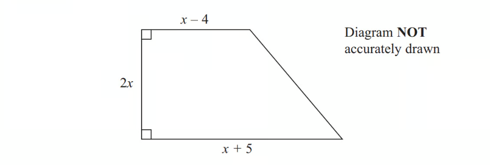

# Exam Questions — Quadratic Equations
**Algebra & Sequences** · Cambridge (CIE) IGCSE maths (0607)
> Source: [https://www.savemyexams.com/igcse/maths/cie/international-maths/23/extended/topic-questions/](https://www.savemyexams.com/igcse/maths/cie/international-maths/23/extended/topic-questions/) · 14 questions across 1 sets

## Calculator  Questions (14 questions)

### Q1 — very_hard — 4 marks

**Q1** [2 marks]

The diagram shows a trapezium.

All the measurements are in centimetres.

The area of the trapezium is 351 cm2.

Show that  $2x^{2}+x-351=0$

*Source: November 2013 1MA0/2H Q22A*

**Q1** [2 marks]

**Extract:**

2 x squared plus x minus 351 equals 0

Work out the value of $x$.

*Source: November 2013 1MA0/2H Q22B*

### Q2 — very_hard — 5 marks

**Q2** [3 marks]

Solve $2x^{2}+9x-7=0$

You must show all your working and give your solutions correct to 3 significant figures.

*Source: November 2012 1MA0/2H Q22A*

**Q2** [2 marks]

**Extract:**

Solve ![2 x squared plus 9 x minus 7 equals 0] 

You must show all your working and give your solutions correct to 3 significant figures.

**Use your answer to part (a)** to solve        $\frac{2}{y^{2}}+\frac{9}{y}-7=0$ 
Give your solutions correct to 3 significant figures.

*Source: November 2012 1MA0/2H Q22B*

### Q3 — hard — 2 marks

**Q3** [2 marks]

Solve by factorisation  $10m^{2}-31m-14=0$.

$m$ = .................... or $m$ = ....................

### Q4 — hard — 2 marks

**Q4** [2 marks]

The $n$th term of a sequence is $4n^{2}+n+3.$
Find the value of $n$ when the $n$th term is 498.

$n=$..................................................

*Source: 2019 March 0580/42 Q11B*

### Q5 — medium — 3 marks

**Q5** [3 marks]

Solve the equation $2x^{2}+7x-3=0$.

Show all your working and give your answers correct to 2 decimal places.

$x$ = ..................... or $x$ = .....................

*Source: 2018	Feb/Mar 0580/22 Q17*

### Q6 — medium — 3 marks

**Q6** [3 marks]

Solve the equation $6m^{2}+25m+16=0$. 
Show all your working and give your answers correct to 2 decimal places.

$m=$ ..................... or $m=$.....................

*Source: 2018	May/June 0580/41 Q5D*

### Q7 — medium — 3 marks

**Q7** [3 marks]

Solve the equation  $3x^{2}-2x-2=0$. 
Show all your working and give your answers correct to 2 decimal places.

$x$ = ........................... or $x$ = ...........................

*Source: 2018	Oct/Nov 0580/23 Q20*

### Q8 — medium — 3 marks

**Q8** [3 marks]

Use the quadratic formula to solve the equation  $3x^{2}+7x-11=0.$
You must show all your working and give your answers correct to 2 decimal places.

$x$ = ....................  or  $x$ = ....................

*Source: 2018	Oct/Nov 0580/21 Q19*

### Q9 — medium — 3 marks

**Q9** [3 marks]

Solve the equation $3x^{2}-2x-10=0.$ 
Show all your working and give your answers correct to 2 decimal places.

$x$ = ..................... or $x$ = .....................

*Source: 2019	May/June 0580/22 Q20*

### Q10 — medium — 3 marks

**Q10** [3 marks]

Use the quadratic formula to solve  $9x^{2}-12x-23=0$. 
Give your answers correct to 2 decimal places.

$x=$ ............................ or $x=$ ............................

*Source: 2020 March 0580/42 Q10D*

### Q11 — very_hard — 4 marks

**Q11** [4 marks]

Find all the solutions to the equation.

`open parentheses x squared minus 4 x plus 4 close parentheses to the power of open parentheses x squared minus 9 x plus 20 close parentheses end exponent equals 1`

*Source: Nov 22 0607/41 Q12CII*

### Q12 — hard — 2 marks

**Q12** [2 marks]

Solve by factorisation.

$3x^{2}-11x+6=0$

$x=$ ........................... or $x=$...........................

*Source: Nov 2023 0607/43 Q8C*

### Q13 — medium — 3 marks

**Q13** [3 marks]

Solve $6x^{2}-7x+2=0.$ 
You must show all your working.

$x=$ ..................   or   $x=$ ..................

*Source: June 2023 0607/42 Q10DII*

### Q14 — hard — 7 marks

**Q14** [3 marks]

Nina runs 5 km at $y$ km/h and then walks 7 km at `open parentheses y minus 7 close parentheses` km/h. 
She takes a total of 2 hours.

Show that  $2y^{2}-26y+35=0$.

*Source: November 2023 0607/41 Q7BI*

**Q14** [3 marks]

Solve   $2y^{2}-26y+35=0$.

$y=$..................  or  $y=$ ..................

*Source: November 2023 0607/41 Q7BII*

**Q14** [1 mark]

**Extract:**

Nina runs 5 km at ![y] km/h and then walks 7 km at ![open parentheses y minus 7 close parentheses] km/h.

Find Nina's walking speed

........................................ km/h

*Source: November 2023 0607/41 Q7BIII*

