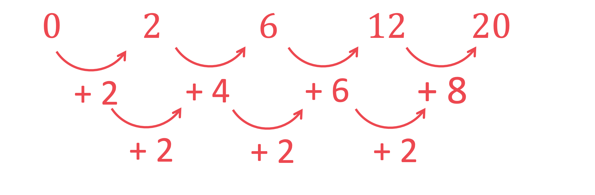
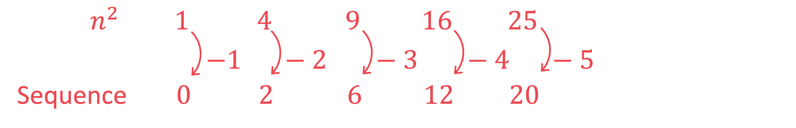
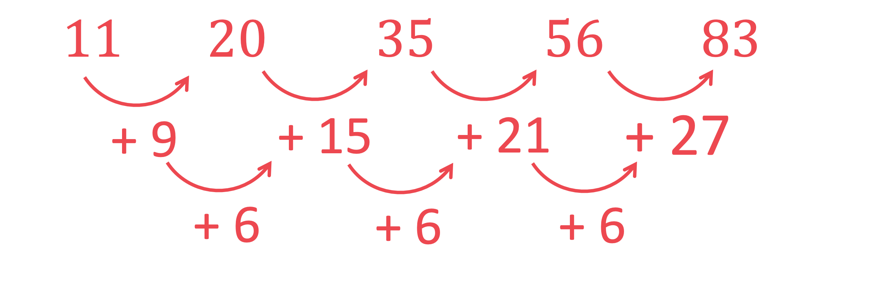
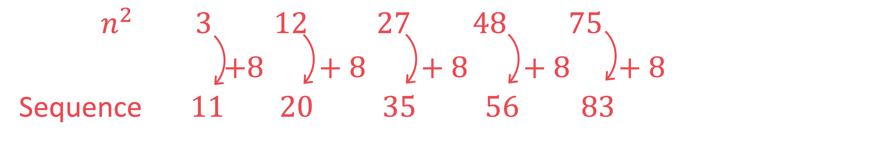

# Mark Schemes — Sequences
**Algebra & Sequences** · Cambridge (CIE) IGCSE maths (0607)

## Non-Calculator Questions (23 questions)

### Q1
> *Find the difference between each term*

$2,7,14,23,34\,57911$

> *The difference is not the same, so it is not a linear sequence*

> *Find the difference between the differences*

$2,7,14,23,34\,57911\,222$

> *The second difference is always 2, so this is a quadratic sequence, in terms of *$n^{2}$

> *Write down the sequence *$n^{2}$* underneath*

| *Sequence* | *2* | *7* | *14* | *23* | *34* |
|---|---|---|---|---|---|
| $n^{2}$ | *1* | *4* | *9* | *16* | *25* |

> *Consider the difference between *$n^{2}$* and the sequence*

| *Sequence* | *2* | *7* | *14* | *23* | *34* |
|---|---|---|---|---|---|
| $n^{2}$ | *1* | *4* | *9* | *16* | *25* |
| *Difference from *$n^{2}$ | *+1* | *+3* | *+5* | *+7* | *+9* |

> *Find the *$n$*th** term of the differences from *$n^{2}$

> *The difference from *$n^{2}$* goes up in steps of 2, so it is based on *$2n$

> *The differences from *$n^{2}$* are 1 less than the sequence *$2n$* (which would be 2, 4, 6, 8), so the *$n$*th** term of the differences is *$2n-1$

> *Put this information all together*

$n^{2}+2n-1$

**[B1 B1 B1]**

> **[exam-tip]**
> You can check if your $n$th term expression is correct by substituting in $n=1,2,3,...$ to verify that it produces the original sequence.

> **[mark-scheme]**
> **B1**: $n^{2}$ present in answer. Must be $n^{2}$ and not $2n^{2}$ or any other multiple.
> 
> **B1**: $+2n$ present in answer.
> 
> **B1**: Fully correct answer.

### Q2
> *Simply continue the sequence 3 more terms*

$7\mathrm{th} \mathrm{term}=5\mathrm{th} \mathrm{term}+6\mathrm{th} \mathrm{term}=5+8=13\,8\mathrm{th} \mathrm{term}=6\mathrm{th} \mathrm{term}+7\mathrm{th} \mathrm{term}=8+13=21\,9\mathrm{th} \mathrm{term}=7\mathrm{th} \mathrm{term}+8\mathrm{th} \mathrm{term}=13+21=34$

**34** **[1]**
> *Simply continue the sequence*

$4\mathrm{th} \mathrm{term}=2\mathrm{nd} \mathrm{term}+3\mathrm{rd} \mathrm{term}=b+a+b=a+2b$

**adding 2nd and 3rd terms**** [1]**

$5\mathrm{th} \mathrm{term}=3\mathrm{rd} \mathrm{term}+4\mathrm{th} \mathrm{term}=a+b+a+2b=2a+3b\,6\mathrm{th} \mathrm{term}=4\mathrm{th} \mathrm{term}+5\mathrm{th} \mathrm{term}=a+2b+2a+3b=3a+5b$

**showing next two additions**** [1]**
> *Equate 7 to the expression for the 3rd term, *$a+b$* and equate 29 to the expression for the 6th term, *$3a+5b$

`table row cell a plus b end cell equals 7 row cell 3 a plus 5 b end cell equals 29 end table`

**[1]**

> *We have a pair of **linear simultaneous equations**. Solve using elimination or substitution. For example, using elimination;*

`table row cell a plus b end cell equals cell 7 space space space space space space space space space space space circle enclose 1 end cell row cell 3 a plus 5 b end cell equals cell 29 space space space space space space space space space circle enclose 2 end cell row cell circle enclose 1 cross times 3 colon space 3 a plus 3 b end cell equals cell 21 space space space space space space space space space circle enclose 3 end cell row cell space circle enclose 2 minus space circle enclose 3 colon space 2 b end cell equals 8 row b equals 4 end table`

**any valid process to solve simultaneous equations**** [1]**

> *Having found **a** or **b**, substitute it into either of the initial equations to find the remaining variable*

`table attributes columnalign right center left columnspacing 0px end attributes row cell subs. space b end cell equals cell 4 space into space circle enclose 1 comma space a plus 4 equals 7 end cell row cell space space space space space space space space space space space space space space space space space space space space space space space space space space space space space space space space space space space space space space space space space space space a end cell equals cell 3 space space space end cell end table`

$a=3,b=4$** [1]**

### Q3
> *The sequence goes down by two each term so it is related to *$-2n$*.      *

$-2n$

**[1]**

> *Find the difference between the sequence given and the sequence *$-2n$*. *
*This is easiest to do by considering the term previous to the first term.*

$7+2=9$

> *Add this on to *$-2n$*and rearrange.*

$9-2n$ **[1] **
**The answer **$-2n+9$** will also gain full marks**

### Q4
*For "the 2nd term of the sequence is −2", substitute **n** = 2 into **an**2** + **bn** and equate to −2* 
*For "the 4th term of the sequence is 12", substitute **n** = 4 into **an**2** + **bn** and equate to 12*

`a open parentheses 2 close parentheses squared plus b open parentheses 2 close parentheses equals negative 2
a open parentheses 4 close parentheses squared plus b open parentheses 4 close parentheses equals 12`

**[1]**

> *We have a pair of **linear simultaneous equations**. Simplify the equations and solve using elimination (you could also solve using substitution if that is a preferred method)*

`table row cell 4 a plus 2 b end cell equals cell negative 2 space space space space space space space space circle enclose 1 end cell row cell 16 a plus 4 b end cell equals cell 12 space space space space space space space space space space circle enclose 2 end cell row cell circle enclose 1 cross times 2 colon space 8 a plus 4 b end cell equals cell negative 4 space space space space space space space space circle enclose 3 end cell row cell space circle enclose 2 minus space circle enclose 3 colon space 8 a end cell equals 16 row a equals 2 end table`

**[1]**

> *Substitute your found value of **a** or **b** into one of the simultaneous equations to find the missing variable. For example, substituting **a** = 2 into 4**a** + 2**b** = −2,*

`table row cell 8 plus 2 b end cell equals cell negative 2 end cell row cell space space 2 b end cell equals cell negative 10 end cell row cell space space space space b end cell equals cell negative 5 end cell end table`

**[1]**

> *Thus the **n**th term of the sequence is 2**n**2** − 5**n**. Substitute **n** = 6 into this to find the 6th term*

`table row cell 2 open parentheses 6 close parentheses squared minus 5 open parentheses 6 close parentheses end cell equals 42 end table`

**Final answer:** **42 ****[1]**
> *We know it is a quadratic sequence so find the first and second differences*

> *The second difference is 2 which tells us that in the nth term **an**2** + **bn **+ **c **:*

$a=\frac{2}{2}=1$

> *Therefore the **n**th term contains **n**2*

**identifying n****2**** as part of the nth term ****[1]**

> *Write the sequence **n**2** and determine what needs needs to be added to it to get the given sequence*

> *We see that to go from **n**2 **to the given sequence, we add the sequence "−1, −2, −4, −4, −5, ..." which has the **n**th term −**n**     *

**n****2**** − ****n*** ***[1]**

### Q5
*The numerators (top of the fraction) are increasing with a difference of 2, 4, 6, 8, ... so the next numerator will be 21+10=31* *The denominators (bottom of the fraction) are following the two times table, so the next denominator will be 12*

$\frac{31}{12}$ **[1]**

### Q6
> *The terms of the sequence are decreasing by 5 each time*

*(17 − 12 = 5, 12 − 7 = 5 and 7 − 2 = 5)*

> *So subtract 5 from *$T_{4}$

*2 − 5 = −3*

**−3*** ***[1]**
> *The terms of the sequence are being reduced by 5 each time so it is an arithmetic sequence with a common difference of −5. Therefore the sequence is something to do with '−5**n**'*

$T_{n}=-5n+c$

> *We need to find **c. **The first term, for example, is 17 therefore when *$T_{n}=17,n=1$* so*

`17 equals negative 5 open parentheses 1 close parentheses plus c`

> *Solve to find **c*

$17=-5+c\,22=c$

$T_{n}=-5n+22$ ** **
**'−5n****'**** ****[1]**
** ****'22'**** [1]**

### Q7
> *The sequence is decreasing by 4 each term so the next two will be*

**3, -1 ****[1]**
*As the sequence is decreasing by 4 each term, the sequence is based upon the sequence *$-4n$ *Writing out the *$-4n$* sequence:*

*-4, -8, -12, -16, ...*

> *Find the difference between each term in the *$-4n$* sequence, and our sequence (19, 15, 11, 7, ... )*

*The difference between -4 and 19 is +23* 
*The difference between -8 and 15 is +23* *and so on*

> *This means the sequence can be described as*

$-4n+23$ **[2]** 
**1 mark for each term**
> *Using the nth term found in previous part; *$-4n+23$

> *Set this equal to -65*

$-65=-4n+23$

**[1]**

> *Subtract 23 from both sides*

$-88=-4n$

> *Divide both sides by -4*

$n=22$ **[1]**

### Q8
*The number of grey mats is increasing by 3 each time.* 
*The total number of mats is increasing by 4, then 5, then 6. If the sequence continues, from pattern number 4 to pattern number 5, the number of mats will increase by 7.*

| Pattern number | 1 | 2 | 3 | 4 | 5 |
|---|---|---|---|---|---|
| Number of grey mats | 6 | 9 | 12 | 15 | $18$ |
| Total number of mats | 6 | 10 | 15 | 21 | $28$ |

**[2] **

**If you don't spot the sequence, you could sketch the next pattern**
> *The number of grey mats is increasing by 3 each time, so it's something to do with the 3 times table, or *$3n$*. *
*Write the sequence *$3n$* for the first few terms and the number of grey mats underneath it. *

`table row cell space 3 n space end cell equals cell space space space 3 comma space space space space 6 comma space space space space 9 comma space space space space 12 comma space... space space end cell row cell Number space of space grey space mats space end cell equals cell space space space 6 comma space space space space 9 comma space space space 12 comma space space space 15 comma space... space space space space end cell end table`

*We can see that to go from *$3n$* to the number of grey mats, we always add 3.* *So the number of grey mats is *$3n+3$

**     **$3n+3$** **
**"**$3n$**" [1] **
**"+ 3" [1]**
> *Method 1 *
*We know that the total number of grey mats is *$3n+3$*. Therefore equate this to 24 and solve*

`table row cell 3 n plus 3 end cell equals 24 row cell 3 n end cell equals 21 row n equals 7 end table`

**[1]**

*We now know it's the 7th pattern.* 
*In Q12(a), we identified that the term-to-term rule for the total number of mats is to add 4, then add 5, then add 6, then add 7 and so on. *
*We need to continue this sequence for two more steps, starting with the 28 mats on the 5th pattern.*

*28 + 8 + 9 = 45*

**45**** ****mats**** ****[1]**

> *Method 2 *
*Extend the table to continue the grey mats sequence until you get to 24*

| Pattern number | 1 | 2 | 3 | 4 | 5 | *6* | *7* |
|---|---|---|---|---|---|---|---|
| Number of grey mats | 6 | 9 | 12 | 15 | 18 | *21* | *24* |
| Total number of mats | 6 | 10 | 15 | 21 | 28 |   |   |

**[1]**

*We now know it's the 7th pattern, or two more steps.* 
*In Q12(a), we identified that the term-to-term rule for the total number of mats is to add 4, then add 5, then add 6, then add 7 and so on. *
*We need to complete two more columns of the table*

| Pattern number | 1 | 2 | 3 | 4 | 5 | *6* | *7* |
|---|---|---|---|---|---|---|---|
| Number of grey mats | 6 | 9 | 12 | 15 | 18 | *21* | *24* |
| Total number of mats | 6 | 10 | 15 | 21 | 28 | *36* | *45* |

**45**** ****mats**** ****[1]**

### Q9
*This sequence is a linear sequence (it changes by the same amount each time)* 
*The formula for the **n**th term of a linear sequence is*

**an+b**

> *a** is the common difference (the amount the sequence goes up by each time)*

**a ***= 6*

> *b** is the term before the first term shown (think about going backwards)*

**b ***= - 4 - 6 = -10*

**Either**** a = 6 or b = -10*** ***[1] **
**n****th term =**** ****6****n**** - 10** **[1]**

### Q10
> *i) The numerator of one of the terms is the denominator of the previous term. *
*The denominator of a term is formed by adding together the numerator and the denominator of the previous term.*

**Final answer:** $\frac{q}{p+q}$** [1]**

> *ii) Write down the numerator by looking at the denominator of the 5th term. *
*Write down the denominator by adding together the numerator and denominator of the 5th term.*

$\frac{18}{11+18}$

$\frac{18}{29}$* ***[1]**

### Q11
*It is easiest to spot the pattern of the numbers* 
*The number of small lines is increasing with a difference of 6, 8, 10, 12, ...* 
*The number of dots is increasing with a difference of 4, 5, 6, 7, 8, ...*

|   | Diagram 1 | Diagram 2 | Diagram 3 | Diagram 4 | Diagram 5 | Diagram 6 |
|---|---|---|---|---|---|---|
| Number of small lines | 4 | 10 | 18 | 28 | **Final answer:** **40** | **Final answer:** **54** |
| Number of dots | 4 | 8 | 13 | 19 | **Final answer:** **26** | **Final answer:** **34** |

**Mark for each ****[4]**
> *The number of small lines is 4, 10, 18, 28, 40, 54, ...*

> *This is increasing, where the difference between each number is 6, 8, 10, 12, 14, ...*

> *The difference between the differences is 2, this means the sequence will involve an *$n^{2}$* term*

**For including an **$n^{2}$** term**** [1]**

> *Writing out the sequence *$n^{2}$

*1, 4, 9, 16, 25, 36, ...*

> *The difference between the *$n^{2}$* sequence and the sequence 4, 10, 18, 28, 40, 54, ... is*

*+3, +6, +9, +12, +15, +18, ...*

> *This sequence could be expressed as *$3n$

> *So the sequence 4, 10, 18, 28, 40, 54, ... could instead be expressed as*

$n^{2}+3n$ **[1]**
*The expression for the number of small lines from part b was *$n^{2}+3n$ 
*We can set this equal to 10 300 and find which number diagram this corresponds to*

$10300=n^{2}+3n$

**[1]**

> *Subtract 10 300 from both sides to form a quadratic equation in the form *$ax^{2}+bx+c=0$

$n^{2}+3n-10300=0$

> *Find two numbers that multiply to give -10300 and add to 3*

*103 × (−100) = −10300*

*103 + (−100) = 3*

> *So the two numbers in the brackets are 103 and −100*

`open parentheses n plus 103 close parentheses open parentheses n minus 100 close parentheses equals 0`

> *Solve*

$n=-103\mathrm{or}n=100$

> *As *$n$* is the diagram number, it must be positive*

$n=100$ **[1]**
> *The number of dots is 4, 8, 13, 19, 26, 34, ... and we are told this follows the pattern *$D=an^{2}+bn+1$* where *$D$* is the number of dots*

> *As the first term is 4, this means that *$D=4$* when *$n=1$* and we can substitute this into the equation*

`4 equals a open parentheses 1 close parentheses squared plus b open parentheses 1 close parentheses plus 1`

> *Simplifying*

$4=a+b+1$

> *Subtracting 1 from each side*

$3=a+b$

> *Doing this again with the second diagram, where *$D=8$* and *$n=2$

`8 equals a open parentheses 2 close parentheses squared plus b open parentheses 2 close parentheses plus 1
8 equals 4 a plus 2 b plus 1
7 equals 4 a plus 2 b`

> *We can now solve the following pair of simultaneous equations by elimination*

`circle enclose 1 space 3 equals a plus b
circle enclose 2 space 7 equals 4 a plus 2 b`

> *Multiply equation 1 by 2*

`table row cell circle enclose 1 cross times 2 space space space space 6 end cell equals cell 2 a plus 2 b end cell row cell circle enclose 2 space space space space 7 end cell equals cell 4 a plus 2 b end cell end table`

> *Subtract this from equation 2, and solve for *$a$

`table row cell circle enclose 2 minus circle enclose 1 cross times 2 space space space space 1 end cell equals cell 2 a end cell row a equals cell 1 half end cell end table`

> *Substitute back into equation 1 to find *$b$

$3=\frac{1}{2}+b\,b=\frac{5}{2}$

$a=\frac{1}{2}$ **[1]** 
$b=\frac{5}{2}$** ****[1]**

### Q12
*The numerator increases by 1 and the denominator increases by 2 each time* *Find the next term* * *

*next term = *$\frac{7+1}{13+2}$

$\frac{8}{15}$* ***[1]**

*Both the numerator and denominator sequences are linear, because they changes by the same amount each time* 
*The formula for the **n**th term of a linear sequence is*

**an + b**

> *a** is the common difference (the amount the sequence goes up by each time) *
*b** is the term before the first term shown (think about going backwards) *
*Find the **n**th term of the numerator sequence  *

**a*** = 1,     ***b*** = 3 -1 = 2   so   ***n***th term = ***n*** + 2**  *

> *Find the **n**th term of the denominator sequence  *

**a*** = 2,     ***b*** = 5 - 2 = 3   so   ***n***th term = 2***n*** + 3*

**either formula correct**** [1]**

> *Find the nth term formula of the original sequence (by writing the numerator **n**th-term formula over the denominator **n**th-term formula)  *

**n****th term = **$\frac{n+2}{2n+3}$** ****[1]**

### Q13
> *Sequence A:*

> *The numbers go down by 4 each time so the rule is subtract 4.*

*The 5th term is 1 - 4 = -3*

**[1]**

> *The rule is subtract 4 so the **n**th term is -**4n + **k.*

$-4n+k$

**[1]**

> *Find **k  **by considering the difference between sequence A and the sequence -4**n.*

$-4n=-4,-8,-12,...$* *
*1st term: 13 - (-4) = 17, so ***k ***= 17*

*The ***n***th term for sequence A is *$-4n+17$

**[1]**

> *Sequence B:*

> *The numbers go up by a different amount each time so this is not a linear sequence.*

> *Identify a similar sequence.*

$n^{3}=1,8,27,64,...$

**[1]**

> *Find the **n**th term** **by considering the difference between sequence B and the sequence **n**3**.*

$n^{3}-1=1,7,26,63,...$

**[1]**

> *Find the 5th term** **by substituting **n **= 5 into the **n**th term **n**3 **- 1. *

`open parentheses 5 close parentheses cubed space minus space 1 space equals space 125 space minus space 1 space equals space 124`

**[1]**

> *Sequence C:*

> *Consider the sequences in the numerators and the denominators separately.*

> *Numerators:*

$7,8,9,10$

> *The rule is add 1 so the **n**th term is **n + k**. *
*There is a gap of + 6 between the sequence of the numerators and the sequence **n.*

$n+6$

**[1]**

> *Denominators:*

$8,16,32,64$

> *Each term is multiplied by 2 to get the next term so the **n**th term is 2**k**. *
*2**3 **= 8 = 2**1+2** *
*2**4 **= 16 = 2**2+2** *
*2**5 **= 32 = 2**3+2** *
*2**6 **= 64 = 2**5+2*

*The ***n***th term is *$2^{n+2}$

**[1]**

> *n**th term for sequence C:*

`fraction numerator n plus 6 over denominator 2 to the power of open parentheses n plus 2 close parentheses end exponent end fraction`

** [1]**

> *Find the 5th term for sequence C by substituting 5 into the **n**th term, or by continuing the sequence for both the numerators and the denominators separately.*

`fraction numerator open parentheses 5 close parentheses plus 6 over denominator 2 to the power of open parentheses 5 close parentheses plus 2 end exponent end fraction equals 11 over 128`

** [1]**

| Sequence | 1st term | 2nd term | 3rd term | 4th term | 5th term |   | *n*th term |
|---|---|---|---|---|---|---|---|
| A | 13 | 9 | 5 | 1 | **Final answer:** **-3** |   | $17-4n$ |
| B | 0 | 7 | 26 | 63 | **Final answer:** **124** |   | $n^{3}-1$ |
| C | $\frac{7}{8}$ | $\frac{8}{16}$ | $\frac{9}{32}$ | $\frac{10}{64}$ | $\frac{11}{128}$ |   | $\frac{n+6}{2^{(n+2)}}$ |
> *The numerators increase by 1 each time.*

*Numerator: *$p+1$

> *The denominators are doubling each time.*

*Denominator: *$2q$

$\frac{p+1}{2q}$** **
**1 mark for each correct part ****[2]**

### Q14
> *Find the differences between terms in sequence **A**.*

*The differences form the sequence 6, 10, 14, 18 which is going up in 4s. So the next difference would be 22.* 
*Add 22 to the 5th term to get the 6th term in sequence **A**.*

*The term-to-term rule for sequence **B **is multiply the previous term by 3.* 
*Multiply 81 by 3 to get the 6th term in sequence **B**.*

| Term | 1 | 2 | 3 | 4 | 5 | 6 |
|---|---|---|---|---|---|---|
| Sequence *A* | 7 | *7 + 6 =* 13 | *13 + 10 = *23 | *23 + 14 = *37 | *37 + 18 = *55 | *55 + 22 = ***77** |
| Sequence *B* | 1 | *1 × 3 = *3 | *3 × 3 = *9 | *9 × 3 = *27 | *27 × 3 = *81 | *81 × 3 = ***243** |

**1 mark for each**** [2]**
i) *The differences between terms are increasing by the same amount each time, this means the sequence is a quadratic: *$an^{2}+bn+c.$ 
*The second difference is double the value of **a**.* 
*Find the second difference.*

*6, 10, 14, 18, 22, ... is going up in 4s*

*2***a*** = 4* **a*** = 2*

*Therefore the ***n***th term looks like *$2n^{2}+bn+c$

**[1]**

> *Write out the terms in the sequence *$2n^{2}$*.*

| **n** | *1* | *2* | *3* | *4* | *5* |
|---|---|---|---|---|---|
| *2***n***2* | *2(1)**2** = 2* | *2(2)**2** = 8* | *2(3)**2** = 18* | *2(4)**2** = 32* | *2(5)**2** = 50* |

> *Subtract the sequence *$2n^{2}$* from the original sequence *$2n^{2}+bn+c.$

`stack attributes charalign center stackalign right end attributes row 2 n squared plus b n plus c none none 7 comma 13 comma 23 comma 37 comma 55 none end row row minus left parenthesis 2 n squared none none none none none none 2 comma none 8 comma 18 comma 32 comma 50 right parenthesis end row horizontal line row b n plus c none none 5 comma none 5 comma none 5 comma none 5 comma none 5 none end row end stack space`

> *The **n**th term for the difference is simply 5 or *$0n+5.$

> *Add this together with *$2n^{2}$* to find the **n**th term for sequence **A**.*

$2n^{2}+5$**[1]**

ii) *The terms in sequence **B** are powers of 3.* *Write the terms as powers of 3.*

| *Term* | *1* | *2* | *3* | *4* | *5* |
|---|---|---|---|---|---|
| *Sequence ***B** | *1 = 3**0* | *3 = 3**1* | *9 = 3**2* | *27 = 3**3* | *81 = 3**4* |

> *The exponents (powers) are one less than the term number. The **n**th term will have **n**-1 as the exponent.*

$3^{n-1}$** **
**3 as the base number ****[1]** 
**n-1 as the exponent ****[1]**

### Q15
> *Determine the rule for this sequence *
*Each term goes up by 3, so the next term is*

*20 + 3*

**23** **[1]**

### Q16
> *The first three terms are when **n** = 1, **n** = 2 and **n** = 3. *
*Substitute **n** = 1, **n** = 2 and **n** = 3 into the **n**th term*

$n=1,n^{2}+1=1^{2}+1=2\,n=2,n^{2}+1=2^{2}+2=5\,n=3,n^{2}+1=3^{2}+1=10$

**correct substitution shown for n =1, n = 2 or n = 3**** [1]**

**2, 5, 10**** [1]**

### Q17
> *Method 1*

> *The terms are the 4 times table, 4**n**, so*

** ****n****th term =**** **$4n$ **[1] **
**If you don't spot that the sequence is the 4 times table, then you can use the more formal method below**

> *Method 2*

> *The terms are increasing by the same amount so it is an **arithmetic sequence** (**linear sequence**) and the formula for the **n**th term is **dn **+** b, **where** d** is the common difference*

> *The terms are increasing by 4 each time, so **d** = 4*

**n***th term =* $4n+b$

*To find **b** , substitute **n** = 1 and the first term into the **n**th term formula and solve for **b*

`table attributes columnalign right center left columnspacing 0px end attributes row 4 equals cell 4 open parentheses 1 close parentheses plus b end cell row 4 equals cell 4 plus b end cell row cell 4 minus 4 end cell equals b row b equals 0 end table`

> *Now we can write the **n**th term*

** ****n****th term =**** **$4n$** ****[1]**
> *The terms are not increasing by the same amount each time so find the first and second differences*

> *The second difference is always 6 which tells us that we have a quadratic sequence **an**2** + **bn **+ **c  **and that:*

$a=\frac{6}{2}=3$

**identifying 3n****2**** as part of the nth term**** ****[1]**

> *Write the sequence 3**n**2** and determine what needs needs to be added to it to get the given sequence*

> *We see that to go from **3n**2 **to the given sequence, we add 8 to every term*

**3****n****2**** + 8*** ***[1]**

### Q18
*This sequence is a linear sequence, because it changes by the same amount each time* 
*The formula for the **n**th term of a linear sequence is*

> *an+b*

> *a** is the common difference (the amount the sequence goes up by each time)*

**a ***= 3*

> *b** is the term before the first term shown (think about going backwards)*

**b ***= 8 - 3 = 5*

**Either ****a = 3**** or ****b = 5*** ***[1]**
**n****th term =**** ****3****n ****+ 5** **[1]**

### Q19
> *Method 1*

> *The formula for the **n**th term of a linear or arithmetic sequence is **an **+** b*

> *The terms are decreasing by 4 each time, so **a **= −4*

**n***th term =* $-4n+b$

*To find **b** , substitute **n** = 1 and the first term into the **n**th term formula and solve for **b*

`table attributes columnalign right center left columnspacing 0px end attributes row 11 equals cell negative 4 open parentheses 1 close parentheses plus b end cell row 11 equals cell negative 4 plus b end cell row 15 equals b end table`

> *Now we can write the **n**th term*

** ****n****th term =**** **$-4n+15$** ****or**** **$15-4n$

**"**$-4n$**" [1] **
**" **$+15$**" [1]**

> *Method 2** *
*The sequence decreases by the same amount each time, so it's an arithmetic sequence *
*The general term for an arithmetic sequence is:  *$n$*th term = *`a plus open parentheses n minus 1 close parentheses d`*,** where *$a$* the first term and *$d$* is the common difference** *
*We can see that *$a=11$* and the sequence goes down by 4 every time so *$d=-4$*. Substitute these into the general term*

`table row cell n th space term end cell equals cell 11 plus open parentheses n minus 1 close parentheses cross times open parentheses negative 4 close parentheses end cell row blank equals cell 11 plus open parentheses negative 4 close parentheses open parentheses n minus 1 close parentheses end cell row blank equals cell 11 minus 4 open parentheses n minus 1 close parentheses end cell end table`

> *Be careful with the double negative*

`table attributes columnalign right center left columnspacing 0px end attributes row blank equals cell 11 minus 4 n plus 4 end cell row blank equals cell 15 minus 4 n end cell end table`

$-4n+15$** ****or**** **$15-4n$** **
**"**$-4n$**" [1] **
**" **$+15$**" [1]**

### Q20
i) *Difference between each term is 3, so next term is 14+3*

**17** **[1]**

ii) *Increases by 3 each term, so similar to the three times table (3n) 3n would be 3, 6, 9, 12, ... *
*This sequence is the same as 3n, but each term has had 2 added to it*

**3n+2** **[1]** 
**Either the 3 or the 2**** [1]**

### Q21
> *The formula for the **n**th term of an **arithmetic sequence** (**linear sequence**)  is **dn **+** b, **where** d** is the common difference*

> *The terms are decreasing by 3 each time, so **d** = -3*

**n***th term =* $-3n+b$

**[1]**

*To find **b** , substitute **n** = 1 and the first term into the **n**th term formula and solve for **b*

`table row 15 equals cell negative 3 open parentheses 1 close parentheses plus b end cell row 15 equals cell negative 3 plus b end cell row cell 15 plus 3 end cell equals b row b equals 18 end table`

> *Now we can write the **n**th term*

** ****n****th term =**** **$-3n+18$ **[1]**

### Q22
> *Finding the 4th term by substituting in *$n=4$* and evaluating*

`2 open parentheses 4 close parentheses squared plus 5 open parentheses 4 close parentheses minus 15 equals 37`

> *Finding the 4th term by substituting in *$n=5$* and evaluating*

`2 open parentheses 5 close parentheses squared plus 5 open parentheses 5 close parentheses minus 15 equals 60`

**Either 37 or 60**** [1]**

> *Finding the difference*

$60-37=23$

**23**** ****[1]**

### Q23
*Method 1 *
*The "*$-8n$*" tells us that the sequence is going down by 8 each term. So the highest term must be the first term as the sequence is always decreasing. * 
*At the first term, *$n=1$* so substitute *$n=1$* into the *$n$*th term*

$60-8\times1=52$

**52**** ****[1]**

*Method 2 *
*Investigate the sequence by writing out the first few terms* 
*At the first term, *$n=1$* so substitute *$n=1$* into the *$n$*th term*

$60-8\times1=52$

> *At the second term, *$n=2$* so substitute *$n=2$* into the *$n$*th term*

$60-8\times2=44$

> *At the first term, *$n=3$* so substitute *$n=3$* into the *$n$*th term*

$60-8\times1=36$

> *By now it should be clear that the highest term is 52*

**52**** ****[1]**
> *Method 1** *
*The sequence decreases by the same amount each time, so it's an arithmetic sequence *
*The general term for an arithmetic sequence is:  *$n$*th term = *`a plus open parentheses n minus 1 close parentheses d`*,** where *$a$* the first term and *$d$*is the common difference** *
*We can see that *$a=12$* and the sequence increases by 7 every time so *$d=7$*. Substitute these into the general term*

`table row cell n th space term end cell equals cell 12 plus open parentheses n minus 1 close parentheses cross times 7 end cell end table`

> *Expand the bracket and simplify*

`table row cell n th space term end cell equals cell 12 plus 7 open parentheses n minus 1 close parentheses end cell row blank equals cell 12 plus 7 n minus 7 end cell row blank equals cell 7 n plus 5 end cell end table`

$7n+5$** **
**"**$7n$**" [1] **
**" **$+5$**" [1]**

> *Method 2** *
*The terms are increasing by 7 each time, so it's an arithmetic sequence and something to do with the " 7 times table", or "*$7n$*". **Write the sequence *$7n$* for the first four terms and write the given sequence directly underneath it. *

`table row cell space 7 n space end cell equals cell space space space space space space space 7 comma space space space space space space space space 14 comma space space space space space space space space space space 21 comma space space space space space space space 28 comma space... space space end cell row cell Given space sequence space end cell equals cell space space space space space 12 comma space space space space space space space space 19 comma space space space space space space space space space 26 comma space space space space space space space space 33 comma space... space space space space end cell end table`

> *We can see that to go from *$7n$* to the given sequence, we always add 5.*

> *So the *$n$*th term is *$7n+5$

**                        **$7n+5$** "**** [1] **
**" **$+5$**" [1]**
