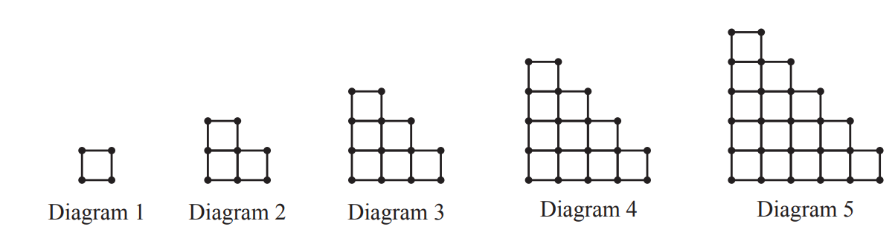

# Exam Questions — Sequences
**Algebra & Sequences** · Cambridge (CIE) IGCSE maths (0607)
> Source: [https://www.savemyexams.com/igcse/maths/cie/international-maths/23/extended/topic-questions/](https://www.savemyexams.com/igcse/maths/cie/international-maths/23/extended/topic-questions/) · 23 questions across 1 sets

## Non-Calculator Questions (23 questions)

### Q1 — hard — 3 marks

**Q1** [3 marks]

These are the first five terms of a sequence.

$2,7,14,23,34$

Find the $n$th term of the sequence.

### Q2 — hard — 6 marks

**Q2** [1 mark]

Here are the first six terms of a Fibonacci sequence.

1   1   2   3         5    8

The rule to continue a Fibonacci sequence is,

the next term in the sequence is the sum of the two previous terms.

Find the 9th term of this sequence.

*Source: Sample 2015 1MA1/3H Q3A*

**Q2** [2 marks]

**Extract:**

The rule to continue a Fibonacci sequence is, the next term in the sequence is the sum of the two previous terms.

The first three terms of a different Fibonacci sequence are

$aba+b$

Show that the $6$th term of this sequence is $3a+5b$

*Source: Sample 2015 1MA1/3H Q3B*

**Q2** [3 marks]

**Extract:**

The first three terms of a different Fibonacci sequence are

a       b       a + b

Show that the 6th term of this sequence is 3a + 5b

Given that the 3rd term is 7 and the 6th term is 29,

find the value of $a$ and the value of $b$.

*Source: Sample 2015 1MA1/3H Q3C*

### Q3 — medium — 2 marks

**Q3** [2 marks]

Here is a sequence of numbers.

7,   5,   3,   1,   – 1, …

Find an expression for the $n$th term of this sequence.

*Source: 2020 Specimen 0580/02 Q15B*

### Q4 — hard — 6 marks

**Q4** [4 marks]

The $n$th term of a sequence is given by $an^{2}+bn$ where $a$ and $b$ are integers.

The 2nd term of the sequence is —2 
The 4th term of the sequence is 12

Find the 6th term of the sequence.

*Source: 2018 June Q16A*

**Q4** [2 marks]

Here are the first five terms of a different quadratic sequence.

0   2   6   12   20

Find an expression, in terms of $n$, for the $n$th term of this sequence.

*Source: 2018 June Q16B*

### Q5 — hard — 1 marks

**Q5** [1 mark]

These are the first five terms of a sequence.

| $\frac{1}{2}$ | $\frac{3}{4}$ | $\frac{7}{6}$ | $\frac{13}{8}$ | $\frac{21}{10}$ |
|---|---|---|---|---|

Find the next term.

*Source: 2019	May/June 0580/21 Q22B*

### Q6 — medium — 3 marks

**Q6** [1 mark]

In a sequence

$T_{1}=17T_{2}=12T_{3}=7T_{4}=2.$

Find

$T_{5}$

*Source: Specimen 2025 0580/02 Q9A*

**Q6** [2 marks]

**Extract:**

T_1 = 17          T_2 = 12           T_3 = 7           T_4 = 2.

Find $T_{n}$.

*Source: Specimen 2025 0580/02 Q9B*

### Q7 — medium — 6 marks

**Q7** [2 marks]

| 19, | 15, | 11, | 7, | .... |
|---|---|---|---|---|

Write down the next two terms of the sequence.

*Source: 2019	May/June 0580/43 Q10A*

**Q7** [2 marks]

**Extract:**

19, 15, 11, 7, ....

Find the $n$th term of this sequence.

[2]

*Source: 2019	May/June 0580/43 Q10A*

**Q7** [2 marks]

**Extract:**

Find the nth term of this sequence.

Find the value of $n$ when the $n$th term is -65.

$n$ = ..............................................

*Source: 2019	May/June 0580/43 Q10A*

### Q8 — medium — 6 marks

**Q8** [2 marks]

Marco is making patterns with grey and white circular mats.

The patterns form a sequence. Marco makes a table to show some information about the patterns.

| Pattern number | 1 | 2 | 3 | 4 | 5 |
|---|---|---|---|---|---|
| Number of grey mats | 6 | 9 | 12 | 15 |   |
| Total number of mats | 6 | 10 | 15 | 21 |   |

Complete the table for Pattern 5.

*Source: 2018	May/June 0580/41 Q12A*

**Q8** [2 marks]

**Extract:**

| Pattern number | 1 | 2 | 3 | 4 | 5 |
| Number of grey mats | 6 | 9 | 12 | 15 |   |

Find an expression, in terms of $n$, for the number of grey mats in Pattern $n$.

*Source: 2018	May/June 0580/41 Q12B*

**Q8** [2 marks]

**Extract:**

| Pattern number | 1 | 2 | 3 | 4 | 5 |
| Number of grey mats | 6 | 9 | 12 | 15 |   |
| Total number of mats | 6 | 10 | 15 | 21 |   |

Marco makes a pattern with 24 grey mats. Find the total number of mats in this pattern.

*Source: 2018	May/June 0580/41 Q12C*

### Q9 — medium — 2 marks

**Q9** [2 marks]

These are the first five terms of a sequence.

$-4281420$

Find an expression for the $n$th term of this sequence.

*Source: 2018	Oct/Nov 0580/22 Q13*

### Q10 — hard — 2 marks

**Q10** [2 marks]

$\frac{1}{3},\frac{3}{4},\frac{4}{7},\frac{7}{11},\frac{11}{18},...$

i) One term of this sequence is $\frac{p}{q}$.

Find, in terms of $p$ and $q$, the next term in this sequence.

[1]

ii) Find the 6th term of this sequence.

[1]

*Source: 2019	Oct/Nov 0580/41 Q10C*

### Q11 — very_hard — 10 marks

**Q11** [4 marks]

The sequence of diagrams above is made up of small lines and dots.

Complete the table.

|   | Diagram 1 | Diagram 2 | Diagram 3 | Diagram 4 | Diagram 5 | Diagram 6 |
|---|---|---|---|---|---|---|
| Number of small lines | 4 | 10 | 18 | 28 |   |   |
| Number of dots | 4 | 8 | 13 | 19 |   |   |

*Source: 2019	May/June 0580/42 Q11A*

**Q11** [2 marks]

**Extract:**

|   | Diagram 1 | Diagram 2 | Diagram 3 | Diagram 4 | Diagram 5 | Diagram 6 |
| Number of small lines | 4 | 10 | 18 | 28 |   |   |

For Diagram $n$ find an expression, in terms of $n$, for the number of small lines.

*Source: 2019	May/June 0580/42 Q11B*

**Q11** [2 marks]

**Extract:**

For Diagram ![n] find an expression, in terms of ![n], for the number of small lines.

Diagram $r$ has 10 300 small lines.   Find the value of $r$.

$r$ = ..............................................

*Source: 2019	May/June 0580/42 Q11C*

**Q11** [2 marks]

**Extract:**

|   | Diagram 1 | Diagram 2 | Diagram 3 | Diagram 4 | Diagram 5 | Diagram 6 |
| Number of small lines | 4 | 10 | 18 | 28 |   |   |
| Number of dots | 4 | 8 | 13 | 19 |   |   |

The number of dots in Diagram $n$ is $an^{2}+bn+1$.

Find the value of $a$ and the value of $b$.

$a$ = ..............................................  
$b$ = ..............................................

*Source: 2019	May/June 0580/42 Q11D*

### Q12 — hard — 3 marks

**Q12** [3 marks]

Find the next term and the $n$th term of this sequence.

$\frac{3}{5},\frac{4}{7},\frac{5}{9},\frac{6}{11},\frac{7}{13},...$

Next term = .................................................  
 $n$th term = .................................................

*Source: 2018	Oct/Nov 0580/43 Q10A*

### Q13 — very_hard — 12 marks

**Q13** [10 marks]

| Sequence | 1st term | 2nd term | 3rd term | 4th term | 5th term |   | *n*th term |
|---|---|---|---|---|---|---|---|
| A | 13 | 9 | 5 | 1 |   |   |   |
| B | 0 | 7 | 26 | 63 |   |   |   |
| C | $\frac{7}{8}$ | $\frac{8}{16}$ | $\frac{9}{32}$ | $\frac{10}{64}$ |   |   |   |

Complete the table for the three sequences.

*Source: 2020 Oct/Nov 0580/42 Q11A*

**Q13** [2 marks]

**Extract:**

Sequence C: 7/8, 8/16, 9/32, 10/64

One term in Sequence C is $\frac{p}{q}$. Write down the next term in Sequence $C$ in terms of $p$and $q$.

*Source: 2020 Oct/Nov 0580/42 Q11B*

### Q14 — very_hard — 6 marks

**Q14** [2 marks]

The table shows the first five terms of sequence *A* and sequence *B*.

| Term | 1 | 2 | 3 | 4 | 5 | 6 |
|---|---|---|---|---|---|---|
| Sequence *A* | 7 | 13 | 23 | 37 | 55 |   |
| Sequence *B* | 1 | 3 | 9 | 27 | 81 |   |

Complete the table for the 6th term of each sequence.

*Source: 2019 March 0580/42 Q11A*

**Q14** [4 marks]

**Extract:**

The table shows the first five terms of sequence *A* and sequence *B*.

| Term | 1 | 2 | 3 | 4 | 5 | 6 |
| Sequence *A* | 7 | 13 | 23 | 37 | 55 |   |
| Sequence *B* | 1 | 3 | 9 | 27 | 81 |   |

i) Find the $n$th term of sequence *A.  *

[2]

ii) Find the $n$th term of sequence *B*.

[2]

*Source: 2019 March 0580/42 Q11A*

### Q15 — easy — 1 marks

**Q15** [1 mark]

These are the first five terms in a sequence.

$811141720$

Find the next term.

*Source: 2018	Oct/Nov 0580/21 Q11A*

### Q16 — easy — 2 marks

**Q16** [2 marks]

The $n$ th term of a number sequence is $n^{2}+1$

Write down the first three terms of the sequence.

*Source: June 2009 1380/4H Q3*

### Q17 — hard — 3 marks

**Q17** [1 mark]

Find the $n$th term of each sequence.

4,   8,   12,   16,   20,   .........

*Source:  SME Topic Papers Q5A*

**Q17** [2 marks]

11,   20,   35,   56,   83,   ..........

*Source:  SME Topic Papers Q5B*

### Q18 — medium — 2 marks

**Q18** [2 marks]

These are the first five terms in a sequence.

$811141720$

Find an expression for the $n$th term.

*Source: 2018	Oct/Nov 0580/21 Q11B*

### Q19 — medium — 2 marks

**Q19** [2 marks]

Find an expression for the $n$th term of the sequence below.

$11,7,3,-1,...$

*Source: 2018	May/June 0580/23 Q22A*

### Q20 — medium — 3 marks

**Q20** [3 marks]

These are the first four terms of a sequence.

| 5 | 8 | 11 | 14 |
|---|---|---|---|

i) Write down the next term.

[1]

ii) Find an expression, in terms of *n*, for the *n*th term.

[2]

*Source: 2019	May/June 0580/21 Q22A*

### Q21 — easy — 2 marks

**Q21** [2 marks]

Write an expression for the$n$th term of the sequence below.

15    12    9    6

*Source: Nov 2017 J560/05 Q2B*

### Q22 — easy — 2 marks

**Q22** [2 marks]

A sequence has $n$th term $2n^{2}+5n-15$.   
Find the difference between the 4th term and the 5th term of this sequence.

*Source: 2019	May/June 0580/43 Q10B*

### Q23 — medium — 3 marks

**Q23** [1 mark]

The nth term of a sequence is $60-8n$. Find the largest number in this sequence.

*Source: 2020	May/June 0580/21 Q5A*

**Q23** [2 marks]

Here are the first five terms of a different sequence.

12          19          26          33          40

Find an expression for the $n$th term of this sequence.

[2]

*Source: 2020	May/June 0580/21 Q5B*

