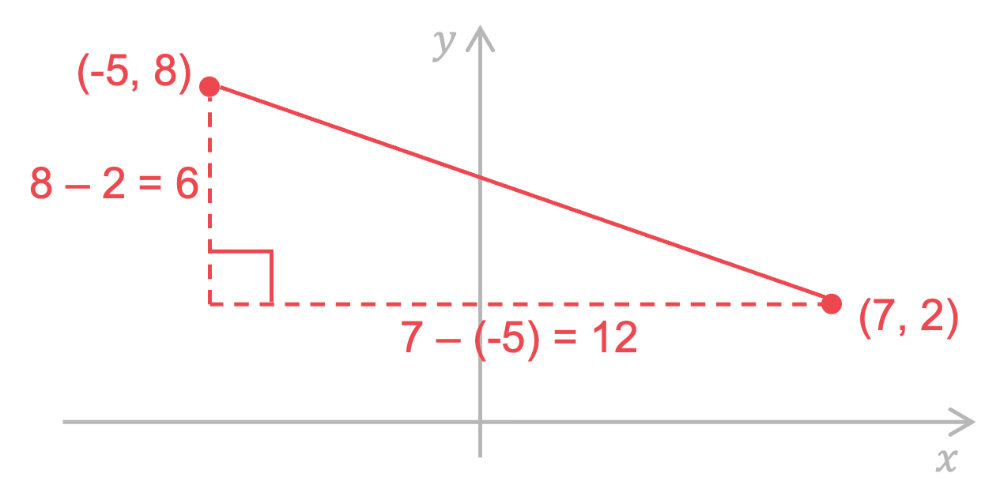

# Mark Schemes — Coordinate Geometry
**Coordinate Geometry & Graphs** · Cambridge (CIE) IGCSE maths (0607)

## Calculator Questions (18 questions)

### Q1
> *Find the coordinates of the midpoint using the formula *`open parentheses fraction numerator x subscript 1 plus x subscript 2 over denominator 2 end fraction space comma space fraction numerator y subscript 1 plus y subscript 2 over denominator 2 end fraction close parentheses`

`open parentheses fraction numerator 2 plus negative 4 over denominator 2 end fraction comma fraction numerator 7 plus 11 over denominator 2 end fraction close parentheses`

> *Simplify*

`open parentheses fraction numerator negative 2 over denominator 2 end fraction comma space 18 over 2 close parentheses`

`open parentheses negative 1 comma space 9 close parentheses`** [2]**
**1 mark for each**

### Q2
> *Start with a sketch of the points P, Q, and **R**: remember it does not need to be to scale, though it may help to draw some axes and put the points in the correct quadrants*

> *Now add in **M **and **N**, using the information regarding midpoints*

> *First we can find **M** and **N** using the midpoint formula, *`open parentheses fraction numerator x subscript 1 plus x subscript 2 over denominator 2 end fraction space comma space fraction numerator y subscript 1 plus y subscript 2 over denominator 2 end fraction close parentheses`

`table row M equals cell open parentheses fraction numerator negative 3 plus 1 over denominator 2 end fraction space comma space fraction numerator negative 6 plus 4 over denominator 2 end fraction close parentheses end cell row M equals cell open parentheses negative 1 comma space minus 1 close parentheses end cell end table`           `table row N equals cell open parentheses fraction numerator 1 plus 5 over denominator 2 end fraction space comma space fraction numerator 4 plus open parentheses negative 2 close parentheses over denominator 2 end fraction close parentheses end cell row N equals cell open parentheses 3 comma space 1 close parentheses end cell end table`

* **attempting to find either midpoint using a correct method*** ****[1]**

> *We need to show that the gradient of **MN** is the same as the gradient of **PR **Starting with **MN**, find the gradient using *$\frac{y_{1}-y_{2}}{x_{1}-x_{2}}$*, taking **M **as *`open parentheses x subscript 1 comma space y subscript 1 close parentheses`* and **N** as *`open parentheses x subscript 2 comma space y subscript 2 close parentheses`

$m_{MN}=\frac{-1-1}{-1-3}=\frac{-2}{-4}=\frac{1}{2}$

> *Now **PR**, find the gradient using *$\frac{y_{1}-y_{2}}{x_{1}-x_{2}}$*, taking **P **as *`open parentheses x subscript 1 comma space y subscript 1 close parentheses`* and **R** as *`open parentheses x subscript 2 comma space y subscript 2 close parentheses`

`m subscript P R end subscript equals fraction numerator negative 6 minus open parentheses negative 2 close parentheses over denominator negative 3 minus 5 end fraction equals fraction numerator negative 4 over denominator negative 8 end fraction equals 1 half`

* **attempting to find either gradient using a correct method*** ****[1]**
*c**orrectly obtaining both gradients*** ****[1]**

> *Conclude with a final statement*

$m_{MN}=m_{PR}=\frac{1}{2}$** ****therefore ****MN**** and ****PR**** are parallel ****[1]**

### Q3
*Sketch the two points, and draw a right-angled triangle between them*

*Find the difference in their x-coordinates and y-coordinates to find the length and height of the triangle*

> *We can then use Pythagoras to find the distance between the two points*

**[1]**

> *Using Pythagoras to find longest side*

$\sqrt{12^{2}+4^{2}}=12.64911064...$

**[1]**

$12.6$ **[1]** 
**Round to 3 significant figures**
*The midpoint of two coordinates can be thought of as the average (mean) of the two points*

> *We can find the mean of the x-coordinates using *$\frac{x_{1}+x_{2}}{2}$* and find the mean of the y-coordinates using *$\frac{y_{1}+y_{2}}{2}$

*Midpoint =* `open parentheses fraction numerator 8 plus negative 4 over denominator 2 end fraction comma fraction numerator 5 plus 1 over denominator 2 end fraction close parentheses`

**Final answer:** **Midpoint = **$(2,3)$** **

> *Mark for each of 2 and 3** [2]*

### Q4
> *Method 1*

> *Use the formula distance = *`square root of open parentheses x subscript 1 minus x subscript 2 close parentheses squared plus open parentheses y subscript 1 minus y subscript 2 close parentheses end root`*. This formula is not on the formula sheet, but it's worth knowing- and is really just an application of Pythagoras' Theorem (see Method 2 below)*

*distance = *`square root of open parentheses 7 minus open parentheses negative 5 close parentheses close parentheses squared plus open parentheses 2 minus 8 close parentheses squared end root`

*for correct numbers inside the square root sign** ***[1]** 
*for square root of** ***[1]**

`equals square root of 12 squared plus open parentheses negative 6 close parentheses squared end root
equals square root of 144 plus 36 end root
equals square root of 180
equals 13.4164079...`

> *Round to at least 3 significant figures*

**13.4 ****or**** 13.41 to 13.42** [**1]**

> *Method 2*

> *Sketch a diagram of the points and work out the horizontal and vertical distances between them, as below*

> *As the lines in the diagram form a right-angle triangle, we can use Pythagoras' Theorem to calculate the distance between the points*

*distance = *$\sqrt{12^{2}+6^{2}}$

*for correct numbers inside the square root sign** ***[1]**
* **for square root of*** [1]**

$=\sqrt{144+36}\,=\sqrt{180}\,=13.4164079...$

> *Round to at least 3 significant figures*

**13.4 ****or**** 13.41 to 13.42** [**1]**

### Q5
> *Let **P ** have the coordinates **x **and **y.*

> *Form an equation in terms of **x **and **y **for the gradient of **P, **using the formula for the gradient, *$\text{gradient}=\frac{\text{change in}y}{\text{change in}x}=\frac{y_{2}-y_{1}}{x_{2}-x_{1}}$*.*

$2=\frac{y-(0)}{x-0}=\frac{y}{x}$

> *Rearrange to find an expression for **y **in terms of **x.*

$y=2x$

** [1]**

> *Substitute into the formula for the length of a line segment, *`d equals square root of open parentheses x subscript 2 minus x subscript 1 close parentheses squared plus open parentheses y subscript 2 minus y subscript 1 close parentheses squared end root.`

`table row cell square root of open parentheses x minus 0 close parentheses squared plus open parentheses 2 x minus 0 close parentheses squared end root space end cell equals cell square root of 2645 space end cell row cell open parentheses x close parentheses squared plus open parentheses 2 x close parentheses squared space end cell equals cell 2645 space end cell end table`

**[1]**

> *Simplify.*

`table row cell x squared space plus space 4 x squared space end cell equals cell 2645 space end cell row cell 5 x squared space end cell equals cell 2645 space end cell end table`

> *Divide both sides by 5.*

`table row cell x squared space end cell equals cell 2645 over 5 space equals space 529 end cell end table`

**[1]**

> *Square root both sides to find **x**.*

`table row cell x space end cell equals cell space 23 end cell end table`

> *Substitute in to the original equation to find **y.*

`table row cell y space end cell equals cell space 2 x space equals 2 open parentheses 23 close parentheses space equals space 46 end cell end table`

$P(23,46)$ **[1]**

### Q6
> *Using the distance of a line formula, *`" d equals square root of open parentheses x subscript 2 minus x subscript 1 close parentheses squared plus open parentheses y subscript 2 minus y subscript 1 close parentheses squared end root "`*to find the length **AC**.*

`A C equals square root of open parentheses 4 minus negative 3 close parentheses squared plus open parentheses negative 4 minus 10 close parentheses squared end root`

*Part under the square root*** ****[1] **
*Including the square root*** [1]**

`A C equals square root of open parentheses 7 close parentheses squared plus open parentheses negative 14 close parentheses squared end root
A C equals square root of 245
A C equals 15.652 space 475 space...`

**The length ****AC**** is 15.7 units**** [1]**

### Q7
> *Find the points where the graphs intersect by forming an equation by making the expressions equal.*

`open parentheses x minus 1 close parentheses squared equals 1 half x plus 1`

**[1]**

> *Expand and simplify the left hand side by expanding *`open parentheses x minus 1 close parentheses open parentheses x minus 1 close parentheses.`

$x^{2}-x-x+1=\frac{1}{2}x+1\,x^{2}-2x+1=\frac{1}{2}x+1$

**[1]**

> *Subtract 1 from both sides.*

$x^{2}-2x=\frac{1}{2}x$

> *Subtract *$\frac{1}{2}x$* from both sides.*

`table attributes columnalign right center left columnspacing 0px end attributes row cell x squared minus 2 x minus 1 half x end cell equals 0 row cell x squared minus 5 over 2 x end cell equals 0 end table`

**[1]**

> *Factorise out the **x**.*

`x open parentheses x minus 5 over 2 close parentheses equals 0`

> *Make each factor equal to zero and solve for **x**.*

`table row x equals 0 row cell x minus 5 over 2 end cell equals cell 0 rightwards double arrow x equals 5 over 2 end cell end table`

**[1]**

> *Find the corresponding **y**-values by substitute the **x**-values into an equation for one of the graphs.*

`table row x equals cell 0 rightwards double arrow y equals open parentheses 0 minus 1 close parentheses squared equals 1 end cell row x equals cell 5 over 2 rightwards double arrow y equals open parentheses 5 over 2 minus 1 close parentheses squared equals 9 over 4 end cell end table`

**[1]**

> *Write down the coordinates for the two points of intersection.*

`A open parentheses 0 comma space 1 close parentheses space and space B open parentheses 5 over 2 comma fraction numerator space 9 over denominator 4 end fraction close parentheses`

> *Find the distance between the two points using the formula *`d equals square root of open parentheses x subscript 2 minus x subscript 1 close parentheses squared plus open parentheses y subscript 2 minus y subscript 1 close parentheses squared end root.`

`table row d equals cell square root of open parentheses 5 over 2 minus 0 close parentheses squared plus open parentheses 9 over 4 minus 1 close parentheses squared end root end cell row blank equals cell square root of 125 over 16 end root end cell row blank equals cell fraction numerator 5 square root of 5 over denominator 4 end fraction end cell row blank equals cell 2.795084... end cell end table`

**[1]**

> *Round to 3 significant figures.*

**AB**** = 2.80** **[1]**

### Q8
> *Sketching a diagram can help. You can form a right angled triangle between points **A** and **B**.*

> *Work out the horizontal and vertical distances between the two points and substitute them into Pythagoras' theorem, *$a^{2}+b^{2}=c^{2}$*, to find the length **AB**.*

`open parentheses 9 minus 2 close parentheses squared plus open parentheses 4 minus 1 close parentheses squared equals A B squared`

**[1]**

> *Simplify the left hand side.*

$7^{2}+3^{2}=AB^{2}$

> *Simplify the left hand side further.*

$58=AB^{2}$

> *Take the square root of both sides.*

$7.61577...=AB$

**[1]**

$7.62$** ****[1]**
**Answers between 7.615 and 7.616 will be accepted.**

### Q9
*The length of a line between the points *`open parentheses x subscript 1 space comma space y subscript 1 close parentheses`* and *`open parentheses x subscript 2 space comma space y subscript 2 close parentheses`* is *`square root of open parentheses x subscript 2 minus x subscript 1 close parentheses squared plus open parentheses y subscript 2 minus y subscript 1 close parentheses squared end root` 
*A** has coordinates (5,6) and **C** has coordinates (8,14)* 
*Substitute these numbers into the formula* * *

`A C equals square root of open parentheses 8 minus 5 close parentheses squared plus open parentheses 14 minus 6 close parentheses squared end root`

*(8-5) and (14-6) seen*** [1]**
* *$(8-5)^{2}+(14-6)^{2}$* seen*** ****[1]**

> *Use a calculator to find this value and give your answer to 3 significant figures*

**8.54**** [1]**
*The mid-point of the points *`open parentheses x subscript 1 space comma space y subscript 1 close parentheses`* and *`open parentheses x subscript 2 space comma space y subscript 2 close parentheses`* has coordinates *`open parentheses fraction numerator space x subscript 1 plus x subscript 2 over denominator 2 end fraction comma fraction numerator space y subscript 1 plus y subscript 2 over denominator 2 end fraction close parentheses`

*B** has coordinates (0,-2) and **C** has coordinates (8,14)* *Substitute these numbers into the formula*

`open parentheses fraction numerator 0 plus 8 over denominator 2 end fraction comma fraction numerator negative 2 plus 14 over denominator 2 end fraction close parentheses`

*One coordinate correct*** ****[1]** 
**The mid-point of ****BC**** is (4,6)** **[1]**

### Q10
> *The formula for the length between the points (**x**1**, **y**1**) and (**x**2**, **y**2**) is *`square root of open parentheses x subscript 2 minus x subscript 1 close parentheses squared plus open parentheses y subscript 2 minus y subscript 1 close parentheses squared end root`*. Use this formula with the points (-3, 8) and (9, -2). Use brackets around negatives.*

`square root of open parentheses 9 minus open parentheses negative 3 close parentheses close parentheses squared plus open parentheses open parentheses negative 2 close parentheses minus 8 close parentheses squared end root`

* One correct bracket*** [1]*** *
*Correct expression*** [1]**

> *You could simplify before typing it into your calculator or just type it straight in.*

`table attributes columnalign right center left columnspacing 0px end attributes row blank blank cell square root of open parentheses 12 close parentheses squared plus open parentheses negative 10 close parentheses squared end root end cell row blank equals cell square root of 144 plus 100 end root end cell row blank equals cell square root of 244 end cell row blank equals cell 2 square root of 61 end cell row blank equals cell 15.6204... end cell end table`

> *Round to 3 significant figures.*

**15.6**** ****[1]**

### Q11
> *Use the distance between two points, *`open parentheses x subscript 1 comma space y subscript 1 close parentheses`* and *`open parentheses x subscript 2 comma space y subscript 2 close parentheses`* formula, *`" d equals square root of open parentheses x subscript 2 minus x subscript 1 close parentheses squared plus open parentheses y subscript 2 minus y subscript 1 close parentheses squared end root "`*.*

`A B equals square root of open parentheses 6 minus negative 3 close parentheses squared plus open parentheses negative 2 minus 4 close parentheses squared end root`

*Correct subtraction of coordinates ***[1]**** **
*Square root ***[1]**

$AB=\sqrt{81+36}=3\sqrt{13}=10.816653...$

**10.8 units*** ***[1]**

### Q12
*To find the length *$AB$*, consider a right-angled triangle joining the two points*

> *Find the difference in **y** coordinates, and the difference in **x** coordinates, and then use Pythagoras to find the longest side*

`square root of open parentheses 7 minus 2 close parentheses squared plus open parentheses 12 minus negative 1 close parentheses squared end root`

**[2]**

`square root of open parentheses 5 close parentheses squared plus open parentheses 13 close parentheses squared end root equals square root of 194 equals 13.92838828...`

$13.9$ **[1] **
**Round to 3 significant figures**

### Q13
> *If *$r=p+2$* and *$s=q+4$* then we can rewrite *`open parentheses r comma space s close parentheses`* in terms of *$p$* and *$q$*.*

`open parentheses r comma space s close parentheses equals open parentheses p plus 2 comma space q plus 4 close parentheses`

> *Now we can substitute into the gradient formula *$\frac{y_{1}-y_{2}}{x_{1}-x_{2}}$*, taking *`open parentheses p plus 2 comma space q plus 4 close parentheses`* **as *`open parentheses x subscript 1 comma space y subscript 1 close parentheses`* and *`open parentheses p comma space q close parentheses`* as *`open parentheses x subscript 2 comma space y subscript 2 close parentheses`*.*

$m=\frac{q+4-q}{p+2-p}$

**[1]**

> *Collecting like terms cancels out the *$p$*s and *$q$*s in the denominator and numerator so that;*

$m=\frac{4}{2}$

**[1]**

> *Simplify *$\frac{4}{2}$* to 2.*

**The gradient of the line is 2 ****[1]**

### Q14
> *When in the form **y** = **mx** + **c**, a straight line has gradient **m.*

> *Rearrange the equation given for the line to the form **y** = **mx** + **c  **to determine its gradient.*
*Start by subtracting *$5x$* from both sides.*

$2y=-5x+7$

**[1]**

> *Divide both sides by 2.*

$y=\frac{-5}{2}x+\frac{7}{2}$

> *The gradient is the coefficient of **x.*

**m = -2.5 [****1]**

### Q15
> *Use the midpoint formula, *`open parentheses fraction numerator x subscript 1 plus x subscript 2 over denominator 2 end fraction space comma space fraction numerator y subscript 1 plus y subscript 2 over denominator 2 end fraction close parentheses`

`M equals open parentheses fraction numerator 2 plus 6 over denominator 2 end fraction space comma space fraction numerator 3 plus 8 over denominator 2 end fraction close parentheses`

**[1]**

> *Simplify by hand, or work out the **x** and then the **y** coordinate using your calculator*

`equals open parentheses 8 over 2 space comma space 11 over 2 close parentheses`

$M=(4,5.5)$**[1]**
**You're not asked to plot the midpoint- but check against the diagram that your answer looks right**

### Q16
> *When in the form **y** = **mx** + **c**, we know that **L** has gradient **m.*

*Rearrange the equation given for **L **to the form **y** = **mx** + **c  **to determine its gradient. * *Start by subtracting *$7x$* to both sides.*

$2y=-7x+10$

**[1]**

> *Divide both sides by 2.*

$y=\frac{-7}{2}x+\frac{10}{2}$

> *The gradient is the coefficient of **x.*

**m = -3.5 ****[****1]**

### Q17
*The midpoint of two coordinates can be thought of as the average (mean) of the two points.*

> *We can find the mean of the x-coordinates using *$\frac{x_{1}+x_{2}}{2}$* and find the mean of the y-coordinates using *$\frac{y_{1}+y_{2}}{2}$*.*

*Midpoint = *`open parentheses fraction numerator 5 space plus space 13 over denominator 2 end fraction space comma space fraction numerator negative 4 space plus space 1 over denominator 2 end fraction close parentheses`

**[1]**

**Midpoint = **$(9,-1.5)$** ****[1]**
> *When in the form **y** = **mx** + **c**,  **L** has gradient **m. *

> *Rearrange the equation given for **L **to the form **y** = **mx** + **c  **to determine its gradient. *

$y=-3x+2$

**m = -3**** [1]**

### Q18
> *Calculate the gradient of the line from those two points by dividing the rise by the run, *$m=\frac{y_{2}-y_{1}}{x_{2}-x_{1}}$*.*

$m=\frac{-4-8}{9-5}$

$m=\frac{-12}{4}$

**[1]**

$m=-3$* ***[1]**
