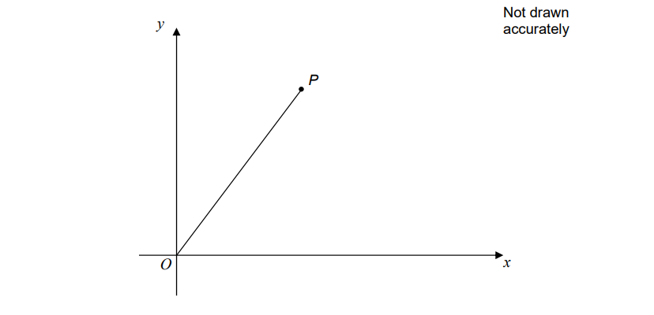
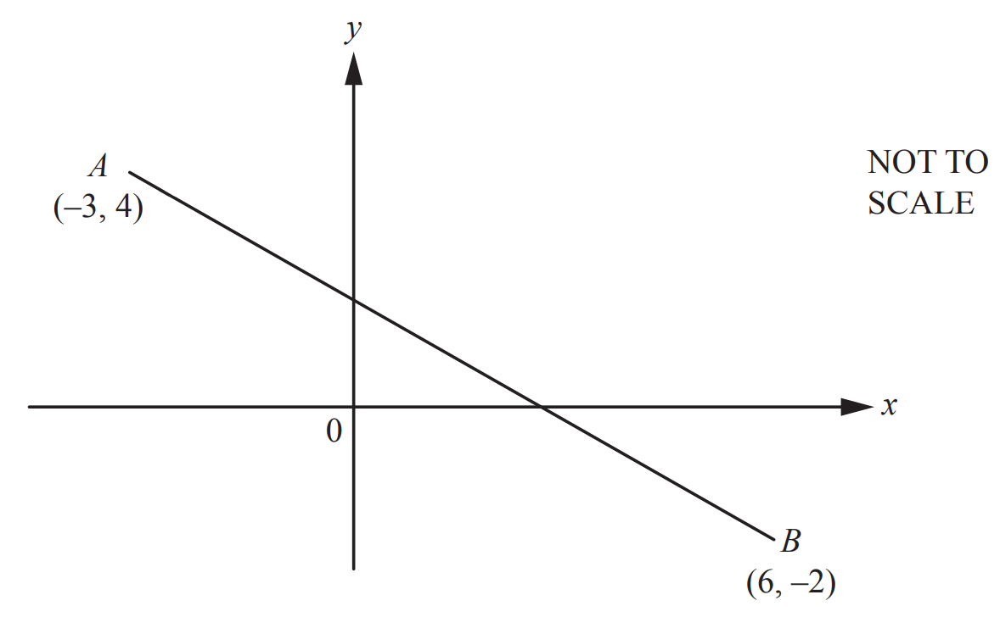

# Exam Questions — Coordinate Geometry
**Coordinate Geometry & Graphs** · Cambridge (CIE) IGCSE maths (0607)
> Source: [https://www.savemyexams.com/igcse/maths/cie/international-maths/23/extended/topic-questions/](https://www.savemyexams.com/igcse/maths/cie/international-maths/23/extended/topic-questions/) · 18 questions across 1 sets

## Calculator Questions (18 questions)

### Q1 — medium — 2 marks

**Q1** [2 marks]

$A$ is the point $(2,7)$ and $B$ is the point $(--4,11)$.

Find the coordinates of the midpoint of the line $AB$.

(.................... , ....................)

*Source: 2025 Specimen 4 Q5*

### Q2 — hard — 4 marks

**Q2** [4 marks]

A triangle has vertices $P,Q$ and $R$.

The coordinates of $P$ are (—3, —6)
The coordinates of $Q$ are (1, 4) 
The coordinates of $R$ are (5, —2)

$M$ is the midpoint of $PQ$.
 $N$ is the midpoint of $QR$.

Prove that $MN$ is parallel to $PR$. 
You must show each stage of your working.

*Source: 2017	November 1MA1/2H Q19*

### Q3 — medium — 5 marks

**Q3** [3 marks]

$A$ is the point $(8,5)$ and $B$ is the point $(-4,1)$.

Calculate the length of $AB.$

*Source: 2019	May/June 0580/42 Q4C*

**Q3** [2 marks]

**Extract:**

A is the point (8, 5) and B is the point (−4, 1).

Find the co-ordinates of the midpoint of $AB.$

( ..................... , ..................... )

*Source: 2019	May/June 0580/42 Q4C*

### Q4 — medium — 3 marks

**Q4** [3 marks]

*A* is the point (7, 2) and *B* is the point (−5, 8).

Calculate the length of *AB.*

*Source: Specimen 2025 0580/04 Q16A*

### Q5 — hard — 4 marks

**Q5** [4 marks]

The diagram shows a line joining $O$ to $P$.

The gradient of the line is 2

The length of the line is $\sqrt{2645}$

Work out the coordinates of $P.$

*Source: Specimen 2015 8300/3H Q28*

### Q6 — medium — 3 marks

**Q6** [3 marks]

A rhombus $ABCD$ has a diagonal $AC$ where $A$ is the point $(-3,10)$ and C is the point $(4,-4).$

Calculate the length $AC.$

*Source: 2020	May/June 0580/41 Q10A*

### Q7 — hard — 7 marks

**Q7** [7 marks]

The graphs of $y = ( x - 1 )^{2}$ and $y=\frac{1}{2}x+1$ intersect at *A* and *B*.

Find the length of *AB*.

*AB* = ................................................

*Source: 2020 May/June 0580/42 Q9C*

### Q8 — medium — 3 marks

**Q8** [3 marks]

*A* is the point (2, 1) and *B* is the point (9, 4).

Find the length of *AB*.

*Source: 2019	Oct/Nov 0580/23 Q12-*

### Q9 — medium — 5 marks

**Q9** [3 marks]

*C* is the point (8, 14).

Calculate the length of *AC*.

*Source: 2018	Oct/Nov 0580/41 Q8D*

**Q9** [2 marks]

**Extract:**

C is the point (8, 14).

Find the co-ordinates of the mid-point of *BC*.

( ..................... , ......................)

*Source: 2018	Oct/Nov 0580/41 Q8D*

### Q10 — medium — 3 marks

**Q10** [3 marks]

The coordinates of *P* are $(-3,8)$ and the coordinates of *Q* are $(9,-2)$.

Calculate the length *PQ*.

*Source: 2020 May/June 0580/43 Q9B*

### Q11 — medium — 3 marks

**Q11** [3 marks]

Calculate the length of *AB*.

*Source: 2018	Feb/Mar 0580/42 Q10A*

### Q12 — medium — 3 marks

**Q12** [3 marks]

$A$ is the point $(7,12)$and $B$ is the point $(2,-1)$.

Find the length of $AB$.

*Source: 2019	May/June 0580/42 Q15*

### Q13 — hard — 3 marks

**Q13** [3 marks]

A straight line goes through the points ($p,q$) and ($r,s$), where

- $p+2=r$
- $q+4=s.$

Find the gradient of the line.

*Source: Specimen 2015 J560/06 Q14*

### Q14 — easy — 2 marks

**Q14** [2 marks]

Find the gradient of the straight line with equation $5x+2y=7$

*Source: Nov 2020 4MA1/2HR Q16*

### Q15 — easy — 2 marks

**Q15** [2 marks]

The point $A$ has coordinates (2, 3).
The point $B$ has coordinates (6, 8).

$M$ is the midpoint of the line $AB$.
Find the coordinates of $M$.

*Source: 2014	June 1MA0/2H Q1*

### Q16 — easy — 2 marks

**Q16** [2 marks]

The straight line $L$ has equation $2y+7x=10$

Find the gradient of $L$.

*Source: Jan 2022 4MA1/1H Q10A*

### Q17 — easy — 3 marks

**Q17** [2 marks]

The point* *$A$ has coordinates (5, −4) 
The point $B$ has coordinates (13, 1)

Work out the coordinates of the midpoint of $AB$.

*Source: Jan 2020 4MA1/1H Q1A*

**Q17** [1 mark]

Line $L$ has equation $y=2-3x$

Write down the gradient of line $L$.

*Source: Jan 2020 4MA1/1H Q1B*

### Q18 — easy — 2 marks

**Q18** [2 marks]

Point $A$ has coordinates (5, 8) 
Point $B$ has coordinates (9, –4)

Work out the gradient of $AB$.

*Source: Jan 2021 4MA1/1H Q13A*

