# Exam Questions — Sketching 2D Inequalities
**Coordinate Geometry & Graphs** · Cambridge (CIE) IGCSE maths (0607)
> Source: [https://www.savemyexams.com/igcse/maths/cie/international-maths/23/extended/topic-questions/](https://www.savemyexams.com/igcse/maths/cie/international-maths/23/extended/topic-questions/) · 17 questions across 1 sets

## Exam Questions (17 questions)

### Q1 — medium — 3 marks

**Q1** [3 marks]

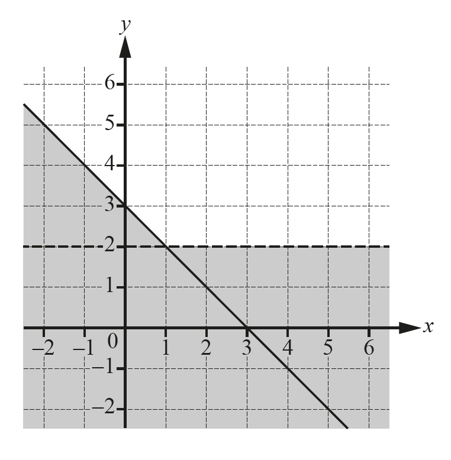

Find the two inequalities that define the region on the grid that is **not** shaded.

*Source: 2018	May/June 0580/22 Q19*

### Q2 — hard — 4 marks

**Q2** [4 marks]

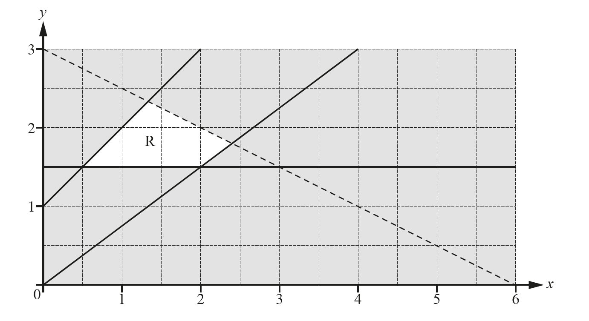

There are four inequalities that define the region R.
One of these is $y\leqx+1$.

Find the other three inequalities.

*Source: 2018	May/June 0580/21 Q21*

### Q3 — very_hard — 8 marks

**Q3** [1 mark]

Raheem makes baskets and mats. 
Each week he makes $x$ baskets and $y$ mats.

He makes fewer than 10 mats.
The number of mats he makes is greater than or equal to the number of baskets he makes.

One of the inequalities that shows this information is  $y<10$.

Write down the other inequality.

*Source: 2020	May/June 0580/41 Q6A*

**Q3** [2 marks]

Raheem takes $2\frac{1}{4}$ hours to make a basket and $1\frac{1}{2}$ hours to make a mat.

Each week he works for a maximum of 22.5 hours.

Show that  $3x+2y\leq30$.

*Source: 2020	May/June 0580/41 Q6B*

**Q3** [5 marks]

**Extract:**

Raheem makes baskets and mats. Each week he makes x baskets and y mats. He makes fewer than 10 mats. The number of mats he makes is greater than or equal to the number of baskets he makes. One of the inequalities that shows this information is y < 10. Write down the other inequality.

Raheem takes 2 1/4 hours to make a basket and 1 1/2 hours to make a mat. Each week he works for a maximum of 22.5 hours. Show that 3x + 2y ≤ 30.

On the grid, draw three straight lines and shade the unwanted regions to show these inequalities.

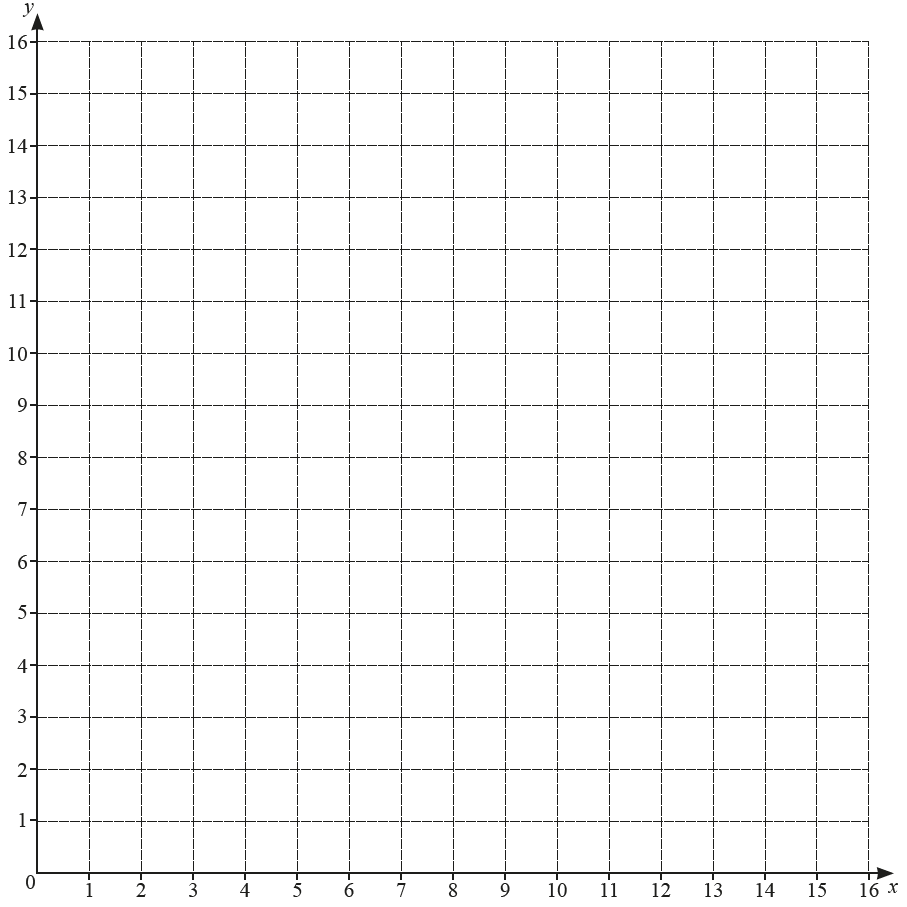

*Source: 2020	May/June 0580/41 Q6C*

### Q4 — hard — 6 marks

**Q4** [2 marks]

Find the point $(x,y)$, with integer co-ordinates, inside the region $R$ such that $3x+5y=35$.

( .............. , .............. )

*Source: 2018	May/June 0580/43 Q9B*

**Q4** [4 marks]

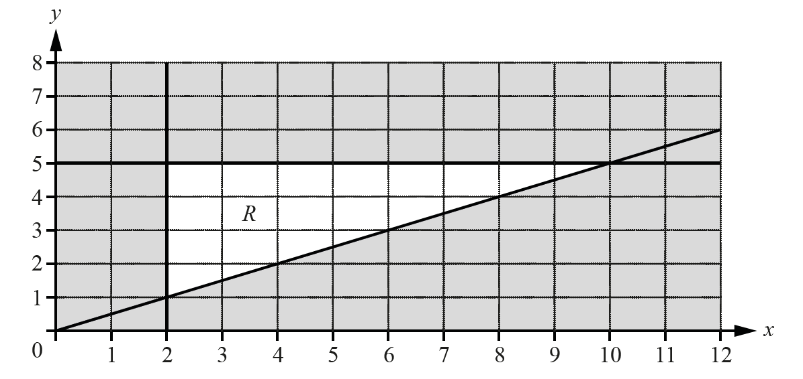

Find the three inequalities that define the region $R$.

*Source: 2018	May/June 0580/43 Q9B*

### Q5 — medium — 3 marks

**Q5** [3 marks]

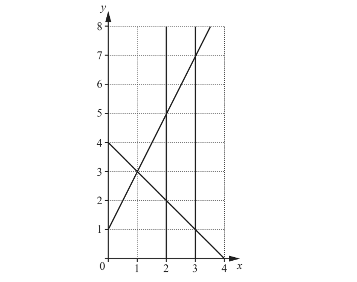

By shading the **unwanted** regions of the grid, find and label the region *R* that satisfies the following four inequalities.

$x\leq3x\geq2y\leq2x+1y\geq4-x$

*Source: 2018	Oct/Nov 0580/22 Q14*

### Q6 — hard — 4 marks

**Q6** [4 marks]

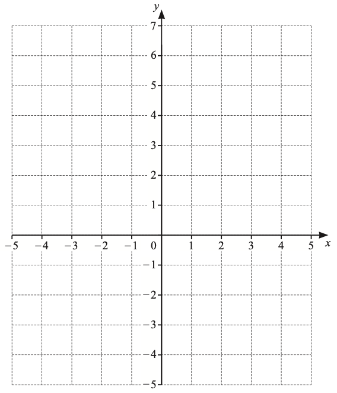

By shading the **unwanted** regions on the grid, draw and label the region $R$ that satisfies the following inequalities.

$-2<x\leq3y\leqx+3$

*Source: 2019	Oct/Nov 0580/23 Q17-*

### Q7 — medium — 2 marks

**Q7** [2 marks]

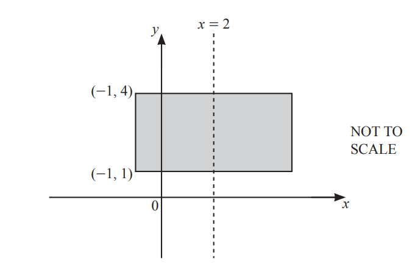

The diagram shows a rectangle with a line of symmetry at $x=2$. Two vertices of the rectangle are at $(-1,1)$ and $(-1,4)$.

The shaded region is defined by the inequalities $a\leqx\leqb$ and $c\leqy\leqd$ .

Find the values of $a,b,c$ and $d$.

$a=$ ................................................

$b=$ ................................................

$c=$ ................................................

$d=$ ................................................

*Source: 2020 Oct/Nov 0580/02 Q11*

### Q8 — very_hard — 10 marks

**Q8** [3 marks]

A car hire company has $x$ small cars and $y$ large cars.

The company has at least 6 cars in total.

The number of large cars is less than or equal to the number of small cars.

The largest number of small cars is 8.

Write down three inequalities, in terms of $x$ and/or $y$, to show this information.

*Source: 2019	Oct/Nov 0580/41 Q9A*

**Q8** [1 mark]

A small car can carry 4 people and a large car can carry 6 people. One day, the largest number of people to be carried is 60.

Show that $2x+3y\leq30$.

*Source: 2019	Oct/Nov 0580/41 Q9B*

**Q8** [6 marks]

**Extract:**

A car hire company has x small cars and y large cars. The company has at least 6 cars in total. The number of large cars is less than or equal to the number of small cars. The largest number of small cars is 8.

A small car can carry 4 people and a large car can carry 6 people. One day, the largest number of people to be carried is 60. Show that 2x + 3y ≤ 30.

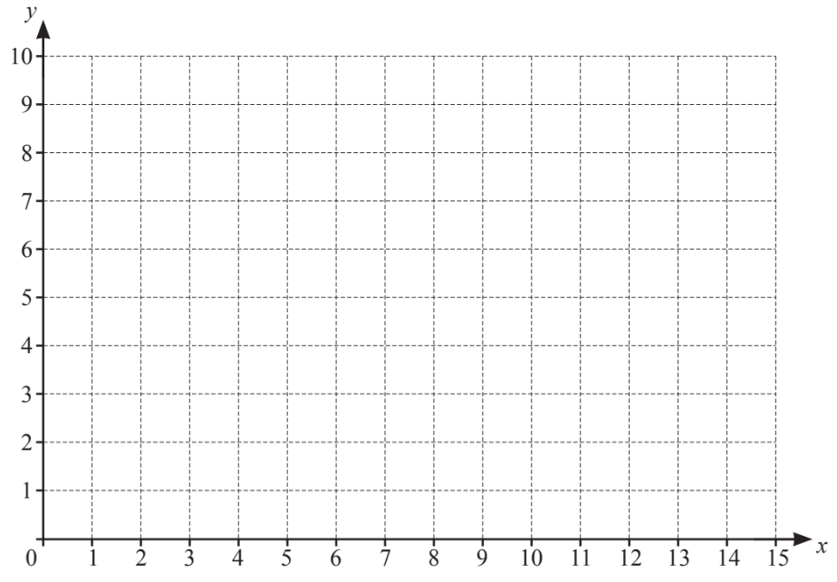

By shading the **unwanted** regions on the grid, show and label the region *R* that satisfies all four inequalities.

*Source: 2019	Oct/Nov 0580/41 Q9C*

### Q9 — hard — 4 marks

**Q9** [4 marks]

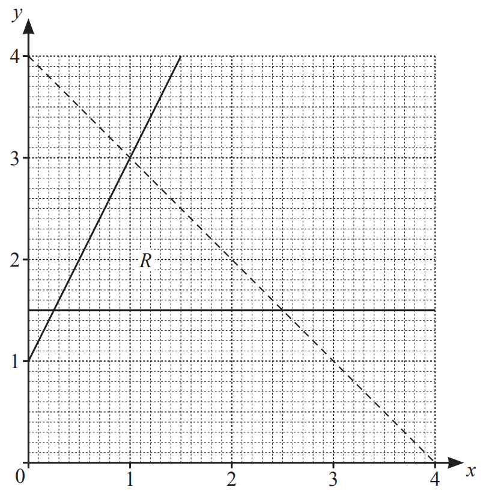

Write down the three inequalities that define the region $R$.

*Source: 2020 May/June 0580/23 Q13*

### Q10 — hard — 4 marks

**Q10** [4 marks]

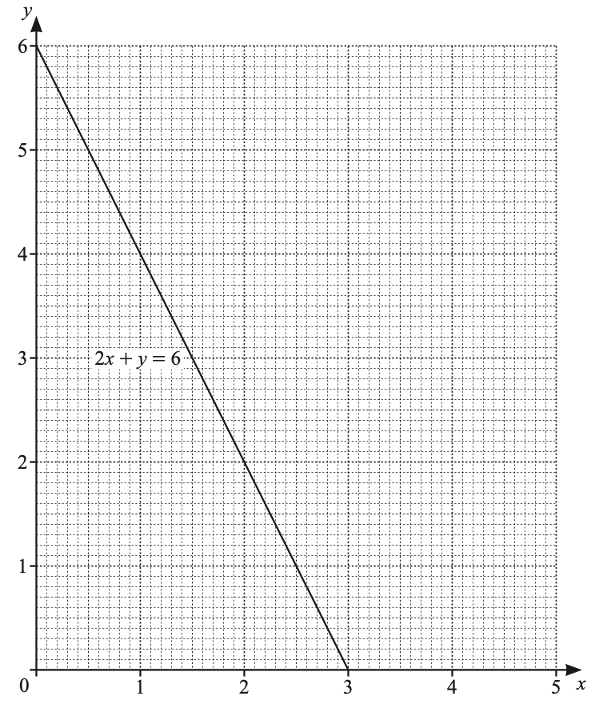

By shading the **unwanted** regions of the grid, find and label the region $R$ that satisfies the following inequalities

$y\leq52x+y\geq6y\geqx+1$

*Source: 2019	Oct/Nov 0580/22 Q16-*

### Q11 — very_hard — 4 marks

**Q11** [4 marks]

On the grid, shade the region that satisfies all these inequalities.

$x+y<4y>x-1y<3x$

Label the region **R**.

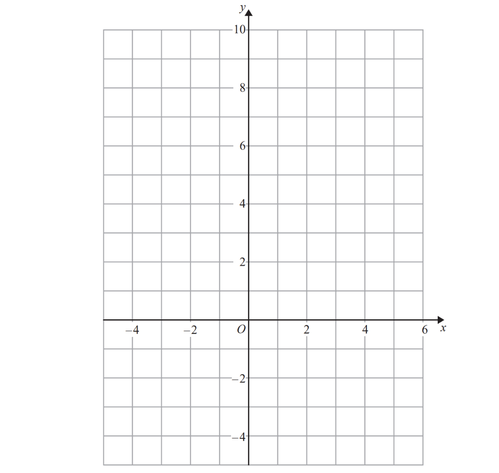

*Source: Spec1 2015 1MA1/3H Q10*

### Q12 — hard — 5 marks

**Q12** [5 marks]

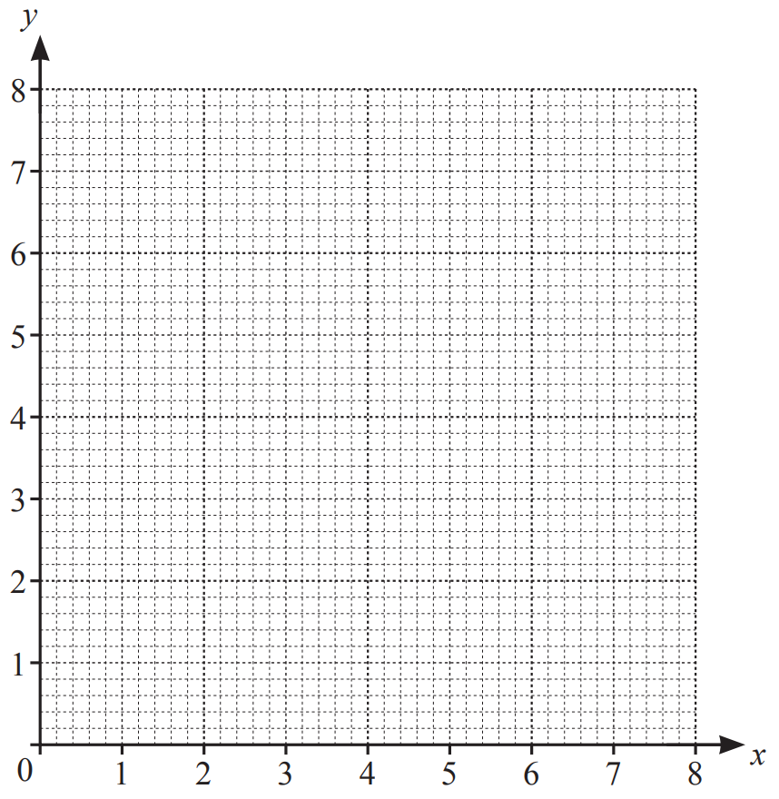

By drawing suitable lines and shading unwanted regions, find the region, $R$, where

$x\geq2$,   $y\geqx$   and   $2x+y\leq8$.

*Source: 2020 May/June 0580/22 Q23A*

### Q13 — hard — 2 marks

**Q13** [2 marks]

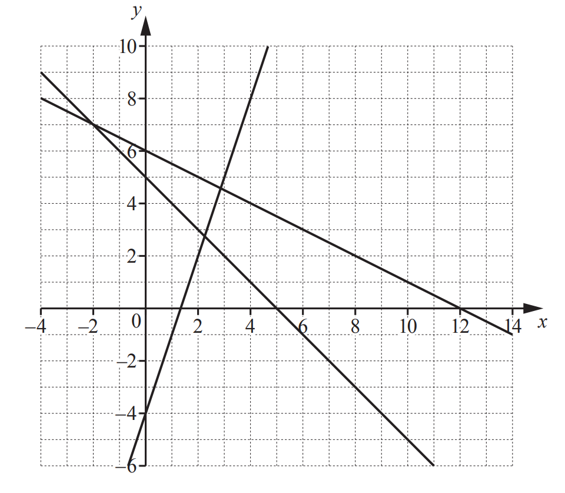

$y\leq-\frac{1}{2}x+6$    $y\geq3x-4$    $x+y\geq5$

By shading the **unwanted **regions of the grid, find and label the region R that satisfies the three inequalities.

*Source: 2019	May/June 0580/22 Q16A*

### Q14 — medium — 4 marks

**Q14** [3 marks]

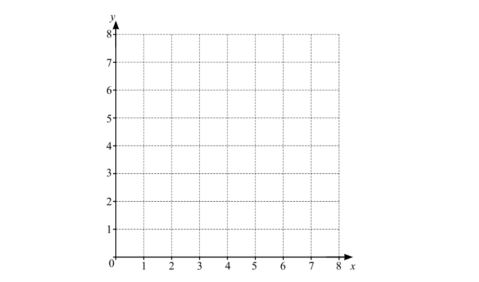

On the grid, draw the lines $y=x$ and $x+y=7$.

*Source: Specimen 2025 0580/04 Q8A*

**Q14** [1 mark]

**Extract:**

On the grid, draw the lines y = x and x + y = 7.

Region R satisfies the three inequalities `y space greater-than or slanted equal to space 0`, `y space less-than or slanted equal to space x` and `x space plus space y space greater-than or slanted equal to space 7`. On the grid, label the region R.

*Source: Specimen 2025 0580/04 Q8B*

### Q15 — very_hard — 6 marks

**Q15** [2 marks]

Given that $x$ and $y$ are integers such that

$3<x<7\,4<y<9\,\mathrm{and}x+y=13$

find all the possible values of $x$.

*Source: November 2015 1MA0/2H Q13A*

**Q15** [4 marks]

On the grid below show, by shading, the region defined by the inequalities

`y space greater-than or slanted equal to space minus 1 space space space space space space space space space space space space space space space space y space less-than or slanted equal to space 4 space minus space x space space space space space space space space space space space space space space space space y space less-than or slanted equal to space 3 x space minus space 1`

Mark this region with the letter *R*.

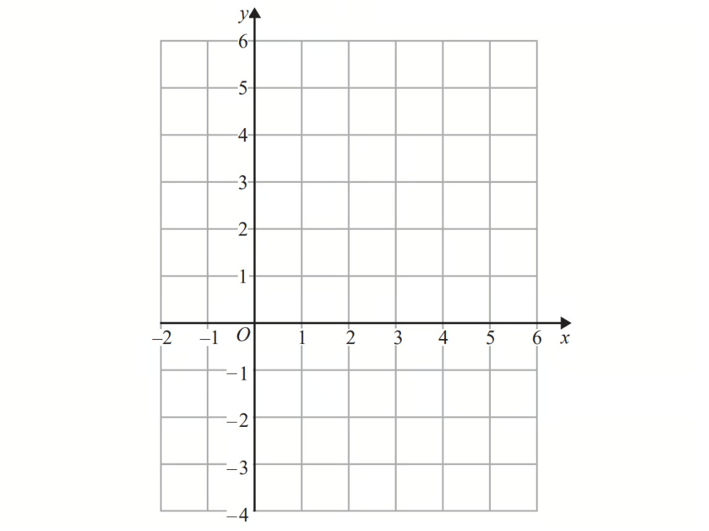

*Source: November 2015 1MA0/2H Q13B*

### Q16 — very_hard — 9 marks

**Q16** [4 marks]

Klaus buys $x$ silver balloons and $y$ gold balloons for a party.

He buys

- more gold balloons than silver balloons
- at least 15 silver balloons
- less than 50 gold balloons
- a total of no more than 70 balloons.

Write down four inequalities, in terms of $x$ and/or $y$, to show this information.

.................................................

.................................................

.................................................

.................................................

*Source: 2018	Feb/Mar 0580/42 Q6A*

**Q16** [5 marks]

**Extract:**

Klaus buys x silver balloons and y gold balloons for a party.   

He buys

- more gold balloons than silver balloons
- at least 15 silver balloons
- less than 50 gold balloons
- a total of no more than 70 balloons.

Write down four inequalities, in terms of x and/or y, to show this information.

On the grid, show the information from **part (a)** by drawing four straight lines and shading the unwanted regions.

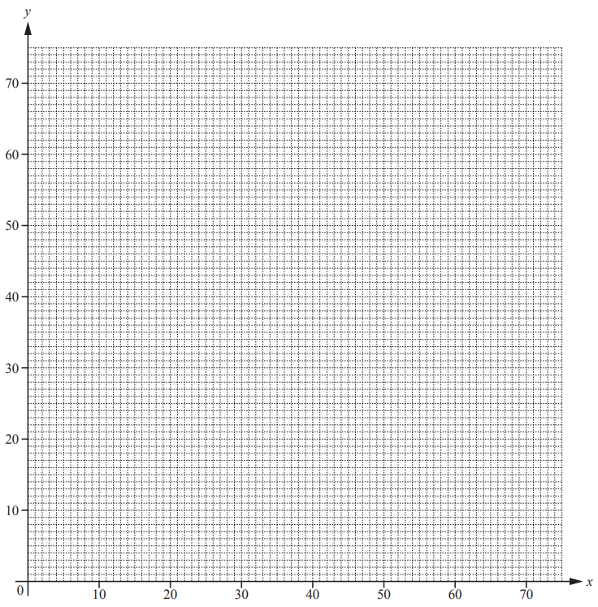

*Source: 2018	Feb/Mar 0580/42 Q6B*

### Q17 — medium — 5 marks

**Q17** [5 marks]

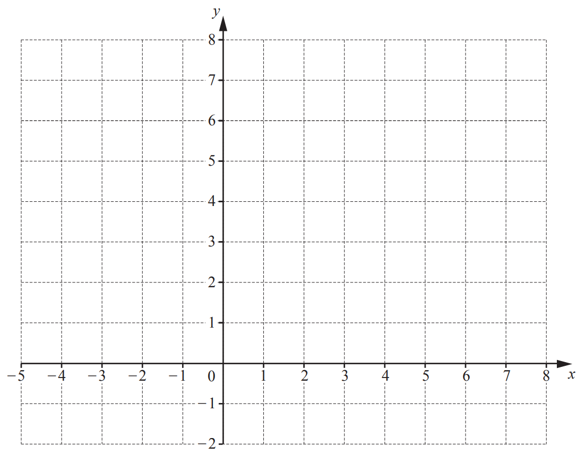

By shading the **unwanted **regions of the grid, draw and label the region $R$ which satisfies the following three inequalities.

| $y\leq2$ | $x<3$ | $y\leqx+4$ |
|---|---|---|

*Source: 2019	May/June 0580/23 Q24*

