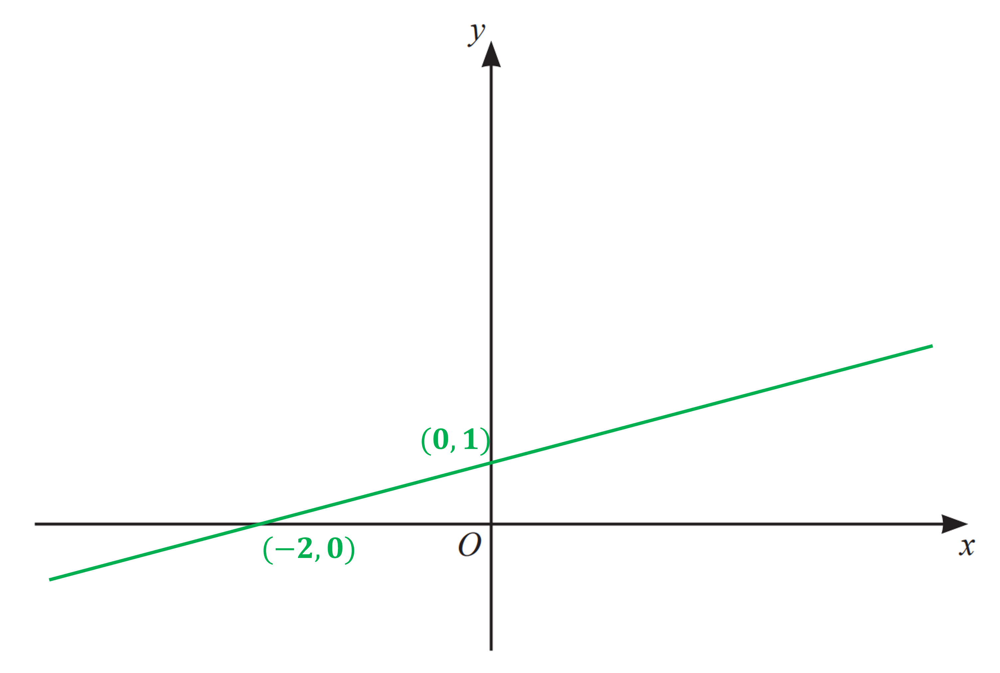
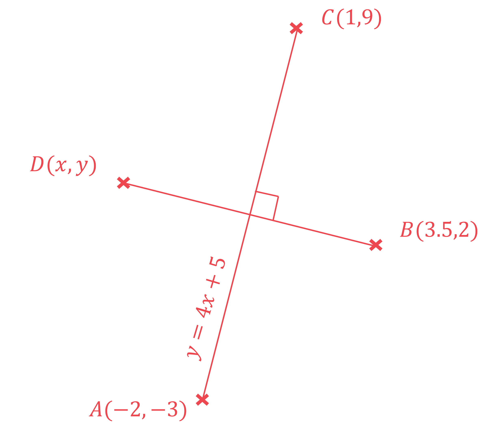
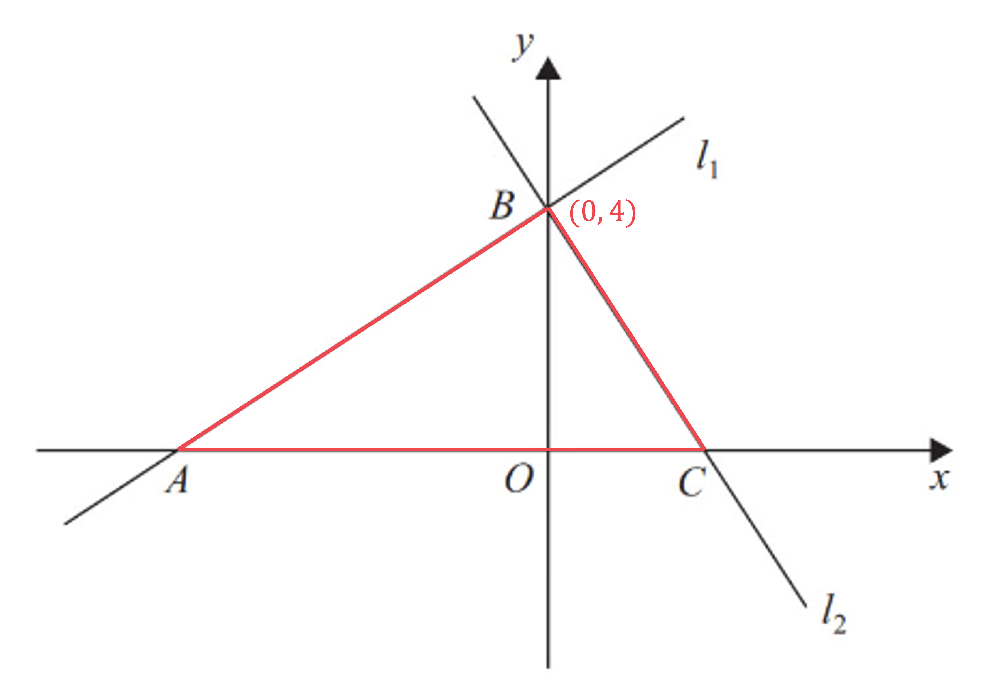
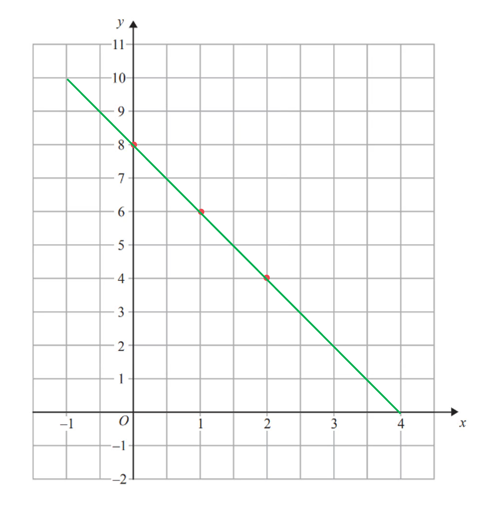

# Mark Schemes — Straight Line Graphs
**Coordinate Geometry & Graphs** · Cambridge (CIE) IGCSE maths (0607)

## Calculator Questions (14 questions)

### Q1
> *This is a linear function so will be the shape of a straight line.*

> *You need to find where the graph crosses the coordinate axes.*

> *The graph crosses the **y**-axis when **x **= 0.*

$x = 0 \Leftrightarrow y = 1 \frac{1}{2} ( 0 ) + 1 = 1$

> *The graph crosses the **x**-axis when **y **= 0.*

$y=0\Rightarrow0=\frac{1}{2}x+1$

> *Subtract 1 from both sides and then multiply both sides by 2.*

$\begin{gathered} 1 \frac{1}{2} x & = - 1 \\ x = - 2 \end{gathered}$

> *Draw the straight line by drawing a line which goes through the points (0, 1) and (-2, 0).*

**Drawing a straight line with positive gradient and positive y-intercept**** ****[1] **
**Drawing the correct graph**** ****[1]**

### Q2
> *The line  *$l$*  crosses the **x** axis at the point where  *$y=0$*.*

> *Form an equation by letting  *$y=0$*.*

$\begin{gathered} 5 x + 12 & = 0 \end{gathered}$

**[1]**

> *Solve the equation by subtracting 12 and then dividing by 5.*

$\begin{gathered} 5 x & = 0 - 12 \\ x & = \frac{- 12 }{5} \end{gathered}$

> *Write both the **x** and the **y** coordinates in your answer.*

$(-\frac{12}{5},0)$** ****[****1****]**
> *The gradients of perpendicular lines are negative reciprocals of each other.*

> *Find the gradient of a line perpendicular to *$l$* by finding the negative reciprocal of the gradient.*

$m = - \frac{1}{grad ( l )}$

$m=-\frac{1}{5}$ **[1]**

### Q3
*The perpendicular bisector of **PQ** is a line that is perpendicular to the line **PQ**.* *If a line has gradient *$m$* then the gradient of a perpendicular line is the negative reciprocal,   *$-\frac{1}{m}$*.*

`| m = - (1)/(( - 5 / 6 )) | | _ = 6 / 5 | | therefore y | = 6 / 5 x + c | |`

**[1]**

> *The perpendicular bisector of **PQ** passes through the midpoint of **PQ**. Find the midpoint by finding the average of the coordinates using the formula *$( \frac{x_{1} + x_{2} }{2} , \frac{y_{1} + y_{2} }{2} )$*.*

$\begin{gathered} \text{Midpoint} = ( \frac{( - 3 ) + 9}{2} , \frac{8 + ( - 2 )}{2} ) \\ = ( 3 , 3 ) \end{gathered}$

**[1]**

> *Substitute **x** = 3 and **y** = 3 into **y **= **mx** + **c** and solve to find **c**.*

$\begin{gathered} 3 = \frac{6}{5} \times 3 + c \\ 3 = \frac{18}{5} + c \\ 3 - \frac{18}{5} & = c \\ \therefore c & = - \frac{3}{5} \end{gathered}$

**[1]**

> *Write out the equation using the value of **c**.*

$y=\frac{6}{5}x-\frac{3}{5}$ **[1]**
> *Find the gradient between **P **and **Q** using the formula *$m=\frac{y_{2}-y_{1}}{x_{2}-x_{1}}.$

$\begin{gathered} m_{P Q} & = \frac{( - 2 ) - 8}{9 - ( - 3 )} \\ = - \frac{5}{6} \end{gathered}$

**[1]**

> *Parallel lines have the same gradient.*

$m=-\frac{5}{6}$

> *Write the equation of the line using **y** = **mx** + **c**.*

$y=-\frac{5}{6}x+c$

> *(6, -1) lies on the line so substitute **x** = 6 and **y** = -1 into the equation and solve to find **c**.*

$\begin{gathered} - 1 & = - \frac{5}{6} \times 6 + c \\ - 1 & = - 5 + c \\ - 1 + 5 & = c \\ \therefore c & = 4 \end{gathered}$

**[1]**

> *Write the equation of the line using this value of **c**.*

$y=-\frac{5}{6}x+4$ **[1]**

### Q4
> *First find the gradient of **PQ **using the formula gradient =*$\frac{y_{1}-y_{2}}{x_{1}-x_{2}}$* given two coordinates *$( x_{1} , y_{1} )$* and *$( x_{2} , y_{2} )$

*gradient of ***PQ ***= *$\frac{24-9}{22-16}$* or *$\frac{9-24}{16-22}$

**[1]**

> *Notice that whether you use **P **as *$( x_{1} , y_{1} )$* and **Q **as *$( x_{2} , y_{2} )$*, or the other way round, the gradient of **PQ** will be the same if you use the formula correctly. A common mistake to avoid is substituting values in as *$"\frac{y_{1}-x_{1}}{y_{2}-x_{2}}"$

*gradient of ***PQ ***= *$\frac{15}{6}$* or *$\frac{-15}{-6}$

*         =*$\frac{5}{2}$

> *If two lines are perpendicular, the gradient of the second line is the **negative reciprocal** of the gradient of the first line *$( m_{2} = - \frac{1}{m} _{1} )$*. Therefore*

* gradient of line perpendicular to ***PQ*** is *$-\frac{2}{5}$*.*

**[1]**

> *To get the equation of the line perpendicular to **PQ **through *$(5,1)$*, substitute *$m=-\frac{2}{5}$*, *$x=5,y=1$* into *$y=mx+c$

$1=-\frac{2}{5}\times5+c$

**[1]**

> *Rearrange to find *$c$

$1=-2+c\,3=c$

> *Write the equation of the line in the form *$y=mx+c$*, using the fact that *$m=-\frac{2}{5}$* and *$c=3$

$y=-\frac{2}{5}x+3$* ***[1]**
**Don't forget to write out the final equation, to get full marks!**

### Q5
i) *Using the distance of a line formula, *$" d = \sqrt{( x_{2} - x_{1} )^{2} + ( y_{2} - y_{1} )^{2}} "$*to find the length **AC**.*

$A C = \sqrt{( 4 - - 3 )^{2} + ( - 4 - 10 )^{2}}$

**Part under the square root ****[1] ****Including the square root**** [1]**

$A C = \sqrt{( 7 )^{2} + ( - 14 )^{2}} 
A C = \sqrt{245} 
A C = 15.652 475 ...$

**The length ****AC**** is 15.7 units**** [1]**

ii) *To find the equation of a line we need the gradient and a point the line passes through.* *To find the gradient, use *$"\frac{\mathrm{Rise}}{\mathrm{Run}}"$* between points **A** and **C**.*

*Gradient *$=\frac{-4-10}{4--3}=\frac{-14}{7}=-2$

**[1]**

> *The equation of the line **AC**, so far, is *$y=-2x+c$*.  To find *$c$*, use either point **A** or point **C;** we've used point **A**.*

*At *$\begin{gathered} A ( - 3 , 10 ) , 10 & = - 2 ( - 3 ) + c , \therefore c = 10 - 6 = 4 \end{gathered}$

$y=-2x+4$** [1]**
> *The line **BD** will be the other diagonal of the rhombus.*

*The diagonals of a rhombus are perpendicular and will meet at the midpoint of both diagonals.*

> *Find the midpoint of the diagonal **AC**.*

*Midpoint of ***AC*** *$= ( \frac{- 3 + 4}{2} , \frac{10 + - 4}{2} ) = ( 1 \frac{1}{2} , 3 )$

**[1]**

> *Find the gradient of **BD** by using the fact that the product of the gradients of perpendicular lines is -1 (*$"m_{1}\timesm_{2}=-1"$*).*

*Gradient of ***BD*** *$=\frac{-1}{-2}=\frac{1}{2}$

**[1]**

> *So the line **BD** has gradient *$\frac{1}{2}$* and passes through the point *$( 1 \frac{1}{2} , 3 )$*.*

$\therefore y = 1 \frac{1}{2} x + c
3 = 1 \frac{1}{2} ( 1 \frac{1}{2} ) + c$

**[1]**

$c=3-\frac{1}{4}=\frac{11}{4}$

$y=\frac{1}{2}x+\frac{11}{4}$* ***[1]**

### Q6
> *In *$y=mx+c$*, *$m$* is the gradient *$( \frac{change \text{in} y}{change \text{in} x} )$* and *$c$* is the **y**-intercept*

> *Finding the gradient*

$m=\frac{9--3}{1--2}=4$

**[1]**

*So we now know the equation is in the form *$y=4x+c$ *To find the *$c$*, substitute in one of the coordinates* 
*Substituting in (1,9) for *$( x , y )$

$9 = 4 ( 1 ) + c
9 = 4 + c$

**[1]**

> *Subtract 4 from each side*

$5=c$

$y=4x+5$ **[1]**
i) *Sketch the given points and the line found previously* 
*Use the coordinates to place the points in roughly the correct positions relative to each other* 
*The diagonals of a kite intersect at right-angles*

> *As *$AC$* and *$BD$* are perpendicular to each other, we can use the equation of *$AC$* *$( y = 4 x + 5 )$* to find *$BD$

> *As they are perpendicular, the gradients will be negative reciprocals of one another e.g. *$\frac{2}{3}$* and *$-\frac{3}{2}$

> *So the gradient of *$BD$* will be *$-\frac{1}{4}$* and the line will be of the form*

$y=-\frac{1}{4}x+c$

**[1]**

> *We can then substitute in a point on the line; *$B ( 3.5 , 2 )$* to find *$c$

$2 = - 1 \frac{1}{4} ( 3.5 ) + c$

**[1]**

> *Simplify*

$2=-\frac{7}{8}+c$

> *Add *$\frac{7}{8}$* to both sides*

$c=\frac{23}{8}$

$y=-\frac{1}{4}x+\frac{23}{8}$ **[1]** 
**or equivalent e.g. **$y=-0.25x+2.875$** or **$8y=-x+23$

ii) *The diagonals intersect at the midpoint of the line *$BD$* which we are told is *$( - 0.5 , 3 )$

> *From *$B ( 3.5 , 2 )$* to the midpoint *$( - 0.5 , 3 )$* is 4 units left, and 1 unit up, or a vector of *$( \begin{gathered} - 4 \\ 1 \end{gathered} )$

*Use of** *$\text{begin} \text{style} ( \begin{gathered} - 4 \\ 1 \end{gathered} )$* **or** *$\text{begin} \text{style} ( \begin{gathered} - 8 \\ 2 \end{gathered} )$* ***[1]**

> *Repeating this from the midpoint to find point *$D$

$( - 0.5 - 4 , 3 + 1 )$

$(-4.5,4)$ **[1]**

### Q7
> *Using **y** =** mx** + **c**...*

> *The line passes through 1 on the y-axis. This tells us that **c** = 1.*

**[1]**

> *To find the gradient, pick two points on the line that pass through vertices of the grid. For example, below we have picked (0, 1) and (4, 9)*

> *By counting squares on the grid, we see that the gradient is*

**m**$=\frac{8}{4}=2$

> *Alternatively, we could use the gradient formula *$\frac{y_{1}-y_{2}}{x_{1}-x_{2}}$* with (0, 1) and (4, 9)*

**m**$=\frac{9-1}{4-0}=\frac{8}{4}=2$

*suitable method to find m** ***[1]**

> *Put **m** and **c** together in the form **y **= **mx **+ **c*

**Final answer:** **y ****= 2****x**** + 1 ****[1]**

### Q8
> *Find the gradient of the line between **A** and **B** using the formula *$m=\frac{y_{2}-y_{1}}{x_{2}-x_{1}}.$

$m_{AB}=\frac{(-5)-3}{7-2}\,m_{AB}=-\frac{8}{5}$

**[1]**

> *Find the gradient of a line perpendicular to **AB** by finding the negative reciprocal of the gradient of **AB**: *$m=-\frac{1}{m_{AB}}.$

$m=-\frac{1}{-\frac{8}{5}}=\frac{5}{8}$

**[1]**

> *Write the equation of the line in the form *$y=mx+c$* leaving **c** as an unknown.*

$y=\frac{5}{8}x+c$

> *The line goes through the point **A**(2, 3) so substitute *$x=2,y=3$* to form an equation.*

$\begin{array}{rcl} 3 = \frac{5}{8} ( 2 ) + c \\ 3 = \frac{10}{8} + c \\ 3 = \frac{5}{4} + c \end{array}$

**[1]**

> *Solve the equation to find the value of **c**.*

$\begin{gathered} c + \frac{5}{4} & = 3 \\ c = 3 - \frac{5}{4} \\ c = \frac{7}{4} \end{gathered}$

> *Write out the equation of the line.*

$y=\frac{5}{8}x+\frac{7}{4}$ **[1]**

### Q9
> *A straight line with equation *$y=mx+c$*  has gradient *$m$*.*

*The line with equation *$y=\frac{1}{3}x+1$* has a gradient of *$\frac{1}{3}$*.*

> *Find the gradient of the line that is perpendicular to the line with a gradient of *$\frac{1}{3}$* by finding the negative reciprocal of the gradient.*

$m=-\frac{1}{\frac{1}{3}}=-3$

**[1]**

> *The perpendicular line has equation *$y=-3x+c$*.*

> *Substitute the coordinate (2, 3) into the equation to find the value of *$c$*.*

$\begin{array}{rcl} y & = - 3 x + c \\ ( 3 ) & = - 3 ( 2 ) + c \\ = - 6 + c \\ \\ c & = 9 \end{array}$

**[1]**

*The perpendicular line has equation *$y=-3x+9$* .*

> *The point **P** is the point at which the two lines meet, so solve the two simultaneous equations *$y=\frac{1}{3}x+1$*and *$y=-3x+9.$

> *Eliminate the *$y$* **variables by setting the two equations equal to each other.*

$\frac{1}{3}x+1=-3x+9$

**[1]**

> *Simplify by bringing the *$x$* **terms to one side and the constant terms to the other.*

$\begin{gathered} 1 \frac{1}{3} x + 3 x & = 9 - 1 \\ \frac{10}{3} x & = 8 \\ x & = \frac{12}{5} \end{gathered}$

> *Find *$y$* by substituting this into either of the equations.*

$\begin{array}{rcl} y & = 1 \frac{1}{3} ( \frac{12}{5} ) + 1 \\ = \frac{4}{5} + 1 \\ = \frac{9}{5} \end{array}$

**[1]**

$(2.4,1.8)$ **[1]**

### Q10
> *Rearrange *$l_{1}$* into the form *$y=mx+c$* to find the gradient, *$m$

$\begin{array}{rcl} 2 x + 12 & = 3 y \\ y = \frac{2}{3} x + 4 \end{array}$

$m=\frac{2}{3}$

** ****Gradient = **$\frac{2}{3}$** ****[1]**
> *From (a) we know that the gradient of *$l_{1}$* is *$\frac{2}{3}$* The gradients of perpendicular lines are negative reciprocals so the gradient of *$l_{2}$* **is*

$m=-\frac{3}{2}$

**[1]**

> *From (a), we also know that the equation of *$l_{1}$* is *$y=\frac{2}{3}x+4$* which tells us **B**, its *$y$*-intercept, is *$( 0 , 4 )$* *

$B = ( 0 , 4 )$

**[1]**

> *B** is also the *$y$*-intercept of *$l_{2}$* so we can now write the equation of *$l_{2}$* in the form *$y=mx+c$* *

$y=-\frac{3}{2}x+4$ **[1]**
> *Area of a triangle = *$\frac{1}{2}\times\mathrm{base}\times\mathrm{height}$

> *From parts (a) and (b) we know point **B**, mark it on the diagram*

> *We can see that the height of triangle **ABC** is 4. To find the base of the triangle, we need to find the *$x$*-intercepts of *$l_{1}$* and *$l_{2}$* by substituting *$y=0$* into their equations and solving for *$x$

$l_{1}:0=\frac{2}{3}x+4$         $l_{2}:0=-\frac{3}{2}x+4$

**[1]**

$\begin{gathered} l_{1} : \frac{2}{3} x & = - 4 \\ x = - 4 \div \frac{2}{3} \\ = - 6 \end{gathered}$.           $\begin{gathered} l_{2} : \frac{3}{2} x & = 4 \\ x = 4 \div \frac{3}{2} \\ = \frac{8}{3} \end{gathered}$

**[1]**

> *The base width of the triangle is *

$\begin{gathered} 6 + \frac{8}{3} & = \frac{26}{3} \end{gathered}$

`| Area of \Delta A B C | = 1 half x 26 / 3 x 4 | | _ = 52 / 3 | |`

$\frac{52}{3}$ **[1]**

### Q11
i) *Rearranging the equation into the form *$y=mx+c$* where *$m$* is the gradient*

> *Divide both sides by 2*

$y=\frac{3}{2}x+2$

**Gradient = **$\frac{3}{2}$ **[1]** 
*Or decimal equivalent 1.5*

ii) *Using the rearranged form of *$y=mx+c$* where *$c$* is the **y**-intercept*

$y=\frac{3}{2}x+2$

> *Crosses the **y**-axis at **y**=2*

$(0,2)$ **[1]**

### Q12
> *Method 1** *

> *Using **y** =** mx** + **c*

> *Rearrange *$y=8-2x$* to *$y=-2x+8$* if necessary*

> *c **represents the **y**-intercept. In this case **c** = 8, so draw a point at (0, 8)*

*point at or line passing through (0, 8) ***[1]**

> *m **represents the gradient. In this case **m** = −2 so *$\frac{\mathrm{rise}}{\mathrm{run}}=\frac{-2}{1}\mathrm{or}\frac{2}{-1}$

*From (0, 8), count 2 units down and 1 unit right, and mark a new point at (1, 6) Noting that 1 unit on the **x** axis is 2 squares, but 1 unit on the **y-**axis is 1 square!*

> *Repeat, marking new points at (2, 4), (3, 2) and (4, 0)*

> *Note we could also count 2 units up and one unit left from (0, 8)*

**line with a gradient of −2**** [1] **
**fully correct line between x = −1 and x = 4*** ***[1]**
**Be careful to check the scale on the ****x**** and ****y**** axes!**

> *Method 2** *

> *Using a table*

> *Use the TABLE function of your calculator with f(x) = 8** − ** 2**x**  from **x** = −1 to** x **= 4 to produce the table below *

> *(If you don't have the TABLE function on your calculator then you can produce points manually by substituting **x** values into f(x) = 8** −  2x**)*

| **x** | *−1* | *0* | *1* | *2* | *3* | *4* |
|---|---|---|---|---|---|---|
| *f(***x***)* | *10* | *8* | *6* | *4* | *2* | *0* |

> *Copy the table down as it is worth a method mark!*

*at least 2 correct coordinate pairs found***  ****[1]**

> *Plot the points on the grid, noting that the scale on the **x- **and **y-** axes are different. *

> *For example, the first column of the table represents the point (−1, 10). *

> *Using a ruler or straight edge, join the points with a straight line. The line should go through all the points if they have been calculated correctly*

**straight line through at least 3 correct points**** [1] **
**fully correct line between x = −1 and x = 4**** ****[1]**
**Be careful to check the scale on the ****x**** and ****y**** axes!**

### Q13
> *Work out the gradient of the line by dividing the rise by the run or using the formula, *$m=\frac{y_{2}-y_{1}}{x_{2}-x_{1}}$

$\frac{8-3}{5-1}=\frac{5}{4}$

**[1]**

> *Substitute the coordinates of one of the points along with the gradient into the equation *$y=mx+c$* and solve to find the *$y$* intercept, *$c$*.*

$3=\frac{5}{4}\times1+c$

**[1]**

> *Simplify the right hand side.*

$3=\frac{5}{4}+c$

> *Subtract *$\frac{5}{4}$* from both sides.*

$\frac{7}{4}=c$

> *Put the values of the gradient and the *$y$* intercept into the equation.*

$y=\frac{5}{4}x+\frac{7}{4}$* ***[1]**

### Q14
> *First find the gradient of **AB** using gradient = *$\frac{y_{1}-y_{2}}{x_{1}-x_{2}}$*. It doesn't matter which point you use as *$( x_{1} , y_{1} )$* but make sure you subtract **y **from** y **and** x **from** x** in the same order*

$\text{gradient} of A B = \frac{2 - 8}{7 - ( - 5 ) } or = \frac{8 - 2}{ - 5 - 7}$

**[1]**

> *              *$=\frac{-6}{12}\mathrm{or}=\frac{6}{-12}$

> *Both of these give a gradient of **AB** of*

> $=-\frac{1}{2}$*.     *

> *Gradients of perpendicular lines are negative reciprocals. Put another way, *$m$*, the gradient of the line perpendicular to **AB**, is *$\frac{-1}{\mathrm{gradient} \mathrm{of}AB}$

$\begin{gathered} m = \frac{- 1}{- 1 \frac{1}{2}} = - 1 \times ( - \frac{2}{1} ) \\ = 2 \end{gathered}$

**[1]**

> *Now we know that the line perpendicular to **AB** through *$( - 1 , 3 )$* has equation *$y=2x+c$*. To find *$c$*, replace *$x$* and *$y$* with *$-1$* and *$3$* respectively*

$3 = 2 ( - 1 ) + c$

**[1]**

$3=-2+c\,5=c$

> *Now replace *$c$* with '5' in *$y=2x+c$* to write the final answer*

$y=2x+5$  **[1]**
