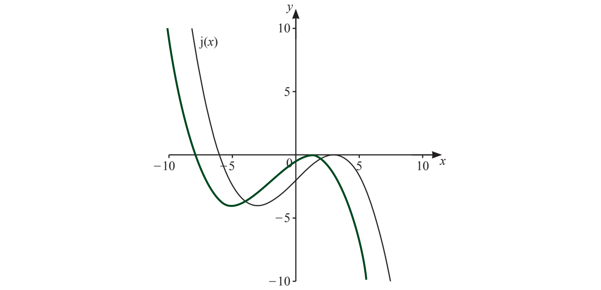

# Mark Schemes — Transformations of Graphs
**Coordinate Geometry & Graphs** · Cambridge (CIE) IGCSE maths (0607)

## Exam Questions (14 questions)

### Q1
> *The transformation *$y=f(x)+a$* corresponds to a translation vertically upwards by *$a$* units*

> *From (3, 2) to (3, -5) is 7 units downwards*

$a=-7$

**[B1]**
> *The transformation *$y=f(x+b)$* corresponds to a translation horizontally left by *$b$* units*

> *From (3, 2) to (-1, 2) is 4 units left*

$b=4$

**[B1]**
> *The vector *$( \begin{gathered} 5 \\ 0 \end{gathered} )$* means the graph has translated 5 units right*

> *The transformation *$y=g(x+b)$* corresponds to a translation horizontally left by *$b$* units*

> *The new equation will be *$y=g(x-5)$

> *Replace all the *$x$* terms with *$( x - 5 )$

$y = a ( x - 5 )^{3} + b ( x - 5 )^{2} + c ( x - 5 ) + d$

**[B1 B1]**

> **[mark-scheme]**
> **B1**: At least one $x$ term replaced with $( x - 5 )$.
> 
> **B1**: Fully correct answer; all $x$ terms replaced with $( x - 5 )$.

### Q2
> *A translation of the graph *$j(x)$* to the graph *$j(x+2)$* will be a movement 2 units to the left*

> *Draw the graph with exactly the same shape but 2 units to the left of the original graph*

**Graph moved to the left [1]**
**Graph moved 2 units right or left [1]**

### Q3
> *Method 1*

> *The easiest method is to consider the translation in reverse*
*A translation of a graph two units to the right and four units down can be reversed by translating it four units up and two units to the left *

> *Consider translating  *$y=x^{2}-x-10$*  four units up and two units to the left *

> *A translation of a graph *$f(x)$* four units up will be *$f(x)+4$

> *Add 4 to the equation of the translated graph*

$\begin{gathered} y = x^{2} - x - 10 + 4 \\ = x^{2} - x - 6 \end{gathered}$

**[1]**

> *A translation of a graph *$f(x)$* two units to the left will be *$f(x+2)$

> *Replace both *$x$*'s with *$x+2$* in the new equation of the translated graph  *

$y = ( x + 2 )^{2} - ( x + 2 ) - 6$

**[1]**

> *Expand the double brackets and simplify*

$\begin{gathered} y = ( x + 2 ) ( x + 2 ) - ( x + 2 ) - 6 \\ = ( x^{2} + 2 x + 2 x + 4 ) - ( x + 2 ) - 6 \\ = x^{2} + 4 x + 4 - ( x + 2 ) - 6 \\ = x^{2} + 4 x - 2 - ( x + 2 ) \end{gathered}$

> *Expand the single brackets and simplify*

$\begin{gathered} y = x^{2} + 4 x - 2 - x - 2 \\ = x^{2} + 3 x - 4 \end{gathered}$

> *Compare the *$x$* coefficients*

$a=3$

> *Compare the constant terms*

$b=-4$

$a=3,b=-4$** ****[1]**

> *Method 2*

> *A translation of a graph *$f(x)$* two units to the right will be *$f(x-2)$

> *Replace both *$x$*'s with *$x-2$* in the equation of the graph *

$y = ( x - 2 )^{2} + a ( x - 2 ) + b$

**[1]**

> *A translation of a graph *$f(x)$* four units downwards will be *$f(x)-4$

> *Subtract 4 from the equation of the graph *

$y = ( x - 2 )^{2} + a ( x - 2 ) + b - 4$

**[1]**

> *Expand the double brackets and simplify*

$\begin{gathered} y = ( x - 2 ) ( x - 2 ) + a ( x - 2 ) + b - 4 \\ = ( x^{2} - 2 x - 2 x + 4 ) + a ( x - 2 ) + b - 4 \\ = x^{2} - 4 x + 4 + a ( x - 2 ) + b - 4 \\ = x^{2} - 4 x + a ( x - 2 ) + b \end{gathered}$

> *Expand the single brackets*

$\begin{gathered} y = x^{2} - 4 x + a x - 2 a + b \end{gathered}$

> *Collect like terms*

$y = x^{2} + ( a - 4 ) x + ( b - 2 a )$

> *Compare the *$x$* coefficients*

$a-4=-1$

> *Solve for *$a$* *

$\begin{gathered} a = - 1 + 4 \\ a = 3 \end{gathered}$

> *Compare the constant terms*

$b-2a=-10$

> *Substitute in your value of *$a$* *

$b - 2 ( 3 ) = - 10$

> *Solve for *$b$* *

$\begin{gathered} b - 6 & = - 10 \\ b = - 10 + 6 \end{gathered}$

$a=3,b=-4$** ****[1]**

### Q4
> $y=f(x-5)+6$* represents two translations*

> *Following the order of operations (BIDMAS), "*$-5$*" **inside** the bracket signifies a **translation** 5 units to the **right*
*Add 5 to the *$x$*-coordinate*

$x$*-coordinate: *$3+5=8$

> *Next, "*$+6$*" **outside** the bracket signifies a **translation** 6 units **up*
*Add** 6 to the *$y$*-coordinate*

$y$*-coordinate: *$-4+6=2$

$(8,2)$** [2]**
**1 mark for each correct coordinate**
> *The minimum point has moved 3 units to the left and 4 units vertically upwards*

> *The top number in the translation vector is -3*
*The bottom number in the translation vector is 4*

> $y=f(x+a)+b$* is a horizontal translation by the vector *$( \begin{gathered} - a \\ b \end{gathered} )$

$y = \mathrm{f} ( x + 3 ) + 4$ **[2]**
**1 mark for each correct value**

### Q5
> *From your knowledge of trig graphs you should know that the graph of *$y = \cos ( x )$* cuts the *$x$*-axis at *$90^{\circ}$* and *$270^{\circ}$

$y=\mathrm{cos}(x-35)$* represents a translation of *$y=\mathrm{cos}(x)$* in the *$x$*-axis by *$+35^{\circ}$* *

$90^{\circ}+35^{\circ}=125^{\circ}\,270^{\circ}+35^{\circ}=305^{\circ}$* *

**[1]**

> *Write your final answers as coordinates*

**    **$( 125 , 0 ) , ( 305 , 0 )$**[1]**

### Q6
> *A translation of a graph *$f(x)$* by 3 units to the right will be *$f(x-3)$

> *Replace *$x$* with *$x-3$* in the equation of the graph*

$y = ( x - 3 )^{2} + 2$

**[1]**

> *Expand the brackets*

$y = ( x - 3 ) ( x - 3 ) + 2
= ( x^{2} - 3 x - 3 x + 9 ) + 2$

> *Simplify*

$y=x^{2}-6x+9+2$

$y=x^{2}-6x+11$** ****[1]**

### Q7
> *A translation of a graph *$f(x)$* one unit to the left will be *$f(x+1)$

> *Replace both *$x$*'s with *$x+1$* in the equation of the graph *

$y = ( x + 1 )^{2} - 4 ( x + 1 )$

**[1]**

> *A translation of a graph *$f(x)$* five units upwards will be *$f(x)+5$

> *Add 5 to the equation of the graph *

$y = ( x + 1 )^{2} - 4 ( x + 1 ) + 5$

**[1]**

> *Expand the double brackets and simplify*

$\begin{gathered} y = ( x + 1 ) ( x + 1 ) - 4 ( x + 1 ) + 5 \\ = ( x^{2} + x + x + 1 ) - 4 ( x + 1 ) + 5 \\ = x^{2} + 2 x + 1 - 4 ( x + 1 ) + 5 \end{gathered}$

> *Expand the single brackets, be careful with the negative sign*

$\begin{gathered} y = x^{2} + 2 x + 1 - 4 x - 4 + 5 \end{gathered}$

> *Simplify by collecting like terms*

$y=x^{2}-2x+2$

$y=x^{2}-2x+2$** ****[1]**

### Q8
> *The point has moved 5 units vertically downwards, so the translation is -5 units in the *$y$* direction*

$y = \mathrm{f} ( x ) - 5$ **[1]**

### Q9
> *A transformation in the form *$y = \mathrm{f} ( x ) + a$* represents a translation of *$a$* units up the ** *$y$*-axis*

> *This is a translation by 2 units vertically downwards on the *$y$*-axis*

> *The *$x$*-coordinates will stay the same but the *$y$*-coordinates will decrease by 2 units*

$\begin{gathered} 7 + 0 & = 7 \\ 13 - 2 & = 11 \end{gathered}$

$( 7 , 11 )$** ****[1]**

### Q10
(i)  $\mathrm{f} ( x ) + 3$* represents a translation of 3 units vertically upwards*

> *The *$x$*-coordinate of every point will stay the same but the *$y$*-coordinate will increase by 3*

$\begin{gathered} - 4 + 3 & = - 1 \end{gathered}$

$( 3 , - 1 )$** ****[1]**

(ii)  $\mathrm{f} ( x + 2 )$* represents a translation of 2 units to the left*

> *The *$x$*-coordinate of every point will  decrease by 2 but the *$y$*-coordinate will stay the same*

$\begin{gathered} 3 - 2 & = 1 \end{gathered}$

$( 1 , - 4 )$** ****[1]**

### Q11
(i)   *The point has moved 4 units to the right, so the whole curve has translated 4 units in the positive *$x$* direction*

> *The top number in the translation vector is 4*

> *The curve has not moved up or down so the bottom number in the translation vector is 0*

$( 4
0 )$** ****[1]**

(ii)  * *$y=f(x-a)$* is a horizontal translation by the vector *$( \begin{gathered} a \\ 0 \end{gathered} )$

$y = \mathrm{f} ( x - 4 )$ **[1]**

### Q12
> *A translation vector *$( a
b )$* moves a point *$a$* units in the *$x$* direction and *$b$* units in the *$y$* direction*

> *The *$x$*-coordinate changes from *$-3$* to *$0$* so it moves *$3$* units to the right, or *$3$* units in the *$x$* direction*

> *The *$y$*-coordinate changes from *$6$* to *$2$* so it moves *$4$* units downwards, or *$-4$* units in the *$y$* direction*

$( 3
- 4 )$
**1 mark for each [2]**

### Q13
> *A translation vector *$( a
b )$* moves a point *$a$* units in the *$x$* direction and *$b$* units in the *$y$* direction*

> *The *$x$*-coordinate starts at *$5$* and moves *$-1$* units in the *$x$* direction, which is *$1$* unit to the left*

$5-1=4$

> *The *$y$*-coordinate starts at *$7$* and moves *$3$* units in the *$y$* direction, which is *$3$* units upwards*

$7+3=10$

$( 4 , 10 )$** ****[1]**

### Q14
> *A translation vector *$( a
b )$* moves a point *$a$* units in the *$x$* direction and *$b$* units in the *$y$* direction*

> *The *$x$*-coordinate changes from *$1$* to *$-1$* so it moves *$2$* units to the left, or *$-2$* units in the *$x$* direction*

> *The *$y$*-coordinate changes from *$5$* to *$7$* so it moves *$2$* units upwards, or *$2$* units in the *$y$* direction*

$( - 2
 2 )$
**1 mark for each [2]**
