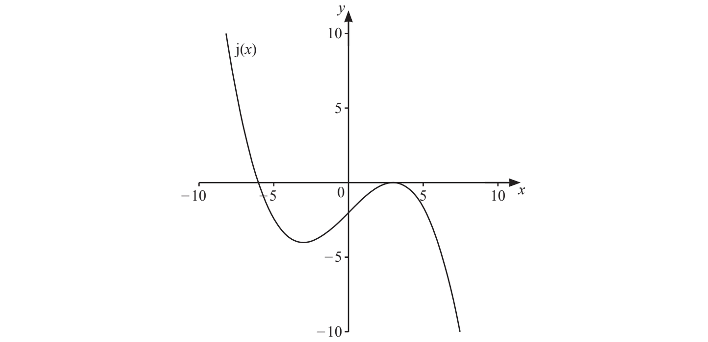
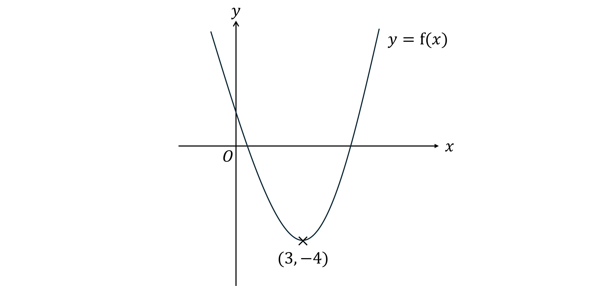

# Exam Questions — Transformations of Graphs
**Coordinate Geometry & Graphs** · Cambridge (CIE) IGCSE maths (0607)
> Source: [https://www.savemyexams.com/igcse/maths/cie/international-maths/23/extended/topic-questions/](https://www.savemyexams.com/igcse/maths/cie/international-maths/23/extended/topic-questions/) · 14 questions across 1 sets

## Exam Questions (14 questions)

### Q1 — hard — 4 marks

**Q1** [1 mark]

The point $P(3,2)$ lies on the curve with equation $y=f(x).$

On the graph of $y=f(x)+a$, where $a$is a constant, the point $P$ is mapped to the point $(3,-5)$.

Determine the value of  $a$.

**Q1** [1 mark]

On the graph of $y=f(x+b)$, where $b$is a constant, the point $P$ is mapped to the point $(-1,2)$.

Determine the value of $b$.

**Q1** [2 marks]

A different function, $\mathrm{g} ( x )$, is a cubic function of the form $\mathrm{g} ( x ) = a x^{3} + b x^{2} + c x + d$.

The graph of $y = \mathrm{g} ( x )$ is translated by the vector $( \begin{gathered} 5 \\ 0 \end{gathered} )$.

Write down the equation of the transformed graph in terms of $a,b,c,d$, and $x$.

### Q2 — easy — 2 marks

**Q2** [2 marks]

The diagram shows a sketch of the graph of $y = \mathrm{j} ( x )$.

On the same diagram, sketch the graph of $y = \mathrm{j} ( x + 2 ).$

*Source: June 2022 0607/41 Q9BI*

### Q3 — hard — 1 marks

**Q3** [1 mark]

The graph with equation $y=x^{2}+ax+b$  undergoes a translation of two units in the positive $x$ direction and four units in the negative $y$ direction.

The equation of the translated graph is $y=x^{2}-x-10.$

Find the values of $a$ and $b$.

### Q4 — hard — 4 marks

**Q4** [2 marks]

A curve with equation $y=f(x)$ has one minimum point at $P(3,---4)$.

Write down the coordinates of the minimum point of the curve with the equation  $y = \mathrm{f} ( x - 5 ) + 6$.

**Q4** [2 marks]

**Extract:**

A curve with equation y = f(x) has one minimum point at P(3, -4).

Write down an equation of the graph if the minimum point is instead translated to the point $( 0 , 0 )$

### Q5 — hard — 2 marks

**Q5** [2 marks]

The graph of $y = \cos ( x - 35 )$ for $0^{\circ}\leqx\leq360^{\circ}$ crosses the $x$-axis at two points.

Write down the coordinates of the points where this occurs.

### Q6 — medium — 2 marks

**Q6** [2 marks]

The graph with equation $y=x^{2}+2$  undergoes a translation of 3 units to the right.

Show that the equation of the translated graph simplifies to  $y=x^{2}-6x+11.$

### Q7 — medium — 3 marks

**Q7** [3 marks]

The graph with equation $y=x^{2}-4x$  undergoes a translation of one unit in the negative $x$ direction and five units in the positive $y$ direction.

Find the equation of the translated graph.
Give your answer in the form  $y=ax^{2}+bx+c.$

### Q8 — easy — 1 marks

**Q8** [1 mark]

A curve with equation $y=f(x)$ is translated so that the point at $(0,0)$ is mapped to the point $(0,-5)$.

Find the equation of the translated curve.

### Q9 — easy — 1 marks

**Q9** [1 mark]

$( 7 , 13 )$ is a point on the graph  $y = \mathrm{f} ( x )$.

Write down the coordinates of a point which must be on the graph of  $y = \mathrm{f} ( x ) - 2$.

### Q10 — medium — 2 marks

**Q10** [2 marks]

The diagram shows part of the curve with equation  $y = \mathrm{f} ( x )$.
The coordinates of the minimum point of this curve are $( 3 , - 4 )$

Write down the coordinates of the minimum point of each of the curves below:

(i)   $y = \mathrm{f} ( x ) + 3$

[1]

(ii)  $y = \mathrm{f} ( x + 2 )$

[1]

### Q11 — medium — 2 marks

**Q11** [2 marks]

A curve with equation$y=f(x)$is translated so that the point at $(0,0)$ is mapped onto the point $(4,0)$.

(i)    Find the translation vector.

[1]

(ii)   Find the equation of the translated curve.

[1]

### Q12 — easy — 2 marks

**Q12** [2 marks]

$P$ is the point $(-3,6)$.
$Q$ is the point $(0,2)$.

Find the translation vector that maps the point $P$ onto the point $Q$.

*Source: June 2023 0607/21 Q3B*

### Q13 — easy — 1 marks

**Q13** [1 mark]

$F$  is the point $(5,7)$. 
The vector that maps $F$ onto the point $G$ is $( - 1
 3 )$.

Find the coordinates of $G$.

(...................... , ......................)

*Source: March 2022 0607/22 Q4B*

### Q14 — easy — 2 marks

**Q14** [2 marks]

Find the vector that translates the point $(1,5)$ to the point $(-1,7).$

*Source: November 2023 0607/41 Q4B*

