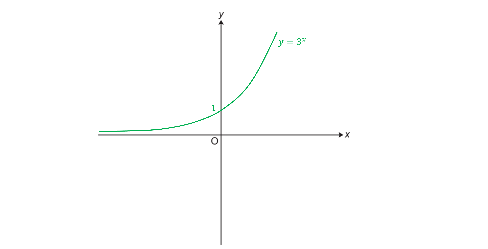
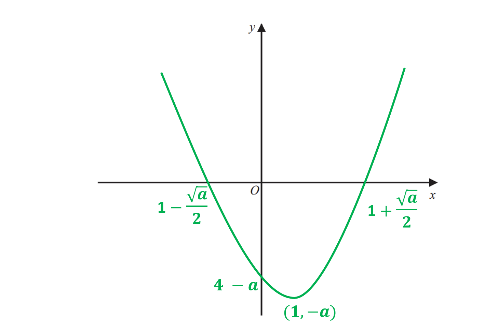
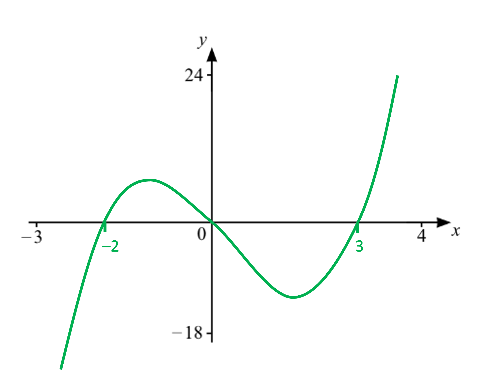
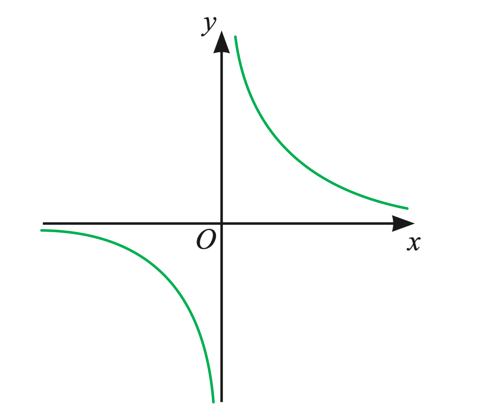
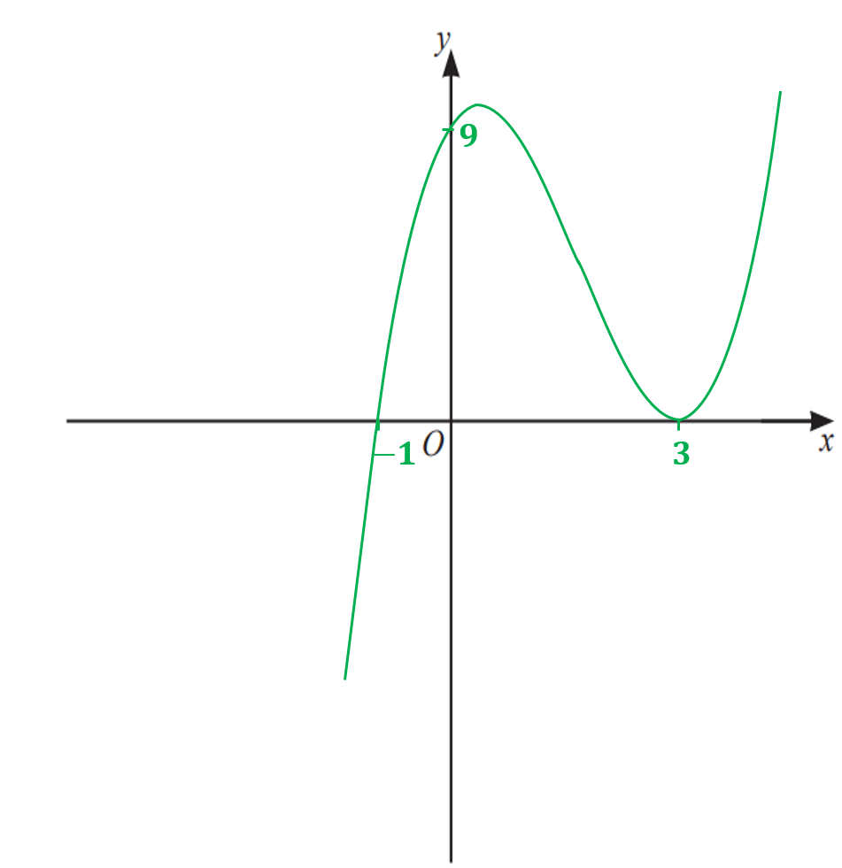

# Mark Schemes — Types of Graphs
**Coordinate Geometry & Graphs** · Cambridge (CIE) IGCSE maths (0607)

## Exam Questions (11 questions)

### Q1
> $y=3^{x}$* is an exponential equation and you are required to recognise/ be able to draw its graph*

> *All graphs in the form *$y=k^{x}$* where *$k$* is a number, go through 1 on the *$y$* axis (because when *$x=0$*, *$y=k^{0}=1$*)*

> *The curve must not cross the *$x$*-axis*

**Correct shape curve in correct areas of the axes [1]**
**Clearly marked as passing through (0, 1) [1]**

### Q2
*Quadratic curves given in the form *$y=(x+a)^{2}+b$* have turning points at *$(-a,b)$

> *For *$y=(x-1)^{2}-6$* the value of *$a$* is -1 and the value of *$b$* is -6*

$a=-1,b=-6$

> *So the turning point is at *`open parentheses negative open parentheses negative 1 close parentheses comma space minus 6 close parentheses`*.*

**(1, -6)** **[1]**

### Q3
> *Consider each function separately*

- $y=\frac{2}{x^{2}}$* is a positive reciprocal graph with *$x^{2}$* on the denominator so it cannot have any negative **y **values - **C   *
- $y=-\frac{1}{2}x^{3}$*  is a negative cubic function which intercepts the **y **axis at the origin - **B*
- $y=-\frac{5}{x}$* is a negative reciprocal graph - **E   *

> *If you are unsure between **A **and **E  **for the last one, consider some coordinates and look at which quadrant they are in*

| **Equation** | **Graph** |
|---|---|
| $y=\frac{2}{x^{2}}$ | **Final answer:** **C** |
| $y=-\frac{1}{2}x^{3}$ | **Final answer:** **B** |
| $y=-\frac{5}{x}$ | **Final answer:** **E** |

**1 mark for each correct answer ****[3]**

### Q4
> *Starting with the equations,*

> *(1)** is a linear equation (*$y=mx+c$*) so matches the only straight line, graph **D*

> *(2) **is an exponential equation with a positive coefficient so matches graph **A *

> *(3) **is a cubic equation with a negative coefficient so matches graph **E*

> *(4)** is a reciprocal equation with a positive coefficient so matches graph **B*

> *(5) is a quadratic equation with a negative coefficient so matches graph C*

**Graph A → Equation 2**
**Graph B → Equation 4**
**Graph C → Equation 5**
**Graph D → Equation 1**
**Graph E → Equation 3**
**At least 2 correct [1]**
**At least 3 correct [1]**
**All correct [1]**

### Q5
> *This is a quadratic function so will be the shape of a parabola (∪)*

> *You need to find where the graph crosses the coordinate axes*

> *The graph crosses the **y**-axis when **x **= 0*

`x equals 0 space rightwards double arrow space y equals open parentheses 0 minus 3 close parentheses squared minus 5 equals 9 minus 5 equals 4`

> *So the graph crosses the **y **axis at the point (0, 4)*

**[1]**

> *The graph crosses the **x**-axis when **y **= 0*

`y equals 0 space rightwards double arrow space 0 space equals open parentheses x minus 3 close parentheses squared minus 5`

> *Add 5 to both sides*

`table row cell open parentheses x minus 3 close parentheses squared end cell equals 5 end table`

> *Square root both sides and then add 3 to both sides*

`table row cell x minus 3 end cell equals cell plus-or-minus square root of 5 end cell row x equals cell 3 plus-or-minus square root of 5 end cell end table`

**[1]**

> *The graph goes through the **x **axis twice, at the points *$(3+\sqrt{5},0)$* and *$(3-\sqrt{5},0)$

> *The turning point of *`a open parentheses x plus b close parentheses squared plus c space`*is at the point *$(-b,c)$

`a equals 1 space comma space space b equals negative 3 space comma space space c equals negative 5 space rightwards double arrow space Minimum space point colon space open parentheses 3 comma negative 5 close parentheses`

**[1]**

> *Draw the parabola by drawing a symmetrical ∪ shape which goes through *$(0,4)$*, crosses through *$(3+\sqrt{5},0)$* and *$(3-\sqrt{5},0)$* and has a minimum point at *$(3,-5)$

**Drawing a ****∪**** shaped-parabola through (0,4)**** [1] **
**Fully correct graph and labels ****[1]**

### Q6
> *This is a quadratic function so will be the shape of a parabola (∪)*

> *You need to find where the graph crosses the coordinate axes*

> *The graph crosses the **y**-axis when **x **= 0*

`x equals 0 space rightwards double arrow space y equals 4 open parentheses 0 minus 1 close parentheses squared minus a equals 4 minus a`

> *We know that **a  **> 4, so the graph crosses the **y **axis **below **zero *

> *The graph crosses the **x**-axis when **y **= 0*

`y equals 0 space rightwards double arrow space 0 equals 4 open parentheses x minus 1 close parentheses squared minus a`

> *Add **a** to both sides and divide by 4*

`table row cell 4 open parentheses x minus 1 close parentheses squared space end cell equals cell space a end cell row cell open parentheses x minus 1 close parentheses squared end cell equals cell a over 4 end cell end table`

> *Square root both sides and then add 1 to both sides*

`table row cell x minus 1 end cell equals cell plus-or-minus square root of a over 4 end root end cell row x equals cell 1 plus-or-minus space square root of a over 4 end root end cell end table`

> *We know that **a  **> 4, so both answers are possible and the graph goes through the **x **axis twice*

> *The turning point of *`a open parentheses x plus b close parentheses squared plus c space`*is at the point *$(-b,c)$

`a equals 4 space comma space space b equals negative 1 space comma space space c equals negative a space rightwards double arrow space space Minimum space point colon space open parentheses 1 comma negative a close parentheses`

> *We know that **a  **> 4, so -**a **< -4 and the minimum point must be in the fourth quadrant*

> *Draw the parabola by drawing a symmetrical ∪ shape which goes through *$(0,4-a)$*, crosses through *$(1-\sqrt{\frac{a}{4}},0)$* and *$(1+\sqrt{\frac{a}{4}},0)$* and has a minimum point at *$(1,-a)$

> *Note that *$\sqrt{\frac{a}{4}}=\frac{\sqrt{a}}{\sqrt{4}}=\frac{\sqrt{a}}{2}$

**Drawing a ****∪**** shaped-parabola**** [1]**
**Finding the correct minimum point ****[1]**
**Finding any correct intercept with the axes ****[1]**
**Fully correct graph ****[1]**

### Q7
> *The graph of *$y=f(x)$* crosses the *$x$*-axis where *`straight f open parentheses x close parentheses equals 0`

`x open parentheses x plus 2 close parentheses open parentheses x minus 3 close parentheses equals 0
x equals 0 comma space x equals space minus 2 space or space x equals 3`

> *Mark points on the *$x$*-axis*

> *Draw a smooth cubic curve through the points marked on the *$x$*-axis. If *`straight f open parentheses x close parentheses`* were expanded to *$ax^{3}+bx^{2}+cx+d$* then *$a$* would be positive (1) so the curve goes from bottom left to top right*

**-2, 0 and 3 marked on the**** **$x$**-axis [1] **
**correct shape curve with two turning points**** [1] **
**correct shape curve with one**** **$x$**-intercept to the left of the origin, one through the origin and one to the right of the origin**** [1]**

### Q8
> *Consider each function separately*

> $y=1-\frac{x}{3}$* is a straight line graph with a negative gradient and a **y **- intercept at (0, 1) - **A*

> $y=2x^{2}$*  is a positive quadratic function with its minimum point at the origin - **C*

> $y=-\frac{4}{x}$* is a negative reciprocal graph - **D*

> *If you are unsure between **D **and **F  **for the last one, consider some coordinates and look at which quadrant they are in*

| Function | $y=x+1$ | $y=1-\frac{x}{3}$ | $y=2x^{2}$ | $y=-\frac{4}{x}$ |
|---|---|---|---|---|
| Diagram | E | **Final answer:** **A** | **Final answer:** **C** | **Final answer:** **D** |

**1 mark for each correct answer ****[3]**

### Q9
> $y=\frac{1}{x}$* is a reciprocal graph and is one you should memorise*
*It features two symmetrical curves; neither cross either axis*

**One curve in correct place**** [1]**
**Fully correct sketch**** [1]**

### Q10
> *Find the points of intersection with the axis*

> *Find the **x- **intercepts by letting **y** equal zero*

`open parentheses x plus 1 close parentheses open parentheses x minus 3 close parentheses squared equals 0`

> * Solve by letting each bracket equal zero*

`table row cell open parentheses x plus 1 close parentheses end cell equals 0 row x equals cell negative 1 space end cell end table`*       **and        *`table row cell open parentheses x minus 3 close parentheses squared end cell equals 0 row x equals cell 3 space end cell end table`

> *So the **x** intercepts are -1 and 3*

> *x** = 3 is a repeated root so the graph at coordinate (3, 0) touches the **x** axis but does not go through it*

> *The graph goes through the **x** axis at the coordinate (-1, 0)*

> *Find the **y- **intercept by letting **x** equal zero *

`table row cell open parentheses 0 space plus space 1 close parentheses open parentheses 0 minus 3 close parentheses squared end cell equals y row cell open parentheses 1 close parentheses open parentheses negative space 3 close parentheses squared end cell equals y row y equals 9 end table`

> *So the **y- **intercept must have the coordinate (0, 9)*

> *If the brackets were to be expanded, the first term would be positive **x**3**, so the graph is going in the positive direction*

> *Draw the graph, remembering to include the points where it crosses the axes*

** ****1 mark for each correct**** intercept [3]**
** ****1 mark for correct**** shape in the correct position**** ****[3]**

### Q11
> *There should be no need to sketch this graph*

> *As it is given in factorised form we know that the zeros, or roots, are at *$x=2$* and *$x=-2$

> *The line of symmetry of a quadratic is a vertical line that intersects the *$x$*-axis at the midpoint of the zeros*

> *This is the *$y$*-axis*

$x=0$ **[1]**
