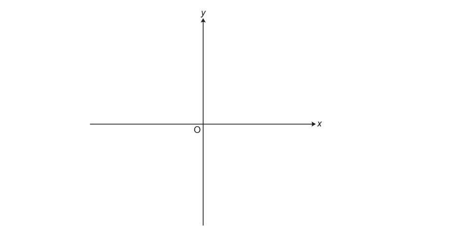
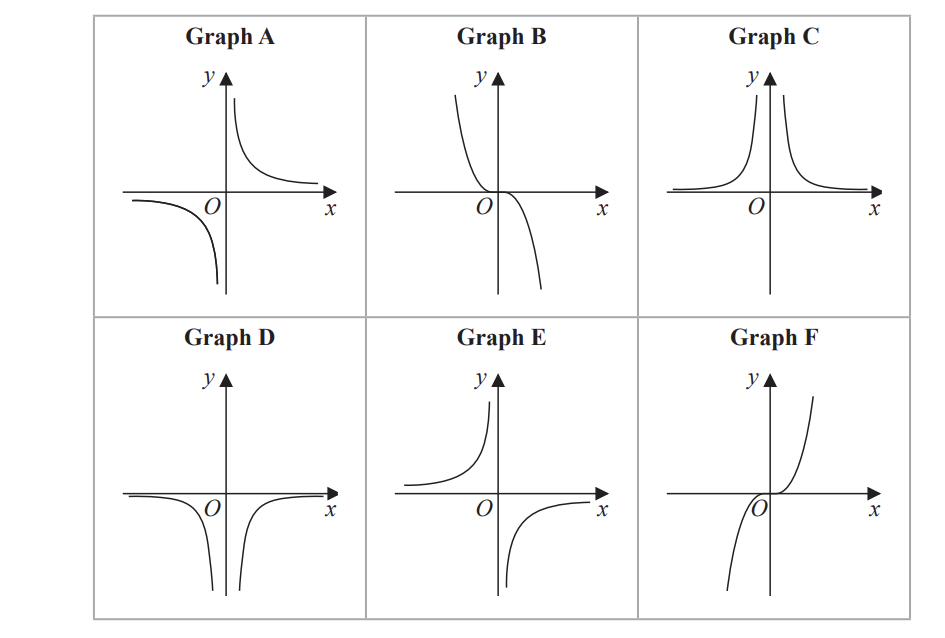
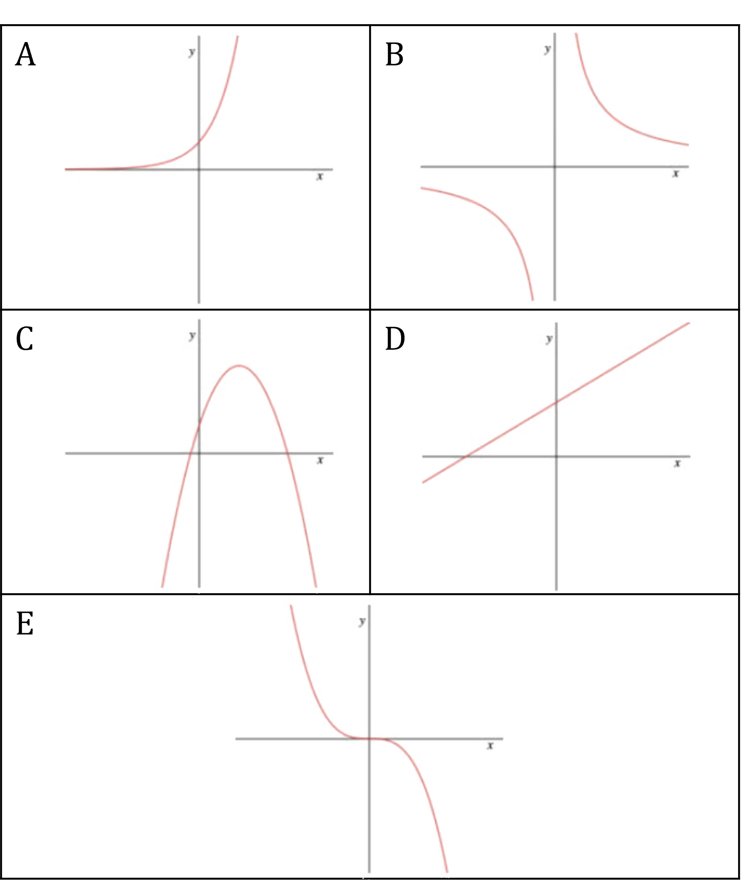
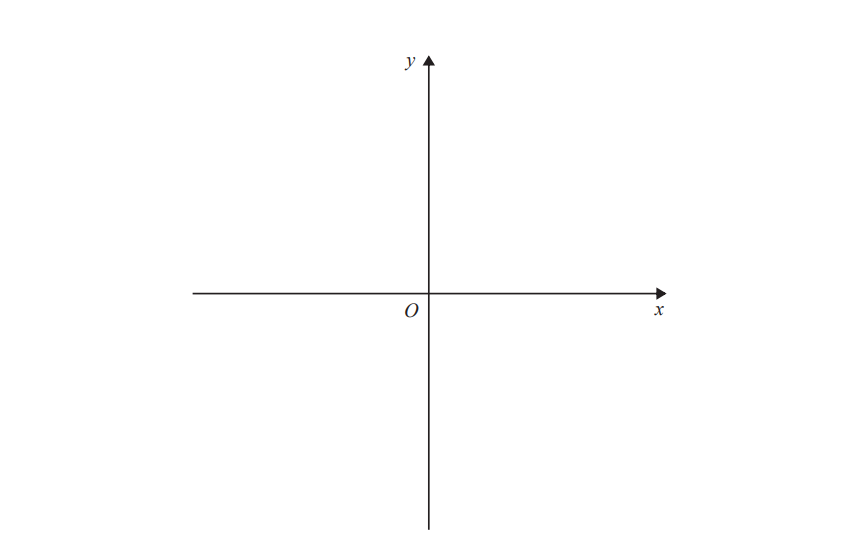
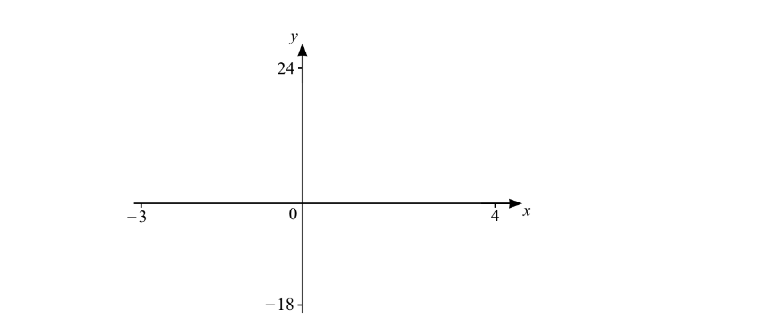
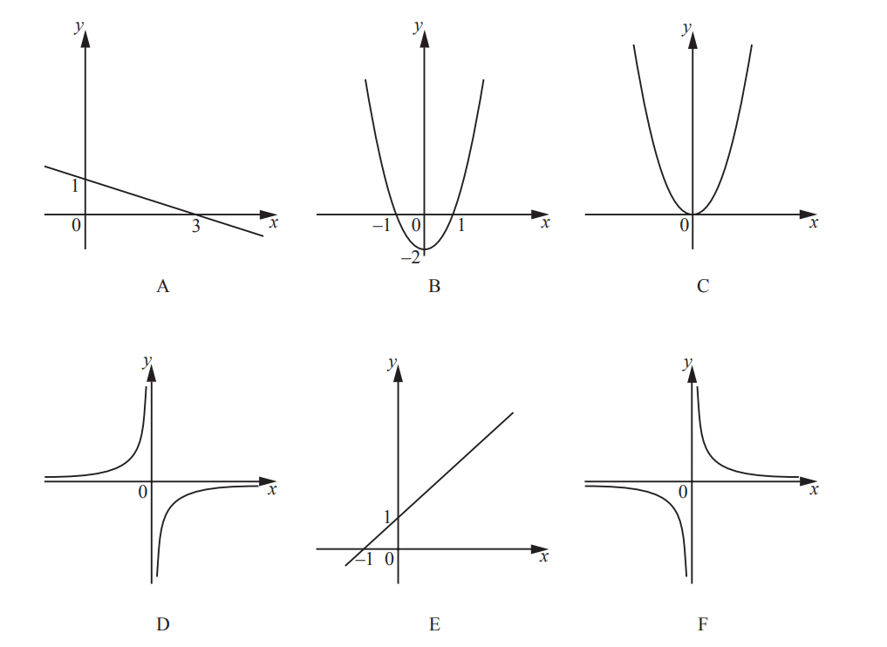
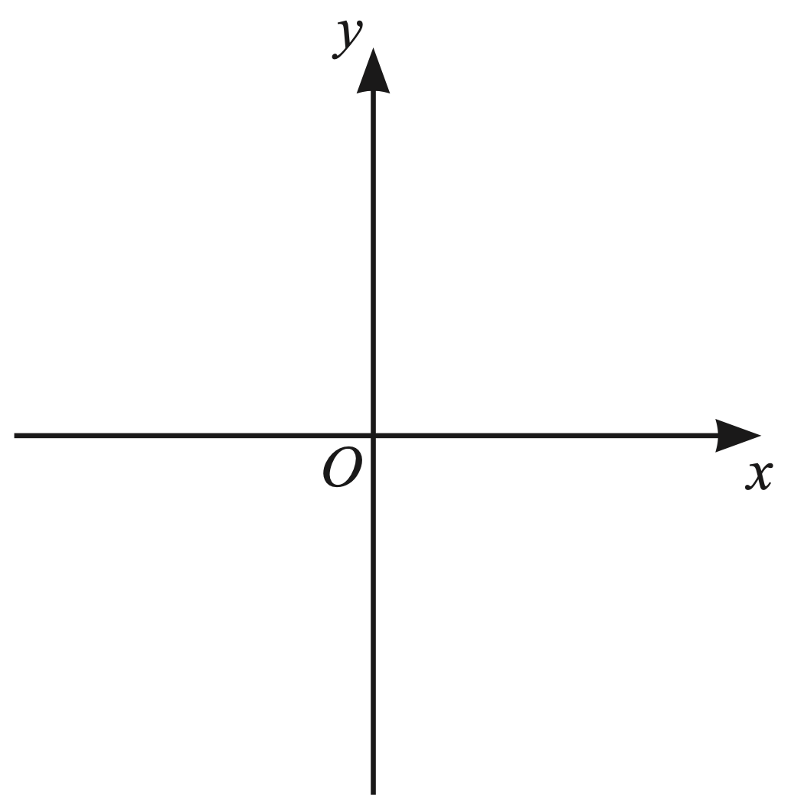
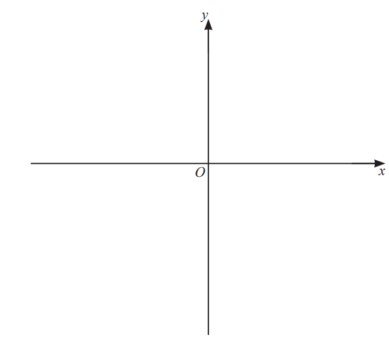

# Exam Questions — Types of Graphs
**Coordinate Geometry & Graphs** · Cambridge (CIE) IGCSE maths (0607)
> Source: [https://www.savemyexams.com/igcse/maths/cie/international-maths/23/extended/topic-questions/](https://www.savemyexams.com/igcse/maths/cie/international-maths/23/extended/topic-questions/) · 11 questions across 1 sets

## Exam Questions (11 questions)

### Q1 — easy — 2 marks

**Q1** [2 marks]

Sketch the graph of $y=3^{x}$* *

Give the value of the $y$-intercept.

*Source: Nov 2019 J560/04 Q17*

### Q2 — easy — 1 marks

**Q2** [1 mark]

The equation of a curve is $y=(x--1)^{2}--6$

Write down the coordinates of the turning point.

### Q3 — hard — 3 marks

**Q3** [3 marks]

Here are six graphs.

Complete the table below with the letter of the graph that could represent each given equation.

Write your answers on the dotted lines.

| **Equation** | **Graph** |
|---|---|
| $y=\frac{2}{x^{2}}$ | .................... |
| $y=-\frac{1}{2}x^{3}$ | .................... |
| $y=-\frac{5}{x}$ | .................... |

*Source: Jan 2020 4MA1/2H Q15*

### Q4 — easy — 3 marks

**Q4** [3 marks]

Match the graphs to the equations.

**(1) **$y=\frac{1}{2}x+3$**,    (2) **$y=2^{x}$**,    (3) **$y=-2.1x^{3}$**,   **

** (4) **$y=\frac{3}{x}$**,   (5) **$y=-2x^{2}+3x+1$

### Q5 — hard — 4 marks

**Q5** [4 marks]

The curve $C$ has equation $y = ( x - 3 )^{2} - 5$

Using the axes below, sketch the curve $C$. 
On your sketch show clearly

(i) the exact coordinates of any points of intersection of $C$ with the coordinate axes,

(ii) the coordinates of the turning point.

*Source: Specimen 16 4MA1/1H Q21*

### Q6 — hard — 4 marks

**Q6** [4 marks]

The curve$C$has equation $y=4(x-1)^{2}-a$   where $a>4$

Using the axes below, sketch the curve $C$. 
On your sketch show clearly, in terms of $a$,

(i) the coordinates of any points of intersection of $C$ with the coordinate axes,

(ii) the coordinates of the turning point.

*Source: Jan 2020 4MA1/1H Q20*

### Q7 — medium — 1 marks

**Q7** [1 mark]

$f(x)=x(x+2)(x--3)$

On the diagram, sketch the graph of $y=f(x)$for `– 3 less-than or slanted equal to x less-than or slanted equal to 4`.
Show the values of the intersections with the axes.

*Source: Specimen 0580/02 Q26A*

### Q8 — medium — 3 marks

**Q8** [3 marks]

The diagrams A, B, C, D, E and F are six graphs of different functions.

Complete the table to identify the correct graph for each function. One has been done for you.

| Function | $y=x+1$ | $y=1-\frac{x}{3}$ | $y=2x^{2}$ | $y=-\frac{4}{x}$ |
|---|---|---|---|---|
| Diagram | E |   |   |   |

*Source: 2020 Specimen 0580/02 Q21*

### Q9 — medium — 2 marks

**Q9** [2 marks]

Sketch the graph of the function.

$y=\frac{1}{x}$

*Source: 2020 March 0580/22 Q10B*

### Q10 — medium — 4 marks

**Q10** [4 marks]

On the diagram, sketch the graph of $y = ( x + 1 ) ( x - 3 )^{2}$.

Label the values where the graph meets the $x$-axis and the $y$-axis.

*Source: 2020 Oct/Nov 0580/43 Q7B*

### Q11 — medium — 1 marks

**Q11** [1 mark]

Write down the equation of the line of symmetry of the graph with equation $y = ( x - 2 ) ( x + 2 )$.
